---


theme: sred-theme
routerMode: hash
title: "Ethernet Switch Security"
info: |
  Network Security Using Dedicated Devices
  Open-source teaching deck
transition: slide-left
mdc: true
---


# Ethernet Switch Security

## Layer 2 as a security boundary

Goal: understand what a switch can enforce before traffic ever reaches a router or firewall.

---


# Learning objectives

By the end you should be able to:

- explain MAC learning and VLAN forwarding;
- identify common Layer-2 attacks;
- explain DHCP snooping, DAI and port controls;
- describe Private VLAN isolation for intra-segment security;
- separate segmentation from authentication;

---


# Where the switch sits

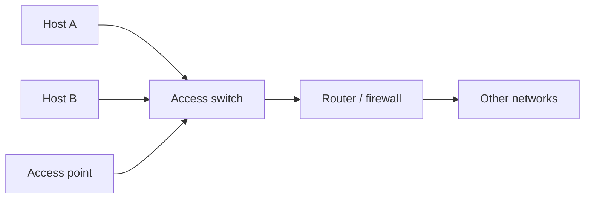

The switch is often the **first enforcement point** after the endpoint.

---


# What can a switch see?

A typical Ethernet switch can reason about:

- ingress port;
- source MAC;
- destination MAC;
- VLAN tag;
- EtherType;
- sometimes selected Layer-3/4 fields through ACL features.

Its native language is still primarily **Layer 2**.

---


# MAC learning

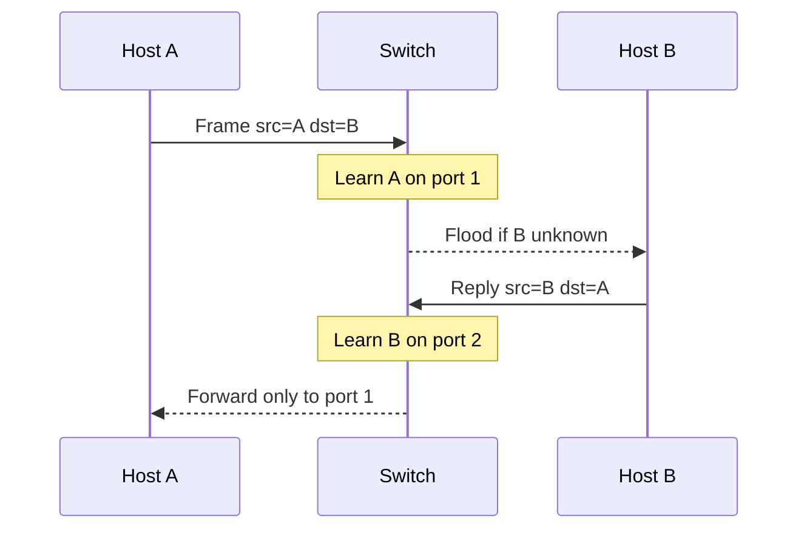

Learning is convenient, but it is also part of the attack surface.

---


# The forwarding table

Conceptually:

| MAC | VLAN | Port |
|---|---:|---:|
| `00:11:22:33:44:55` | 10 | 3 |
| `00:11:22:33:44:66` | 10 | 7 |

Security questions:

- who is allowed to appear on a port?
- how many MACs are expected?
- what if the mapping changes rapidly?

---


# Threat model at Layer 2

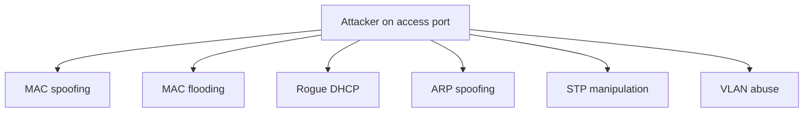

A switch cannot assume that an endpoint connected to an access port is honest.

---


# MAC spoofing

An attacker can change a software-configurable MAC address.

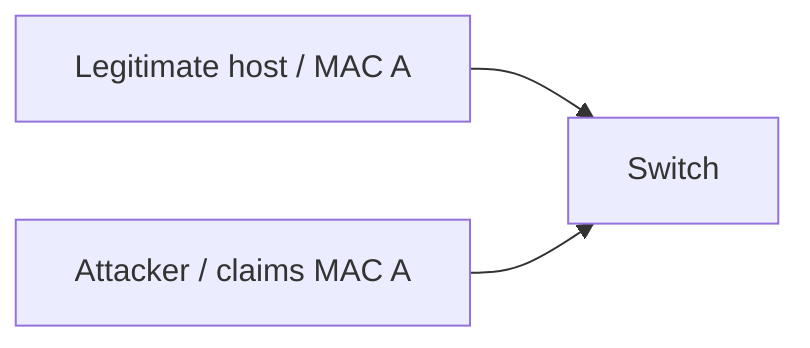

Therefore **MAC identity is not strong identity**. It can still be useful as one signal.

---


# Port security idea

A simple control binds expectations to a physical port:

```text
port 3:
  expected MACs: 1
  allowed MAC: aa:bb:cc:dd:ee:ff
```

Possible reactions:

- drop offending frames;
- log;
- temporarily disable the port;
- place the device in a restricted VLAN.

---


# Static vs learned bindings

Two common models:

__Static__
- administrator defines the MAC/port mapping;
- predictable but operationally expensive.

__Learned / sticky__
- first valid MAC is remembered;
- easier operationally;
- first device to appear may become trusted accidentally.

Operational convenience changes the security model.

---


# MAC flooding

If a forwarding table is exhausted, some devices may flood more traffic than normal.

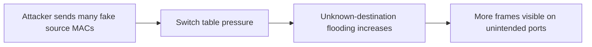

Modern hardware behavior varies, so teach the **resource-exhaustion principle**, not folklore.

---


# Mitigating table abuse

Useful controls include:

- per-port MAC limits;
- violation actions;
- storm controls;
- monitoring for rapid MAC churn;
- disabling unused ports.

The broader principle:

> Put a bound on resources that an untrusted endpoint can consume.

---


# VLANs

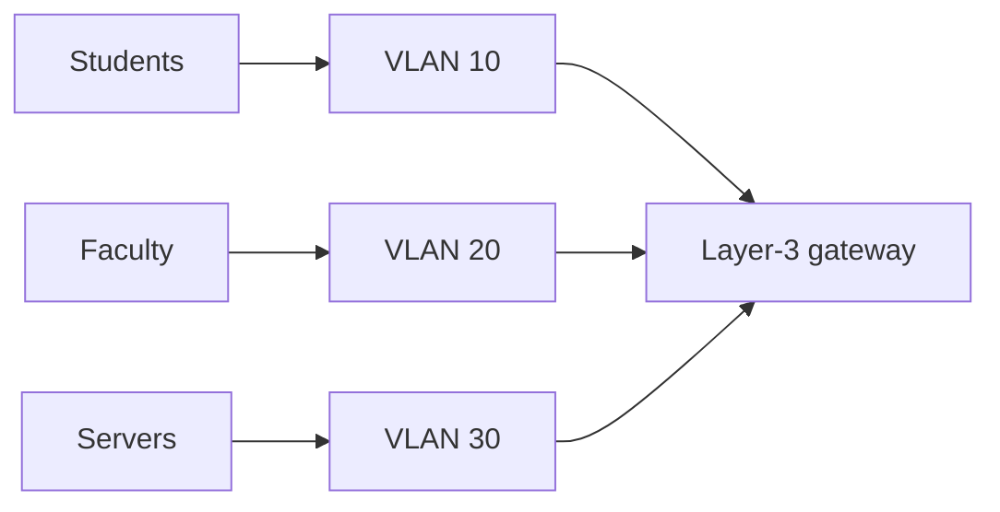

VLANs create separate Layer-2 broadcast domains.

---


# VLANs are not a complete policy

A VLAN answers:

> Which Layer-2 segment is this port in?

It does **not** by itself answer:

> Which application flows are permitted between segments?

Inter-VLAN routing plus ACL/firewall policy is still required.

---


# Access ports and trunks

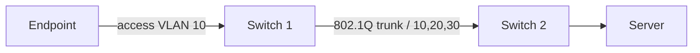

Security goal: endpoint-facing ports should not accidentally become trunks.

---


# VLAN hopping: the lesson

Do not focus on one historical trick. Focus on configuration assumptions:

- auto-negotiation of trunks;
- unexpected tagged frames;
- native VLAN mismatches;
- unused VLANs permitted on trunks.

Principle:

> Explicitly configure trust boundaries; do not negotiate them with untrusted endpoints.

---


# Private VLANs: the problem

Regular VLANs separate broadcast domains, but hosts **inside the same VLAN** can freely communicate.

Sometimes that is undesirable:

- a DMZ where each server should reach the gateway but **not** other servers;
- a shared hosting or multi-tenant segment;
- guest ports that must reach the Internet but not each other.

Private VLANs (PVLANs) add **intra-VLAN isolation** without consuming additional subnets or VLAN IDs.

> Originated as a Cisco feature; now standardized in **IEEE 802.1Q** (isolated/community port concepts).

---


# Private VLAN port types

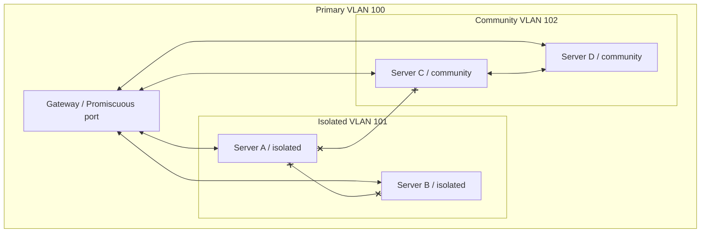

| Port type | Can talk to |
|-----------|------------|
| **Promiscuous** | all ports in the primary VLAN |
| **Isolated** | promiscuous ports only (not other isolated ports) |
| **Community** | promiscuous ports + same community (not other communities or isolated) |

---


# Private VLAN security lesson

PVLANs enforce **Layer-2 microsegmentation within a subnet**:

- single IP subnet, single gateway, yet hosts cannot reach each other;
- reduces lateral movement without adding firewall rules or extra subnets;
- the gateway (promiscuous port) must still apply upper-layer policy.

Limitations to understand:

- **Layer-3 bypass**: if a host can route through the gateway and back, PVLAN isolation is defeated — the gateway needs ACLs;
- PVLANs do not replace authentication or encryption;
- not all switch platforms implement PVLANs identically.

> Think of PVLANs as **fine-grained access control inside a single broadcast domain**.

---


# Normal DHCP flow

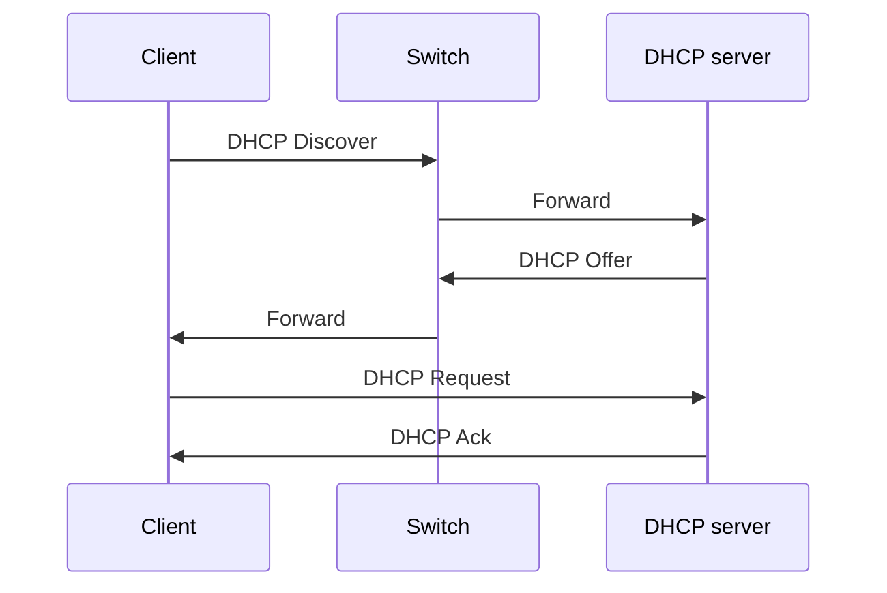

DHCP determines more than an IP address: gateway and DNS are especially security-sensitive.

---


# Rogue DHCP server

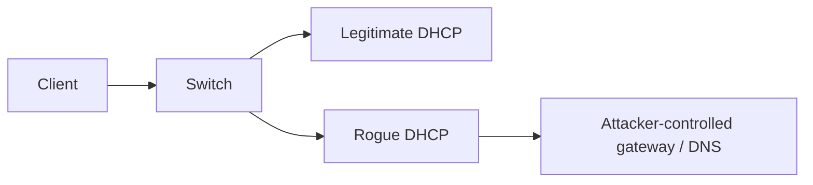

The fastest responder may influence the victim unless the infrastructure constrains server responses.

---


# DHCP snooping

Classify ports:

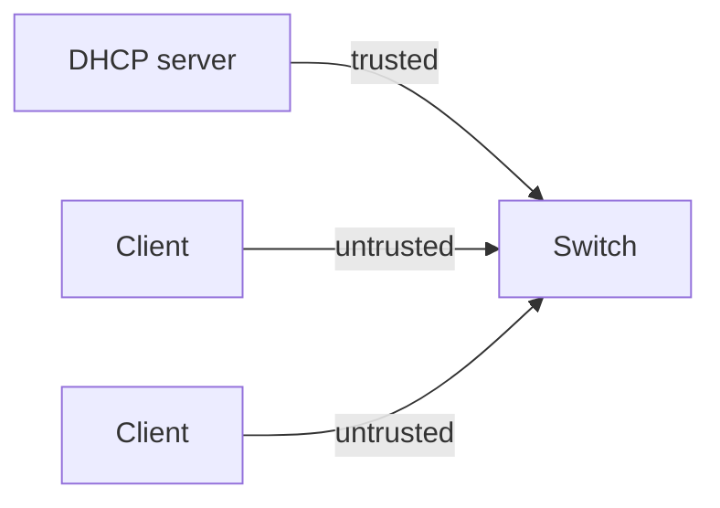

Server-originated DHCP replies are accepted only where they are expected.

---


# DHCP snooping binding table

The switch can learn bindings such as:

| MAC | IP | VLAN | Port |
|---|---|---:|---:|
| `AA:01` | `10.0.10.21` | 10 | 4 |
| `AA:02` | `10.0.10.22` | 10 | 7 |

This table becomes useful to **other Layer-2 security features**.

---


# ARP spoofing

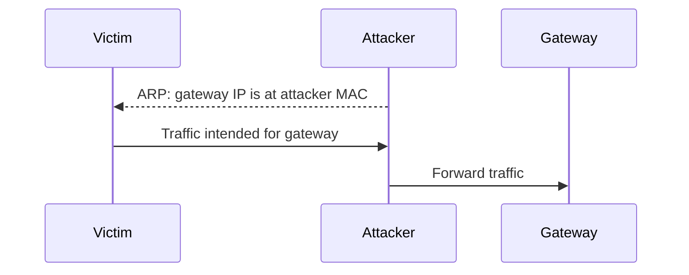

The attacker attempts to place itself in the path.

---


# Dynamic ARP Inspection

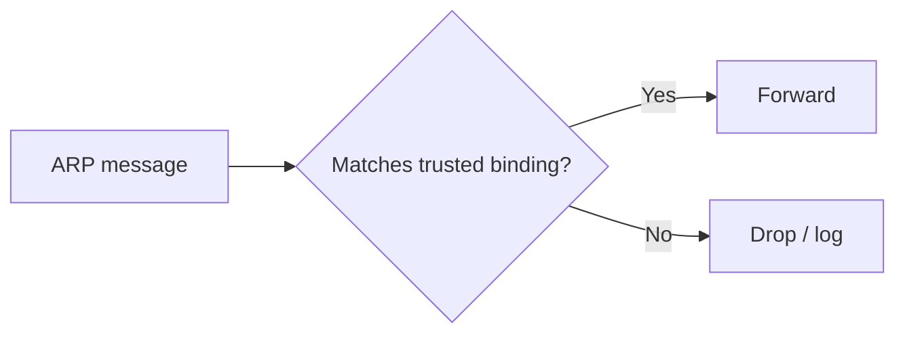

A DHCP-derived binding can therefore protect ARP behavior.

---


# IP Source Guard

Another use of the binding table:

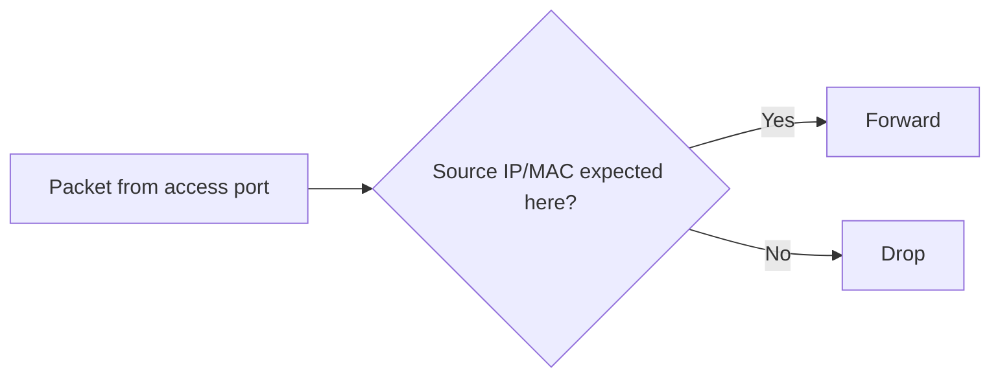

This constrains simple source-address impersonation on the local segment.

---


# Controls reinforce each other

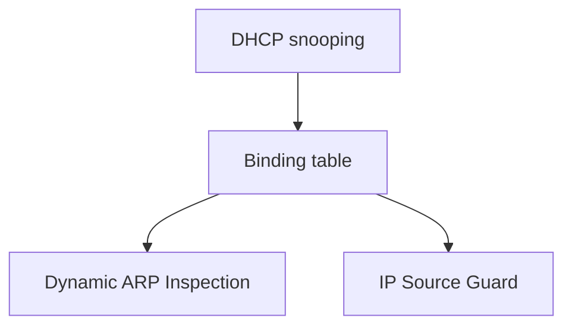

This is a small example of **defense in depth using shared infrastructure state**.

---


# Spanning Tree exists for a reason

Redundant links can create loops.

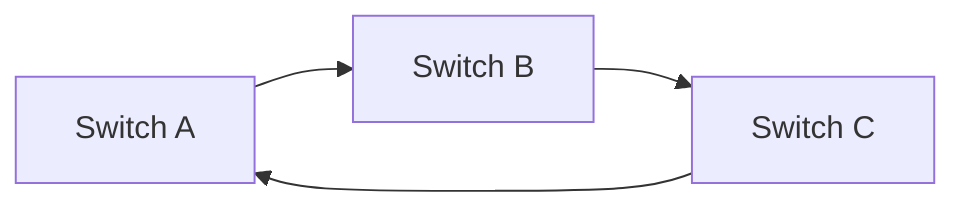

STP decides which links should forward so Ethernet does not loop indefinitely.

---


# STP as an attack surface

If an access device can inject influential BPDUs, it may attempt to change topology decisions.

Security questions:

- should an endpoint ever send BPDUs?
- should an access port become part of topology control?
- what happens if the root bridge changes unexpectedly?

---


# BPDU Guard

Concept:

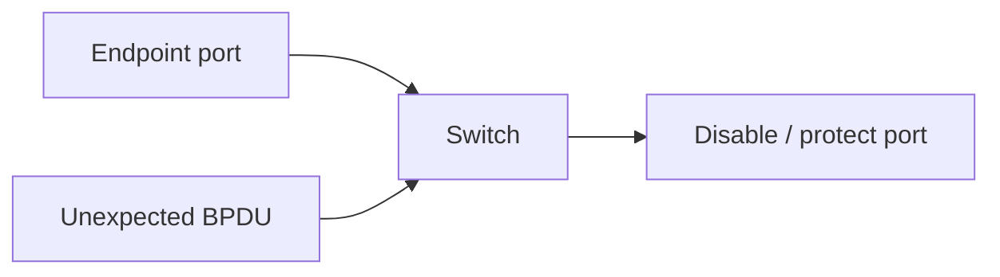

Use it on ports where a switch should **never** legitimately appear.

---


# Broadcast storms

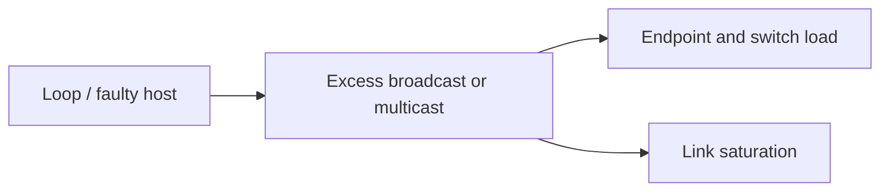

Availability failures at Layer 2 can affect an entire broadcast domain.

---


# Storm control

Storm control is configured **per port**. The switch monitors incoming traffic in three classes:

- **broadcast** — destination `FF:FF:FF:FF:FF:FF`;
- **multicast** — group destination MACs;
- **unknown unicast** — destination MAC not in the forwarding table (flooded).

For each class the administrator sets a **threshold**, typically expressed as:

| Unit | Example |
|------|---------|
| % of link bandwidth | broadcast ≤ 20% of 1 Gbps |
| packets per second | multicast ≤ 5 000 pps |
| bits per second | unknown unicast ≤ 100 Mbps |

When traffic exceeds the threshold the switch acts:

| Action | Behavior |
|--------|----------|
| **Drop** | silently discard excess frames above the limit |
| **Shutdown** | place the port in err-disable state |
| **Trap / Log** | send SNMP trap or syslog but continue forwarding |

> Shared media resources need limits so one endpoint cannot consume the segment.

---


# Storm control: recovery and operations

A port shut down by storm control does not always recover automatically.

Common recovery options:

- **manual re-enable** — an operator must intervene;
- **auto-recovery timer** — the port re-enables after a configured interval (e.g., 300 s);
- **monitoring integration** — SNMP trap triggers an alert for review.

Operational considerations:

- set thresholds based on **observed baselines**, not arbitrary numbers;
- different port roles need different limits (server uplink vs end-user access);
- storm control protects the **switch and segment**, not individual endpoints;
- a storm on one port can still affect the broadcast domain before the threshold triggers.

> Storm control is a safety valve, not a precision instrument — tune it with real traffic data.

---


# Discovery protocols

Protocols such as LLDP intentionally reveal topology/device information.

Questions to ask:

- is discovery required on endpoint-facing ports?
- what inventory information does it expose?
- can it help operations enough to justify the exposure?

Security and manageability often trade off.

---


# The switch software stack is an attack surface

A switch is a **networked computer** running its own OS, management daemons, and protocol stacks.

Those components can contain exploitable vulnerabilities:

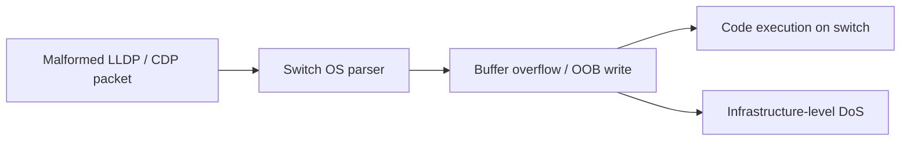

Real examples:

| CVE | Impact |
|-----|--------|
| CVE-2019-1890 | Cisco CDP flaw — remote crash / code execution via crafted CDP frames |
| CVE-2023-32154 | RouterOS LLDP out-of-bounds write via IPv6 ND — unauthenticated RCE |

Mitigations:

- disable LLDP / CDP on endpoint-facing ports where not needed;
- keep switch firmware up to date;
- restrict LLDP-MED auto-configuration policies;
- limit voice VLAN access to devices authenticated via 802.1X with verified OUIs;
- treat the switch management plane with the same rigor as any server.

> The switch is not just a transparent pipe — it runs code, and that code can be attacked.

---


# Management plane security

A switch has two very different roles:

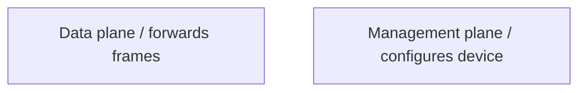

Protect management with:

- dedicated management network;
- strong authentication;
- SSH/HTTPS rather than insecure legacy protocols;
- logging and backups.

---

# Mirror traffic for monitoring

```mermaid
flowchart LR
  H1["Host 1"] --> S["OVS"]
  H2["Host 2"] --> S
  S -->|"normal"| R["Router"]
  S -.->|"mirror copy"| IDS["Suricata / tcpdump"]
```

This becomes a bridge into the later IDS/IPS lecture.

---


# What should be logged?

Useful switch-side signals include:

- port up/down events;
- MAC address changes;
- authentication failures;
- STP topology changes;
- DHCP snooping violations;
- ARP inspection violations;
- unusually high broadcast rates.

Logs are useful only if somebody consumes them.

---


# Physical security still matters

If an attacker can physically reach:

- the switch console;
- an unlocked rack;
- an unused active port;
- a patch panel;

software policy may be bypassed.

Dedicated network devices remain **physical systems**.

---


# Fail-open or fail-closed?

Ask this for every control.

Example: if authentication infrastructure is unavailable, should an access port:

- deny all access;
- grant limited access;
- grant normal access?

There is no universal answer. Availability and security requirements must be explicit.

---

# Common mistakes

- Treating VLANs as complete security policy
- Treating MAC addresses as trustworthy identity
- Leaving unused ports active
- Allowing trunks where they are not required
- Forgetting the management plane
- Enabling protections without understanding failure behavior
- Collecting logs that nobody monitors

---

# Control map

| Problem | Typical control |
|---|---|
| Rogue DHCP | DHCP snooping |
| ARP spoofing | DAI |
| Source IP misuse | IP Source Guard |
| Unexpected switch | BPDU Guard |
| Too many MACs | Port security / limits |
| Broadcast abuse | Storm control |
| Segment separation | VLANs |
| Intra-VLAN isolation | Private VLANs |
| Strong admission decision | NAC / 802.1X |

---

# What the switch cannot solve

A switch cannot determine whether:

- an HTTPS request contains SQL injection;
- a DNS name is malicious;
- an authenticated user should access a database;
- malware is hiding in an email attachment.

Higher-layer controls exist because **visibility determines possible decisions**.

---


# Mental model

```mermaid
flowchart LR
  PORT["Physical port"] --> ID["Endpoint identity?" ]
  ID --> SEG["VLAN / segment"]
  SEG --> L2["Layer-2 validation"]
  L2 --> L3["Router / firewall"]
```

Switch security is the beginning of the chain, not the whole chain.

---


# Expert augmentation: MACsec at Layer 2

802.1X answers:

> May this device use this port?

MACsec answers a different question:

> Can someone tap this cable and read or modify frames?

```mermaid
flowchart LR
  H[Host or switch] == encrypted Ethernet link ==> S[Switch]
  TAP[Physical tap] -. sees protected frames .-> H
```

MACsec is **hop-by-hop Layer 2 protection**: endpoint-to-switch or switch-to-switch.

It does not replace VLANs, ACLs, NAC, or IPsec.

---


# MACsec: what the hardware changes

```mermaid
flowchart LR
  F[Ethernet frame] --> ASIC[Switch ASIC / NIC MACsec engine]
  ASIC --> P[Protected Ethernet frame]
  P --> LINK[Physical link]
```

Key teaching points:

- MACsec uses **AES-GCM** (AES-128-GCM by default, AES-256-GCM optional) for authenticated encryption — confidentiality and integrity in a single pass;
- encryption and integrity are applied below IP;
- modern deployments rely on hardware support for line-rate operation;
- MKA distributes and rotates session keys;
- unsupported devices silently turn this into a design constraint.

```mermaid
flowchart TB
  A[802.1X] -->|admit device| B[Port access]
  C[MACsec] -->|protect link| D[Frame confidentiality + integrity]
  E[IPsec] -->|protect routed path| F[Layer 3 tunnel]
```

---

# Final checklist

When evaluating switch security, ask:

- Which ports are trusted?
- Which VLAN should each endpoint reach?
- How is endpoint identity established?
- Can a client impersonate infrastructure services?
- Are ARP/DHCP assumptions validated?
- Can one host exhaust shared Layer-2 resources?
- Is management isolated and monitored?
