# Ethernet Switch Security

## Layer 2 as a security boundary

---

# Learning objectives

- explain MAC learning and VLAN forwarding;
- identify common Layer-2 attacks;
- explain DHCP snooping, DAI and port controls;
- describe Private VLAN isolation for intra-segment security;
- separate segmentation from authentication;

---

# Where the switch sits

<div style="transform: scale(0.8); transform-origin: top center;">

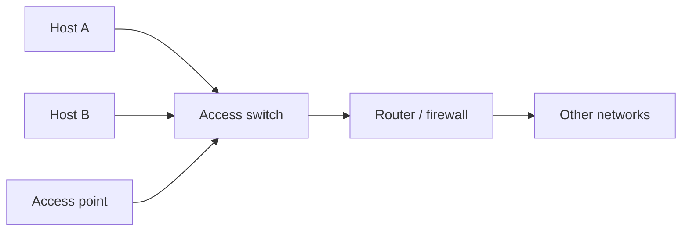

</div>

The switch is often the **first enforcement point** after the endpoint.

---

# What can a switch see?

A typical Ethernet switch can reason about:

- ingress port;
- source MAC;
- destination MAC;
- VLAN tag;
- EtherType;
- sometimes selected Layer-3/4 fields through ACL features.

Its native language is still primarily **Layer 2**.

---

# MAC learning

<div style="transform: scale(0.8); transform-origin: top center;">

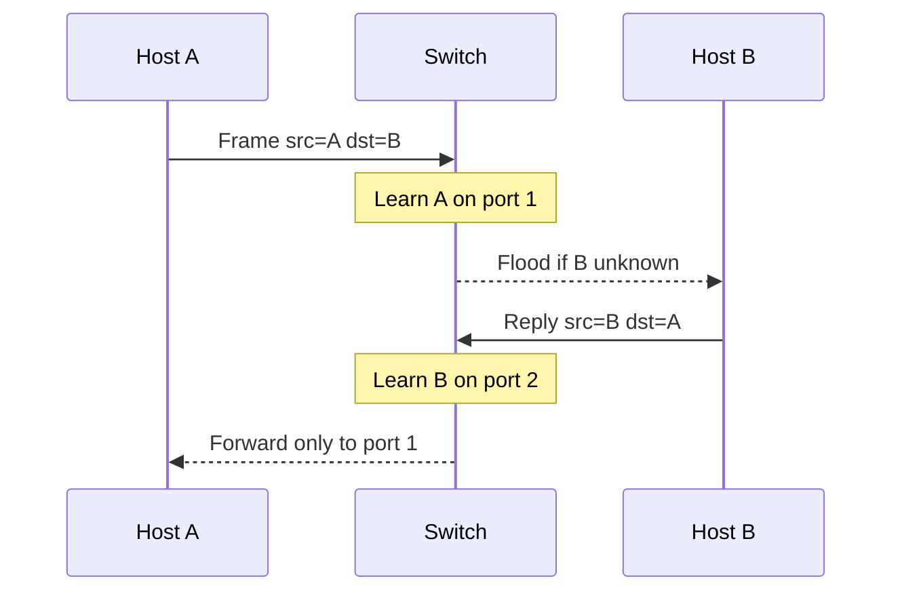

</div>

---

# The forwarding table

| MAC | VLAN | Port | Age (s) |
|---|---:|---:|---:|
| `00:11:22:33:44:55` | 10 | 3 | 120 |
| `00:11:22:33:44:66` | 10 | 7 | 45 |

Each entry has an **aging timer** (typically 300 s by default). If a MAC is not seen again before the timer expires, the entry is removed and traffic to that MAC is flooded until it is re-learned.

Why aging matters for security:

- **stale entries** would prevent correct forwarding after a host moves;
- an attacker who stays quiet can **disappear** from the table, then reappear on a different port;
- very short aging timers increase flooding; very long timers delay detection of topology changes.

---

# Threat model at Layer 2

An attacker on an access port may attempt:

- **MAC spoofing** — impersonate another host's MAC address;
- **MAC flooding** — exhaust the forwarding table to cause flooding;
- **Rogue DHCP** — serve false gateway / DNS information;
- **ARP spoofing** — redirect traffic via forged ARP replies;
- **STP manipulation** — inject BPDUs to alter topology decisions;
- **VLAN abuse** — craft tagged frames to escape the assigned VLAN.

A switch cannot assume that an endpoint connected to an access port is honest.

---

# MAC spoofing

An attacker can change a software-configurable MAC address.

<div style="transform: scale(0.8); transform-origin: top center;">

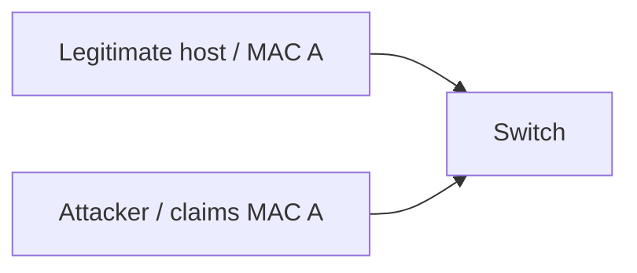

</div>

Therefore **MAC identity is not strong identity**.

---

# Port security idea

A simple control binds expectations to a physical port:

```text
port 3:
  expected MACs: 1
  allowed MAC: aa:bb:cc:dd:ee:ff
```

Possible reactions:

- drop offending frames;
- log;
- temporarily disable the port;
- place the device in a restricted VLAN.

---

# Static vs learned bindings

**Static**
- administrator defines the MAC/port mapping;
- predictable but operationally expensive.

**Learned / sticky**
- first valid MAC is remembered;
- easier operationally;
- first device to appear may become trusted accidentally.

---

# MAC flooding

The switch stores MAC-to-port mappings in a **CAM (Content Addressable Memory) table** of finite size. Typical capacities:

- **access switches**: 8K – 32K entries;
- **larger / campus switches**: 64K – 128K+ entries.

If the table is exhausted, the switch cannot learn new MACs and begins **flooding** frames to all ports in the VLAN. An attacker using a tool like `macof` can fill a small CAM table in seconds.

<div style="transform: scale(0.8); transform-origin: top center;">

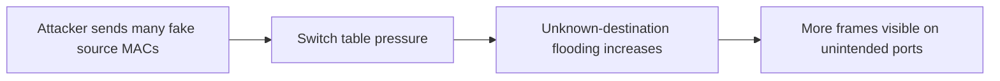

</div>

---

# VLANs

<div style="transform: scale(0.8); transform-origin: top center;">

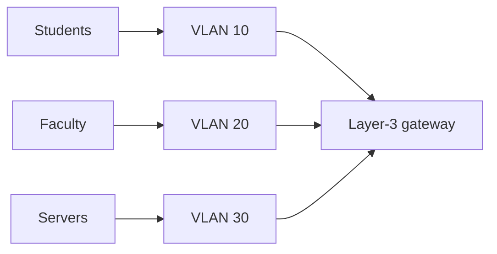

</div>

VLANs create separate Layer-2 broadcast domains.

---

# VLANs are not a complete policy

A VLAN answers:

> Which Layer-2 segment is this port in?

It does **not** by itself answer:

> Which application flows are permitted between segments?

Inter-VLAN routing plus ACL/firewall policy is still required.

---

# Access ports and trunks

<div style="transform: scale(0.8); transform-origin: top center;">

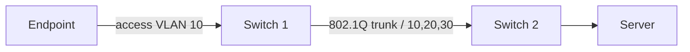

</div>

Security goal: endpoint-facing ports should not accidentally become trunks.

---

# VLAN hopping: the lesson

Do not focus on one historical trick. Focus on configuration assumptions:

- auto-negotiation of trunks;
- unexpected tagged frames;
- native VLAN mismatches;
- unused VLANs permitted on trunks.

Principle:

> Explicitly configure trust boundaries; do not negotiate them with untrusted endpoints.

---

# Private VLANs: the problem

Regular VLANs separate broadcast domains, but hosts **inside the same VLAN** can freely communicate.

Sometimes that is undesirable:

- a DMZ where each server should reach the gateway but **not** other servers;
- a shared hosting or multi-tenant segment;
- guest ports that must reach the Internet but not each other.

Private VLANs (PVLANs) add **intra-VLAN isolation** without consuming additional subnets or VLAN IDs.

---

# Private VLAN port types

<div style="transform: scale(0.8); transform-origin: top center;">

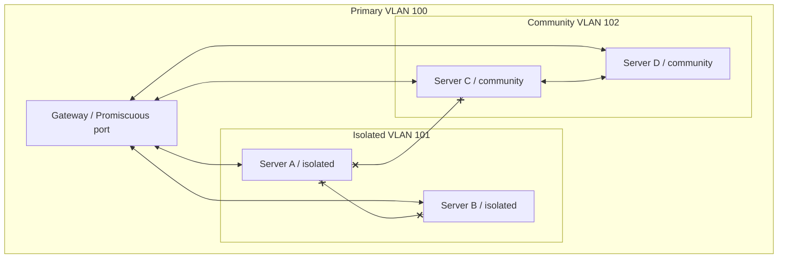

</div>

---

# Private VLAN port types

| Port type | Can talk to |
|-----------|------------|
| **Promiscuous** | all ports in the primary VLAN |
| **Isolated** | promiscuous ports only (not other isolated ports) |
| **Community** | promiscuous ports + same community (not other communities or isolated) |

> Not all switch platforms implement PVLANs identically.

---

# Normal DHCP flow

<div style="transform: scale(0.8); transform-origin: top center;">

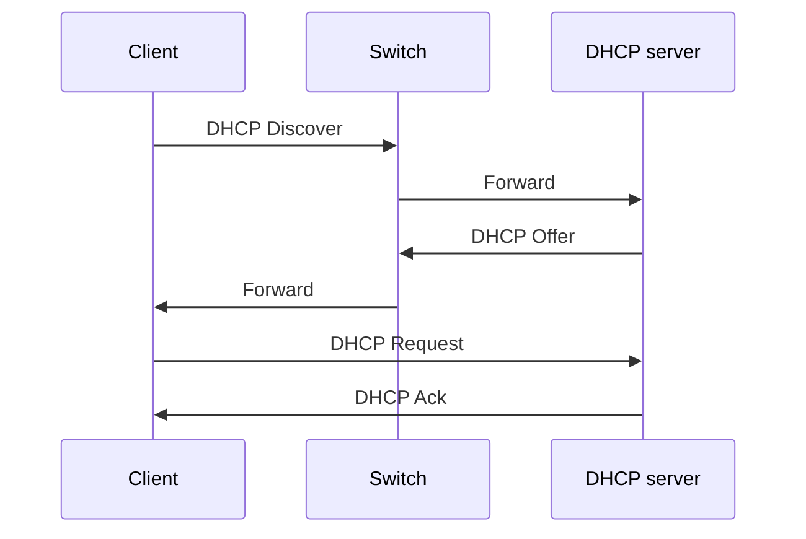

</div>

---

# Rogue DHCP server

<div style="transform: scale(0.8); transform-origin: top center;">

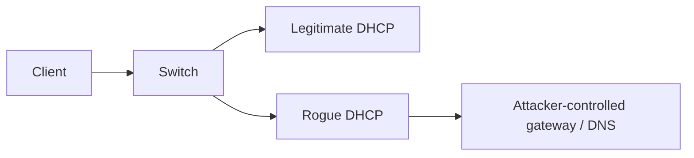

</div>

The fastest responder may influence the victim unless the infrastructure constrains server responses.

---

# DHCP snooping

Classify ports:

<div style="transform: scale(0.8); transform-origin: top center;">

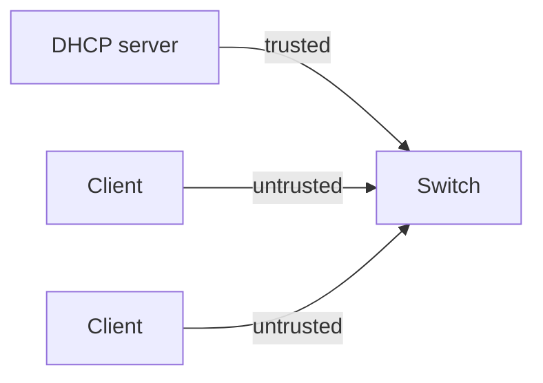

</div>

Server-originated DHCP replies are accepted only where they are expected.

---

# DHCP snooping binding table

The switch can learn bindings such as:

| MAC | IP | VLAN | Port |
|---|---|---:|---:|
| `AA:01` | `10.0.10.21` | 10 | 4 |
| `AA:02` | `10.0.10.22` | 10 | 7 |

This table becomes useful to **other Layer-2 security features**.

---

# ARP spoofing

<div style="transform: scale(0.8); transform-origin: top center;">

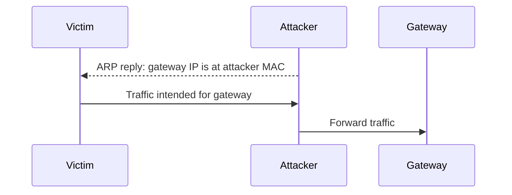

</div>

The attacker attempts to place itself in the path.

---

# Dynamic ARP Inspection

<div style="transform: scale(0.8); transform-origin: top center;">

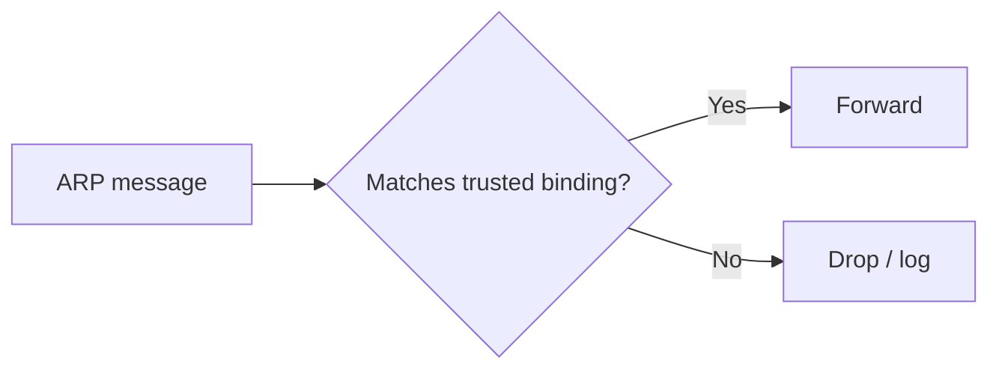

</div>

A DHCP-derived binding can therefore protect ARP behavior.

---

# IP Source Guard

Another use of the binding table:

<div style="transform: scale(0.8); transform-origin: top center;">

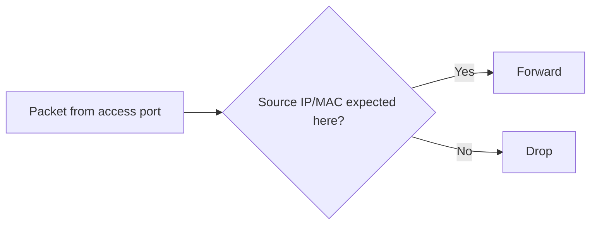

</div>

---

# Spanning Tree exists for a reason

Redundant links can create loops.

<div style="transform: scale(0.8); transform-origin: top center;">

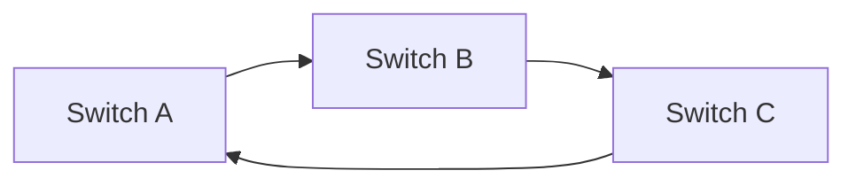

</div>

STP decides which links should forward so Ethernet does not loop indefinitely.

---

# BPDU Guard

<div style="transform: scale(0.8); transform-origin: top center;">

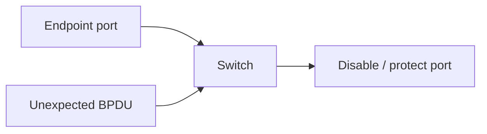

</div>

Use it on ports where a switch should **never** legitimately appear.

---

# Broadcast storms

<div style="transform: scale(0.8); transform-origin: top center;">

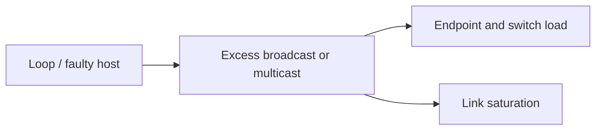

</div>

Availability failures at Layer 2 can affect an entire broadcast domain.

---

# Storm control

Storm control is configured **per port**. The switch monitors incoming traffic in three classes:

- **broadcast** — destination `FF:FF:FF:FF:FF:FF`;
- **multicast** — group destination MACs;
- **unknown unicast** — destination MAC not in the forwarding table (flooded).

---

# Storm control

For each class the administrator sets a **threshold**, typically expressed as:

| Unit | Example |
|------|---------|
| % of link bandwidth | broadcast ≤ 20% of 1 Gbps |
| packets per second | multicast ≤ 5 000 pps |
| bits per second | unknown unicast ≤ 100 Mbps |

---

# Storm control

When traffic exceeds the threshold the switch acts:

| Action | Behavior |
|--------|----------|
| **Drop** | silently discard excess frames above the limit |
| **Shutdown** | place the port in err-disable state |
| **Trap / Log** | send SNMP trap or syslog but continue forwarding |

---

# Storm control: recovery and operations

A port shut down by storm control does not always recover automatically.

Common recovery options:

- **manual re-enable** — an operator must intervene;
- **auto-recovery timer** — the port re-enables after a configured interval (e.g., 300 s);
- **monitoring integration** — SNMP trap triggers an alert for review.

> Storm control is a safety valve, not a precision instrument — tune it with real traffic data.

---

# Discovery protocols

Protocols such as CDP/LLDP intentionally reveal topology/device information.

Questions to ask:

- is discovery required on endpoint-facing ports?
- what inventory information does it expose?
- can it help operations enough to justify the exposure?

---

# The switch software stack is an attack surface

A switch is a **networked computer** running its own OS, management daemons, and protocol stacks.

Those components can contain exploitable vulnerabilities:

<div style="transform: scale(0.8); transform-origin: top center;">

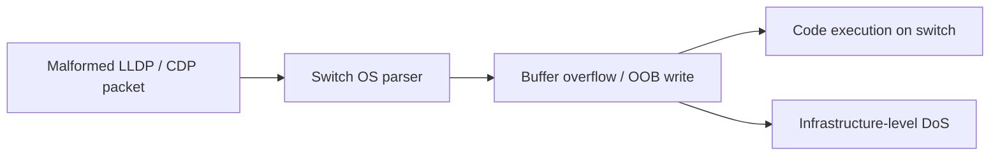

</div>

Real examples:

| CVE | Impact |
|-----|--------|
| CVE-2023-32154 | RouterOS LLDP out-of-bounds write via IPv6 ND — unauthenticated RCE |

---

# Switch mitigations

- disable LLDP / CDP on endpoint-facing ports where not needed;
- keep switch firmware up to date;
- restrict LLDP-MED auto-configuration policies;
- limit voice VLAN access to devices authenticated via 802.1X with verified OUIs;
- treat the switch management plane with the same rigor as any server.

> The switch is not just a transparent pipe — it runs code, and that code can be attacked.

---

# Management plane security

A switch has two very different roles:

<div style="transform: scale(0.8); transform-origin: top center;">

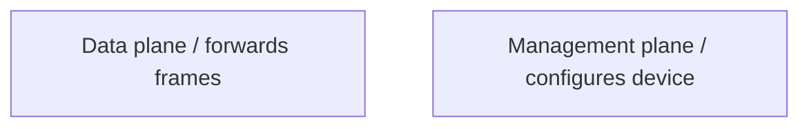

</div>

Protect management with:

- dedicated management network;
- strong authentication;
- SSH/HTTPS rather than insecure legacy protocols;
- logging and backups.

---

# Out-of-band vs in-band management

| Approach | Pros | Cons |
|----------|------|------|
| **OOB** | management reachable even during data plane failure; attack surface isolated | extra cabling, switches, or serial console servers |
| **In-band** | no extra infrastructure; simpler in small environments | management shares fate with production; exposed to data plane attacks |

Best practice: use **OOB for critical infrastructure**; if in-band is unavoidable, place management in a dedicated VLAN with strict ACLs.

---

# SNMP security

SNMP (Simple Network Management Protocol) is widely used for monitoring and configuring network devices.

| Version | Authentication | Encryption | Risk |
|---------|---------------|------------|------|
| **v1 / v2c** | community string (plaintext) | none | anyone who captures the string has full read/write access |
| **v3** | username + auth (SHA/HMAC) | optional (AES) | significantly stronger; the only version suitable for production |

> Always use **SNMPv3** with `authPriv` (authentication + encryption);

---

# What should be logged?

Useful switch-side signals include:

- port up/down events;
- MAC address changes;
- authentication failures;
- STP topology changes;
- DHCP snooping violations;
- ARP inspection violations;
- unusually high broadcast rates.

Logs are useful only if somebody consumes them.

---

# Physical security still matters

If an attacker can physically reach:

- the switch console;
- an unlocked rack;
- an unused active port;
- a patch panel;

software policy may be bypassed.

Dedicated network devices remain **physical systems**.

---

# Fail-open or fail-closed?

Ask this for every control.

Example: if authentication infrastructure is unavailable, should an access port:

- deny all access;
- grant limited access;
- grant normal access?

There is no universal answer. Availability and security requirements must be explicit.

---

# Expert augmentation: MACsec at Layer 2

802.1X answers:

> May this device use this port?

MACsec answers a different question:

> Can someone tap this cable and read or modify frames?

<div style="transform: scale(0.8); transform-origin: top center;">

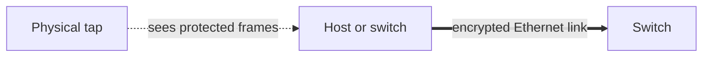

</div>

MACsec is **hop-by-hop Layer 2 protection**: endpoint-to-switch or switch-to-switch.

It does not replace VLANs, ACLs, NAC, or IPsec.

---

# MACsec: what the hardware changes

<div style="transform: scale(0.8); transform-origin: top center;">

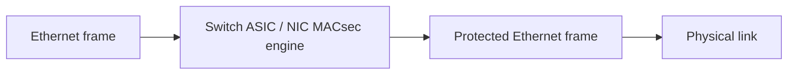

</div>

- MACsec uses **AES-GCM** (AES-128-GCM by default, AES-256-GCM optional) for authenticated encryption — confidentiality and integrity in a single pass;
- encryption and integrity are applied below IP;
- modern deployments rely on hardware support for line-rate operation;
- MKA distributes and rotates session keys;
- unsupported devices silently turn this into a design constraint.

---

# Final checklist

When evaluating switch security, ask:

- Which ports are trusted?
- Which VLAN should each endpoint reach?
- How is endpoint identity established?
- Can a client impersonate infrastructure services?
- Are ARP/DHCP assumptions validated?
- Can one host exhaust shared Layer-2 resources?
- Is management isolated and monitored?
