# Router Security

## Layer 3 forwarding as a security boundary

__Open-source lab stack:__ Linux routing, FRRouting, nftables

Routers decide where packets go. Secure routers also constrain **where packets are allowed to go**.

---

# Learning objectives

You should be able to:

- explain forwarding vs routing control plane;
- design simple ingress/egress ACL policy;
- explain anti-spoofing and uRPF;
- separate NAT from firewalling;
- identify route-manipulation risks;
- build a small routed lab with FRRouting.

---

# Where the router sits

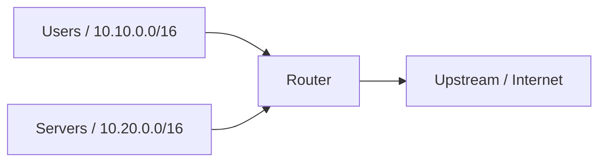

Every routed boundary is an opportunity for policy.

---

# Forwarding plane vs control plane

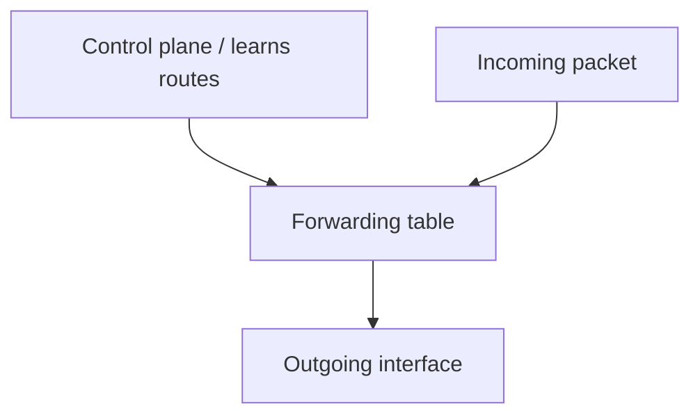

Security can fail either because the forwarding policy is wrong or because the routing information is wrong.

---

# What a router sees

At minimum:

- source and destination IP;
- IP protocol;
- ingress interface;
- destination route;
- next hop.

Filtering features may also inspect:

- TCP/UDP ports;
- TCP flags;
- ICMP types;
- connection state when combined with firewall functions.

---

# Longest-prefix match

Routes:

```text
10.0.0.0/8       -> A
10.20.0.0/16     -> B
10.20.30.0/24    -> C
```

Destination `10.20.30.7` follows `/24` because it is the most specific matching route.

Security implication: a more specific route can unexpectedly change the path.

---

# Static routing

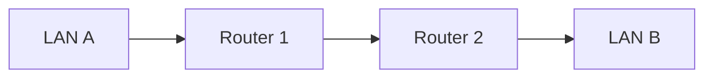

Static routes are simple and predictable, but operationally difficult at scale.

Predictability is often a security advantage in small environments.

---

# Dynamic routing

Routers exchange reachability information.

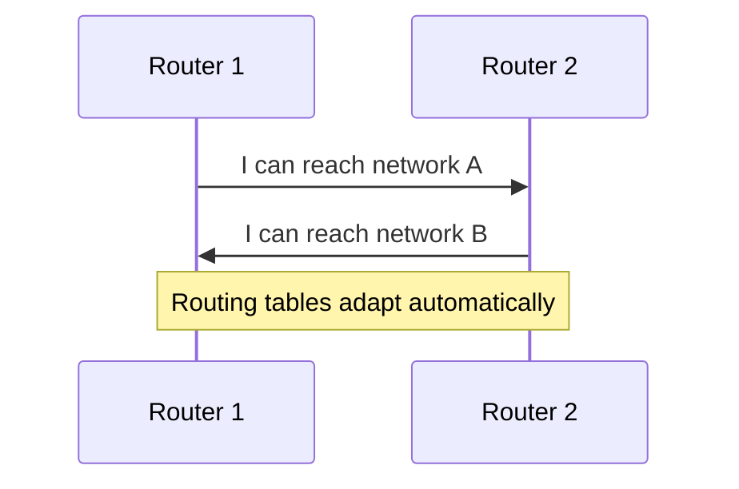

Automation creates a new trust problem: **who may influence routing?**

---

# Routing protocols are security-sensitive

Threats include:

- unauthorized neighbors;
- false route advertisements;
- accidental route leaks;
- route hijacking;
- management-plane compromise;
- unstable routing causing availability failures.

A secure data plane with an untrusted control plane is not enough.

---

# ACLs on routed boundaries

Example requirement:

```text
Students -> DNS server :53       allow
Students -> Web server :443      allow
Students -> Database :5432       deny
Students -> Management network   deny
```

An ACL turns routing into an **enforced path**, not just a reachable path.

---

# Stateless ACL reasoning

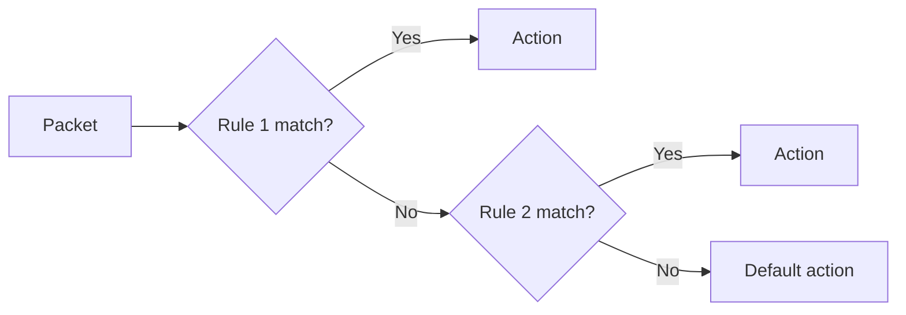

Ordering matters. The first matching rule often determines the result.

---

# Default deny

Safer pattern:

```text
allow required flow 1
allow required flow 2
allow required flow 3
deny everything else
```

This is easier to reason about than trying to enumerate every dangerous flow.

---

# Ingress filtering

Packets entering from the Internet should not normally claim internal/private source ranges.

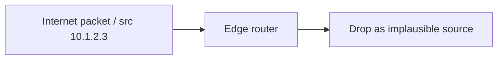

The policy uses **where the packet arrived** as part of trust.

---

# Source spoofing

Attackers may forge a source address to:

- hide origin;
- abuse trust based on address;
- launch reflection attacks;
- confuse logging.

A router cannot prove identity from an IP source field alone.

---

# uRPF concept

Unicast Reverse Path Forwarding asks:

> If I routed a packet back to this source, would the expected path be compatible with where it arrived?

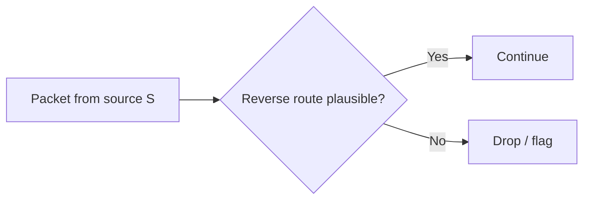

---

# Strict vs loose reverse-path checks

__Strict__
- source should be reachable through the same interface;
- strong but problematic with asymmetric routing.

__Loose__
- source only needs to exist in the routing table;
- more tolerant;
- weaker anti-spoofing.

Topology determines which mode is safe.

---

# Egress filtering

Security policy should also constrain outbound traffic.

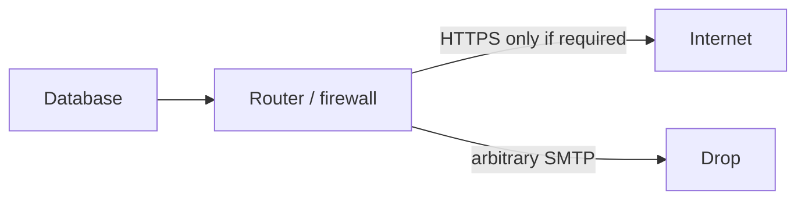

Compromised systems should not automatically have unrestricted Internet access.

---

# Network segmentation with routing

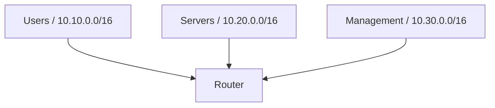

Segmentation becomes meaningful only when inter-segment flows are explicitly controlled.

---

# NAT is address translation

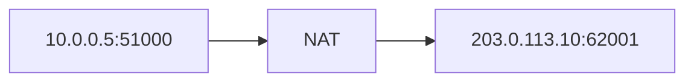

NAT modifies addressing and maintains mappings.

It is **not automatically a security policy**.

---

# Why NAT often feels like security

Typical outbound NAT creates state only after an internal host sends traffic.

So unsolicited inbound traffic often fails to map anywhere.

That side effect is useful, but the clean mental model is:

> NAT translates. Firewall policy decides.

---

# Source NAT

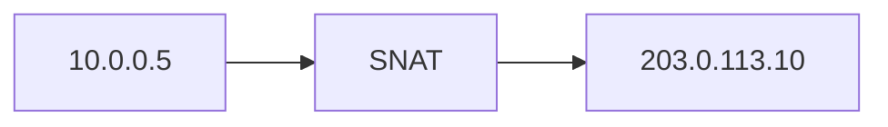

Common uses:

- private-to-public Internet access;
- address overlap workarounds;
- hiding internal addressing from peers.

Do not confuse hidden addressing with confidentiality.

---

# Destination NAT

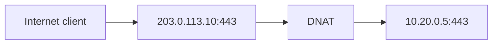

Publishing a service through DNAT should always be paired with explicit filtering.

---

# Hairpin and asymmetric paths

Complex NAT/routing designs can cause:

- return traffic through a different gateway;
- state not matching the original path;
- confusing logs;
- broken troubleshooting.

Before blaming a security device, always draw **both directions** of the flow.

---

# ICMP is not simply bad

ICMP supports:

- error reporting;
- Path MTU Discovery;
- diagnostics;
- IPv6 Neighbor Discovery requirements.

Blanket blocking can break networks.

Secure policy should allow the ICMP functions the architecture needs.

---

# Control-plane protection

The router itself is a host.

Protect services such as:

- SSH;
- routing protocol sockets;
- SNMP/API management;
- web UI;
- NTP/DNS dependencies.

Traffic **to the router** is different from traffic **through the router**.

---

# Management plane separation

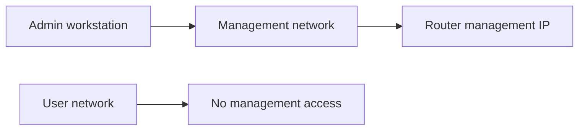

Keep device administration away from ordinary user paths whenever possible.

---

# Route authentication: concept only

Some routing protocols support mechanisms to authenticate neighbors or updates.

Do not turn this lecture into crypto.

The security concept is:

> Accept control-plane information only from expected peers, and protect the channel appropriately.

---

# Route leak vs attack

Not every dangerous route is malicious.

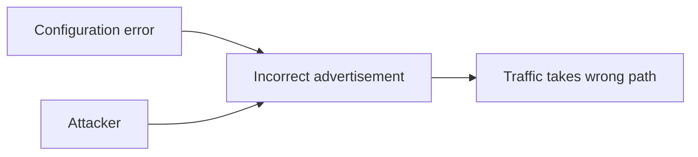

Network security must handle **mistakes and adversaries**.

---

# Default route risk

A default route says:

```text
If nothing more specific matches, send it here.
```

That is powerful. A wrong default route may redirect enormous amounts of traffic.

Treat default-route changes as security-relevant events.

---

# Open-source routing with FRRouting

FRRouting provides open-source implementations of routing protocols such as:

- OSPF;
- BGP;
- IS-IS;
- RIP;
- others.

Linux still performs the actual packet forwarding.

---

# Linux router architecture

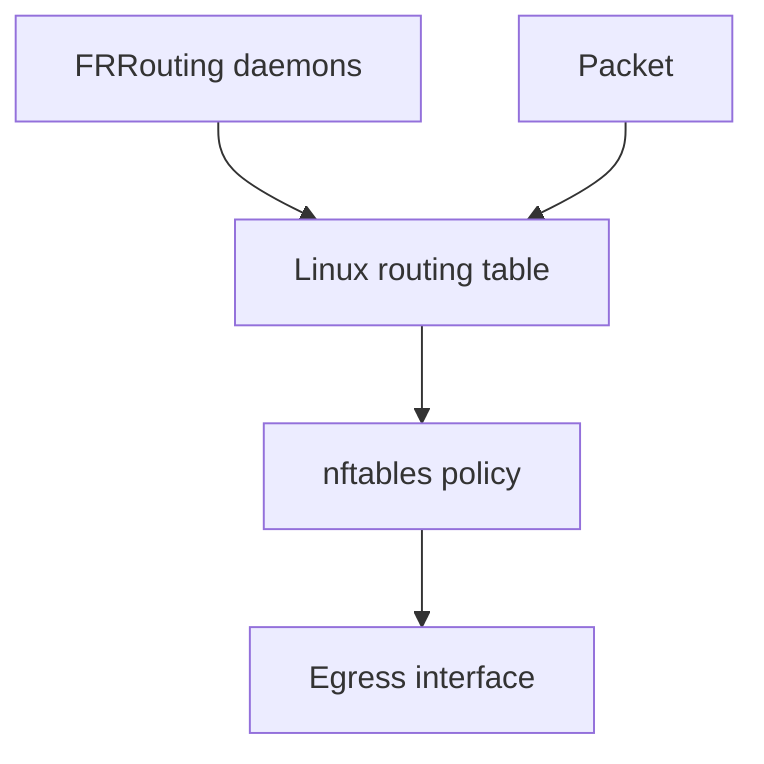

This separation is pedagogically useful: route learning and packet filtering remain visible.

---

# Minimal Linux forwarding

```bash
sysctl -w net.ipv4.ip_forward=1
ip route
ip rule
```

Then add `nftables` policy.

Students should first prove routing works, then add security controls one at a time.

---

# FRRouting lab topology

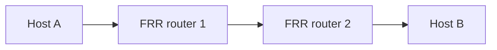

Start with static routes, then enable a dynamic protocol and compare the routing tables.

---

# Example FRR idea

```text
router ospf
 network 10.0.12.0/30 area 0
 network 10.10.0.0/16 area 0
```

The exact syntax is less important than observing:

- neighbor formation;
- learned prefixes;
- route withdrawal;
- convergence after a link failure.

---

# ACL with nftables

Conceptual example:

```text
ip saddr 10.10.0.0/16 ip daddr 10.20.0.10 tcp dport 443 accept
ip saddr 10.10.0.0/16 ip daddr 10.20.0.0/16 drop
```

Use packet counters so students can see which rule matched.

---

# Counters are teaching tools

A rule that never increments may be:

- unnecessary;
- shadowed;
- incorrect;
- matching the wrong interface/direction.

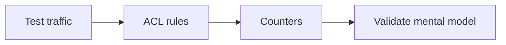

---

# Routing and firewall troubleshooting

Always ask in order:

1. Did the packet arrive?
2. Is there a route to the destination?
3. Which ACL/firewall rule applies?
4. Did NAT change the packet?
5. Is there a return route?
6. Does the return path hit compatible state/policy?

---

# Packet path exercise

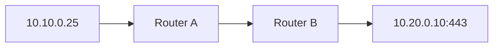

Ask students to annotate:

- source/destination at each hop;
- route selected;
- ACL decision;
- any NAT translation;
- return path.

---

# Router logs worth keeping

- routing neighbor up/down;
- route changes;
- default-route changes;
- ACL denies for important boundaries;
- management logins;
- configuration changes;
- CPU/memory anomalies;
- interface errors and drops.

Avoid flooding the SIEM with meaningless packet denies.

---

# High availability

Two routers can remove a single point of failure.

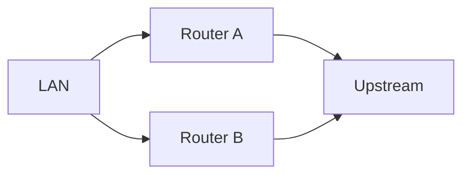

But HA introduces state, routing, and failover complexity. Redundancy is not free.

---

# Security zones vs routing domains

Do not assume one subnet equals one trust level.

Ask:

- Who owns it?
- What workloads live there?
- What data is present?
- Which paths are required?
- Which administrative plane controls it?

Addressing is an implementation detail; **trust is an architectural decision**.

---

# Common mistakes

- Permitting `any any` temporarily and never removing it
- Relying on NAT as the firewall
- Blocking all ICMP
- Forgetting egress filtering
- Trusting source IPs too much
- Ignoring return paths
- Exposing management services broadly
- Accepting dynamic routes from unexpected peers

---

# Design scenario

You have:

- students `10.10.0.0/16`;
- servers `10.20.0.0/16`;
- management `10.30.0.0/16`;
- Internet uplink.

Requirements:

- students need DNS + HTTPS;
- only admins reach management;
- servers have minimal Internet egress.

---

# One possible policy

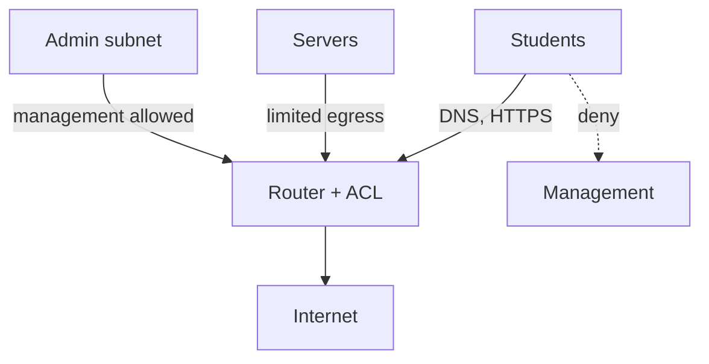

Students should justify every allowed edge.

---

# What routers cannot solve

A router cannot usually tell whether:

- an HTTPS request is malicious;
- a user is authorized to access a record;
- a DNS domain is phishing;
- an attachment contains malware.

Layer-3 policy is necessary but not sufficient.

---

# Mental model

```mermaid
flowchart LR
  LEARN["Learn / configure route"] --> PATH["Choose path"]
  PATH --> POLICY["Apply boundary policy"]
  POLICY --> NAT["Translate if required"]
  NAT --> SEND["Forward"]
```

Security questions can exist at every stage.

---

# Expert augmentation: BGP FlowSpec

Static ACLs are local and slow to operate during a distributed attack.

BGP FlowSpec distributes traffic-matching rules through the routing control plane.

```mermaid
flowchart LR
  C[Mitigation controller] --> RR[BGP route reflector]
  RR --> R1[Edge router 1]
  RR --> R2[Edge router 2]
  RR --> R3[Edge router 3]
  R1 --> DROP1[drop / rate-limit / redirect]
```

Example idea:

```text
match dst 203.0.113.10, udp dst-port 53
then rate-limit or discard
```

---

# FlowSpec operational risk: TCAM pressure

Routers forward fast because match rules are pushed into specialized hardware tables.

```mermaid
flowchart LR
  P[Packet] --> TCAM[TCAM lookup]
  TCAM -->|hit| ACT[Forward / drop / redirect]
  TCAM -->|overflow risk| CPU[slow path / control CPU]
```

Important lesson:

> More granular mitigation is not free.

Design questions:

- who is allowed to inject FlowSpec rules?
- how are bad rules validated?
- what happens when hardware tables fill?
- what is the rollback path?

---

# Review questions

1. Why can a route be security-sensitive?
2. What does ingress filtering accomplish?
3. Why can strict uRPF break asymmetric networks?
4. Why is NAT not a firewall?
5. Why should egress traffic be filtered?
6. What is different about traffic to the router vs through it?

---

# Final checklist

When securing a routed boundary, ask:

- What prefixes should be reachable?
- From which interfaces are source addresses plausible?
- What is the default policy?
- What outbound flows are genuinely required?
- Is NAT separate from filtering logic?
- Who may influence routing?
- Is management isolated?
- Is the return path understood?
