# Router Security

## Layer 3 forwarding as a security boundary

Routers decide where packets go. Secure routers decide **where packets are allowed to go**.

---

# Learning objectives

- explain forwarding vs routing control plane;
- design simple ingress/egress ACL policy;
- explain anti-spoofing and uRPF;
- separate NAT from firewalling;
- identify route-manipulation risks;
- describe first-hop redundancy with VRRP and its failure modes;

---

# Where the router sits

<div style="transform: scale(0.8); transform-origin: top center;">

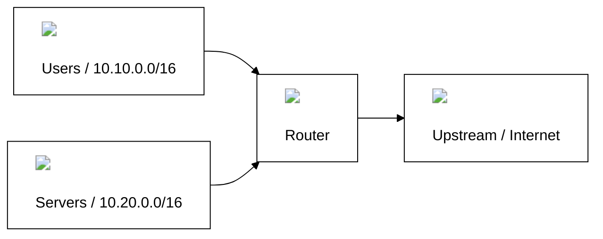

</div>

Every routed boundary is an opportunity for policy.

---

# Forwarding plane vs control plane

<div style="transform: scale(0.8); transform-origin: top center;">

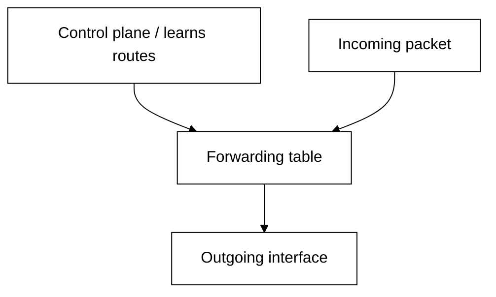

</div>

Security can fail either because the forwarding policy is wrong or because the routing information is wrong.

---

# What a router sees

At minimum:

- source and destination IP;
- IP protocol;
- ingress interface;
- destination route;
- next hop.

Filtering features may also inspect:

- TCP/UDP ports;
- TCP flags;
- ICMP types;
- connection state when combined with firewall functions.

---

# Three planes of router security

| Plane | Function | Security focus |
|-------|----------|----------------|
| **Data plane** | forwards packets | ACLs, NAT, anti-spoofing, fragmentation |
| **Control plane** | learns and distributes routes | routing protocols, VRRP, ICMP |
| **Management plane** | administers the device | SSH, SNMP, logging, access control |

Each plane has its own attack surface and requires its own defenses.

---

# Data plane

## Filtering, forwarding, and address translation

---

# Longest-prefix match

Routes:

```text
10.0.0.0/8       -> A
10.20.0.0/16     -> B
10.20.30.0/24    -> C
```

Destination `10.20.30.7` follows `/24` because it is the most specific matching route.

Security implication: a more specific route can unexpectedly change the path.

---

# Network segmentation with routing

<div style="transform: scale(0.8); transform-origin: top center;">

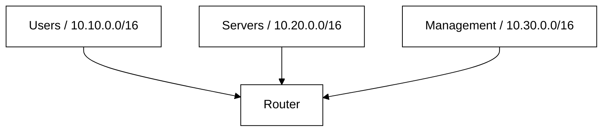

</div>

Segmentation becomes meaningful only when inter-segment flows are explicitly controlled.

---

# Filtering at a routed boundary

A router can filter packets in **two directions** on every interface:

<div style="transform: scale(0.8); transform-origin: top center;">

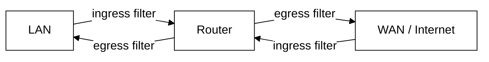

</div>

- **Ingress (in)** — applied to packets **arriving** on an interface;
- **Egress (out)** — applied to packets **leaving** an interface.

The same packet can be filtered at multiple points. Deciding **where** to filter is a design choice.

We use Access Control Lists (ACLs) for filtering on a router.

---

# What fields can we match?

A router ACL typically matches on **Layer 3** fields:

| Field | Security question |
|-------|-------------------|
| **Source IP** | where does this packet claim to come from? |
| **Destination IP** | where is it going? |
| **Ingress interface** | which physical boundary did it cross? |
| **IP protocol** | is it TCP, UDP, ICMP, or something else? |

Many routers can also match **Layer 4** fields (TCP/UDP ports, TCP flags, ICMP types) — we will cover those in depth in the **Firewalls** lecture, since firewalls do the same matching with added statefulness.

For now, focus on what decisions we can make with **IP addresses and direction** alone.

---

# Source IP + direction = anti-spoofing

Combining **source IP** with **ingress interface** is powerful:

| Arriving on | Source IP | Verdict |
|-------------|-----------|---------|
| Internet-facing interface | `10.0.0.0/8` (private) | **drop** — impossible source |
| Internet-facing interface | `203.0.113.0/24` (public) | allow |
| LAN interface | `10.10.0.0/16` (our range) | allow |
| LAN interface | `192.168.99.0/24` (not ours) | **drop** — not expected here |

This is **ingress filtering** (BCP 38 / RFC 2827) — one of the most effective anti-spoofing controls.

---

# Destination IP = access policy

Matching on **destination IP** controls **what a segment is allowed to reach**:

```text
from Students  → DNS server (10.20.0.10)     allow
from Students  → Web server (10.20.0.20)     allow
from Students  → Database (10.20.0.30)       deny
from Students  → Management (10.30.0.0/16)   deny
```

An ACL turns routing into an **enforced path**, not just a reachable path.

Without it, every routable destination is reachable by default.

---

# Rule ordering and default deny

ACL rules are evaluated **top-down, first match wins**:

<div style="transform: scale(0.8); transform-origin: top center;">

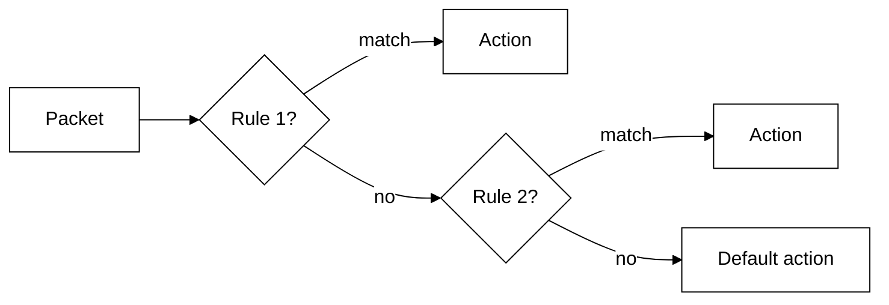

</div>

Best practice — end every ACL with **default deny**.

---

# uRPF: automated anti-spoofing

Manually writing anti-spoofing ACLs for every interface is error-prone. **Unicast Reverse Path Forwarding** automates it:

> If I routed a reply **back** to this source IP, would it go out the same interface the packet arrived on?

<div style="transform: scale(0.8); transform-origin: top center;">

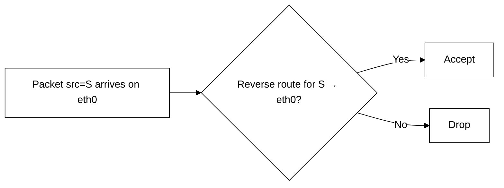

</div>

---

# uRPF: automated anti-spoofing
| Mode | Check | Trade-off |
|------|-------|-----------|
| **Strict** | reverse route must point to the **same interface** | strong, but breaks with asymmetric routing |
| **Loose** | source must exist **anywhere** in the routing table | weaker, but safe with asymmetric paths |

Topology determines which mode is appropriate.

---

# Filtering via Null0 (black-hole routing)

Instead of writing an ACL rule, route unwanted traffic to a **discard interface**:

```text
ip route 192.168.99.0/24 Null0
```

| | ACL drop | Null0 route |
|--|----------|-------------|
| **Speed** | per-packet evaluation | single route lookup |
| **Granularity** | match on src, dst, protocol, port | destination prefix only |
| **Logging** | can log matched packets | **no logs** — packet vanishes silently |
| **Use case** | fine-grained policy | bulk prefix blocking, RFC 6666 discard routes |

Null0 is faster but blind — use it carrefoully (e.g. under DDOS).

---

# Egress filtering

<div style="transform: scale(0.8); transform-origin: top center;">

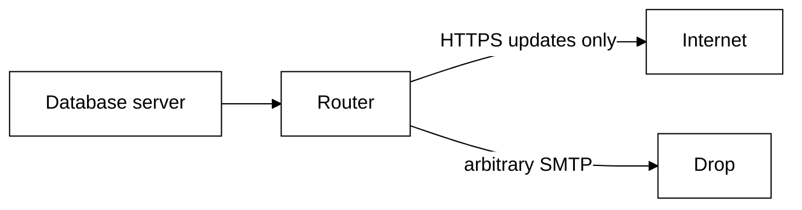

</div>

Why filter outbound?

- a compromised server should not freely exfiltrate data;
- outbound SMTP from a database is a strong indicator of compromise;
- egress filtering limits **lateral movement** and **command-and-control** reach.

> If a system doesn't need to talk to the Internet, don't let it.

---

# BGP FlowSpec (RFC 8955)

Static ACLs are local and slow to operate during a distributed attack.

BGP FlowSpec distributes traffic-matching rules through the routing control plane.

<div style="transform: scale(0.8); transform-origin: top center;">

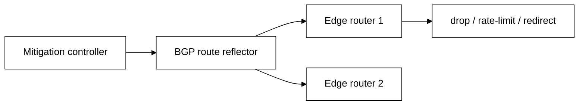

</div>

Example rule:

```text
match dst 203.0.113.10, udp dst-port 53
then rate-limit or discard
```

---

# FlowSpec operational risk: TCAM pressure

Routers forward fast because match rules are pushed into specialized hardware tables.

<div style="transform: scale(0.8); transform-origin: top center;">

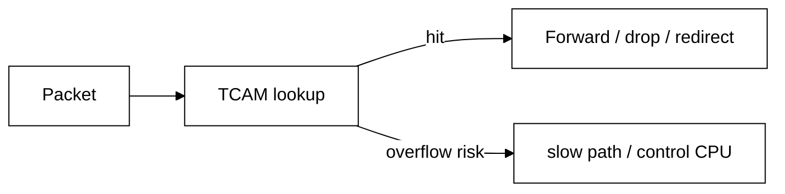

</div>

> More granular mitigation is not free.

---

# IP fragmentation as a security problem

IP allows packets to be fragmented in transit. Only the **first fragment** carries the TCP/UDP header:

| Fragment | Contains ports? | ACL can match? |
|----------|----------------|----------------|
| First (offset 0) | yes | yes |
| Subsequent (offset > 0) | no | **no** — header fields missing |

Attackers exploit this:

- **tiny fragment attack** — craft a first fragment so small that TCP ports fall into the second fragment, bypassing ACLs;
- **overlapping fragments** — fragments reassemble into a different packet than what the ACL inspected.

---

# IP fragmentation as a security problem

Mitigations:

- enforce a **minimum fragment size** (RFC 791 recommends ≥ 68 bytes);
- drop non-initial fragments on security boundaries where full header inspection is required;
- modern routers can use `fragment-offset` matching in ACLs.

---

# NAT is address translation

<div style="transform: scale(0.8); transform-origin: top center;">

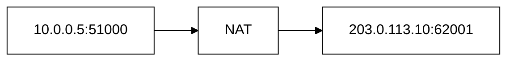

</div>

NAT modifies addressing and maintains mappings.

It is **not automatically a security policy**.

---

# Why NAT often feels like security

Typical outbound NAT creates state only after an internal host sends traffic.

So unsolicited inbound traffic often fails to map anywhere.

That side effect is useful, but the clean mental model is:

> NAT translates. Firewall policy decides.

---

# Source NAT

<div style="transform: scale(0.8); transform-origin: top center;">

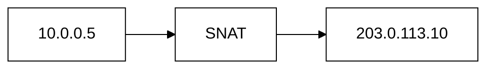

</div>

Common uses:

- private-to-public Internet access;
- address overlap workarounds;
- hiding internal addressing from peers.

Do not confuse hidden addressing with confidentiality.

---

# Destination NAT

<div style="transform: scale(0.8); transform-origin: top center;">

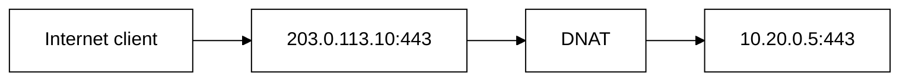

</div>

Publishing a service through DNAT should always be paired with explicit filtering.

---

# Hairpin and asymmetric paths

Complex NAT/routing designs can cause:

- return traffic through a different gateway;
- state not matching the original path;
- confusing logs;
- broken troubleshooting.

Before blaming a security device, always draw **both directions** of the flow.

---

# Hairpin NAT example

<div style="transform: scale(0.8); transform-origin: top center;">

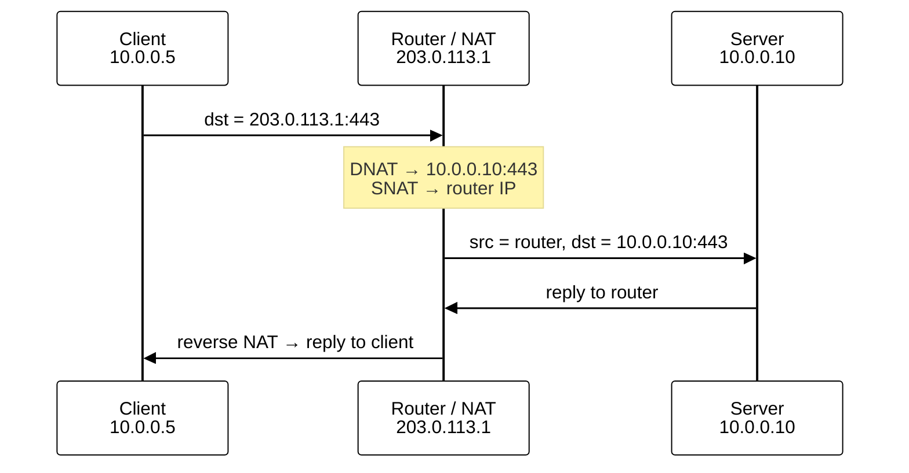

</div>

The client and server are on the **same LAN** but traffic loops through the router because the client uses the public IP.

Problems: double NAT state, source IP of the client is hidden from the server, asymmetric path if misconfigured.

---

# Counters are debugging tools

A rule that never increments may be:

- unnecessary;
- shadowed;
- incorrect;
- matching the wrong interface/direction.

<div style="transform: scale(0.8); transform-origin: top center;">

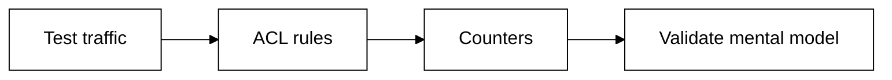

</div>

---

# Routing and firewall troubleshooting

Always ask in order:

1. Did the packet arrive?
2. Is there a route to the destination?
3. Which ACL/firewall rule applies?
4. Did NAT change the packet?
5. Is there a return route?
6. Does the return path hit compatible state/policy?

---

# Common mistakes

- Permitting `any any` temporarily and never removing it
- Relying on NAT as the firewall
- Blocking all ICMP
- Forgetting egress filtering
- Trusting source IPs too much
- Ignoring return paths
- Exposing management services broadly
- Accepting dynamic routes from unexpected peers

---

# What routers cannot solve

A router cannot usually tell whether:

- an HTTPS request is malicious;
- a user is authorized to access a record;
- a DNS domain is phishing;
- an attachment contains malware.

Layer-3 policy is necessary but not sufficient.

---

# Control plane

## Routing protocols, redundancy, and ICMP

---

# Static routing

<div style="transform: scale(0.8); transform-origin: top center;">

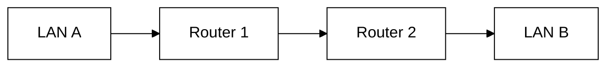

</div>

Static routes are simple and predictable, but operationally difficult at scale.

Predictability is often a security advantage in small environments.

---

# Dynamic routing

<div style="transform: scale(0.8); transform-origin: top center;">

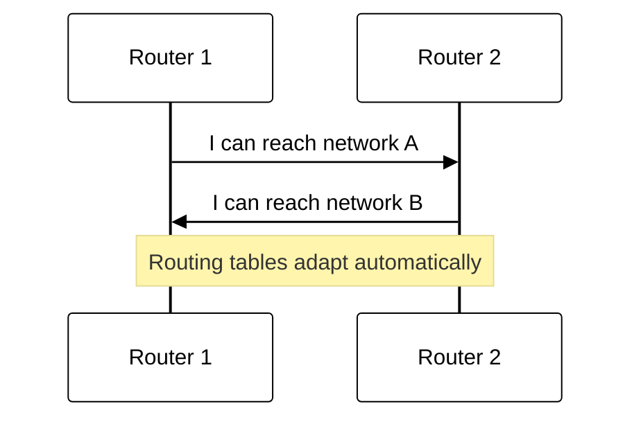

</div>

Automation creates a new trust problem: **who may influence routing?**

---

# Dynamic routing protocols

| Protocol | Type | Scope | Notes |
|----------|------|-------|-------|
| **RIP** | distance-vector | small / legacy | simple but slow convergence; limited to 15 hops |
| **OSPF** | link-state | campus / enterprise | fast convergence; area-based hierarchy; supports authentication |
| **IS-IS** | link-state | ISP / large enterprise | similar to OSPF; common in service-provider networks |
| **BGP** | path-vector | inter-AS / Internet | the protocol that glues the Internet together; policy-rich but complex |
| **EIGRP** | hybrid (Cisco) | enterprise | Cisco proprietary (open draft exists); not used in our labs |

---

# Dynamic routing protocols

Security relevance:

- **IGPs** (OSPF, IS-IS, RIP) operate within a trusted boundary — a rogue router inside the network can poison them;
- **BGP** operates between organizations — a misconfiguration or hijack can redirect Internet traffic globally;
- all protocols benefit from **neighbor authentication** and **prefix filtering**.

---

# Routing protocols are security-sensitive

Threats include:

- unauthorized neighbors;
- false route advertisements;
- accidental route leaks;
- route hijacking;
- management-plane compromise;
- unstable routing causing availability failures.

A secure data plane with an untrusted control plane is not enough.

---

# OSPF authentication example

OSPF supports three authentication modes:

| Mode | Security |
|------|----------|
| **Null** (type 0) | no authentication — any device can join |
| **Simple password** (type 1) | password sent in cleartext — trivially sniffed |
| **Cryptographic** (type 2) | HMAC (MD5 or SHA) — the only production-worthy option |

> Authentication proves neighbor identity — it does **not** encrypt the routing updates.

---

# Case study: Pakistan YouTube hijack (2008)

In February 2008, the Pakistani government ordered YouTube blocked. Pakistan Telecom (AS 17557) created a **Null0 route** for YouTube's prefix `208.65.153.0/24`.

The route **leaked to their upstream provider** (PCCW, AS 3491), which propagated it globally via BGP.

<div style="transform: scale(0.8); transform-origin: top center;">

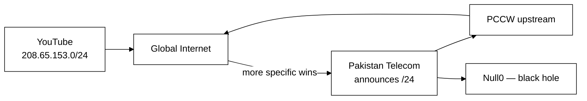

</div>

Because `/24` was **more specific** than YouTube's `/22`, routers worldwide preferred the Pakistani route.

> Reference: [RIPE NCC analysis of the YouTube hijack](https://www.ripe.net/publications/news/industry-developments/youtube-hijacking-a-ripe-ncc-ris-case-study)

---

# The default gateway is a single point of failure

<div style="transform: scale(0.8); transform-origin: top center;">

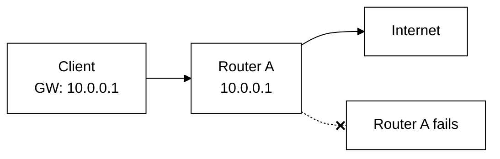

</div>

If the only gateway goes down, every host on the segment loses external connectivity — even if a second router is physically present.

The host's ARP cache still points to the old MAC. Manually reconfiguring every endpoint is not a viable recovery strategy.

---

# Virtual default gateway

The solution: two physical routers **share a single virtual IP address**.

| Role | IP | Physical? |
|------|-----|-----------|
| Virtual gateway | `10.0.0.1` | no — shared |
| Router A | `10.0.0.2` | yes |
| Router B | `10.0.0.3` | yes |

Hosts configure `10.0.0.1` as their default gateway and never need to know which physical router is currently active.

A **virtual MAC address** is also shared, so the ARP mapping stays valid after failover — no host-side changes required.

---

# VRRP architecture

**VRRP** (Virtual Router Redundancy Protocol, RFC 5798) is the standardized protocol for gateway redundancy.

<div style="transform: scale(0.8); transform-origin: top center;">

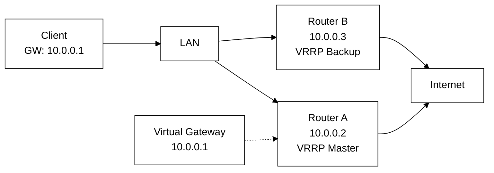

</div>

> Cisco's proprietary equivalent is **HSRP**. We use VRRP because it is an open standard.

---

# VRRP failover sequence

<div style="transform: scale(0.6); transform-origin: top center;">

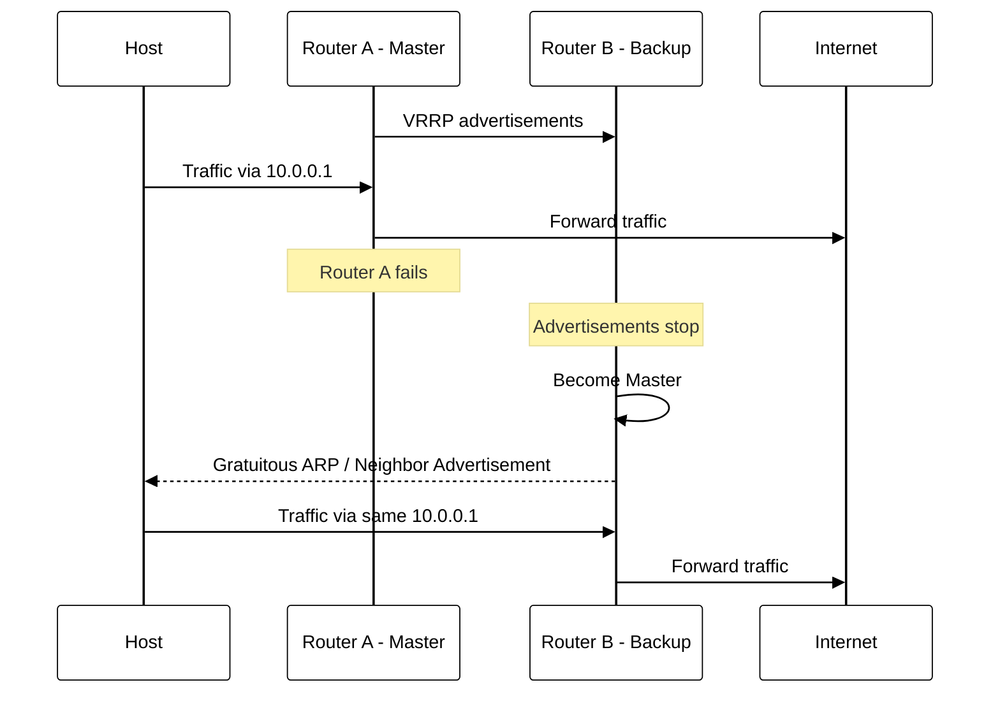

</div>

---

# VRRP security and failure scenarios

VRRP has its own attack surface and failure modes:

| Threat / Failure | Impact |
|-----------------|--------|
| **Spoofed VRRPs** | attacker claims Master role with high priority → traffic redirected |
| **Incorrect priority** | wrong router becomes Master; preemption after recovery may cause flapping |
| **Split-brain** | both routers believe they are Master  |
| **Interface tracking failure** | Master's uplink is down but it keeps the virtual IP → traffic black-holed |
| **Asymmetric routing** | outbound via Router A, return via Router B → stateful devices drop return traffic |

> Redundancy is not free — every HA mechanism introduces new failure modes that must be understood.

---

# ICMP is not simply bad

ICMP supports:

- error reporting;
- Path MTU Discovery;
- diagnostics;
- IPv6 Neighbor Discovery requirements.

Blanket blocking can break networks.

Secure policy should allow the ICMP functions the architecture needs.

---

# ICMP redirect attacks

A router sends an **ICMP Redirect** when a better next-hop exists on the same segment:

<div style="transform: scale(0.8); transform-origin: top center;">

```mermaid
%%{init: {'theme': 'base', 'themeVariables': {'primaryColor': '#ffffff', 'primaryBorderColor': '#000000', 'primaryTextColor': '#000000', 'lineColor': '#000000'}}}%%
flowchart LR
  A["Attacker"] -->|"forged ICMP Redirect:<br/>use me as gateway"| V["Victim"]
  V -->|"traffic now flows to attacker"| A
  A --> GW["Real gateway"]
```

</div>

---

# ICMP redirect attacks

Linux sysctl controls:

```text
net.ipv4.conf.all.accept_redirects = 0       # ignore incoming redirects
net.ipv4.conf.all.send_redirects = 0          # don't send redirects
net.ipv6.conf.all.accept_redirects = 0        # same for IPv6
```

ICMP redirects are almost never needed on modern networks — **disable them on all router interfaces and endpoints**.

---

# Management plane

## Administering the device securely

---

# Control-plane protection

The router itself is a host.

Protect services such as:

- SSH;
- routing protocol sockets;
- SNMP/API management;
- web UI;
- NTP/DNS dependencies.

Traffic **to the router** is different from traffic **through the router**.

---

# Management plane separation

<div style="transform: scale(0.8); transform-origin: top center;">

```mermaid
%%{init: {'theme': 'base', 'themeVariables': {'primaryColor': '#ffffff', 'primaryBorderColor': '#000000', 'primaryTextColor': '#000000', 'lineColor': '#000000'}}}%%
flowchart LR
  ADM["Admin workstation"] --> MGMT["Management network"]
  MGMT --> R["Router management IP"]
  USERS["User network"] --> X["No management access"]
```

</div>

Keep device administration away from ordinary user paths whenever possible.

---

# ACLs to the router itself

Management services (SSH, SNMP, HTTP) listen **on the router**. Use ACLs to restrict who can reach them:

```text
! Allow SSH only from management subnet
permit tcp 10.30.0.0/16 any eq 22
! Allow SNMP only from monitoring server
permit udp host 10.30.0.5 any eq 161
! Deny everything else to the router
deny ip any any
```

<div style="transform: scale(0.8); transform-origin: top center;">

```mermaid
%%{init: {'theme': 'base', 'themeVariables': {'primaryColor': '#ffffff', 'primaryBorderColor': '#000000', 'primaryTextColor': '#000000', 'lineColor': '#000000'}}}%%
flowchart LR
  ADM["Admin<br/>10.30.0.0/16"] -->|"SSH allowed"| R["Router"]
  USER["User<br/>10.10.0.0/16"] -->|"SSH denied"| R
```

</div>

This is applied as a **control-plane ACL** (or VTY ACL), separate from data-plane transit ACLs.

Without it, any host with a route to the router can attempt to log in.

---

# NetFlow and IPFIX

ACLs and logs show individual events. **NetFlow** (Cisco) and **IPFIX** (RFC 7011, the IETF standard) export **flow summaries** — metadata about conversations passing through the router.

| Field | Example |
|-------|---------|
| Source / Destination IP | `10.10.0.5` → `203.0.113.50` |
| Source / Destination port | `51000` → `443` |
| Protocol | TCP |
| Bytes / Packets | 1.2 MB / 850 pkts |
| Start / End time | 14:03:12 – 14:03:47 |
| Ingress / Egress interface | eth0 → eth1 |

---

# NetFlow and IPFIX

<div style="transform: scale(0.8); transform-origin: top center;">

```mermaid
%%{init: {'theme': 'base', 'themeVariables': {'primaryColor': '#ffffff', 'primaryBorderColor': '#000000', 'primaryTextColor': '#000000', 'lineColor': '#000000'}}}%%
flowchart LR
  R["Router<br/>exports flows"] --> C["Collector<br/>(e.g. nfcapd)"]
  C --> A["Analyzer<br/>(e.g. nfdump, ntopng)"]
```

</div>

NetFlow/IPFIX gives **traffic visibility without full packet capture** — essential for detecting anomalies, DDoS patterns, and policy violations.

---

# Router logs worth keeping (via SNMP)

- routing neighbor up/down;
- route changes;
- default-route changes;
- ACL denies for important boundaries;
- management logins;
- configuration changes;
- CPU/memory anomalies;
- interface errors and drops.

Avoid flooding the SIEM with meaningless packet denies.

---

# Final checklist

When securing a routed boundary, ask:

- What prefixes should be reachable?
- From which interfaces are source addresses plausible?
- What is the default policy?
- What outbound flows are genuinely required?
- Is NAT separate from filtering logic?
- Who may influence routing?
- Is management isolated?
- Is the return path understood?
