# Network Access Control

## Deciding who gets onto the network

NAC moves the question from **which port is active?** to **which user/device should receive which access?**


**Mihai Chiroiu** · © Network Security Using Dedicated Devices

---

# Learning objectives

- explain AAA and why authentication completes the access-control picture;
- explain the 802.1X roles;
- describe RADIUS message types, dynamic authorization (RFC 5176), and Blast-RADIUS;
- compare EAP methods (EAP-TLS, PEAP, EAP-TEAP) and certificate enrollment;
- compare WEP, WPA, WPA2, and WPA3 security mechanisms;
- compare 802.1X, MAB, iPSK, and DPP for wired and wireless access;
- design guest and quarantine flows;

---

# The basic problem

<div style="transform: scale(0.8); transform-origin: top center;">

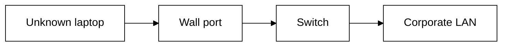

</div>

Should plugging in a cable immediately grant normal internal access?

A secure enterprise usually wants an **admission decision** first.

---

# AAA — Authentication, Authorization, Accounting

Every access-control system rests on three pillars:

- **Authentication** — _Who are you?_ (credentials, certificates, tokens)
- **Authorization** — _What are you allowed to do?_ (VLAN, ACL, role)
- **Accounting** — _What did you do?_ (session logs, traffic records)

NAC closes that gap by adding **authentication** before granting access.

---

# Why authentication matters

Without authentication, authorization is based on **physical location** or **MAC address** — both easily spoofed.

```text
Port Fa0/1 → VLAN 10   ← anyone who plugs in gets VLAN 10
MAC aa:bb:cc → allow     ← trivially spoofable
```

Authentication ties access to a **verified identity**, making authorization decisions meaningful.

---

# NAC as a decision point

<div style="transform: scale(0.8); transform-origin: top center;">

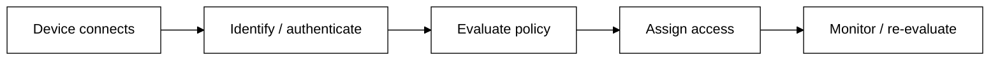

</div>

NAC combines identity, network control, and policy.

---

# Three 802.1X roles

<div style="transform: scale(0.8); transform-origin: top center;">

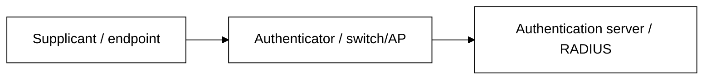

</div>

---

# NAC state machine

<div style="transform: scale(0.8); transform-origin: top center;">

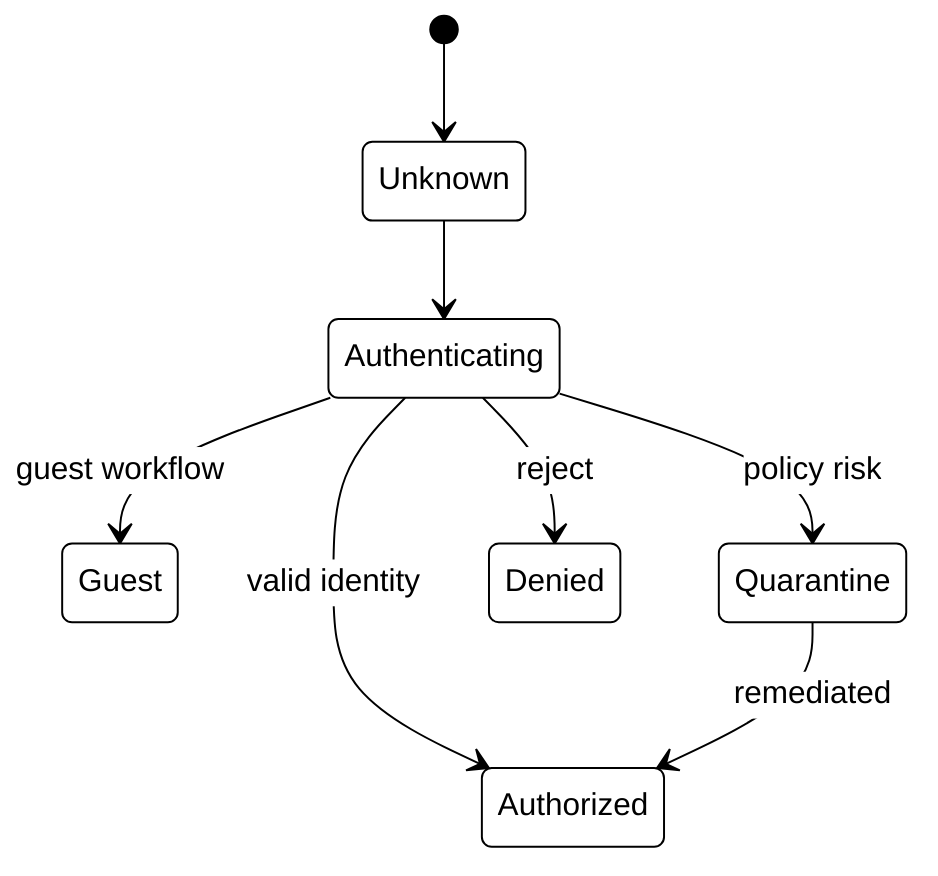

</div>

---

# Supplicant

The supplicant is the endpoint component that participates in authentication.

Examples:

- operating-system 802.1X client;
- managed laptop agent;
- Wi-Fi supplicant.

It presents credentials or participates in a certificate-based exchange.

---

# Linux as a supplicant — `wpa_supplicant`

On Linux, `wpa_supplicant` handles both Wi-Fi and wired 802.1X.

Minimal wired configuration (`/etc/wpa_supplicant/wpa_supplicant-eth0.conf`):

```ini
ctrl_interface=/var/run/wpa_supplicant
ap_scan=0                          # wired, no scanning

network={
    key_mgmt=IEEE8021X
    eap=PEAP
    identity="alice@corp.com"
    password="s3cret"
    phase2="auth=MSCHAPV2"
    ca_cert="/etc/ssl/certs/corp-ca.pem"
}
```

---

# Authenticator

The switch or AP controls the edge port.

Before successful authentication, it can permit only traffic needed for the authentication process.

<div style="transform: scale(0.8); transform-origin: top center;">

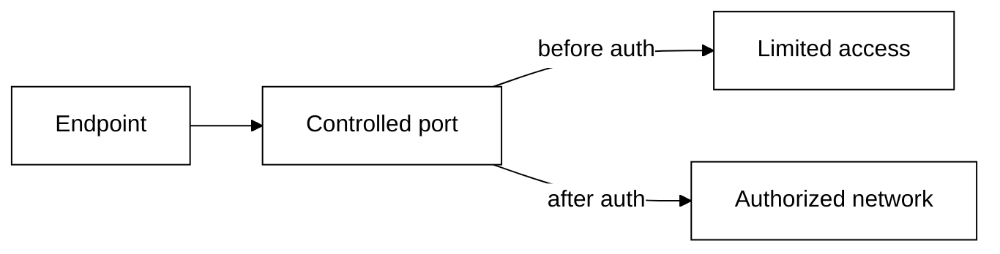

</div>

---

# 802.1X switchport host modes

The authenticator can handle multiple devices behind a port in different ways:

| Mode | Behavior | Use case |
|---|---|---|
| **Single-host** | One MAC allowed; port shuts on second | Desktops, strict security |
| **Multi-domain** | One MAC per domain (data + voice) | IP phone + PC behind it |
| **Multi-host** | First MAC authenticates; all others ride free | Legacy hubs (insecure) |
| **Multi-auth** | Each MAC authenticates independently | Conference rooms, docks |

---

# Multi-host bypass risk

In **multi-host** mode, only the first device authenticates — all subsequent devices inherit that session:

<div style="transform: scale(0.7); transform-origin: top center;">

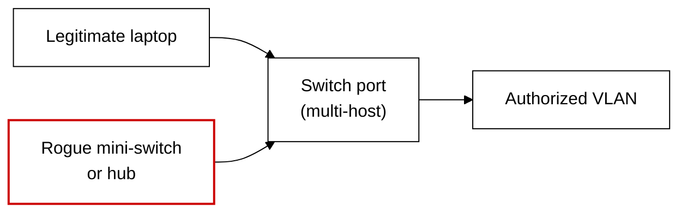

</div>

An attacker plugs a **rogue mini-switch** behind the legitimate device → gets full network access without ever authenticating.

**Mitigation:** use **multi-auth** mode (each MAC authenticates) or limit MACs per port. Never use multi-host in security-sensitive environments.

---

# Bait-and-switch attack

Even in **single-host** or **multi-auth** mode, an attacker can exploit the gap between authentication and ongoing traffic:

<div style="transform: scale(0.6); transform-origin: top center;">

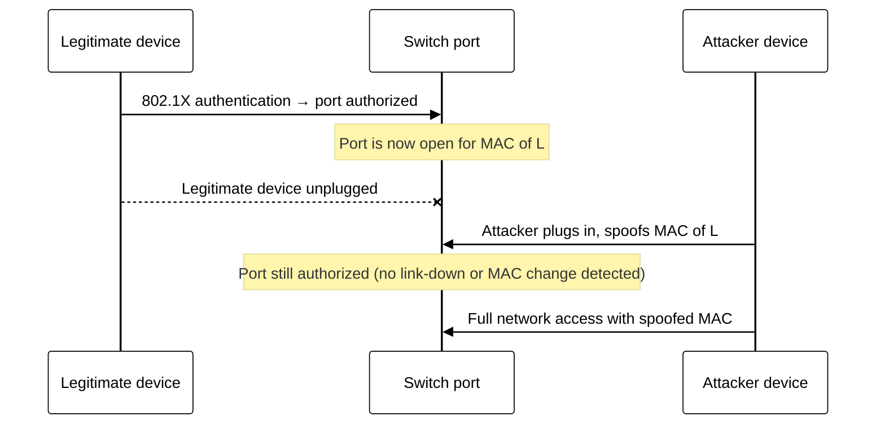

</div>

**Mitigations:**

- Enable **link-down re-authentication** — port reverts to unauthorized on link-loss
- Use **MACsec (802.1AE)** — cryptographic session binding, not just MAC-based
- Enable **802.1X re-authentication timers** — periodic re-auth catches stale sessions

---

# Authentication server

The authentication server evaluates the supplied identity and returns a result.

Often:

- RADIUS server;
- backed by local users, LDAP, certificates, or identity infrastructure.

The network device does not need to store every enterprise credential. But it might.

---

# 802.1X message path

<div style="transform: scale(0.8); transform-origin: top center;">

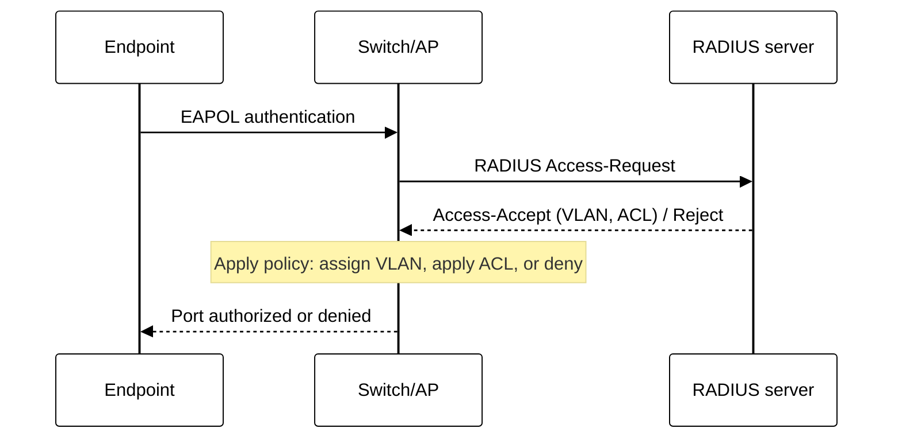

</div>

---

# Dynamic VLAN assignment

The physical socket no longer defines the full trust level.

<div style="transform: scale(0.7); transform-origin: top center;">

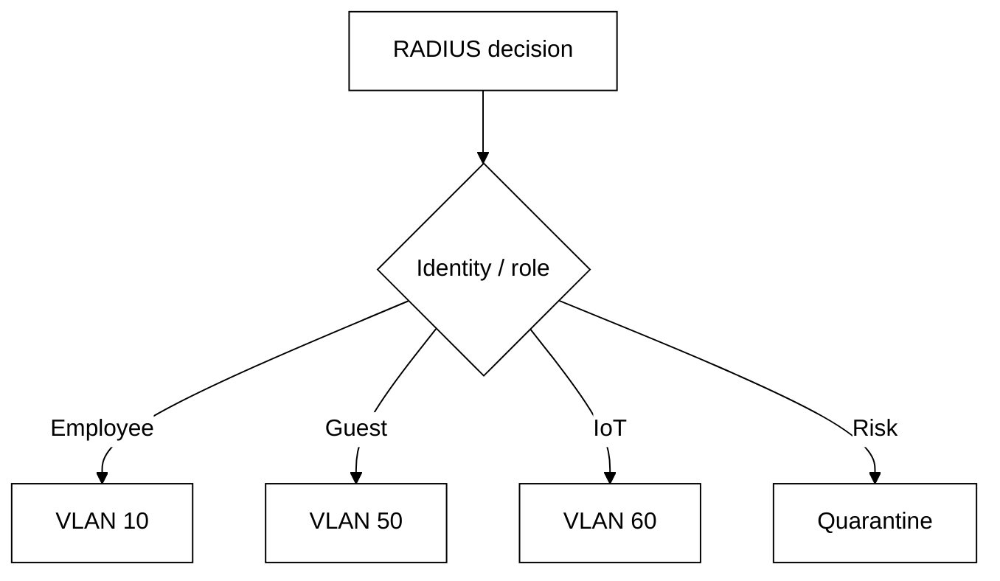
</div>

---

# RADIUS: Remote Access Dial In User Service

RADIUS provides AAA-related messages between the network access device and the authentication server.
- request;
- accept/reject/challenge;
- attributes;
- accounting.

---

# RADIUS message types

RADIUS uses a simple request/response model over **UDP** (ports 1812/1813).

Four core authentication messages:

| Message | Direction | Purpose |
|---|---|---|
| **Access-Request** | NAS → RADIUS | Carries user credentials |
| **Access-Accept** | RADIUS → NAS | Authentication succeeded, may include authorization attributes |
| **Access-Reject** | RADIUS → NAS | Authentication failed |
| **Access-Challenge** | RADIUS → NAS | Server needs more information (e.g. next EAP round) |

NAS = Network Access Server (the switch or AP).

---

# RADIUS Access-Request

The NAS sends an Access-Request when a user/device attempts to authenticate.

Typical attributes included:

```text
User-Name         = "alice@corp.com"
NAS-IP-Address    = 10.0.1.1
NAS-Port          = 15
NAS-Port-Type     = Ethernet
Calling-Station-Id = AA:BB:CC:DD:EE:FF   ← client MAC
Called-Station-Id  = 11:22:33:44:55:66   ← switch port MAC
EAP-Message       = <EAP payload>
```

The password (if used) is encrypted with the shared secret + authenticator.

---

# RADIUS Access-Accept

On successful authentication, the server returns attributes that **drive authorization**:

```text
Access-Accept
  Tunnel-Type           = VLAN
  Tunnel-Medium-Type    = IEEE-802
  Tunnel-Private-Group-Id = 10         ← assigned VLAN
  Filter-Id             = "employee"   ← downloadable ACL
  Session-Timeout       = 3600         ← re-auth after 1 hour
```

The NAS applies these attributes to configure the port — this is where **authentication becomes authorization**.

---

# Quarantine network — RADIUS in action

The same RADIUS attributes can place a risky endpoint into quarantine:

```text
Access-Accept
  Tunnel-Private-Group-Id = 999       ← quarantine VLAN
  Filter-Id             = "quarantine" ← restrictive ACL
```

<div style="transform: scale(0.8); transform-origin: top center;">

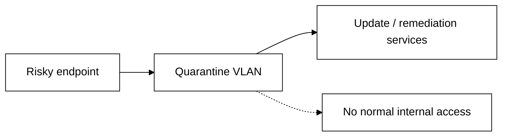

</div>

---

# RADIUS attributes

Attributes can carry policy information such as:

- VLAN assignment;
- user role;
- session timeout;
- access restrictions;
- accounting identifiers.

This is how an identity decision becomes a network configuration decision.

---

# RADIUS Access-Reject

**Access-Reject:**
- Sent when credentials are invalid or policy denies access.
- May include a `Reply-Message` with a human-readable reason.

---

# RADIUS Access-Challenge

**Access-Challenge:**
- Used during **multi-round exchanges** (e.g. EAP-TLS handshake).
- Contains an `EAP-Message` with the next step of the authentication.

<div style="transform: scale(0.5); transform-origin: top center;">

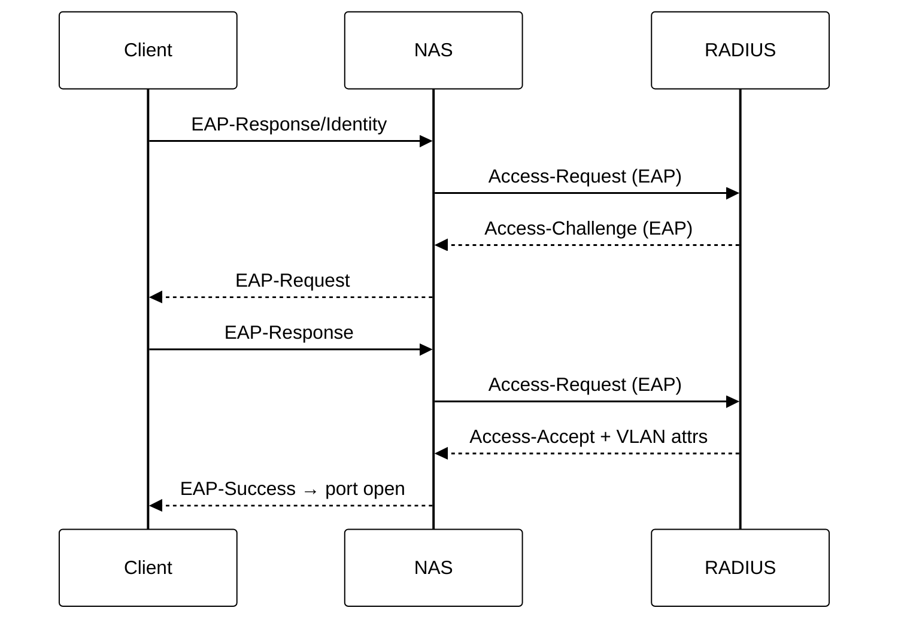

</div>

---

# RADIUS Accounting

Separate from authentication, RADIUS accounting tracks **session lifecycle** (UDP port 1813).

| Message | When sent |
|---|---|
| **Accounting-Request (Start)** | Session begins |
| **Accounting-Request (Interim)** | Periodic update |
| **Accounting-Request (Stop)** | Session ends |
| **Accounting-Response** | Server acknowledges |

Accounting records include: session duration, bytes in/out, termination cause.

This is the **third A** — essential for audit trails and compliance.

---

# RADIUS Dynamic Authorization (RFC 5176)

Traditional RADIUS is **NAS-initiated** — the server only responds to requests.

RFC 5176 (obsoleting RFC 3576) **inverts the direction**: the AAA server sends unsolicited messages to the NAS on **UDP port 3799**.

Two new message types:

| Message | Purpose |
|---|---|
| **Disconnect-Request (DM)** | Immediately terminate a user session |
| **Change-of-Authorization (CoA)** | Modify an active session's attributes (VLAN, ACL, role) in real-time |

---

# CoA in practice

<div style="transform: scale(0.65); transform-origin: top center;">

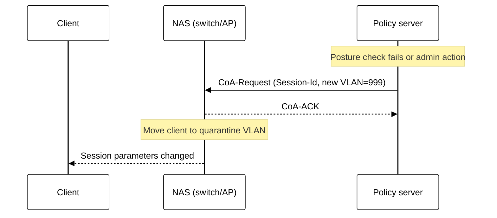

</div>

Use cases:

- **Quarantine on demand** — move an infected endpoint without re-authentication
- **Privilege escalation** — upgrade a user's VLAN after posture passes
- **Administrative disconnect** — force a rogue device off the network immediately

Without RFC 5176, policy changes only take effect at the next re-authentication.

---

# RADIUS cryptographic weakness — MD5

RADIUS (RFC 2865, designed in 1997) protects responses with a 16-byte **Response Authenticator**:

$$\text{ResponseAuth} = \text{MD5}(\text{Code} \| \text{ID} \| \text{Length} \| \text{RequestAuth} \| \text{Attributes} \| \text{SharedSecret})$$

The User-Password attribute is also obscured using MD5:

$$\text{cipher} = \text{password} \oplus \text{MD5}(\text{SharedSecret} \| \text{RequestAuth})$$

**MD5 has been cryptographically broken since 2004** — chosen-prefix collisions can be computed in seconds on modern hardware.

---

# Blast-RADIUS (CVE-2024-3596)

Disclosed July 2024, **CVSS 9.0** — a fundamental protocol-level spoofing attack on RFC 2865.
The attacker **does not need** the shared secret or user credentials — only an on-path position between NAS and RADIUS server.

<div style="transform: scale(0.8); transform-origin: top center;">

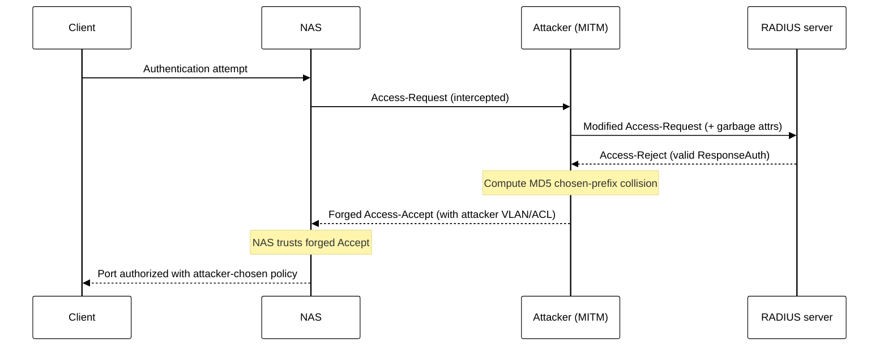

</div>

> DeKok, A. et al., *"RADIUS/UDP considered harmful"*, USENIX Security 2024.

---

# Blast-RADIUS — what is and isn't vulnerable

**Protected by Message-Authenticator (Attribute 80):**

RFC 3579 mandates `Message-Authenticator` (HMAC-MD5) whenever `EAP-Message` is present. Because HMAC-MD5 remains secure even when MD5 collision resistance is broken, **pure 802.1X EAP flows are immune** to Blast-RADIUS on compliant implementations.

**Vulnerable (no mandatory Message-Authenticator):**

- **MAB** — MAC sent as PAP/CHAP username/password, no EAP → no Message-Authenticator
- **Administrative RADIUS** — CLI login to switches, routers, firewalls over UDP
- **VPN RADIUS** — legacy VPN concentrators using PAP/CHAP

**Fix:** both NAS firmware and RADIUS server must be patched to **require and validate Message-Authenticator on every request and response**, regardless of EAP presence.

---

# RADIUS over TLS — RadSec (RFC 6614)

The definitive fix: encrypt the entire RADIUS control plane.

| | RADIUS/UDP | RadSec (RADIUS/TLS) | RADIUS/DTLS |
|---|---|---|---|
| Transport | UDP 1812/1813 | **TCP 2083** | **UDP 2083** |
| Encryption | None (shared secret only) | **TLS 1.2/1.3** | **DTLS 1.2** |
| Auth integrity | MD5 Response Authenticator | TLS record MAC | DTLS record MAC |
| Metadata exposure | NAS-IP, User-Name visible | Fully encrypted | Fully encrypted |
| Spoofing risk | Blast-RADIUS | Eliminated | Eliminated |

RadSec uses **mutual TLS** (client and server certificates) — the shared secret becomes a formality (`radsec`).

**Recommendation:** migrate all RADIUS infrastructure to RadSec; where not possible, enforce Message-Authenticator on all flows.

---

# EAP: Extensible Authentication Protocol

802.1X transports EAP methods.

Different EAP methods authenticate in different ways.

- password or certificate
- server authenticated
- endpoint authenticated
- are credentials exposed to an untrusted intermediary

---

# EAP packet format

```text
 0                   1                   2                   3
 0 1 2 3 4 5 6 7 8 9 0 1 2 3 4 5 6 7 8 9 0 1 2 3 4 5 6 7 8 9 0 1
+-+-+-+-+-+-+-+-+-+-+-+-+-+-+-+-+-+-+-+-+-+-+-+-+-+-+-+-+-+-+-+-+
|     Code      |  Identifier   |            Length             |
+-+-+-+-+-+-+-+-+-+-+-+-+-+-+-+-+-+-+-+-+-+-+-+-+-+-+-+-+-+-+-+-+
|     Type      |  Type-Data ...
+-+-+-+-+-+-+-+-+-+-+-+-+-+-+-+-+
```

- **Code** — 1 = Request, 2 = Response, 3 = Success, 4 = Failure
- **Identifier** — matches requests to responses
- **Type** — which EAP method (only in Request/Response)

EAP is carried inside EAPOL (802.1X) on the LAN and inside RADIUS between the NAS and the server.

---

# EAP message codes

| Code | Name | Purpose |
|---|---|---|
| 1 | **Request** | Authenticator asks client for information |
| 2 | **Response** | Client provides requested information |
| 3 | **Success** | Authentication succeeded (no type/data) |
| 4 | **Failure** | Authentication failed (no type/data) |

Only the **authenticator** (or RADIUS server) sends Requests; only the **supplicant** sends Responses.

Success and Failure are single-packet notifications — they carry no EAP type field.

---

# Common EAP methods

| Method | Client credential | Server credential | Inner tunnel | Security |
|---|---|---|---|---|
| **EAP-TLS** | Client certificate | Server certificate | — | Strongest (mutual TLS) |
| **PEAP (MSCHAPv2)** | Username/password | Server certificate | TLS tunnel | Common in Windows |
| **EAP-TEAP** | Certificate + password | Server certificate | TLS tunnel | Chained auth (RFC 7170) |

**EAP-TLS** is the gold standard — no passwords to steal or phish.

---

# The problem with PEAP-MSCHAPv2

MSCHAPv2 relies on password hashing **cryptographically equivalent to NTLMv1** — a captured challenge-response pair can be cracked offline with near-100% success.

PEAP wraps MSCHAPv2 inside a TLS tunnel, but this only protects credentials if the supplicant **strictly validates** the RADIUS server certificate:

- ✓ Validates full X.509 chain against `ca_cert`
- ✓ Checks **Server Authentication** EKU (OID 1.3.6.1.5.5.7.3.1)
- ✓ Verifies server hostname / SAN matches expected value

If server validation is **optional or bypassed** (user clicks "Accept" on an unknown cert), an **Evil Twin AP** with a rogue RADIUS server can harvest MSCHAPv2 credentials before mutual authentication occurs.

---

# Evil Twin + PEAP credential theft

<div style="transform: scale(0.55); transform-origin: top center;">

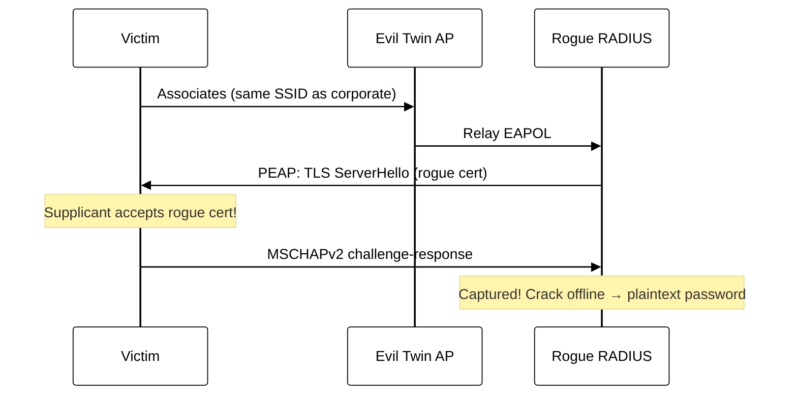

</div>

**Mitigation:** enforce `ca_cert` validation in all supplicant profiles; pin the expected server name. Better: migrate to **EAP-TLS** (no password to steal).

---

# MSCHAPv2 end-of-life — Windows Credential Guard

Starting with **Windows 11 Enterprise 22H2**, Microsoft enables **Credential Guard** by default.

Credential Guard uses virtualization-based security (VBS) to isolate NTLM hashes from the OS, which **breaks** `UseWinLogonCredentials` SSO with EAP-MSCHAPv2.

Enterprises must migrate to:

- **EAP-TLS** (client certificates, including EAP-TLS 1.3 per RFC 9190)
- **EAP-TEAP** with chained EAP-TLS (machine + user certs)
- **EAP-GTC** paired with OTP token servers (no NTLM dependency)

Also note: if a NAS permits the same EAP method both tunneled (PEAP-EAP-TLS) and un-tunneled (EAP-TLS), an attacker can force a **tunnel downgrade** exposing the exchange outside the TLS wrapper. Always disable un-tunneled variants of inner methods.

---

# EAP-TEAP — chained authentication (RFC 7170)

Key capability: **EAP chaining** — a single TLS tunnel carries **both** machine and user authentication sequentially.

<div style="transform: scale(0.6); transform-origin: top center;">

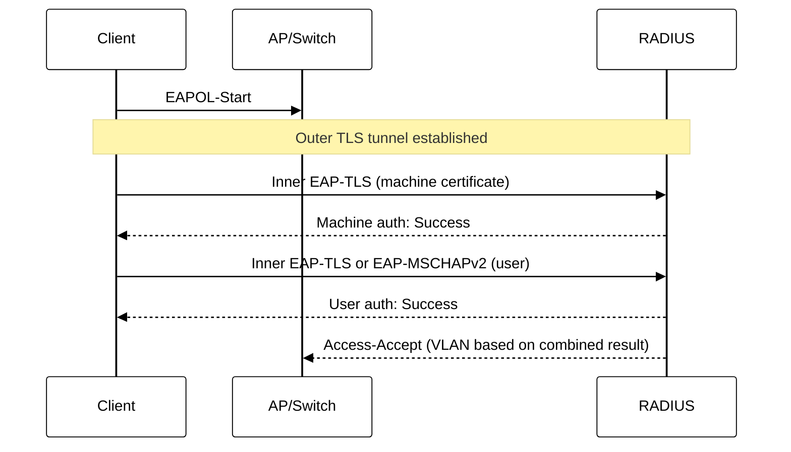

</div>

---

# EAP-TEAP — graduated policy

TEAP's chained result enables graduated access decisions:

| Machine auth | User auth | Policy outcome |
|---|---|---|
| ✓ (cert valid) | ✓ (user logged in) | Full production VLAN |
| ✓ (cert valid) | ✗ (pre-login) | Restricted VLAN (AD/SCCM only) |
| ✗ (unknown device) | ✓ (valid user) | BYOD VLAN (limited access) |
| ✗ | ✗ | Guest or denied |

This directly implements the graduated policy from our earlier slides — the NAC server makes a **composite decision** from both identity factors.

Supported in: Windows 10 (2004+), Windows 11, Windows Server 2022, Cisco ISE 2.7+, FreeRADIUS 3.2+.

---

# Failure: certificate expired

<div style="transform: scale(0.8); transform-origin: top center;">

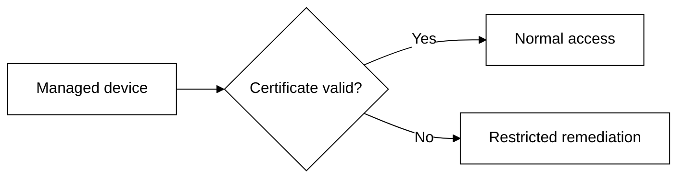

</div>

A strong identity system still needs lifecycle management.

---

# Certificate enrollment at scale

For EAP-TLS, every endpoint needs a certificate. How?

| Platform | Enrollment method | Protocol |
|---|---|---|
| AD-joined Windows | Group Policy auto-enrollment | AD CS (DCOM/RPC) |
| macOS, iOS, Android | MDM/UEM push profile | **SCEP** or **EST** |
| Linux, IoT, AGVs | MDM agent or manual | **EST** (RFC 7030) |
| Cloud-only (Entra ID) | Intune SCEP/PKCS profile | SCEP via NDES or EST |

---

# SCEP vs EST

- **SCEP** — Simple Certificate Enrollment Protocol
- **EST** — Enrollment over Secure Transport (RFC 7030)

| | SCEP (legacy) | EST (RFC 7030) |
|---|---|---|
| Transport | HTTP + CMS/PKCS#7 | **HTTPS (mutual TLS)** |
| Authentication | Static challenge password | TLS client cert or HTTP auth |
| Proof of possession | Limited | **Cryptographic PoP** |
| Renewal | Manual re-enrollment | **Automated re-enrollment** |
| Key types | RSA only (typically) | RSA + **ECDSA/EdDSA** |
| Security | Challenge password often shared | Per-request authentication |

Modern deployments should prefer **EST** — SCEP's static challenge passwords via NDES are a significant security risk.

---

# EAPOL — EAP over LAN

Between the supplicant and the authenticator, EAP rides inside **EAPOL** (IEEE 802.1X) frames:

```text
Destination MAC: 01:80:C2:00:00:03  (PAE group address)
EtherType:       0x888E             (802.1X)
EAPOL Version:   2
EAPOL Type:      0 = EAP-Packet
                 1 = EAPOL-Start
                 2 = EAPOL-Logoff
                 3 = EAPOL-Key (4-way handshake)
Body:            <EAP packet>
```

- **EAPOL-Start** — supplicant announces it wants to authenticate
- **EAPOL-Logoff** — supplicant disconnects cleanly
- **EAPOL-Key** — carries the WPA/WPA2 4-way handshake after EAP succeeds

---

# The IoT problem

Many devices cannot run a normal 802.1X supplicant:

- printers;
- cameras;
- badge readers;
- building systems;
- embedded appliances.

NAC still needs a way to classify them.

---

# MAC Authentication Bypass

<div style="transform: scale(0.8); transform-origin: top center;">

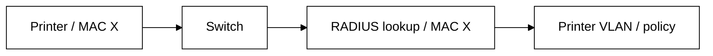

</div>

MAB improves manageability, but the MAC address remains spoofable.

---

# Guest access

<div style="transform: scale(0.8); transform-origin: top center;">

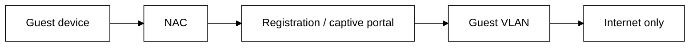

</div>

Guest access should not imply internal trust.

---

# Captive portal limitations

A captive portal is useful for:

- registration;
- terms of use;
- simple guest onboarding.

It is not strong endpoint security by itself.

Modern HTTPS behavior can also make interception-based portal workflows awkward.

---

# Posture assessment

A NAC solution may consider signals such as:

- OS version;
- device enrollment;
- endpoint agent state;
- certificate status;
- vulnerability or compliance signals.

Be cautious: posture checks add complexity and can become brittle.

---

# Policy should match risk

Do not make every condition binary.

Possible policy outcomes:

```text
trusted        -> normal
partially known -> restricted
unknown        -> guest
high risk       -> quarantine
denied          -> no access
```

Graduated access can improve usability and resilience.

---

# Wired NAC

<div style="transform: scale(0.8); transform-origin: top center;">

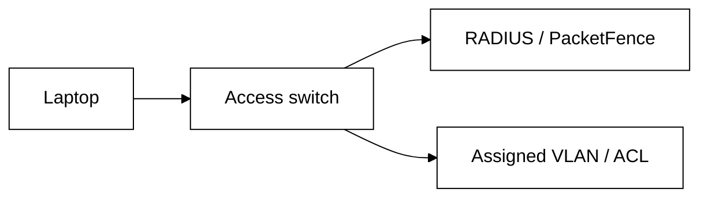

</div>

The switch is the enforcement point.

---

# Wireless NAC

<div style="transform: scale(0.8); transform-origin: top center;">

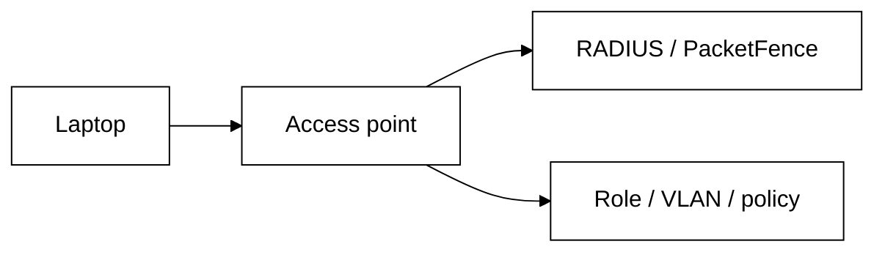

</div>

The same AAA concepts can apply even though the access medium changes.

---

# From NAC to wireless security

NAC provides **authentication** — we've now covered who gets onto the network.

For **authorization**, an AP enforces VLANs and ACLs just like a switch does.

But wireless adds a third requirement: **encryption**.

On a wired network, an attacker must physically tap the cable — MACsec (802.1AE) exists but is rarely deployed.

On a wireless network, **anyone in range** can passively capture every frame. Without encryption, authentication and authorization are meaningless — an attacker simply sniffs the traffic after the legitimate user is admitted.

Wireless security = **authentication + authorization + encryption**.

---

# The wireless threat model

The wireless medium is **inherently shared** — anyone within range can:

- capture frames (passive eavesdropping);
- inject frames (deauthentication, evil twin);
- attempt to associate with the AP;
- perform man-in-the-middle by positioning between client and AP.

No physical access to infrastructure is required — the parking lot is enough.

---

# 802.11 frame structure — three MAC addresses

Unlike Ethernet (2 MACs), an 802.11 data frame carries **three** (or four) MAC addresses:

```text
┌──────────┬──────────┬──────────┬──────────┬─────────┐
│ Frame    │ Address 1│ Address 2│ Address 3│ Seq     │
│ Control  │ (RA)     │ (TA)     │ (DA/SA)  │ Control │
└──────────┴──────────┴──────────┴──────────┴─────────┘
```

| Field | To AP (client → AP) | From AP (AP → client) |
|---|---|---|
| **Address 1** (Receiver) | BSSID (AP MAC) | Client MAC |
| **Address 2** (Transmitter) | Client MAC | BSSID (AP MAC) |
| **Address 3** | Destination (e.g. gateway) | Source (e.g. server) |

Address 4 appears only in WDS (AP-to-AP bridging).

---

# SSID and BSS

- **SSID** (Service Set Identifier) — the human-readable network name (up to 32 bytes)
- **BSSID** — the AP's MAC address (identifies a specific radio cell)
- **BSS** (Basic Service Set) — one AP and its associated clients
- **ESS** (Extended Service Set) — multiple APs sharing the same SSID for roaming

```text
SSID: "CorpWiFi"
  ├── BSS 1: AP-A (BSSID aa:bb:cc:00:00:01) — Floor 1
  ├── BSS 2: AP-B (BSSID aa:bb:cc:00:00:02) — Floor 2
  └── BSS 3: AP-C (BSSID aa:bb:cc:00:00:03) — Floor 3
```

Clients roam between BSSIDs within the same ESS transparently.

---

# Association and authentication flow

<div style="transform: scale(0.6); transform-origin: top center;">

```mermaid
%%{init: {'theme': 'base', 'themeVariables': {'primaryColor': '#ffffff', 'primaryBorderColor': '#000000', 'primaryTextColor': '#000000', 'lineColor': '#000000'}}}%%
sequenceDiagram
  participant C as Client
  participant A as AP
  C->>A: Probe Request (looking for SSID)
  A-->>C: Probe Response (capabilities)
  C->>A: Authentication Request (Open System)
  A-->>C: Authentication Response
  C->>A: Association Request
  A-->>C: Association Response
  Note over C,A: 802.1X / EAP exchange (if WPA-Enterprise)
  Note over C,A: 4-way handshake (key derivation)
  Note over C,A: Encrypted data exchange
```

</div>

Open System Authentication is a legacy formality — real security comes from 802.1X and the 4-way handshake.

---

# Wireless security evolution

| Standard | Year | Cipher | Key management | Status |
|---|---|---|---|---|
| **Open** | 1997 | None | None | Insecure |
| **OWE** | 2018 | AES-CCMP | Unauthenticated DH | Guest encryption |
| **WEP** | 1999 | RC4 | Static shared key | **Broken** |
| **WPA** | 2003 | RC4-TKIP | PSK or 802.1X | Deprecated |
| **WPA2** | 2004 | AES-CCMP | PSK or 802.1X | Baseline |
| **WPA3** | 2018 | AES-CCMP / GCMP-256 | SAE or 802.1X | Current |

Each generation addressed specific failures in the previous one.

---

# Open wireless — no security (1997)

The original 802.11 standard offered an **Open System Authentication** mode with **no encryption**:

- Client sends an Authentication Request → AP replies with Authentication Response → done
- All management and data frames travel in **cleartext**
- Anyone within range can **passively capture all traffic** (Wireshark, `tcpdump`)

Open networks are still common today: **coffee shops, airports, hotels, conference Wi-Fi**.

**Risks:**

- **Eavesdropping** — credentials, cookies, emails readable by any nearby device
- **Session hijacking** — inject or modify frames in real-time
- **Evil Twin** — attacker broadcasts the same SSID; clients auto-connect
- **Rogue AP** — no way for clients to verify AP identity

Even with HTTPS protecting application data, DNS queries, SNI headers, and traffic metadata remain visible.

---

# OWE — Opportunistic Wireless Encryption (RFC 8110)

**Problem:** Legacy Open networks (guest Wi-Fi, airport, conference) provide **zero encryption** — any guest can sniff every other guest's traffic.

A shared PSK doesn't help either — every guest with the same passphrase can derive the same PTK.

**OWE (Wi-Fi Enhanced Open)** solves this:

1. Client and AP perform an **unauthenticated Diffie-Hellman** key exchange inside the Association Request/Response frames
2. Each client gets a **unique PMK** → unique PTK → individualized AES-CCMP encryption
3. Mandatory **PMF (802.11w)** protects management frames

No passphrase, no user interaction — encryption is automatic and per-client.

---

# OWE — transition mode

For backward compatibility, an AP can advertise:

- A **visible Open BSSID** — for legacy clients (cleartext)
- A **hidden OWE BSSID** — for modern clients (encrypted)

Modern clients automatically detect and negotiate OWE; legacy clients fall back to Open.

```text
SSID: "GuestWiFi"
  ├── BSSID 1 (visible): Open       ← legacy devices
  └── BSSID 2 (hidden):  OWE        ← modern devices (auto-encrypted)
```

OWE does **not** authenticate the AP (no certificate/password) — so it does not prevent Evil Twin attacks. But it completely defeats **passive eavesdropping** on guest networks.

---

# WEP — Wired Equivalent Privacy (1999)

WEP was the original 802.11 encryption standard.

| Property | Detail |
|---|---|
| Cipher | RC4 stream cipher |
| Key length | 40-bit or 104-bit + 24-bit IV |
| IV space | 2²⁴ ≈ 16 million (reuse inevitable) |
| Integrity | CRC-32 (not cryptographic) |
| Authentication | Shared Key or Open System |

**WEP is completely broken** — tools like `aircrack-ng` can recover the key in minutes.

---

# WEP — why it fails

<div style="transform: scale(0.8); transform-origin: top center;">

```mermaid
%%{init: {'theme': 'base', 'themeVariables': {'primaryColor': '#ffffff', 'primaryBorderColor': '#000000', 'primaryTextColor': '#000000', 'lineColor': '#000000'}}}%%
flowchart LR
  IV["24-bit IV"] --> RC4["RC4(IV || Key)"]
  RC4 --> XOR["XOR with plaintext"]
  XOR --> CT["Ciphertext + IV"]
```

</div>

Key weaknesses:

- **IV reuse** — after ~5000 packets, IVs repeat → keystream reuse
- **Weak IVs** — certain IV values leak key bytes (FMS attack)
- **CRC-32** — attacker can flip bits and fix the checksum (bit-flipping attack)
- **No per-packet key mixing** — same key for all stations and all packets
- **No replay protection** — captured frames can be retransmitted

---

# WPA — Wi-Fi Protected Access (2003)

WPA was a firmware-upgradeable fix for WEP, based on a draft of 802.11i.

Key improvements over WEP:

- **TKIP** (Temporal Key Integrity Protocol) — per-packet key mixing with RC4
- **Michael MIC** — replaces CRC-32 with a real (though weak) integrity check
- **48-bit IV / sequence counter** — eliminates IV reuse and adds replay protection
- **Per-station keys** — derived via a 4-way handshake (nonce exchange, **not** Diffie-Hellman — both sides already share the PMK)

Two modes:

- **WPA-Personal (PSK)** — pre-shared key, all users share one passphrase
- **WPA-Enterprise (802.1X)** — per-user authentication via RADIUS/EAP

---

# WPA — TKIP key hierarchy

<div style="transform: scale(0.6); transform-origin: top center;">

```mermaid
%%{init: {'theme': 'base', 'themeVariables': {'primaryColor': '#ffffff', 'primaryBorderColor': '#000000', 'primaryTextColor': '#000000', 'lineColor': '#000000'}}}%%
flowchart TB
  PSK["Passphrase / PSK"] --> PMK["Pairwise Master Key (PMK)"]
  PMK --> FOUR["4-Way Handshake"]
  FOUR --> PTK["Pairwise Transient Key (PTK)"]
  PTK --> TK["Temporal Key (per-packet encryption)"]
  PTK --> MIC["MIC Key (integrity)"]
  PMK --> GTK["Group Temporal Key (broadcast)"]
```

</div>

TKIP still uses RC4 internally, so it was always intended as a **transitional** solution.

---

# WPA/WPA2-Enterprise — key derivation via 802.1X

In Enterprise mode there is **no shared passphrase**. The PMK is derived from the EAP exchange:

<div style="transform: scale(0.4); transform-origin: top center;">

```mermaid
%%{init: {'theme': 'base', 'themeVariables': {'primaryColor': '#ffffff', 'primaryBorderColor': '#000000', 'primaryTextColor': '#000000', 'lineColor': '#000000'}}}%%
flowchart TB
  EAP["802.1X / EAP authentication"] --> MSK["Master Session Key (MSK)\n(generated by RADIUS)"]
  MSK --> SEND["RADIUS sends MSK to AP\n(inside Access-Accept, encrypted)"]
  SEND --> PMK["PMK = first 256 bits of MSK"]
  PMK --> FOUR["4-Way Handshake\n(same as PSK mode)"]
  FOUR --> PTK["Pairwise Transient Key (PTK)"]
  PTK --> TK["Temporal Key"]
  PTK --> MIC["MIC Key"]
  PMK --> GTK["Group Temporal Key (broadcast)"]
```

</div>

Each user gets a **unique PMK per session** — compromising one user doesn't expose others.

---

# WPA2 — 802.11i (2004)

WPA2 implemented the full 802.11i standard with a modern cipher.

| Property | Detail |
|---|---|
| Cipher | **AES-CCMP** (128-bit AES in Counter-with-CBC-MAC mode) |
| Integrity | CCMP provides authenticated encryption |
| Key derivation | Same 4-way handshake as WPA |
| Replay protection | Packet sequence number |

Two modes, same as WPA.

---

# The 4-way handshake

<div style="transform: scale(0.7); transform-origin: top center;">

```mermaid
%%{init: {'theme': 'base', 'themeVariables': {'primaryColor': '#ffffff', 'primaryBorderColor': '#000000', 'primaryTextColor': '#000000', 'lineColor': '#000000'}}}%%
sequenceDiagram
  participant C as Client (Supplicant)
  participant A as AP (Authenticator)
  Note over C,A: Both know PMK (from PSK or 802.1X)
  A->>C: Message 1: ANonce
  C->>A: Message 2: SNonce + MIC
  Note over C,A: Both derive PTK = f(PMK, ANonce, SNonce, MACs)
  A->>C: Message 3: GTK (encrypted) + MIC
  C->>A: Message 4: ACK
  Note over C,A: Encrypted data exchange begins
```

</div>

The handshake proves both sides know the PMK **without transmitting it**.

---

# WPA2-PSK attack — offline dictionary

<div style="transform: scale(0.8); transform-origin: top center;">

```mermaid
%%{init: {'theme': 'base', 'themeVariables': {'primaryColor': '#ffffff', 'primaryBorderColor': '#000000', 'primaryTextColor': '#000000', 'lineColor': '#000000'}}}%%
flowchart LR
  CAP["Capture 4-way handshake"] --> DICT["Try passphrase"]
  DICT --> PMK["Derive PMK = PBKDF2(passphrase, SSID)"]
  PMK --> PTK["Derive PTK with captured nonces"]
  PTK --> VER{"MIC matches?"}
  VER -->|No| DICT
  VER -->|Yes| KEY["Passphrase found"]
```

</div>

- Attacker only needs **one captured handshake** (or can force it with deauth)
- PBKDF2 with 4096 iterations is slow — but GPUs can try millions per second
- **Weak passphrases are cracked in seconds**; strong random keys resist this

> Halvorsen, F.M. and Haugen, O., *"Cryptanalysis of IEEE 802.11i TKIP"*, Master's thesis, NTNU, 2009.
>
> Vanhoef, M. and Piessens, F., *"Predicting, Decrypting, and Abusing WPA2/802.11 Group Keys"*, USENIX Security 2016.

---

# PMKID clientless attack (2018)

Discovered by Jens Steube (hashcat), **no client needed, no deauthentication frames**.

The attacker sends a normal association request to the AP. The AP responds with EAPOL-Key Message 1 containing the **PMKID** in the RSN IE:

$$\text{PMK} = \text{PBKDF2-HMAC-SHA1}(\text{passphrase},\ \text{SSID},\ 4096,\ 32)$$

$$\text{PMKID} = \text{HMAC-SHA1-128}(\text{PMK},\ \texttt{"PMK Name"} \| \text{MAC}_\text{AP} \| \text{MAC}_\text{STA})$$

The attacker captures this single frame (< 5 minutes) and runs an offline dictionary attack at the same speed as a traditional 4-way handshake crack.

---

# PMKID — why it evades detection

Traditional handshake capture requires **deauthentication floods** → conspicuous WIDS signature.

PMKID capture consists of **one association request + timeout** — indistinguishable from a passerby's phone trying a stale password.

```text
Traditional:  deauth flood → capture 4-way → crack MIC
                ↑ WIDS alert

PMKID:        single assoc request → capture PMKID → crack HMAC-SHA1
                ↑ looks like normal probe
```

Tools: `hcxdumptool`, `hcxpcapngtool`, `hashcat` mode 22000.

GPU throughput: ~1.6M candidates/sec on an NVIDIA RTX 4090.

---

# PTK decomposition — the full picture

The 512-bit Pairwise Transient Key (PTK) in WPA2-CCMP consists of **three** distinct sub-keys:

```text
PTK (512 bits) = KCK (128) | KEK (128) | TK (128) | [TX/RX MIC keys]

PRF-512(PMK, "Pairwise key expansion",
        min(MAC_AP, MAC_STA) || max(MAC_AP, MAC_STA) ||
        min(ANonce, SNonce) || max(ANonce, SNonce))
```

| Sub-key | Bits | Purpose |
|---|---|---|
| **KCK** (Key Confirmation Key) | 128 | HMAC-SHA1 MIC on EAPOL Messages 2, 3, 4 |
| **KEK** (Key Encryption Key) | 128 | AES-wrap the GTK inside Message 3 |
| **TK** (Temporal Key) | 128 | AES-CCMP encryption of unicast data |

The **Group Temporal Key (GTK)** is delivered via Message 3, encrypted with KEK. GTK is rotated periodically via a separate 2-Way Group Key Handshake.

---

# WPA2 — KRACK attack (2017)

**Key Reinstallation Attack** — exploits the 4-way handshake state machine:

1. Attacker performs a man-in-the-middle between client and AP
2. Blocks delivery of **Message 4** → AP retransmits **Message 3**
3. Client reinstalls the already-in-use PTK, **resetting the nonce counter**
4. Nonce reuse with AES-CCMP allows:
   - packet decryption (known-plaintext XOR)
   - frame injection (on Linux/Android with `wpa_supplicant` 2.4+: the key was zeroed out entirely)

**Fix:** clients must not reinstall an already-active key when receiving a retransmitted Message 3. This is a **client-side software patch** — the protocol itself remains sound when implemented correctly. All major OS vendors released patches in late 2017.

> Vanhoef, M. and Piessens, F., *"Key Reinstallation Attacks: Forcing Nonce Reuse in WPA2"*, ACM CCS 2017.

---

# WPA2 — deauthentication attack

In WPA2 (without PMF), management frames are **unprotected**. An attacker can forge deauthentication frames:

<div style="transform: scale(0.7); transform-origin: top center;">

```mermaid
%%{init: {'theme': 'base', 'themeVariables': {'primaryColor': '#ffffff', 'primaryBorderColor': '#000000', 'primaryTextColor': '#000000', 'lineColor': '#000000'}}}%%
sequenceDiagram
  participant C as Client
  participant AP as Legitimate AP
  participant A as Attacker
  A->>C: Spoofed Deauth (src=AP MAC)
  Note over C: Client disconnects
  C->>AP: Re-association
  Note over A: Capture 4-way handshake
  A->>C: Spoofed Deauth (continuous)
  Note over C: Denial of Service
```

</div>

Two attack goals:

1. **Capture handshakes** — force re-authentication to obtain the 4-way handshake for offline cracking
2. **Denial of Service** — continuously disconnect clients from the network

Tools like `aireplay-ng --deauth` automate this trivially. **PMF (802.11w)** is the fix.

---

# WPA2-Enterprise vs WPA2-Personal

| | WPA2-Personal (PSK) | WPA2-Enterprise (802.1X) |
|---|---|---|
| Credential | Shared passphrase | Per-user (username/cert) |
| Key derivation | PSK → PMK | EAP → PMK per session |
| User revocation | Change PSK everywhere | Disable one account |
| Forward secrecy | No — PSK compromise decrypts past traffic | Depends on EAP method |
| Suited for | Home, small office | Enterprise, campus |

---

# WPA3 (2018)

WPA3 addresses the remaining weaknesses of WPA2:

**WPA3-Personal:**
- **SAE** (Simultaneous Authentication of Equals) replaces PSK
- Based on Dragonfly key exchange (a PAKE protocol)
- Provides **forward secrecy** — past sessions can't be decrypted if passphrase leaks
- **Resistant to offline dictionary attacks** — each guess requires an online interaction

**WPA3-Enterprise:**
- **192-bit security suite** (AES-256-GCM, SHA-384, ECDSA-384)
- Mandatory Protected Management Frames (PMF)

---

# SAE — how it works (vs PSK)

**WPA2-PSK:** Both sides already share the PMK (derived from the passphrase). The 4-way handshake only exchanges nonces for PTK. An attacker who captures the nonces can **offline-brute-force** the passphrase.

**WPA3-SAE (Dragonfly):** The passphrase is used **during** the key exchange itself — never as a static key.

<div style="transform: scale(0.4); transform-origin: top center;">

```mermaid
%%{init: {'theme': 'base', 'themeVariables': {'primaryColor': '#ffffff', 'primaryBorderColor': '#000000', 'primaryTextColor': '#000000', 'lineColor': '#000000'}}}%%
sequenceDiagram
  participant C as Client
  participant A as AP
  Note over C,A: Both derive P = password-to-element(passphrase, SSID)
  Note over C: Pick random r_C, compute scalar_C, element_C
  Note over A: Pick random r_A, compute scalar_A, element_A
  C->>A: SAE Commit: scalar_C, element_C
  A->>C: SAE Commit: scalar_A, element_A
  Note over C,A: Both compute shared secret K from peer's commit + own random
  C->>A: SAE Confirm: HMAC(K, scalars, elements)
  A->>C: SAE Confirm: HMAC(K, scalars, elements)
  Note over C,A: PMK = KDF(K) — then standard 4-way handshake for PTK
```

</div>

| | WPA2-PSK | WPA3-SAE |
|---|---|---|
| Key exchange | Passphrase → static PMK → 4-way handshake | Passphrase used in Dragonfly PAKE → ephemeral PMK → 4-way handshake |
| Offline attack | Captured handshake can be brute-forced | No material in the exchange allows offline verification |
| Forward secrecy | No — same PMK every session | Yes — random _r_ values are ephemeral per session |
| Peer relationship | Client authenticates to AP | **Equals** — both sides prove knowledge simultaneously |

---

# SAE — security properties

| Property | How SAE achieves it |
|---|---|
| **No offline dictionary attack** | Attacker cannot verify a guessed password from captured traffic — only an online attempt (which the AP rate-limits) |
| **Forward secrecy** | Random _r_ and _m_ are ephemeral per session — compromising the password later cannot decrypt past sessions |
| **Mutual authentication** | Both sides prove knowledge of the password via the confirm exchange |
| **Resistance to MITM** | An attacker without the password cannot compute the shared secret or produce a valid confirm message |

> Harkins, D., *"Simultaneous Authentication of Equals: A Secure, Password-Based Key Exchange for Mesh Networks"*, IEEE SECON 2008.

---

# Protected Management Frames (PMF / 802.11w)

Without PMF, management frames (deauth, disassoc, beacon) are **unauthenticated**:

- **Deauthentication attacks** — force clients offline
- **Evil twin APs** — impersonate a legitimate network
- **Channel-switch attacks** — move clients to a rogue AP

PMF (mandatory in WPA3) uses the station's keys to protect management frames.

It does **not** encrypt beacons (SSID is still visible), but prevents spoofed disconnects.

---

# 802.11r — Fast BSS Transition (FT)

In enterprise Wi-Fi, a client roaming between APs must re-authenticate. Without optimization, a full 802.1X + 4-way handshake takes **hundreds of milliseconds** — enough to break VoIP and video calls.

**802.11r (Fast Transition)** pre-distributes key material so roaming requires only **2 frame exchanges** (< 50 ms).

<div style="transform: scale(0.55); transform-origin: top center;">

```mermaid
%%{init: {'theme': 'base', 'themeVariables': {'primaryColor': '#ffffff', 'primaryBorderColor': '#000000', 'primaryTextColor': '#000000', 'lineColor': '#000000'}}}%%
flowchart TB
  MSK["MSK (from 802.1X)"] --> PMK_R0["PMK-R0\n(held by R0 Key Holder = home AP or controller)"]
  PMK_R0 --> PMK_R1_A["PMK-R1 for AP-A\n(R1 Key Holder)"]
  PMK_R0 --> PMK_R1_B["PMK-R1 for AP-B\n(R1 Key Holder)"]
  PMK_R0 --> PMK_R1_C["PMK-R1 for AP-C\n(R1 Key Holder)"]
  PMK_R1_A --> PTK_A["PTK (AP-A)"]
  PMK_R1_B --> PTK_B["PTK (AP-B)"]
  PMK_R1_C --> PTK_C["PTK (AP-C)"]
```

</div>

Each target AP already holds **PMK-R1** before the client roams → the client performs only a fast 2-message FT handshake to derive a new PTK.

---

# WPS — Wi-Fi Protected Setup (2006)

WPS was designed to simplify WPA/WPA2 passphrase provisioning for consumer devices:

| Method | How it works | Security |
|---|---|---|
| **Push-Button (PBC)** | Press buttons on AP + client within 2 min | Any nearby device can join during the window |
| **PIN (external)** | User enters 8-digit PIN from AP label | Reaver attack: PIN split into two halves → **11,000 guesses** (hours) |
| **PIN (internal)** | Client generates PIN, user enters on AP | Same half-PIN flaw |
| **NFC** | Tap device to AP | Rare; requires hardware support |

**Why WPS is broken:**

- The 8-digit PIN has only 7 significant digits (8th is a checksum)
- The protocol validates the first 4 and last 3 digits **separately** → $10^4 + 10^3 = 11{,}000$ attempts (not $10^7$)
- Online brute-force completes in **hours** even with rate-limiting
- Once cracked, the attacker receives the **WPA2 passphrase in cleartext**

> Viehböck, S., *"Brute forcing Wi-Fi Protected Setup"*, 2011.

WPS should be **disabled** on all enterprise and security-conscious networks.

---

# Wi-Fi Easy Connect (DPP)

**Device Provisioning Protocol** (DPP) is the Wi-Fi Alliance's cryptographic replacement for broken WPS.

Uses **public-key cryptography** to onboard headless IoT devices:

1. Manufacturer embeds a **bootstrapping public key** in a QR code (or NFC/BLE)
2. Administrator scans QR with a **configurator** (smartphone/laptop)
3. Configurator and device perform **ECDH key agreement** using bootstrapping keys
4. Configurator provisions a unique **connector credential** or certificate
5. Device joins WPA2/WPA3 network — **no shared passphrase ever exposed**

```text
IoT sensor → QR code → Admin phone → DPP provisioning → WPA3 network
                        (configurator)     (ECDH)        (unique key)
```

---

# MAB on wireless — the encryption gap

On a **wired** switchport, MAB provides authentication and VLAN assignment — the physical cable limits eavesdropping.

On **wireless**, MAB alone creates a severe problem:

- MAB authenticates at the RADIUS layer but **does not generate 802.11 encryption keys**
- An Open SSID with MAB leaves all IoT traffic unencrypted over the air
- A WPA2-PSK SSID with MAB means **every IoT device shares one static passphrase**

If a single camera is physically extracted and its flash memory dumped → the attacker recovers the PSK for the **entire IoT fleet** and can spoof any authorized MAC.

---

# Wireless IoT — iPSK / MPSK

**Identity PSK** (iPSK / MPSK / PPSK) — per-device unique passphrases on a single WPA2-PSK SSID.
Benefits: per-device encryption keys, per-device VLAN, instant credential revocation without re-keying other devices.

<div style="transform: scale(0.8); transform-origin: top center;">

```mermaid
%%{init: {'theme': 'base', 'themeVariables': {'primaryColor': '#ffffff', 'primaryBorderColor': '#000000', 'primaryTextColor': '#000000', 'lineColor': '#000000'}}}%%
sequenceDiagram
  participant D as IoT device
  participant A as AP
  participant R as RADIUS
  D->>A: Associate (WPA2-PSK SSID)
  A->>R: Access-Request (Calling-Station-Id = device MAC)
  R-->>A: Access-Accept (Tunnel-Private-Group-Id=60, Passphrase=<unique>)
  Note over A: AP uses device-specific PSK for 4-way handshake
  A->>D: 4-way handshake with unique PTK
```

</div>

---

# NAC and segmentation

NAC does not replace segmentation.

It helps decide **which segment or role** an endpoint should receive.

<div style="transform: scale(0.8); transform-origin: top center;">

```mermaid
%%{init: {'theme': 'base', 'themeVariables': {'primaryColor': '#ffffff', 'primaryBorderColor': '#000000', 'primaryTextColor': '#000000', 'lineColor': '#000000'}}}%%
flowchart LR
  ID["Identity decision"] --> SEG["Segment / role"]
  SEG --> FW["Firewall policy"]
  FW --> APP["Applications"]
```

</div>

---

# NIST SP 800-207 — Zero Trust Architecture

Zero Trust assumes **no implicit trust** based on network location — even devices inside the corporate perimeter are untrusted until verified.

**Core tenets (NIST SP 800-207, August 2020):**

1. All data sources and computing services are considered **resources**
2. All communication is secured **regardless of network location** — internal traffic is not inherently trusted
3. Access to individual resources is granted on a **per-session basis** and re-evaluated continuously
4. Access is determined by **dynamic policy** — identity, device health, behavioral patterns, environmental attributes
5. The enterprise monitors and measures the **security posture** of all owned and associated assets
6. Authentication and authorization are **strictly enforced before access** is allowed

**Key abstraction — the control loop:**

Every access request passes through a **Policy Decision Point (PDP)** that evaluates trust, and a **Policy Enforcement Point (PEP)** that gates the resource. NAC maps directly to this model: the RADIUS/ISE server is the PDP; the switch or AP is the PEP.

> Rose, S. et al., *"Zero Trust Architecture"*, NIST SP 800-207, August 2020.

---

# NAC and Zero Trust — the tension

NAC provides strong **initial access decisions**, but classical NAC has limitations from a ZTA perspective:

| ZTA tenet | NAC strength | NAC gap |
|---|---|---|
| Per-session access | ✓ 802.1X authenticates each session | Session may last hours without re-evaluation |
| Dynamic policy | ✓ CoA can change access mid-session | Requires integration with EDR/SIEM/MDM |
| No implicit trust | ✓ Port starts unauthorized | Once authorized, lateral movement within VLAN is possible |
| Continuous monitoring | Partial — accounting tracks sessions | Does not inspect application-layer behavior |
| Micro-segmentation | Partial — VLAN/ACL per user | Not per-application or per-flow granularity |

NAC is the **network-layer enforcement** in a ZTA — but it must be complemented by application-layer controls (identity-aware proxies, service mesh, micro-segmentation firewalls).

---

# MACsec / MKA (802.1AE) — continuous wired encryption

802.1X authenticates the port **once**. After that, wired traffic flows in cleartext within the VLAN.

**MACsec (802.1AE)** adds **hop-by-hop Layer 2 encryption** using AES-GCM-256:

<div style="transform: scale(0.7); transform-origin: top center;">

```mermaid
%%{init: {'theme': 'base', 'themeVariables': {'primaryColor': '#ffffff', 'primaryBorderColor': '#000000', 'primaryTextColor': '#000000', 'lineColor': '#000000'}}}%%
flowchart LR
  PC["Endpoint"] -->|"MACsec encrypted"| SW1["Switch 1"]
  SW1 -->|"MACsec encrypted"| SW2["Switch 2"]
  SW2 -->|"MACsec encrypted"| SRV["Server"]
```

</div>

**MKA** (MACsec Key Agreement, 802.1X-2010) derives encryption keys from the 802.1X session:

```text
802.1X EAP → MSK → CAK (Connectivity Association Key)
CAK → MKA protocol → SAK (Secure Association Key)
SAK → AES-GCM-256 per-frame encryption
```

MACsec provides what wireless WPA2/WPA3 provides — but for the **wired** data plane.

---

# NAC and least privilege

Instead of:

```text
Authenticated = entire internal network
```

prefer:

```text
Authenticated + role + device state
  -> only required access
```

NAC can provide context, but downstream firewalls still enforce application flows.

---

# Failure: RADIUS unavailable

What happens if the authentication service fails?

Choices may include:

- fail closed;
- fail open;
- critical VLAN;
- cached authorization.

This is an availability design decision, not merely a configuration checkbox.

---

# Profiling

NAC platforms may infer device type from behavior or metadata.

Examples:

- DHCP fingerprints;
- observed services;
- vendor OUI;
- traffic patterns.

Profiling is **probabilistic context**, not proof of identity.

---

# Common bypass attempts

| Attack | Technique | Mitigation |
|---|---|---|
| MAC spoofing | Clone an authorized MAC | 802.1X (identity-based, not MAC-based) |
| Hub/switch insertion | Plug a mini-switch after auth | Multi-auth mode, MACsec, port link-down re-auth |
| Bait-and-switch | Auth with legitimate device, swap cable | MACsec (802.1AE), link-down triggers re-auth |
| Rogue AP | Stand up a fake AP | WIDS/WIPS, 802.11w (PMF), server certificate pinning |
| VLAN hopping | Double-tag or DTP manipulation | Disable DTP, prune unused VLANs, native VLAN hardening |

---

# What NAC cannot solve

NAC does not know whether:

- an authenticated user is abusing an application;
- a permitted HTTPS request is SQL injection;
- malware runs after successful admission;
- data is being exfiltrated through an allowed service.

Admission is one control in a larger system.

---

# Final checklist

For a NAC design, ask:

- Which endpoint types exist?
- Which can support 802.1X?
- What identity sources are trusted?
- What roles are actually necessary?
- What happens to guests and unknown devices?
- What is the quarantine/remediation path?
- What happens during infrastructure failure?
- How is the assigned role enforced downstream?
