---

theme: sred-theme
title: "Network Access Control"
info: |
  Network Security Using Dedicated Devices
  Open-source teaching deck
transition: slide-left
mdc: true
---

# Network Access Control

## Deciding who gets onto the network

__Open-source lab stack:__ PacketFence, FreeRADIUS, Linux/Open vSwitch

NAC moves the question from **which port is active?** to **which user/device should receive which access?**

---

# Learning objectives

You should be able to:

- explain the 802.1X roles;
- distinguish authentication from authorization;
- explain RADIUS at a high level;
- compare 802.1X and MAC Authentication Bypass;
- design guest and quarantine flows;
- understand PacketFence as an open-source NAC platform.

---

# The basic problem

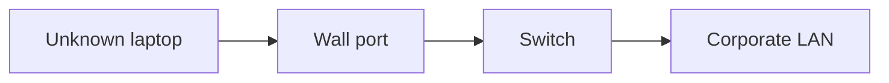

Should plugging in a cable immediately grant normal internal access?

A secure enterprise usually wants an **admission decision** first.

---

# NAC as a decision point

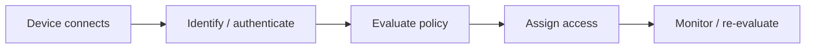

NAC combines identity, network control, and policy.

---

# Three 802.1X roles

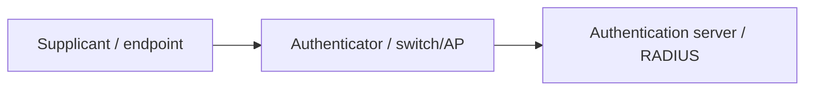

Remember the roles, not vendor names.

---

# Supplicant

The supplicant is the endpoint component that participates in authentication.

Examples:

- operating-system 802.1X client;
- managed laptop agent;
- Wi-Fi supplicant.

It presents credentials or participates in a certificate-based exchange.

---

# Authenticator

The switch or AP controls the edge port.

Before successful authentication, it can permit only traffic needed for the authentication process.

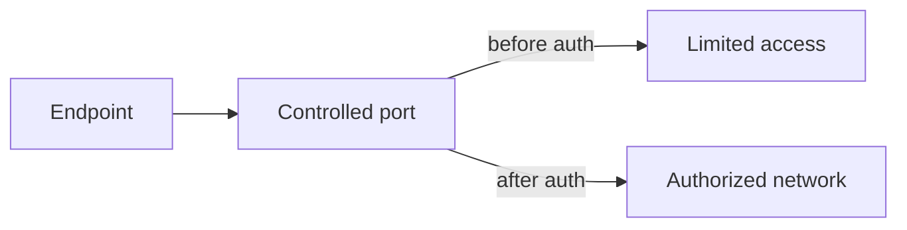

---

# Authentication server

The authentication server evaluates the supplied identity and returns a result.

Often:

- RADIUS server;
- backed by local users, LDAP, certificates, or identity infrastructure.

The network device does not need to store every enterprise credential.

---

# 802.1X message path

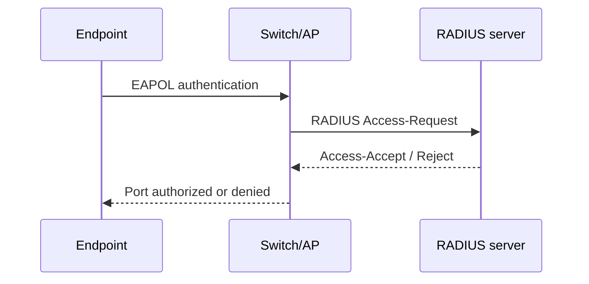

The authenticator relays the decision into network access.

---

# Authentication vs authorization

Authentication asks:

> Who or what are you?

Authorization asks:

> What should you be allowed to access?

NAC is valuable because it can connect the two.

---

# Dynamic authorization

A successful user does not need the same policy as every other user.

Possible outcomes:

```text
employee laptop  -> VLAN 10
contractor       -> VLAN 20
guest            -> VLAN 50
printer           -> VLAN 60
noncompliant PC   -> quarantine
```

---

# Dynamic VLAN assignment

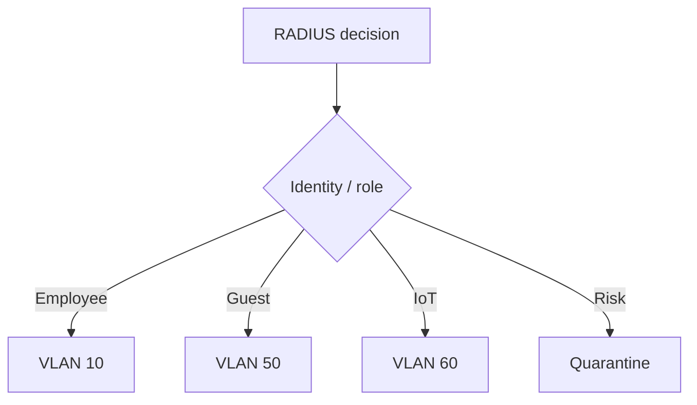

The physical socket no longer defines the full trust level.

---

# RADIUS: what students need

RADIUS provides AAA-related messages between the network access device and the authentication server.

At this level, understand:

- request;
- accept/reject/challenge;
- attributes;
- accounting.

Do not turn the lecture into RADIUS packet trivia.

---

# RADIUS attributes

Attributes can carry policy information such as:

- VLAN assignment;
- user role;
- session timeout;
- access restrictions;
- accounting identifiers.

This is how an identity decision becomes a network configuration decision.

---

# EAP: keep the abstraction

802.1X transports EAP methods.

Different EAP methods authenticate in different ways.

For this lecture, the important security questions are:

- password or certificate?
- server authenticated?
- endpoint authenticated?
- are credentials exposed to an untrusted intermediary?

---

# Certificate-based access

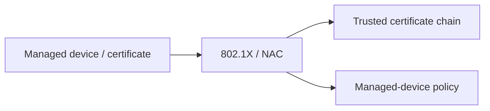

Certificates can provide stronger machine identity than MAC addresses.

---

# User vs machine identity

A laptop may have:

- device identity;
- logged-in user identity.

Security policy may care about both.

Example:

> Corporate laptop + employee user = normal access.

> Corporate laptop before login = limited infrastructure access.

---

# The IoT problem

Many devices cannot run a normal 802.1X supplicant:

- printers;
- cameras;
- badge readers;
- building systems;
- embedded appliances.

NAC still needs a way to classify them.

---

# MAC Authentication Bypass

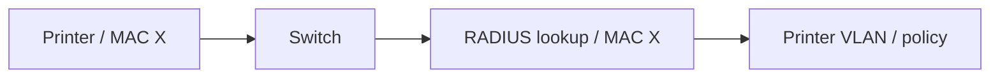

MAB improves manageability, but the MAC address remains spoofable.

---

# MAB is not strong authentication

Treat it as:

- inventory-based admission;
- compatibility mechanism;
- policy hook for devices without 802.1X.

Do not present it as cryptographic proof of device identity.

---

# Guest access


Guest access should not imply internal trust.

---

# Captive portal limitations

A captive portal is useful for:

- registration;
- terms of use;
- simple guest onboarding.

It is not strong endpoint security by itself.

Modern HTTPS behavior can also make interception-based portal workflows awkward.

---

# Quarantine network

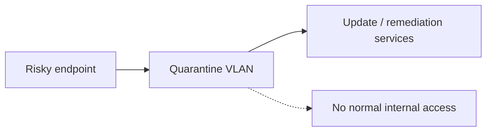

Quarantine is valuable only if there is a realistic recovery path.

---

# Posture assessment

A NAC solution may consider signals such as:

- OS version;
- device enrollment;
- endpoint agent state;
- certificate status;
- vulnerability or compliance signals.

Be cautious: posture checks add complexity and can become brittle.

---

# Policy should match risk

Do not make every condition binary.

Possible policy outcomes:

```text
trusted        -> normal
partially known -> restricted
unknown        -> guest
high risk       -> quarantine
denied          -> no access
```

Graduated access can improve usability and resilience.

---

# Wired NAC

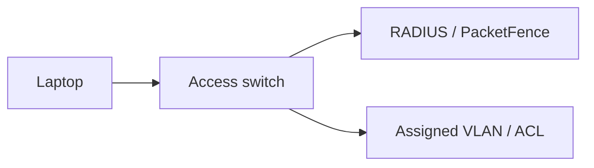

The switch is the enforcement point.

---

# Wireless NAC

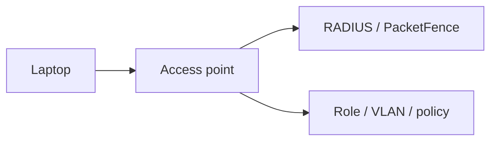

The same AAA concepts can apply even though the access medium changes.

---

# NAC and segmentation

NAC does not replace segmentation.

It helps decide **which segment or role** an endpoint should receive.

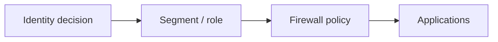

---

# NAC and least privilege

Instead of:

```text
Authenticated = entire internal network
```

prefer:

```text
Authenticated + role + device state
  -> only required access
```

NAC can provide context, but downstream firewalls still enforce application flows.

---

# Open-source platform: PacketFence

PacketFence provides open-source NAC capabilities including:

- 802.1X integration;
- RADIUS;
- registration;
- captive portal workflows;
- device profiling;
- VLAN/role assignment;
- isolation/quarantine patterns.

---

# PacketFence architecture

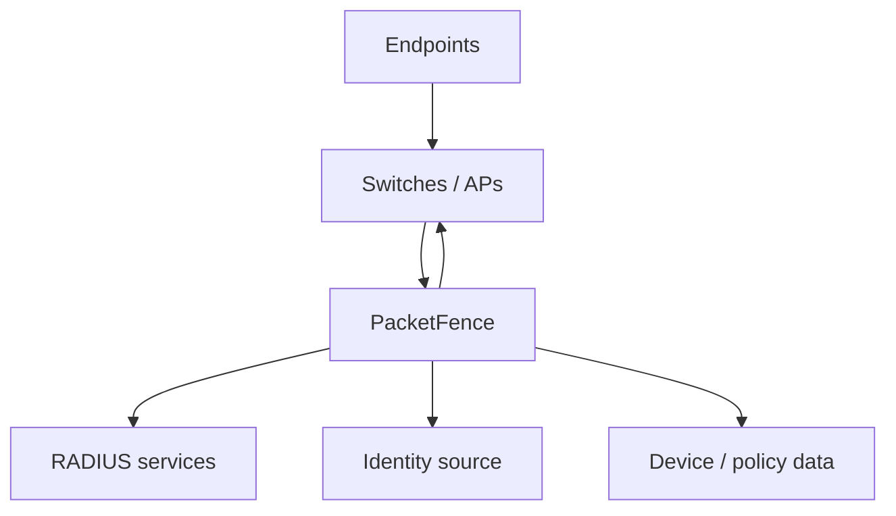

It is useful for teaching because the control relationships are visible.

---

# FreeRADIUS

FreeRADIUS can also be used independently for a smaller teaching lab.

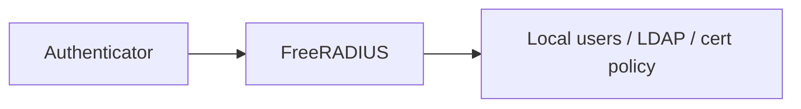

Start small before introducing a full NAC platform.

---

# Lab topology

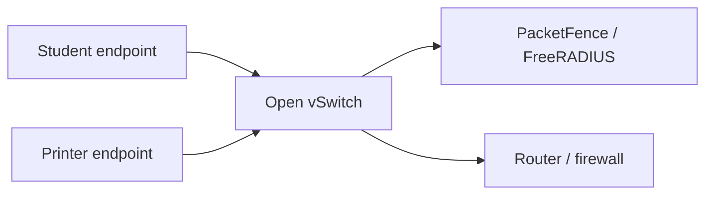

The goal is to observe different access decisions for different endpoint identities.

---

# Demo sequence

1. Endpoint connects with no authentication.
2. Show restricted state.
3. Authenticate a known user/device.
4. Show role/VLAN assignment.
5. Attempt with unknown identity.
6. Show guest or quarantine result.

Make the **state transition** visible.

---

# NAC state machine

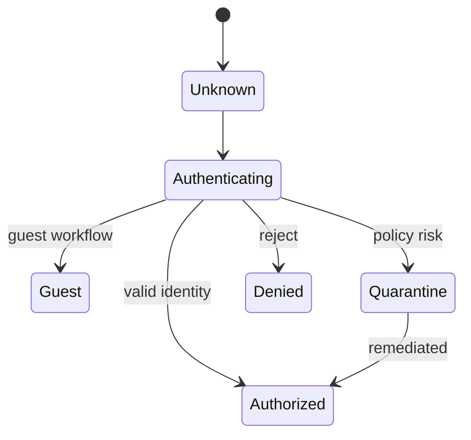

---

# Failure: RADIUS unavailable

What happens if the authentication service fails?

Choices may include:

- fail closed;
- fail open;
- critical VLAN;
- cached authorization.

This is an availability design decision, not merely a configuration checkbox.

---

# Failure: certificate expired

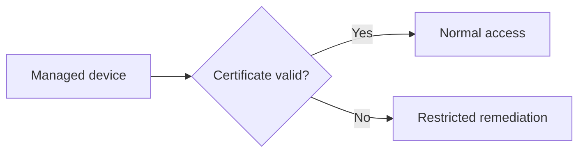

A strong identity system still needs lifecycle management.

---

# Failure: switch cannot enforce role

NAC policy may be correct while the access device is misconfigured.

Always separate:

- policy decision point;
- policy enforcement point.

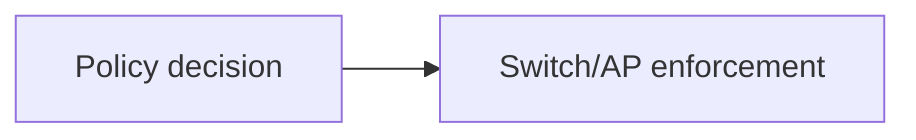

---

# Profiling

NAC platforms may infer device type from behavior or metadata.

Examples:

- DHCP fingerprints;
- observed services;
- vendor OUI;
- traffic patterns.

Profiling is **probabilistic context**, not proof of identity.

---

# Privacy considerations

NAC can collect substantial endpoint and user context.

Ask:

- what data is necessary?
- how long is it retained?
- who can query it?
- is profiling transparent and justified?

Security visibility should still be governed.

---

# Logging and investigations

Useful NAC events:

- successful/failed authentication;
- assigned role/VLAN;
- device first seen;
- endpoint moved ports;
- quarantine events;
- policy changes;
- RADIUS failures.

These events help connect **identity to network activity**.

---

# Common bypass attempts

Attackers may try:

- MAC spoofing against MAB;
- using an already authorized port/device;
- rogue mini-switch behind an endpoint;
- credential theft;
- exploiting fail-open behavior.

NAC reduces risk; it does not make edge access infallible.

---

# Design scenario

A university network has:

- staff laptops;
- student laptops;
- printers;
- lab equipment;
- visitors.

Design an admission policy with no more than five roles.

Keep the policy understandable enough to operate.

---

# Possible role model

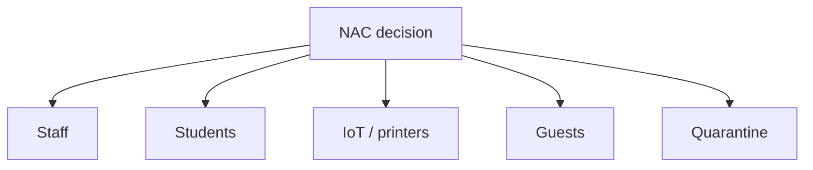

Each role should map to downstream firewall policy.

---

# Common mistakes

- Treating MAB as strong identity
- Granting broad access after authentication
- Building too many roles to operate
- No remediation path for quarantine
- Ignoring RADIUS/NAC outages
- Expired certificate surprises
- Profiling treated as certainty
- No integration with downstream segmentation

---

# What NAC cannot solve

NAC does not know whether:

- an authenticated user is abusing an application;
- a permitted HTTPS request is SQL injection;
- malware runs after successful admission;
- data is being exfiltrated through an allowed service.

Admission is one control in a larger system.

---

# Mental model

```mermaid
flowchart LR
  CONNECT["Connect"] --> AUTH["Authenticate / identify"]
  AUTH --> CONTEXT["Add context"]
  CONTEXT --> ROLE["Assign role"]
  ROLE --> ENFORCE["Switch/AP enforces"]
  ENFORCE --> DOWN["Firewall / app policy"]
```

---

# Expert augmentation: NAC to Zero Trust

Traditional NAC often grants network reachability after admission.

Zero Trust changes the unit of decision:

```mermaid
flowchart LR
  U[User + device] --> PDP[Policy decision point]
  PDP --> PEP[Policy enforcement point]
  PEP --> APP[Single application]
```

Decision inputs can include:

- identity;
- device posture;
- requested application;
- location and risk;
- session context.

---

# ZTNA model: no broad network trust

Instead of exposing a whole subnet:

```mermaid
flowchart LR
  USER[User] --> ZTNA[ZTNA enforcement]
  ZTNA --> APP1[Allowed app]
  ZTNA -. blocked .-> DB[Database subnet]
  ZTNA -. hidden .-> SCAN[Network scanning]
```

NAC remains useful at the access edge.

ZTNA adds:

- application-specific authorization;
- continuous policy checks;
- better control for remote and cloud resources;
- smaller lateral-movement blast radius.

---

# Review questions

1. What are the three 802.1X roles?
2. What is the difference between authentication and authorization?
3. Why is MAB weaker than certificate-based access?
4. What is a quarantine VLAN for?
5. What happens when RADIUS is unavailable?
6. Why does NAC not replace firewalls?

---

# Final checklist

For a NAC design, ask:

- Which endpoint types exist?
- Which can support 802.1X?
- What identity sources are trusted?
- What roles are actually necessary?
- What happens to guests and unknown devices?
- What is the quarantine/remediation path?
- What happens during infrastructure failure?
- How is the assigned role enforced downstream?
