# Firewalls

## Enforcing communication policy between security zones

> Should this communication be allowed?


**Mihai Chiroiu** · © Network Security Using Dedicated Devices

---

# Learning objectives

- distinguish stateless and stateful filtering;
- explain connection tracking;
- design zone-based policy;
- reason about rule order and defaults;
- separate filtering from NAT;

---

# Where the firewall sits

<div style="transform: scale(0.8); transform-origin: top center;">

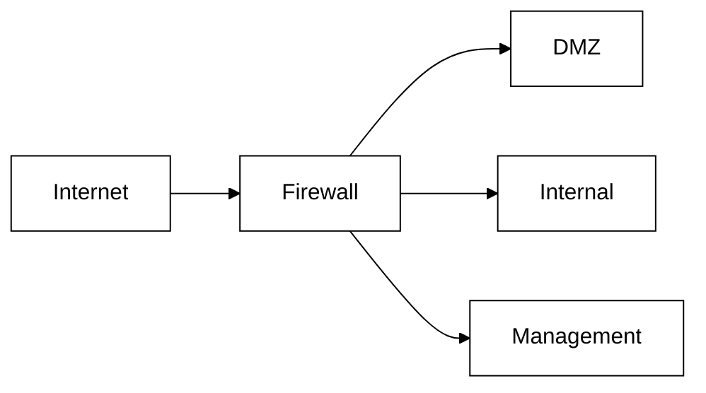

</div>

The firewall becomes a choke point between trust zones.

---

# Hardware vs software firewalls

| Form factor | Examples | Characteristics |
|---|---|---|
| **Dedicated hardware appliance** | Palo Alto PA series, Fortinet FortiGate, Cisco Firepower | Purpose-built ASICs; vendor-managed OS; high throughput |
| **Software on commodity hardware** | pfSense, OPNsense, Linux nftables/iptables | Runs on standard x86/ARM servers; flexible, auditable; limited by CPU |
| **Virtual appliance** | Same vendors, deployed as VMs or containers | Identical software, no dedicated hardware; used in virtualized/cloud environments |
| **Cloud-native** | AWS Security Groups, GCP VPC firewall rules, Azure NSG | Managed by the cloud provider; integrated with cloud networking |

---

# From interfaces to zones

**Problem:** when you add a new interface/redesign the network, every rule referencing the old interfaces must be rewritten.

**Solution:** abstract interfaces into **security zones** — logical groups with a trust level:

| Zone | Interfaces | Trust |
|---|---|---|
| **Internet** | eth0 | Untrusted |
| **DMZ** | eth1, eth1.10 | Semi-trusted |
| **Users** | eth2, eth2.20, eth2.30 | Trusted |
| **Management** | eth3 | Highly trusted |

Policy is written **zone-to-zone** ("Users → Internet: allow 443"). Adding a new VLAN to a zone automatically inherits all its rules.

---

# Zones

<div style="transform: scale(0.8); transform-origin: top center;">

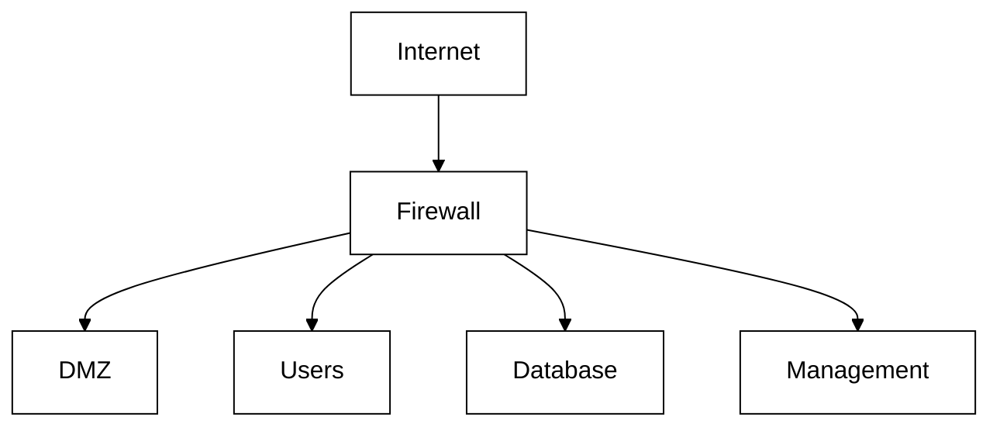

</div>

Think in **trust zones and required flows**, not just interfaces.

---

# Firewall types

| Type | Inspects | State | Use case |
|---|---|---|---|
| **Stateless (packet filter)** | IP header, ports, flags | None — each packet independently | High-speed ACLs, hardware routers |
| **Stateful** | IP header, ports, flags + **connection state** | Tracks flows (conntrack) | Standard perimeter/internal firewalls |
| **Application-layer (L7 / NGFW)** | All of the above + **application content** | Flow + protocol decode | Deep inspection, IPS, URL filtering |

Each type builds on the previous — stateful needs everything stateless does, plus memory; L7 needs everything stateful does, plus protocol parsers.

---

# What a firewall can see

A classic L3/L4 firewall can inspect:

- source/destination IP;
- protocol;
- source/destination port;
- interface/zone;
- TCP flags;
- connection state.

More advanced firewalls may inspect applications, but keep the fundamentals separate.

---

# Stateless filtering

Each packet is considered independently.

<div style="transform: scale(0.8); transform-origin: top center;">

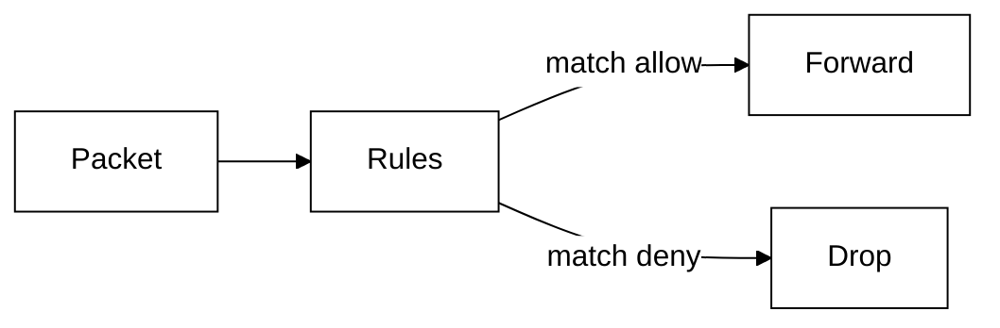

</div>

No memory of previous packets is required.

---

# Example stateless rule

```text
src: Internet
dst: 203.0.113.20
protocol: TCP
dport: 443
action: allow
```

This says nothing about whether the packet belongs to an already-established connection.

---

# How stateless filtering works — pattern matching

A stateless filter sees each packet as a **fixed-layout bit string**. The IP and TCP/UDP headers provide well-known fields at known offsets:

```text
IP header (simplified):
┌────────────────────┬────────────────────┐
│   Source IP (32b)  │     Dest IP (32b)  │
└────────────────────┴────────────────────┘
         ↓                     ↓
  match against rule     match against rule
```

The filter compares header fields against a **template** (pattern) — if the packet matches the pattern, the rule's action applies.

This is exactly how an Access Control List (ACL) works on a router.

---

# Masks — selecting which bits matter

A **mask** lets a rule ignore certain bits during comparison.

| Field | Value in rule | Mask | Effect |
|---|---|---|---|
| Source IP | `10.0.0.0` | `255.0.0.0` (/8) | Matches any `10.x.x.x` |
| Source IP | `192.168.1.0` | `255.255.255.0` (/24) | Matches `192.168.1.0–255` |
| Source IP | `10.0.0.5` | `255.255.255.255` (/32) | Matches exactly `10.0.0.5` |
| Dest port | `443` | (exact) | Matches only HTTPS |

---

# Masks — selecting which bits matter

```text
Packet src:   10.0.0.42       = 00001010.00000000.00000000.00101010
Mask /8:      255.0.0.0       = 11111111.00000000.00000000.00000000
                                ────────
                                only these 8 bits are compared
Rule value:   10.0.0.0        = 00001010.00000000.00000000.00000000
                                ^^^^^^^^
                                match → rule applies
```

The wider the mask (fewer 1-bits), the more traffic a single rule matches.

---

# Stateful filtering

<div style="transform: scale(0.8); transform-origin: top center;">

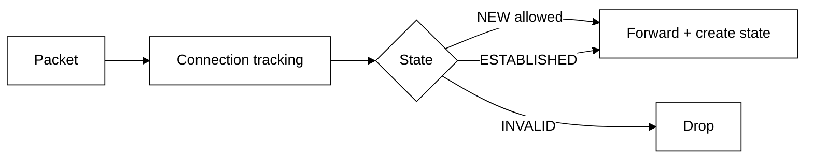

</div>

State turns many packet-level rules into flow-level policy.

---

# TCP connection state

<div style="transform: scale(0.65); transform-origin: top center;">

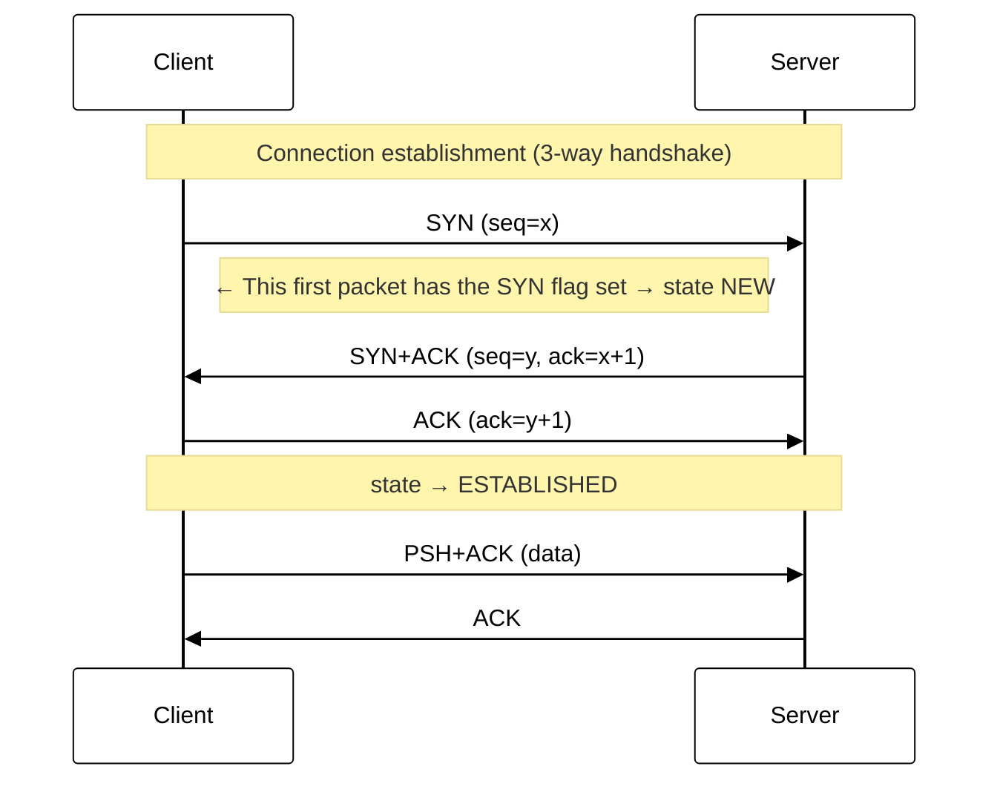

</div>

---

# TCP connection state

<div style="transform: scale(0.65); transform-origin: top center;">

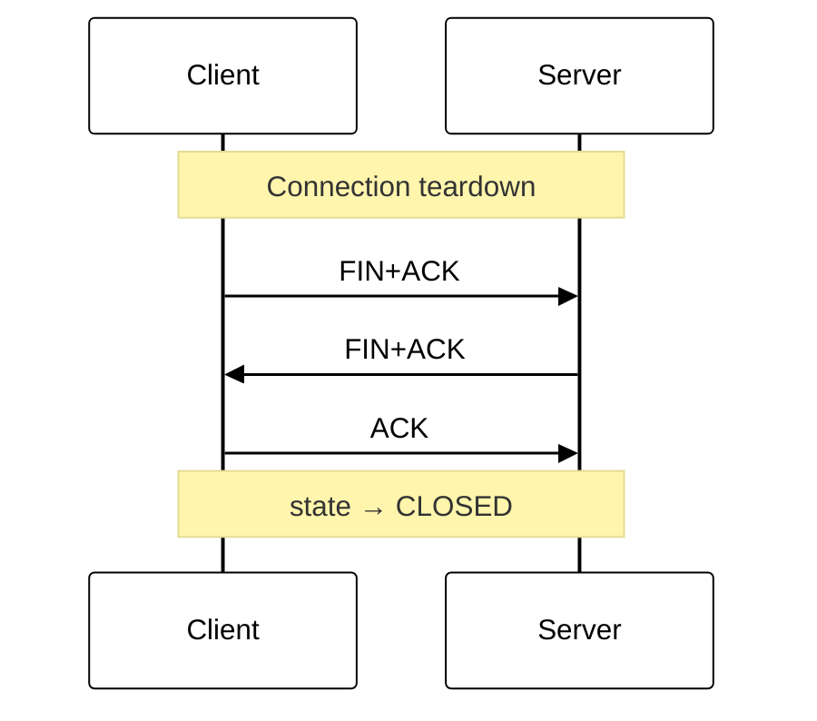
</div>

---

# Pseudo-state for UDP and ICMP

TCP has explicit flags (SYN, FIN, RST) that signal connection lifecycle. **UDP and ICMP have no such flags** — they are connectionless.

Yet stateful firewalls still track them using **pseudo-state** based on timers:

| Protocol | How NEW is detected | How ESTABLISHED works | Timeout |
|---|---|---|---|
| **TCP** | SYN flag in first packet | Completed handshake; bidirectional traffic | Minutes (established) |
| **UDP** | First packet on src:port → dst:port | Reply seen from dst:port → src:port | 30–180 s (varies) |
| **ICMP** | Echo Request (type 8) | Echo Reply (type 0) matches request identifier | 30 s |

---

# Pseudo-state for UDP and ICMP

**Example — DNS query (UDP):**

```text
1. Client 10.0.0.5:51234 → 8.8.8.8:53   → conntrack creates NEW entry
2. Server 8.8.8.8:53 → 10.0.0.5:51234   → matches entry → ESTABLISHED
3. No more packets → timer expires → entry removed
```

Without pseudo-state, the firewall would need an explicit rule to allow DNS replies — just like a stateless filter.

---

# Return traffic

Without state, administrators often write rules in both directions.

With state:

```text
allow NEW internal -> Internet TCP/443
allow ESTABLISHED,RELATED
```

The return packets are accepted because they belong to permitted communication.

---

# Connection tracking table

Conceptually:

| Source | Destination | State |
|---|---|---|
| `10.0.0.5:51000` | `203.0.113.5:443` | ESTABLISHED |

This state is both useful and a resource an attacker may try to exhaust.

---

# Build policy from requirements

Example:

```text
Internet -> Web DMZ :443          allow
Internet -> Internal             deny
Web DMZ -> Database :5432         allow
Web DMZ -> Management             deny
Users -> Internet :443            allow
Management -> infrastructure      allow
```

Every allow should have a reason.

---

# Default policy — allowlist vs blocklist

The **last rule** in a firewall policy defines its fundamental philosophy:

| Approach | Last rule | Also called | Philosophy |
|---|---|---|---|
| **Allowlist** | `deny any any` | Default deny, whitelist | Only explicitly permitted traffic passes |
| **Blocklist** | `allow any any` | Default allow, blacklist | Only explicitly blocked traffic is dropped |

---

# Default policy — allowlist vs blocklist

**Allowlist (default deny)** — the standard for perimeter firewalls:
- You must know and enumerate every required flow
- Unknown traffic is blocked → safer, but requires more upfront work
- A missing rule = broken service (fail-closed)

**Blocklist (default allow)** — sometimes used internally or during migration:
- You enumerate known-bad traffic (malicious IPs, dangerous ports)
- Unknown traffic passes → simpler to deploy, but any oversight = exposure
- A missing rule = potential breach (fail-open)

Most firewalls default to **deny any** at the end of a chain.

---

# Rule order

Rules are often evaluated top to bottom — **first match wins**.

```text
1 deny  10.0.0.50       -> server  tcp/443
2 allow 10.0.0.0/24     -> server  tcp/443
3 allow 192.168.0.0/16  -> server  tcp/22
4 deny  any              -> server  tcp/22
5 allow any              -> server  tcp/443
```

- `10.0.0.50` trying HTTPS → hits rule 1 (deny) ✓
- `10.0.0.42` trying HTTPS → hits rule 2 (allow) ✓
- `192.168.1.5` trying SSH → hits rule 3 (allow) ✓
- `8.8.8.8` trying SSH → skips 1–3, hits rule 4 (deny) ✓
- `8.8.8.8` trying HTTPS → skips 1–4, hits rule 5 (allow) ✓


---

# Shadowed rules

A broad earlier rule can make a later rule unreachable.

<div style="transform: scale(0.8); transform-origin: top center;">

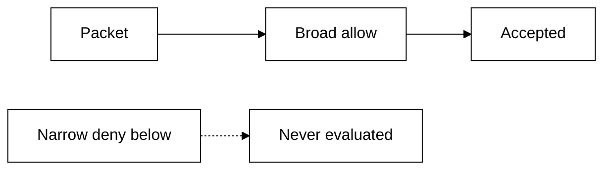

</div>

**If rules 1 and 2 were swapped**, `10.0.0.50` would match the broad allow first — the deny would never fire.

Policy review should detect shadowing.

---

# Intra-firewall anomalies — formal taxonomy

Shadowing is one of **five** formal anomalies between any two rules $R_x$ (earlier) and $R_y$ (later) in the same firewall:

| Anomaly | Predicate relation | Actions | Severity |
|---|---|---|---|
| **Shadowing** | $R_y \subseteq R_x$ | opposite | **Critical** — $R_y$ is unreachable |
| **Generalization** | $R_x \subset R_y$ | opposite | **Warning** — $R_x$ is a narrow exception carved out of $R_y$; deleting $R_x$ silently changes posture |
| **Correlation** | $R_x \cap R_y \neq \emptyset$, neither subset | opposite | **Ambiguous** — packets in the intersection match $R_x$; reordering changes behavior |

---

# Intra-firewall anomalies — formal taxonomy

Shadowing is one of **five** formal anomalies between any two rules $R_x$ (earlier) and $R_y$ (later) in the same firewall:

| Anomaly | Predicate relation | Actions | Severity |
|---|---|---|---|
| **Redundancy** | $R_y \subseteq R_x$ or $R_x \subseteq R_y$ | same | **Bloat** — removing the redundant rule changes nothing |
| **Irrelevance** | Rule matches no routable traffic | any | **Rot** — increases audit burden without filtering packets |

> Al-Shaer, E. and Hamed, H., *"Discovery of Policy Anomalies in Distributed Firewalls"*, IEEE INFOCOM 2004.

---

# Generalization and correlation — examples

**Generalization** (our Rule order slide is exactly this):

```text
1 deny  10.0.0.50       -> server  tcp/443    ← narrow exception
2 allow 10.0.0.0/24     -> server  tcp/443    ← broad rule
```

This is **correct but fragile** — if someone deletes rule 1, all of `10.0.0.0/24` is suddenly allowed.

**Correlation** (two rules overlap on different dimensions):

```text
1 allow 10.0.0.0/24     -> any           tcp/any
2 deny  any              -> 192.168.1.10  tcp/22
```

A packet from `10.0.0.5 → 192.168.1.10:22` is in the **intersection** — it matches rule 1 (allow by source) before rule 2 can deny it by destination. Neither rule is a subset of the other, so reordering either one changes the security outcome.

---

# Inter-firewall (distributed) anomalies

When traffic crosses **multiple firewalls** (perimeter → internal), a new class of anomalies emerges:

| Anomaly | Upstream $FW_A$ | Downstream $FW_B$ | Problem |
|---|---|---|---|
| **Distributed shadowing** | deny tcp/5432 | allow Internet → DB tcp/5432 | $FW_B$'s allow is **unreachable** — $FW_A$ already dropped it |
| **Spuriousness** | allow Internet → DB tcp/5432 | deny Internet → DB tcp/5432 | Unauthorized traffic **transits the perimeter** and internal links before $FW_B$ blocks it |

**Spuriousness** is particularly dangerous: the perimeter allows traffic it should block, relying entirely on an internal firewall. If the internal firewall is misconfigured or bypassed, the flow reaches the target unchallenged.

---

# Inter-firewall (distributed) anomalies

| Anomaly | Upstream $FW_A$ | Downstream $FW_B$ | Problem |
|---|---|---|---|
| **Distributed redundancy** | deny tcp/5432 | deny tcp/5432 | **Defense-in-depth** (intentional) or wasted rules (unintentional) |
| **Distributed correlation** | Partial overlap with opposing actions across $FW_A$ and $FW_B$ | | Multi-hop ambiguity — behavior depends on which firewall sees which dimension |

---

# Inbound policy

Common Internet-facing posture:

```text
allow public services explicitly
deny unsolicited access to internal zones
log selected denies
```

Do not expose management interfaces simply because the firewall can filter them.

---

# Egress policy

Outbound controls can restrict:

- server access to the Internet;
- direct SMTP from workstations;
- unexpected DNS resolvers;
- management protocols leaving the organization;
- data exfiltration paths.

Compromise should not automatically equal unrestricted egress.

---

# North-south vs east-west traffic

<div style="transform: scale(0.7); transform-origin: top center;">

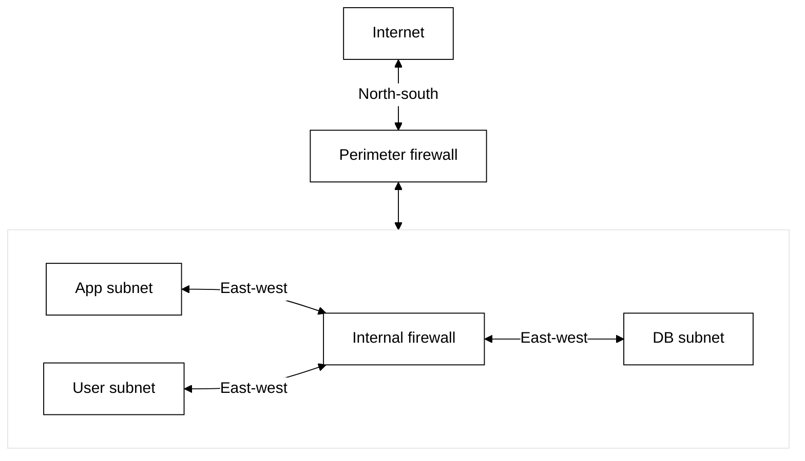

</div>

**North-south** — traffic crossing the perimeter (Internet ↔ internal). This is where traditional firewalls sit.

**East-west** — traffic moving laterally between internal zones. Often **unfiltered** in legacy networks — once an attacker breaches the perimeter, they move freely.

Modern security requires filtering **both directions**. An internal firewall or micro-segmentation prevents a compromised web server from reaching the database directly.

---

# Stateful does not mean application-aware

Both of these can be TCP/443:

```text
GET /index.html
```

```text
POST /login with malicious payload
```

A stateful firewall may permit both because the connection itself is allowed.

---

# Firewall vs WAF

<div style="transform: scale(0.8); transform-origin: top center;">

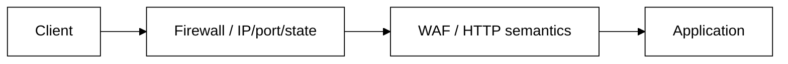

</div>

Different visibility enables different decisions.

---

# NAT and firewalling

Keep these concepts distinct:

<div style="transform: scale(0.8); transform-origin: top center;">

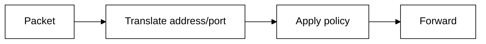

</div>

Exact processing order depends on implementation, but translation and authorization are separate ideas.

---

# DNAT publication

<div style="transform: scale(0.8); transform-origin: top center;">

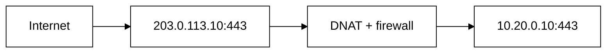

</div>

Publishing a destination does not imply every source should reach it.

---

# SNAT and attribution

If many internal hosts share one external address, downstream systems may see only the translated source.

Preserve useful attribution through:

- firewall logs;
- proxy logs;
- flow logs;
- identity-aware controls where needed.

---

# RELATED traffic

Some protocols negotiate **secondary flows** dynamically inside the primary connection. The firewall must understand the application protocol to link the new flow back to the original.

**Example — FTP active mode:**

<div style="transform: scale(0.7); transform-origin: top center;">

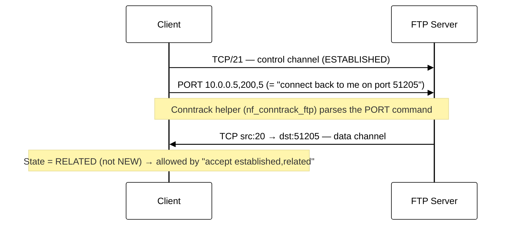

</div>

Without the conntrack helper, the server's inbound data connection would look like an **unsolicited NEW connection** and be dropped by default-deny policy.

Other protocols with RELATED flows: SIP (voice/video media ports), TFTP, PPTP. Enable helpers **only** for protocols actually in use — each one adds parsing complexity and attack surface.

---

# INVALID traffic

Packets may be classified as invalid because they do not fit expected state.

A common principle:

```text
drop invalid early
```

But investigate persistent invalid traffic before assuming it is malicious; routing asymmetry can create surprises.

---

# Asymmetric routing

<div style="transform: scale(0.8); transform-origin: top center;">

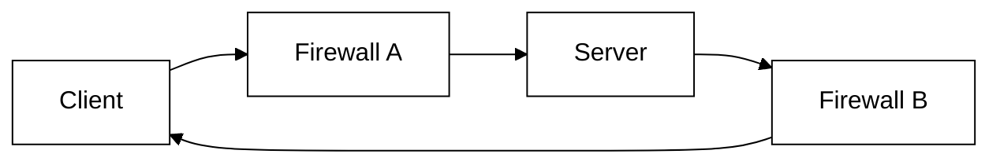

</div>

If state exists only on Firewall A, the reply through Firewall B may be dropped.

---

# Stateful HA

Two firewalls may synchronize connection state.

<div style="transform: scale(0.8); transform-origin: top center;">

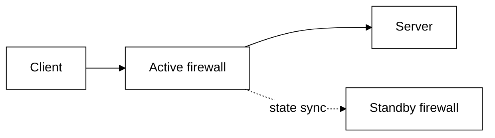

</div>

High availability adds another security-sensitive channel and failure mode.

---

# Policy objects

Instead of repeating raw IPs everywhere, use meaningful groups:

```text
WEB_SERVERS
DATABASE_SERVERS
ADMIN_NETS
DNS_RESOLVERS
```

Readable policy is easier to audit than thousands of anonymous addresses.

---

# Service objects

Similarly:

```text
HTTPS = tcp/443
DNS = udp/53 + tcp/53
POSTGRES = tcp/5432
```

But remember: a port number is not proof that the expected application is actually running there.

---

# Logging strategy

Log what supports decisions:

- denied management access;
- unusual egress;
- new published services;
- policy changes;
- authentication/configuration events;
- selected connection metadata.

Logging every packet can create cost without insight.

---

# Troubleshooting order

<div style="transform: scale(0.6); transform-origin: top center;">

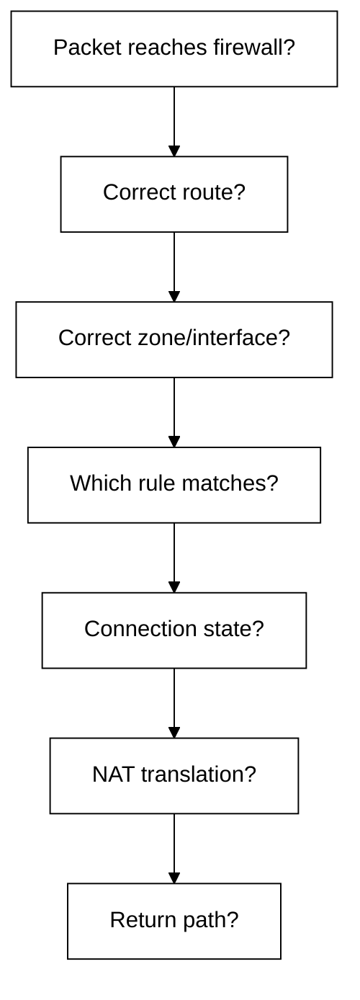

</div>

---

# Change management

A dangerous workflow:

```text
service broken -> add broad allow -> forget it
```

Better:

```text
observe -> identify required flow -> add narrow rule -> test -> document
```

Operational pressure is a major source of firewall weakness.

---

# Common bypasses

Attackers may use:

- allowed ports;
- trusted destinations;
- compromised internal systems;
- DNS/HTTPS tunnels;
- applications that proxy traffic;
- misconfigured broad rules.

A firewall cannot infer intent from IP/port/state alone.

---

# Encrypted traffic

<div style="transform: scale(0.8); transform-origin: top center;">

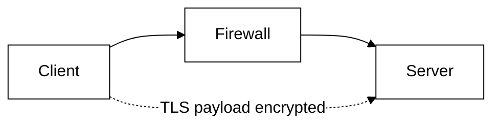

</div>

The firewall still sees metadata, but application content may be opaque.

---

# IPv6 matters

A common mistake is to secure IPv4 and forget IPv6.

If hosts have IPv6 connectivity, firewall policy should explicitly cover it.

Security principle:

> Every enabled network path needs policy, regardless of address family.

---

# Common mistakes

- `any any allow`
- Wrong rule order
- No egress policy
- NAT mistaken for security
- Overlogging meaningless events
- Underlogging administrative changes
- Asymmetric paths with stateful devices
- IPv6 forgotten
- Temporary rules never removed

---

# What the firewall cannot solve

A firewall cannot by itself decide:

- whether a legitimate user steals data;
- whether an HTTP parameter is malicious;
- whether a DNS name is newly malicious;
- whether an email attachment contains malware.

Other layers exist for those questions.

---

# Expert augmentation: firewall acceleration

Advanced firewall features are expensive:

- connection tracking;
- TLS termination or interception;
- IPS pattern matching;
- application identification;
- logging at high rate.

<div style="transform: scale(0.8); transform-origin: top center;">

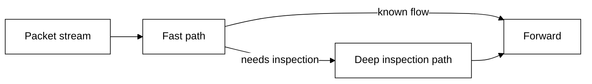

</div>

The architecture must prevent the slow path from becoming the bottleneck.

---

# Beyond L3/L4 — what comes next

This lecture covered **stateless and stateful firewalling** — decisions based on IP addresses, ports, and connection state.

But a firewall that only sees headers cannot answer deeper questions:

- **Is this HTTP request an SQL injection?** → Web Application Firewall (WAF)
- **Does this traffic match a known exploit signature?** → IDS/IPS
- **Is a user uploading confidential documents?** → Data Loss Prevention (DLP)
- **Which application is really using port 443?** → Deep Packet Inspection (DPI) / NGFW

These **Layer 7 inspection** topics will be covered in dedicated upcoming lectures (IDS/IPS, WAF, Secure Web Gateway).

---

# Final checklist

For each firewall boundary, ask:

- What are the zones?
- Which flows are required?
- Is default deny explicit?
- Are rules ordered and non-shadowed?
- Is state handling understood?
- Is egress restricted?
- Is NAT separated conceptually from authorization?
- Are logs actionable?
- Are IPv4 and IPv6 both covered?
