# Firewalls

## Enforcing communication policy between security zones

__Open-source lab stack:__ nftables, conntrack, Linux namespaces

A firewall answers a deceptively simple question:

> Should this communication be allowed?

---

# Learning objectives

You should be able to:

- distinguish stateless and stateful filtering;
- explain connection tracking;
- design zone-based policy;
- reason about rule order and defaults;
- separate filtering from NAT;
- implement and troubleshoot policy with nftables.

---

# Where the firewall sits

<div style="transform: scale(0.8); transform-origin: top center;">

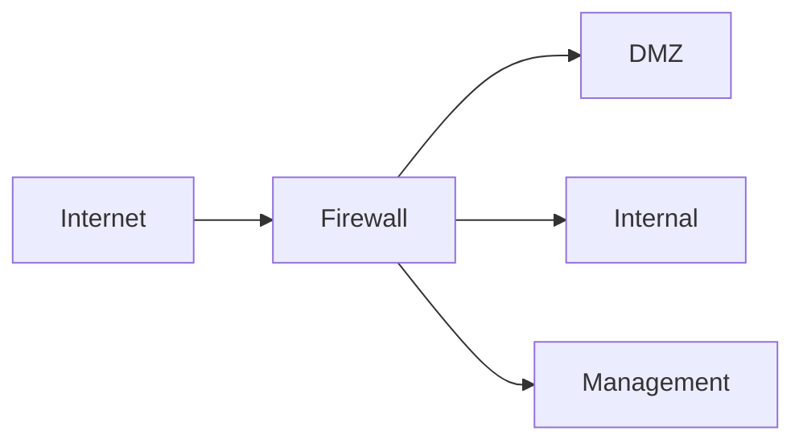

</div>

The firewall becomes a choke point between trust zones.

---

# What a firewall can see

A classic L3/L4 firewall can inspect:

- source/destination IP;
- protocol;
- source/destination port;
- interface/zone;
- TCP flags;
- connection state.

More advanced firewalls may inspect applications, but keep the fundamentals separate.

---

# Stateless filtering

Each packet is considered independently.

<div style="transform: scale(0.8); transform-origin: top center;">

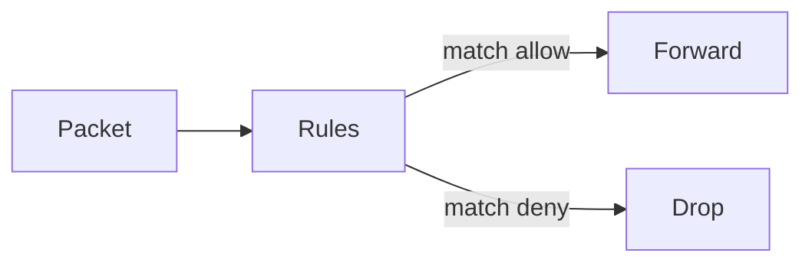

</div>

No memory of previous packets is required.

---

# Example stateless rule

```text
src: Internet
dst: 203.0.113.20
protocol: TCP
dport: 443
action: allow
```

This says nothing about whether the packet belongs to an already-established connection.

---

# Stateful filtering

<div style="transform: scale(0.8); transform-origin: top center;">

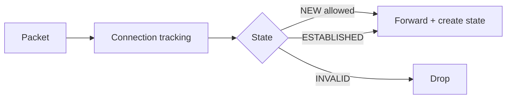

</div>

State turns many packet-level rules into flow-level policy.

---

# TCP connection state

Simplified view:

<div style="transform: scale(0.8); transform-origin: top center;">

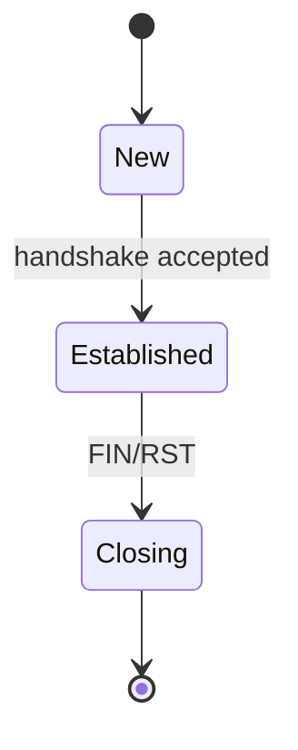

</div>

The firewall tracks enough metadata to recognize return traffic.

---

# Return traffic

Without state, administrators often write rules in both directions.

With state:

```text
allow NEW internal -> Internet TCP/443
allow ESTABLISHED,RELATED
```

The return packets are accepted because they belong to permitted communication.

---

# Connection tracking table

Conceptually:

| Source | Destination | State |
|---|---|---|
| `10.0.0.5:51000` | `203.0.113.5:443` | ESTABLISHED |

This state is both useful and a resource an attacker may try to exhaust.

---

# Zones

<div style="transform: scale(0.8); transform-origin: top center;">

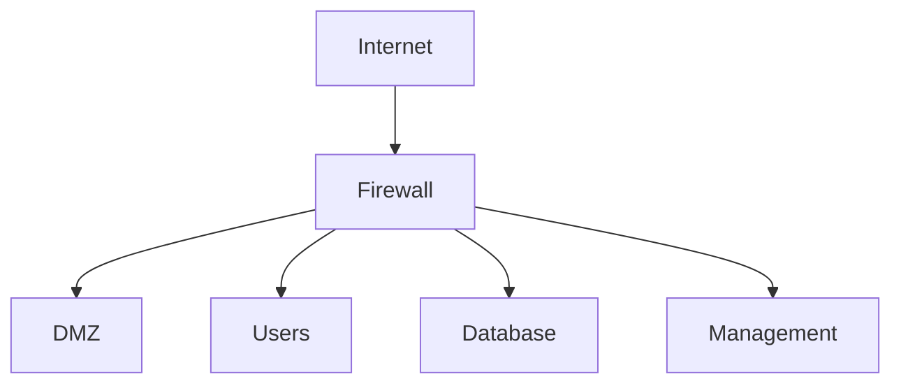

</div>

Think in **trust zones and required flows**, not just interfaces.

---

# Build policy from requirements

Example:

```text
Internet -> Web DMZ :443          allow
Internet -> Internal             deny
Web DMZ -> Database :5432         allow
Web DMZ -> Management             deny
Users -> Internet :443            allow
Management -> infrastructure      allow
```

Every allow should have a reason.

---

# Default deny

<div style="transform: scale(0.8); transform-origin: top center;">

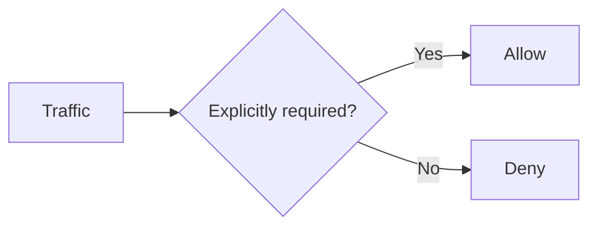

</div>

This reduces dependence on predicting every future attack.

---

# Rule order

Rules are often evaluated top to bottom.

```text
1 allow 10.0.0.0/8 -> server
2 deny  10.0.0.50 -> server
```

If rule 1 matches first, rule 2 never protects the server from `10.0.0.50`.

---

# Shadowed rules

A broad earlier rule can make a later rule unreachable.

<div style="transform: scale(0.8); transform-origin: top center;">

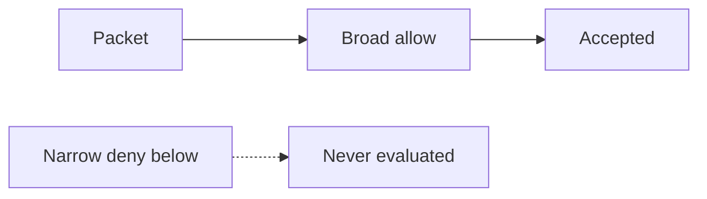

</div>

Policy review should detect shadowing.

---

# Inbound policy

Common Internet-facing posture:

```text
allow public services explicitly
deny unsolicited access to internal zones
log selected denies
```

Do not expose management interfaces simply because the firewall can filter them.

---

# Egress policy

Outbound controls can restrict:

- server access to the Internet;
- direct SMTP from workstations;
- unexpected DNS resolvers;
- management protocols leaving the organization;
- data exfiltration paths.

Compromise should not automatically equal unrestricted egress.

---

# East-west filtering

<div style="transform: scale(0.8); transform-origin: top center;">

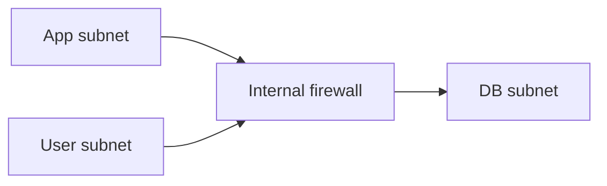

</div>

Perimeter-only security assumes internal networks are trustworthy. Modern environments often need internal segmentation too.

---

# Stateful does not mean application-aware

Both of these can be TCP/443:

```text
GET /index.html
```

```text
POST /login with malicious payload
```

A stateful firewall may permit both because the connection itself is allowed.

---

# Firewall vs WAF

<div style="transform: scale(0.8); transform-origin: top center;">

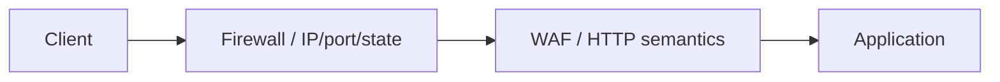

</div>

Different visibility enables different decisions.

---

# NAT and firewalling

Keep these concepts distinct:

<div style="transform: scale(0.8); transform-origin: top center;">

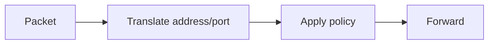

</div>

Exact processing order depends on implementation, but translation and authorization are separate ideas.

---

# DNAT publication

<div style="transform: scale(0.8); transform-origin: top center;">

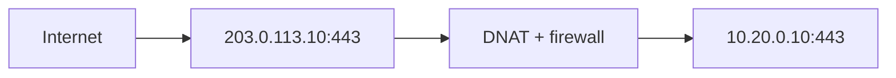

</div>

Publishing a destination does not imply every source should reach it.

---

# SNAT and attribution

If many internal hosts share one external address, downstream systems may see only the translated source.

Preserve useful attribution through:

- firewall logs;
- proxy logs;
- flow logs;
- identity-aware controls where needed.

---

# RELATED traffic

Some protocols create secondary flows related to an initial connection.

Connection tracking may classify them as `RELATED`.

This is convenient, but helpers and protocol awareness expand complexity. Enable only what the environment needs.

---

# INVALID traffic

Packets may be classified as invalid because they do not fit expected state.

A common principle:

```text
drop invalid early
```

But investigate persistent invalid traffic before assuming it is malicious; routing asymmetry can create surprises.

---

# Asymmetric routing

<div style="transform: scale(0.8); transform-origin: top center;">

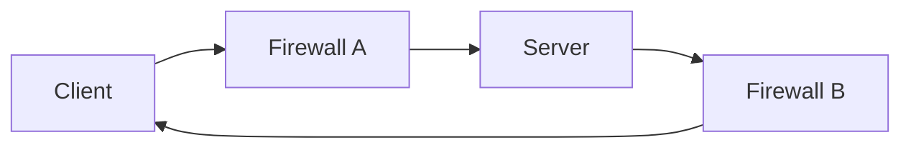

</div>

If state exists only on Firewall A, the reply through Firewall B may be dropped.

---

# Stateful HA

Two firewalls may synchronize connection state.

<div style="transform: scale(0.8); transform-origin: top center;">

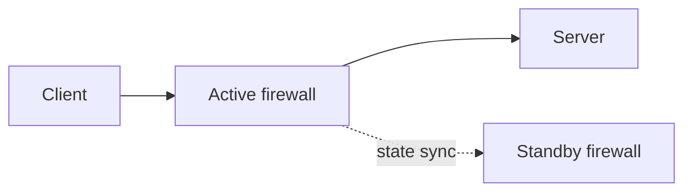

</div>

High availability adds another security-sensitive channel and failure mode.

---

# Policy objects

Instead of repeating raw IPs everywhere, use meaningful groups:

```text
WEB_SERVERS
DATABASE_SERVERS
ADMIN_NETS
DNS_RESOLVERS
```

Readable policy is easier to audit than thousands of anonymous addresses.

---

# Service objects

Similarly:

```text
HTTPS = tcp/443
DNS = udp/53 + tcp/53
POSTGRES = tcp/5432
```

But remember: a port number is not proof that the expected application is actually running there.

---

# Logging strategy

Log what supports decisions:

- denied management access;
- unusual egress;
- new published services;
- policy changes;
- authentication/configuration events;
- selected connection metadata.

Logging every packet can create cost without insight.

---

# Open-source firewall: nftables

nftables provides:

- packet filtering;
- stateful rules;
- NAT;
- sets/maps;
- counters;
- IPv4/IPv6 support.

It exposes the mechanics without hiding them behind a vendor UI.

---

# nftables processing model

<div style="transform: scale(0.8); transform-origin: top center;">

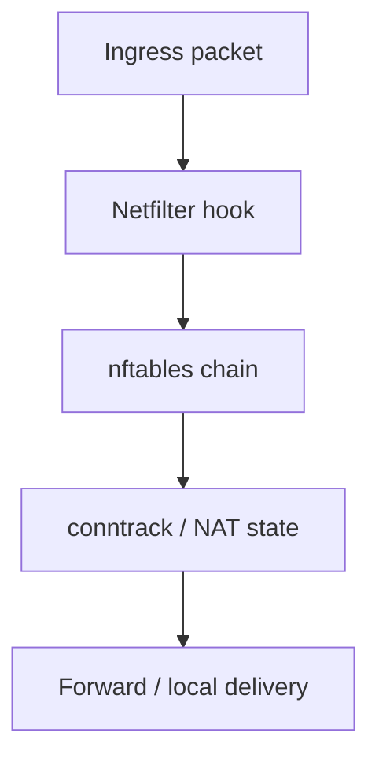

</div>

Students should understand the flow before memorizing syntax.

---

# Minimal stateful policy

```text
ct state invalid drop
ct state established,related accept

iifname "lan0" oifname "wan0" tcp dport 443 accept
counter drop
```

Use counters to verify which rules are exercised.

---

# Sets make policy readable

```text
set web_servers {
  type ipv4_addr
  elements = { 10.20.0.10, 10.20.0.11 }
}
```

Then match the set rather than duplicating addresses across many rules.

---

# Lab topology

<div style="transform: scale(0.8); transform-origin: top center;">

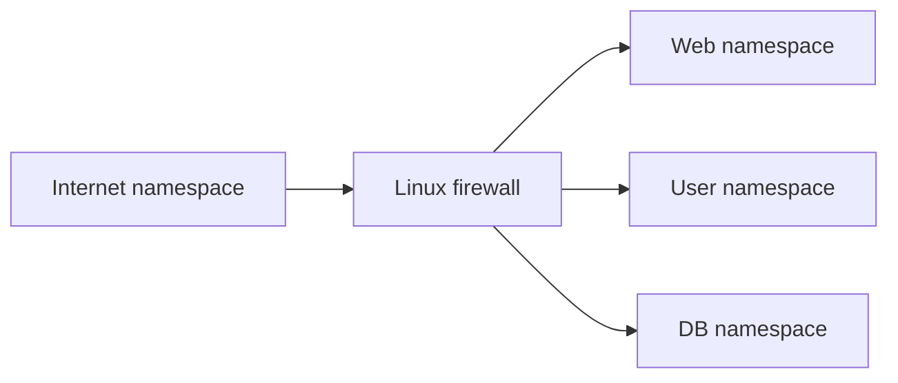

</div>

Students can test every permitted and denied flow directly.

---

# Lab progression

1. Route everything with no firewall.
2. Add default deny.
3. Allow required flows.
4. Add stateful return traffic.
5. Add DNAT for the web service.
6. Add restricted egress.
7. Observe counters and logs.

---

# Troubleshooting order

<div style="transform: scale(0.8); transform-origin: top center;">

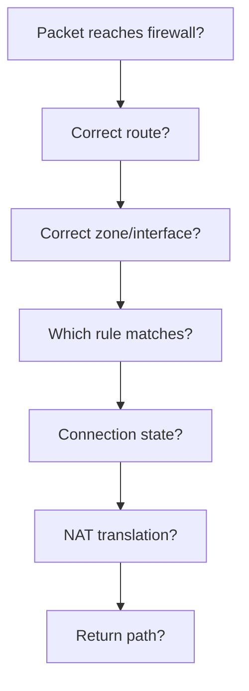

</div>

---

# Policy review questions

For each allow rule:

- Who needs it?
- To which destination?
- Which service?
- From which zone?
- Is the direction correct?
- Is there an owner?
- Is it still required?

Firewall policy accumulates technical debt.

---

# Change management

A dangerous workflow:

```text
service broken -> add broad allow -> forget it
```

Better:

```text
observe -> identify required flow -> add narrow rule -> test -> document
```

Operational pressure is a major source of firewall weakness.

---

# Common bypasses

Attackers may use:

- allowed ports;
- trusted destinations;
- compromised internal systems;
- DNS/HTTPS tunnels;
- applications that proxy traffic;
- misconfigured broad rules.

A firewall cannot infer intent from IP/port/state alone.

---

# Encrypted traffic

<div style="transform: scale(0.8); transform-origin: top center;">

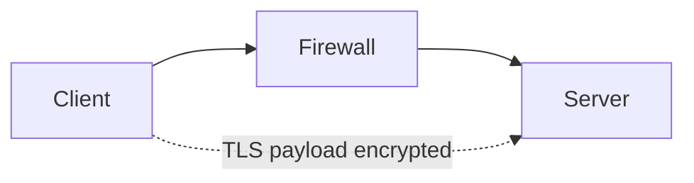

</div>

The firewall still sees metadata, but application content may be opaque.

---

# IPv6 matters

A common mistake is to secure IPv4 and forget IPv6.

If hosts have IPv6 connectivity, firewall policy should explicitly cover it.

Security principle:

> Every enabled network path needs policy, regardless of address family.

---

# Design scenario

Requirements:

- Internet users reach web servers on HTTPS.
- Web servers reach database on PostgreSQL.
- Employees browse the web.
- Only admins reach management.
- Database has no arbitrary Internet access.

Build the smallest understandable policy.

---

# Possible flow graph

<div style="transform: scale(0.8); transform-origin: top center;">

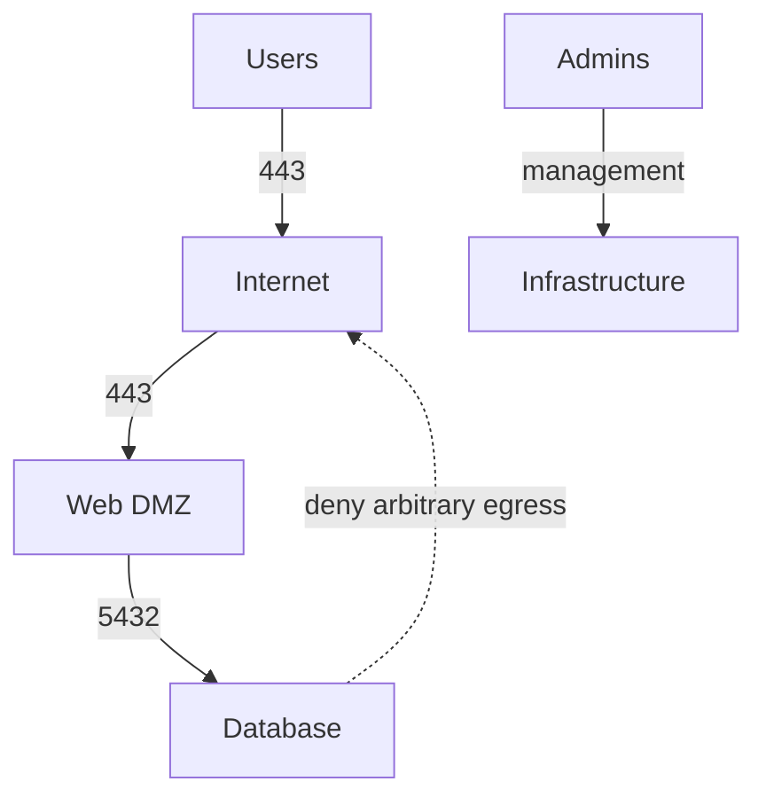

</div>

If a flow is not drawn, why should it be allowed?

---

# Common mistakes

- `any any allow`
- Wrong rule order
- No egress policy
- NAT mistaken for security
- Overlogging meaningless events
- Underlogging administrative changes
- Asymmetric paths with stateful devices
- IPv6 forgotten
- Temporary rules never removed

---

# What the firewall cannot solve

A firewall cannot by itself decide:

- whether a legitimate user steals data;
- whether an HTTP parameter is malicious;
- whether a DNS name is newly malicious;
- whether an email attachment contains malware.

Other layers exist for those questions.

---

# Mental model

<div style="transform: scale(0.8); transform-origin: top center;">

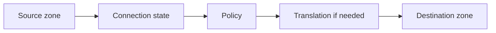

</div>

Always reason about direction and return traffic.

---

# Expert augmentation: firewall acceleration

Advanced firewall features are expensive:

- connection tracking;
- TLS termination or interception;
- IPS pattern matching;
- application identification;
- logging at high rate.

<div style="transform: scale(0.8); transform-origin: top center;">

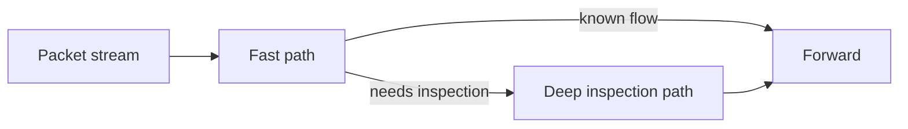

</div>

The architecture must prevent the slow path from becoming the bottleneck.

---

# Software firewall lesson: measure the feature cost

Even with open-source tools, feature choice changes throughput.

<div style="transform: scale(0.8); transform-origin: top center;">

```mermaid
flowchart TB
  A[nftables rules] --> B[conntrack]
  B --> C[logging]
  C --> D[Suricata inline]
  D --> E[TLS proxying]
  E --> F[throughput and latency impact]
```

</div>

Teaching experiment:

1. forward packets with basic filtering;
2. enable connection tracking;
3. add IPS inspection;
4. add TLS termination elsewhere;
5. measure latency, drops, and CPU.

---

# Review questions

1. What is the difference between stateless and stateful filtering?
2. Why does rule order matter?
3. Why should the default policy usually be deny?
4. Why is NAT not a firewall?
5. What breaks stateful filtering in asymmetric paths?
6. Why does HTTPS limit application visibility?

---

# Final checklist

For each firewall boundary, ask:

- What are the zones?
- Which flows are required?
- Is default deny explicit?
- Are rules ordered and non-shadowed?
- Is state handling understood?
- Is egress restricted?
- Is NAT separated conceptually from authorization?
- Are logs actionable?
- Are IPv4 and IPv6 both covered?
