# IDS, IPS, and Network Security Monitoring

## Detecting malicious behavior in traffic

__Open-source stack:__ Suricata, Zeek, tcpdump

Firewalls decide what is permitted. Detection systems ask whether permitted or observed traffic is **suspicious**.

---

# Learning objectives

You should be able to:

- distinguish IDS, IPS, and NSM;
- compare passive and inline deployment;
- explain signatures and protocol-aware detection;
- use Suricata rule concepts;
- explain Zeek's event/log model;
- reason about false positives, tuning, and encrypted traffic.

---

# Three related questions

<div style="transform: scale(0.8); transform-origin: top center;">

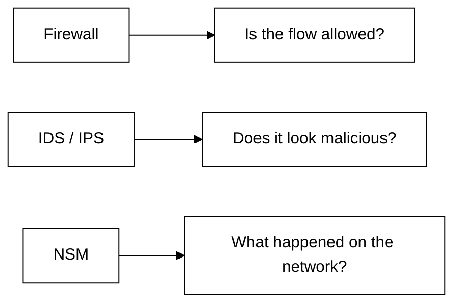

</div>

The tools overlap, but the questions are different.

---

# Passive IDS

<div style="transform: scale(0.8); transform-origin: top center;">

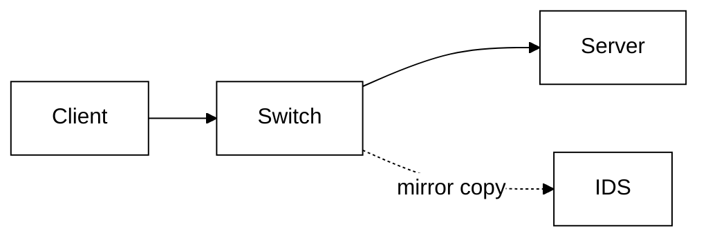

</div>

Advantages:

- cannot normally break the traffic path;
- easy to deploy.

Limitation: it usually cannot directly stop the observed packet.

---

# Inline IPS

<div style="transform: scale(0.8); transform-origin: top center;">

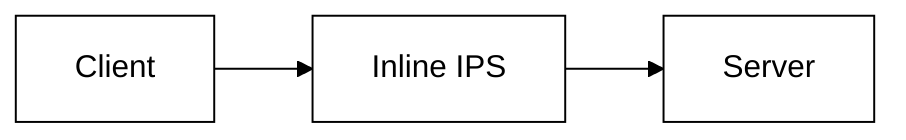

</div>

Possible actions:

- pass;
- drop;
- reject;
- alert;
- rate limit in some designs.

The security sensor is now also an availability dependency.

---

# SPAN / mirror port

<div style="transform: scale(0.8); transform-origin: top center;">

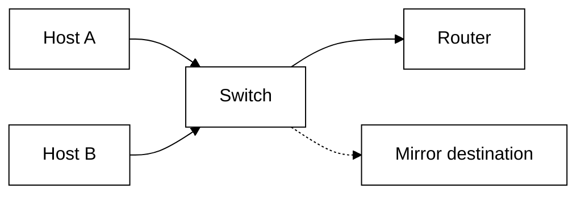

</div>

SPAN is convenient but can lose packets under load and depends on correct switch configuration.

---

# Network TAP

<div style="transform: scale(0.8); transform-origin: top center;">

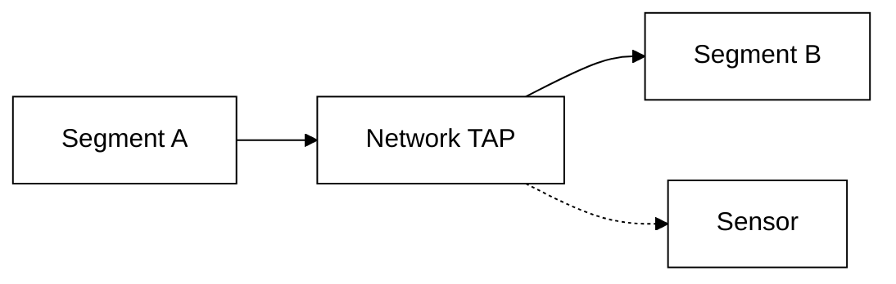

</div>

A TAP is purpose-built for observation and can provide more predictable visibility than a switch mirror.

---

# Visibility determines detection

A sensor cannot detect traffic it never sees.

Ask:

- north-south only?
- east-west too?
- before or after NAT?
- before or after TLS termination?
- one VLAN or many?
- packet loss at the sensor?

---

# Signature detection

Concept:

<div style="transform: scale(0.8); transform-origin: top center;">

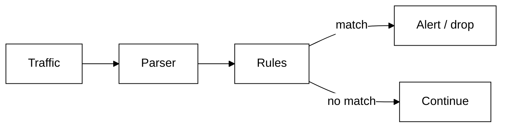

</div>

A signature looks for known suspicious characteristics.

---

# Signature strengths

Good signatures can be:

- explainable;
- specific;
- fast;
- mapped to a known vulnerability or behavior;
- easy to test with packet captures.

They are strongest when the protocol context is understood.

---

# Signature weakness

A signature cannot match what it does not describe.

Attackers may:

- use a new exploit;
- change encoding;
- change infrastructure;
- use legitimate tools;
- hide content inside encryption.

Detection needs more than static byte patterns.

---

# Protocol-aware parsing

Compare:

```text
search every packet for "../"
```

with:

```text
parse HTTP -> inspect normalized URI path
```

Protocol-aware inspection reduces ambiguity and makes rules more semantically meaningful.

---

# Suricata

Suricata is an open-source engine for:

- IDS;
- IPS;
- protocol detection;
- file and flow metadata;
- JSON event output;
- signature rules.

It is a strong teaching platform because packet, flow, protocol, and rule concepts are visible.

---

# Simplified Suricata pipeline

<div style="transform: scale(0.8); transform-origin: top center;">

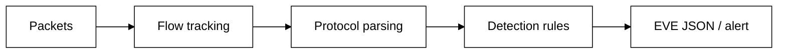

</div>

The real engine is more complex, but this model is enough for architecture reasoning.

---

# Rule anatomy

A simplified Suricata-style rule:

```text
alert http any any -> $HOME_NET any (
  msg:"Suspicious admin path";
  http.uri; content:"/admin";
  sid:1000001;
)
```

Teach the structure, not memorization.

---

# Rule fields to understand

Students should recognize:

- action;
- protocol;
- source/destination;
- direction;
- message;
- content/protocol keywords;
- unique rule ID.

The crucial question is always: **what exact behavior causes the alert?**

---

# Detection on flows

A connection contains more context than one packet.

<div style="transform: scale(0.8); transform-origin: top center;">

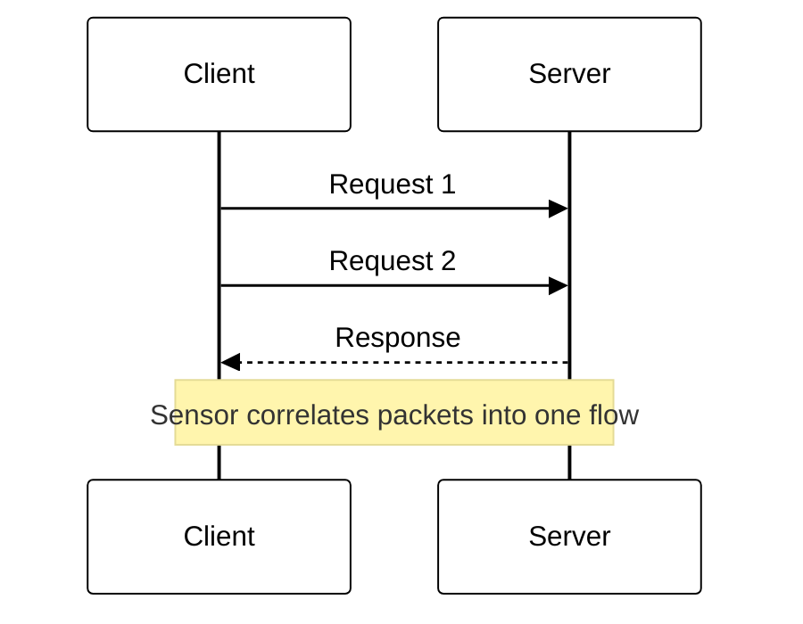

</div>

---

# File extraction and metadata

Network sensors may identify files transferred through supported protocols.

Possible metadata:

- filename;
- MIME/type;
- size;
- hash;
- source/destination;
- transfer protocol.

This can feed malware analysis without making the IDS a full endpoint scanner.

---

# Alert does not equal incident

<div style="transform: scale(0.8); transform-origin: top center;">

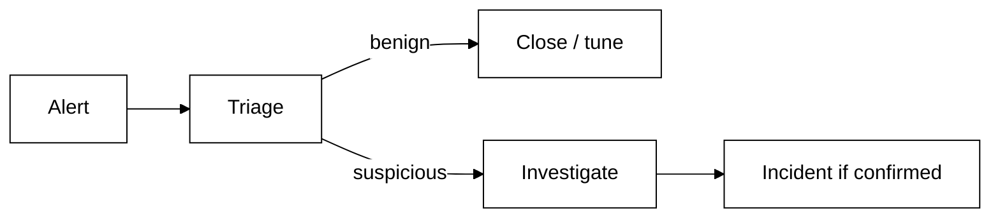

</div>

A detection system creates hypotheses, not automatic truth.

---

# False positives

A false positive is benign activity that triggers a detection.

Too many false positives lead to:

- analyst fatigue;
- ignored alerts;
- disabled rules;
- missed real incidents.

Precision is an operational security property.

---

# False negatives

A false negative is malicious activity the system fails to detect.

Reasons include:

- no applicable rule;
- lost packets;
- encrypted payload;
- visibility gap;
- evasion;
- misconfiguration.

Silence does not prove safety.

---

# Tuning

Good tuning asks:

- Is the vulnerable software actually present?
- Is this service reachable?
- Is the pattern normal in this network?
- Which assets are critical?
- Does the signature have useful context?

Tune by understanding, not merely suppressing noise.

---

# Asset context

The same alert can have different priority:

<div style="transform: scale(0.8); transform-origin: top center;">

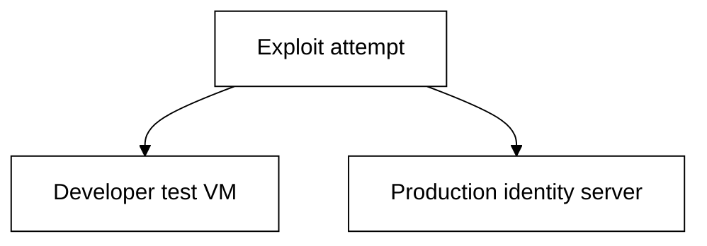

</div>

Asset importance and exposure should influence triage.

---

# Network Security Monitoring

NSM is broader than signatures.

It asks:

> What communications occurred, between whom, using which protocols, with what observable properties?

This supports hunting and incident reconstruction.

---

# Zeek

Zeek is an open-source network analysis framework that turns observed traffic into rich events and logs.

Common logs include:

- connections;
- DNS;
- HTTP;
- TLS;
- files;
- notices.

Its strength is **structured network context**.

---

# Zeek event model

<div style="transform: scale(0.8); transform-origin: top center;">

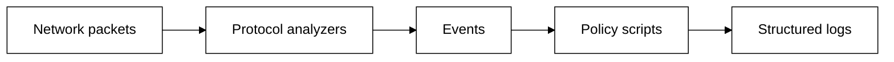

</div>

This differs from thinking only in signatures.

---

# conn.log

Connection records can answer questions like:

- who talked to whom?
- when?
- for how long?
- which protocol?
- how many bytes?
- was the connection successful?

This is foundational investigative context.

---

# DNS and HTTP logs

A timeline might look like:

<div style="transform: scale(0.8); transform-origin: top center;">

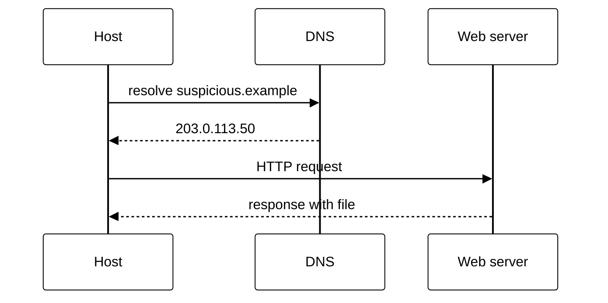

</div>

Zeek can help reconstruct this chain.

---

# Behavioral detection

Instead of matching a known payload, detect patterns such as:

- one host contacting hundreds of destinations;
- DNS labels with unusual entropy;
- rare external services;
- unusual outbound volumes;
- new protocols from a sensitive server.

Behavior needs a baseline and context.

---

# Rare does not mean malicious

A new destination may be:

- an attacker;
- a software update;
- a new SaaS provider;
- a developer experiment;
- a business partner.

Anomaly detection produces leads, not certainty.

---

# Encrypted traffic

<div style="transform: scale(0.8); transform-origin: top center;">

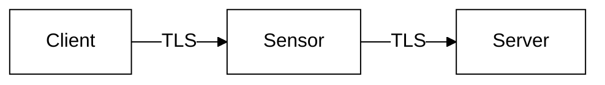

</div>

A passive sensor may still observe:

- endpoints;
- timing;
- sizes;
- TLS handshake metadata;
- certificate information where visible;
- DNS around the connection.

---

# After TLS termination

<div style="transform: scale(0.8); transform-origin: top center;">

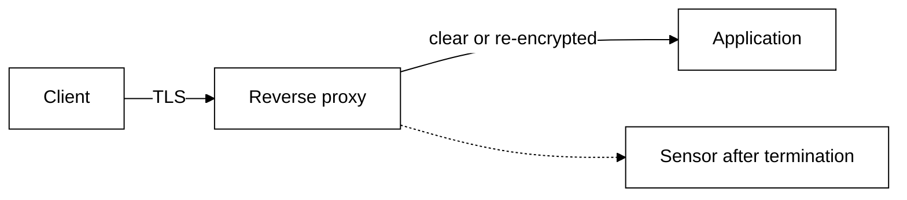

</div>

Sensor placement relative to decryption changes what can be inspected.

---

# QUIC and protocol evolution

Modern protocols can reduce traditional network visibility.

Security teams must adapt by combining:

- network metadata;
- endpoint telemetry;
- server/proxy logs;
- identity data.

A single network sensor is no longer omniscient.

---

# Evasion and normalization

Different endpoints may interpret ambiguous protocol input differently.

An attacker may exploit parser differences.

Principle:

> Detection should normalize and parse traffic as consistently as possible with the protected endpoint.

---

# IPS risk

An incorrect IDS alert is annoying.

An incorrect IPS decision can cause an outage.

<div style="transform: scale(0.8); transform-origin: top center;">

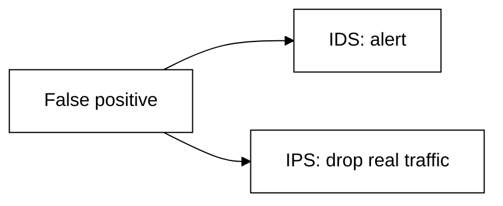

</div>

Blocking requires higher confidence and careful change control.

---

# Fail-open vs fail-closed

If an inline sensor fails:

- **fail-open** preserves availability but loses inspection;
- **fail-closed** preserves enforcement but can stop business traffic.

The right answer depends on the protected service.

---

# Suricata lab topology

<div style="transform: scale(0.8); transform-origin: top center;">

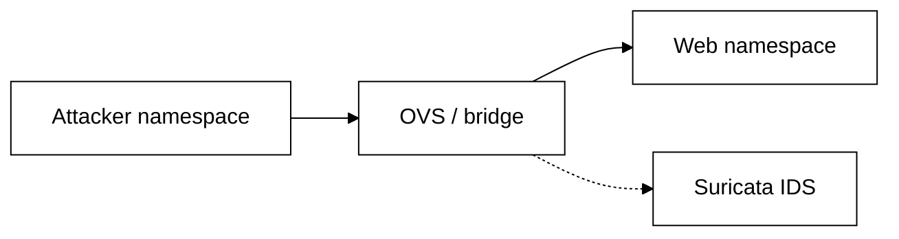

</div>

Generate benign and suspicious requests and compare network traffic with alerts.

---

# Simple lab rule

Example teaching rule:

```text
alert http any any -> any any (
  msg:"Training path requested";
  http.uri;
  content:"/secret-training";
  sid:1000002;
)
```

The point is to see how application-aware matching differs from raw packet filtering.

---

# Zeek lab

Capture the same traffic and ask students to identify:

- connection record;
- DNS lookup;
- HTTP request;
- TLS metadata if HTTPS is used;
- transferred file metadata if available.

One packet trace becomes an **investigation timeline**.

---

# Rule lifecycle

<div style="transform: scale(0.8); transform-origin: top center;">

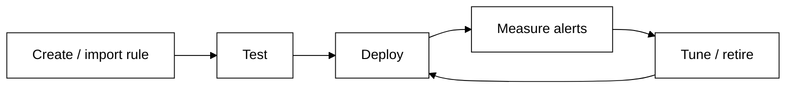

</div>

Detection content needs maintenance just like software.

---

# Metrics that matter

Useful questions:

- Which alerts are actionable?
- How many are investigated?
- Which rules never fire?
- Which rules fire constantly?
- Are sensors dropping packets?
- How quickly are high-confidence alerts triaged?

Raw alert count is a poor success metric.

---

# Design scenario

You have:

- Internet-facing web service;
- employee VLAN;
- database VLAN;
- TLS reverse proxy;
- internal DNS.

Where would you place sensors, and what would each location reveal?

---

# Possible sensor placement

<div style="transform: scale(0.8); transform-origin: top center;">

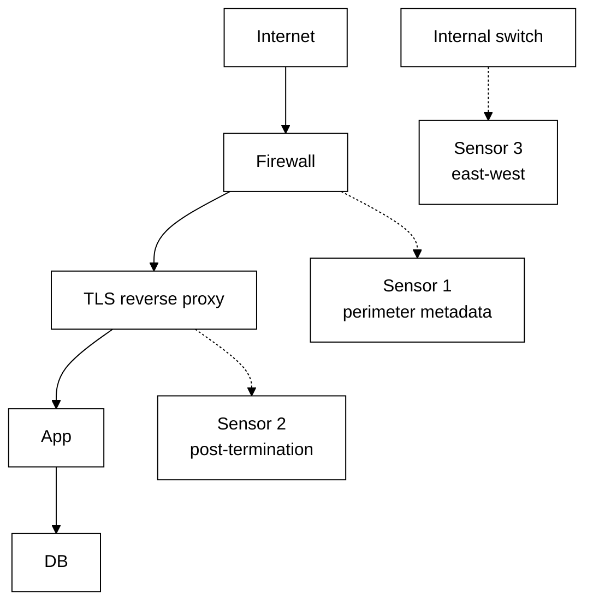

</div>

Different sensors answer different questions.

---

# Common mistakes

- Deploying sensors without validating visibility
- Treating every alert as an incident
- Enabling thousands of rules with no tuning
- Ignoring dropped packets
- Running inline before understanding false positives
- Forgetting encrypted traffic
- Keeping alerts but not network context
- No rule ownership/lifecycle

---

# What IDS/IPS cannot solve

Detection does not replace:

- preventive firewall policy;
- endpoint security;
- secure application design;
- identity controls;
- patching;
- incident response.

A perfect alert that nobody responds to has little value.

---

# Mental model

<div style="transform: scale(0.8); transform-origin: top center;">

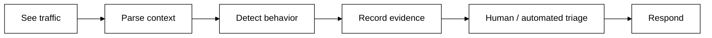

</div>

---

# Expert augmentation: IDS after TLS 1.3

Passive sensors usually cannot decrypt modern TLS sessions.

<div style="transform: scale(0.8); transform-origin: top center;">

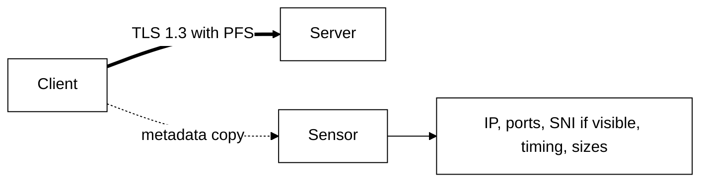

</div>

The sensor may lose payload visibility but still keeps useful metadata.

Important shift:

> from exact payload signatures to protocol metadata and behavior.

---

# Encrypted traffic analysis

ETA-style detection uses flow features rather than plaintext.

<div style="transform: scale(0.8); transform-origin: top center;">

```mermaid
%%{init: {'theme': 'base', 'themeVariables': {'primaryColor': '#ffffff', 'primaryBorderColor': '#000000', 'primaryTextColor': '#000000', 'lineColor': '#000000'}}}%%
flowchart LR
  FLOW[Encrypted flow] --> F1[packet sizes]
  FLOW --> F2[timing]
  FLOW --> F3[TLS fingerprint]
  FLOW --> F4[DNS context]
  F1 --> MODEL[scoring model]
  F2 --> MODEL
  F3 --> MODEL
  F4 --> MODEL
  MODEL --> ALERT[alert / hunt lead]
```

</div>

Caution for students:

- this is probabilistic;
- it needs baselines;
- it produces hunt leads, not mathematical proof.

---

# Review questions

1. What is the operational difference between IDS and IPS?
2. Why can SPAN visibility be incomplete?
3. Why is protocol parsing better than simple byte matching?
4. What does Zeek add beyond signatures?
5. Why are false positives dangerous in IPS mode?
6. What can still be learned from encrypted traffic?

---

# Final checklist

For a network detection deployment, ask:

- Which traffic is actually visible?
- Is packet loss measured?
- Passive or inline?
- Which detections map to real assets?
- How are signatures tested and tuned?
- What structured metadata is retained?
- How does encryption affect visibility?
- Who investigates the alert?
- What response follows confirmation?
