# IDS, IPS, and Network Security Monitoring

## Detecting malicious behavior in traffic

Firewalls decide what is permitted. Detection systems ask whether permitted or observed traffic is **suspicious**.


**Mihai Chiroiu** © Network Security Using Dedicated Devices

---

# Learning objectives

You should be able to:

- distinguish IDS, IPS, and NSM;
- compare passive and inline deployment;
- explain signatures and protocol-aware detection;
- reason about false positives, tuning, and encrypted traffic.

---

# Three related questions

<div style="transform: scale(0.8); transform-origin: top center;">

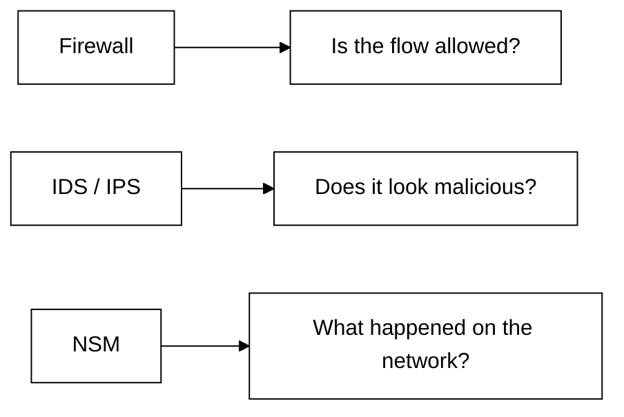

</div>

The tools overlap, but the questions are different.

---

# Passive IDS

<div style="transform: scale(0.8); transform-origin: top center;">

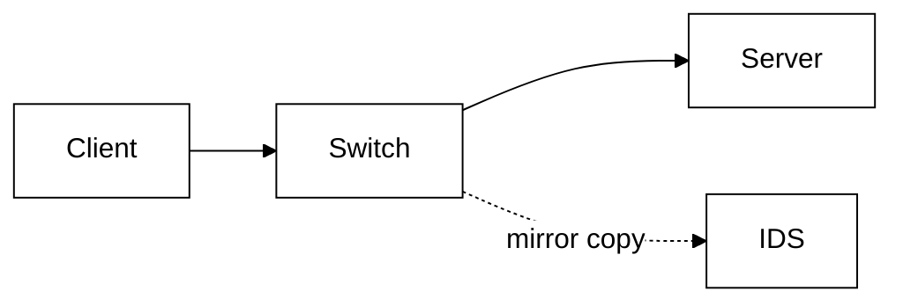

</div>

Advantages:

- cannot normally break the traffic path;
- easy to deploy.

Limitation: it cannot **drop** the initial offending packet (already forwarded on the wire).

However, a passive IDS can still perform **Active Response**:
- inject forged **TCP RST** packets toward both endpoints (**sequence strafing** — multiple RSTs with different sequence numbers to land inside the receiver's sliding window)
- trigger automated **firewall API blocks** (e.g., Wazuh active response + nftables timed address sets)

The *session* can be terminated — only the first packet escapes.

---

# Inline IPS

<div style="transform: scale(0.8); transform-origin: top center;">

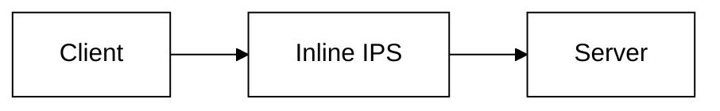

</div>

Possible actions:

- **pass** — allow without alerting;
- **drop** — silently discard the packet (inline only);
- **reject** — drop + send TCP RST or ICMP unreachable to endpoints (inline: inserted in-stream; passive: injected out-of-band via sequence strafing);
- **alert** — log the event;
- **rate limit** — throttle in some designs.

The security sensor is now also an availability dependency.

---

# SPAN / mirror port

<div style="transform: scale(0.8); transform-origin: top center;">

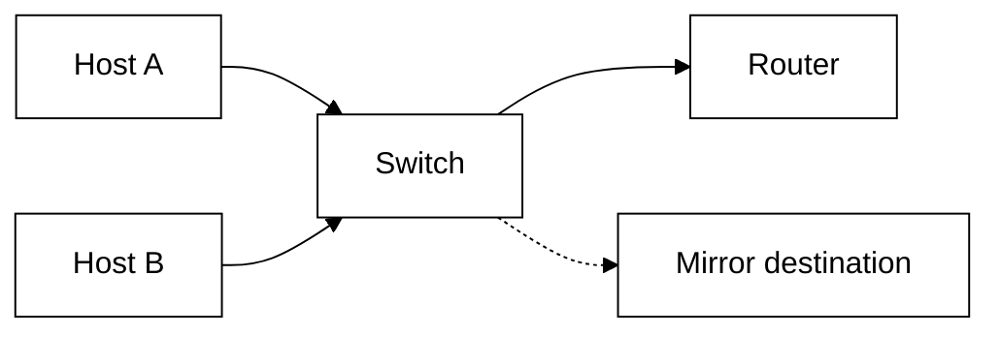

</div>

SPAN is convenient but can lose packets under load and depends on correct switch configuration.

---

# Network TAP

<div style="transform: scale(0.8); transform-origin: top center;">

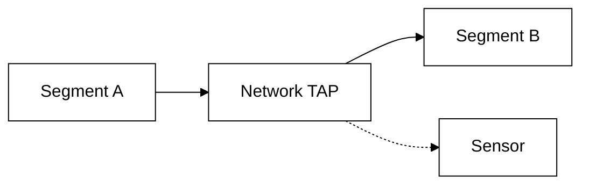

</div>

A TAP is purpose-built for observation and can provide more predictable visibility than a switch mirror.

**Full-duplex caveat:** a link at speed $N$ carries up to $2N$ aggregate traffic (TX + RX). An **aggregation TAP** that merges both directions onto a single $N$-speed sensor NIC will drop packets when bidirectional utilization exceeds 50%. Solutions: dual capture NICs receiving separate TX/RX feeds, or a dedicated **Network Packet Broker** (NPB).

---

# Visibility determines detection

A sensor cannot detect traffic it never sees.

Ask:

- north-south only?
- east-west too?
- before or after NAT?
- before or after TLS termination?
- one VLAN or many?
- packet loss at the sensor?
- **asymmetric routing?** (sensor sees only one direction of a flow → breaks stateful stream reassembly)

---

# Signature detection

Concept:

<div style="transform: scale(0.8); transform-origin: top center;">

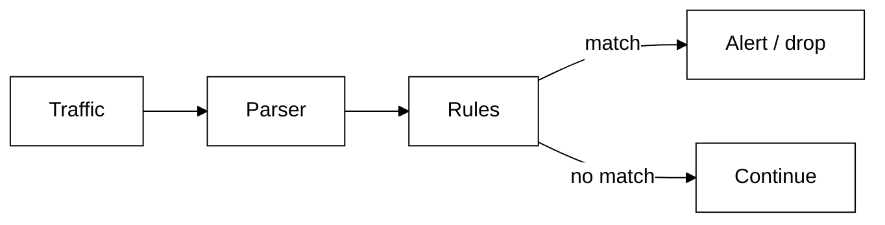

</div>

A signature looks for known suspicious characteristics.

---

# Signature strengths

Good signatures can be:

- explainable;
- specific;
- fast;
- mapped to a known vulnerability or behavior;
- easy to test with packet captures.

They are strongest when the protocol context is understood.

---

# Signature weakness

A signature cannot match what it does not describe.

Attackers may:

- use a new exploit;
- change encoding;
- change infrastructure;
- use legitimate tools;
- hide content inside encryption.

Detection needs more than static byte patterns.

---

# Protocol-aware parsing

Compare:

```text
search every packet for "../"
```

with:

```text
parse HTTP -> inspect normalized URI path
```

Protocol-aware inspection reduces ambiguity and makes rules more semantically meaningful.

---

# Evasion theory — insertion and evasion attacks

A sensor reconstructs the packet stream **independently** from the target host — different network stacks may disagree on reassembly.

**Insertion attack** (Ptacek & Newsham 1998): the IDS **accepts** bytes the target **rejects** (e.g., a segment with a TTL too short to reach the target, or a bad IP checksum). The IDS reassembles a different stream than the target, and the malicious signature does not match.

**Evasion attack**: the IDS **rejects** bytes the target **accepts** (e.g., OS-specific overlapping TCP segment reassembly policies — some OSes keep the first overlapping data, others keep the last). The exploit is reconstructed only on the target.

Peak complexity arises with overlapping IP fragments and TCP segments carrying conflicting payloads — the sensor cannot know which interpretation the target will use (Handley & Paxson 2001).

**Inline IPS solves this via traffic normalization** — scrubbing ambiguities before forwarding: drop invalid header lengths, normalize TTL, resolve overlapping segments with a single deterministic policy.

---

# Suricata

Suricata is an open-source engine for:

- IDS;
- IPS;
- protocol detection;
- file and flow metadata;
- JSON event output;
- signature rules.


---

# Rule anatomy

An idiomatic Suricata rule:

```text
alert http $EXTERNAL_NET any -> $HOME_NET any (
  msg:"LOCAL Suspicious Admin URI Path Access";
  flow:established,to_server;
  http.uri; content:"/admin"; startswith; nocase;
  classtype:web-application-activity;
  sid:1000001; rev:1;
)
```

`flow:established,to_server` limits inspection to client requests inside an established TCP session — skipping SYN floods and server replies.

---

# Rule fields

The **rule header** is a 7-tuple:

| Field | Example |
|---|---|
| Action | `alert` |
| Protocol | `http` |
| Source IP | `$EXTERNAL_NET` |
| Source port | `any` |
| Direction | `->` |
| Destination IP | `$HOME_NET` |
| Destination port | `any` |

**Sticky buffers:** `http.uri` switches the inspection buffer for all subsequent `content` keywords — they match against the normalized URI, not the raw packet payload.

**MPM pre-filter:** the engine marks one `content` per rule as the `fast_pattern` anchor. A single Aho–Corasick pass finds candidate rules; only those rules are fully evaluated — the engine does **not** test 50 000 rules sequentially.

---

# Detection on flows

A connection contains more context than one packet.

<div style="transform: scale(0.8); transform-origin: top center;">

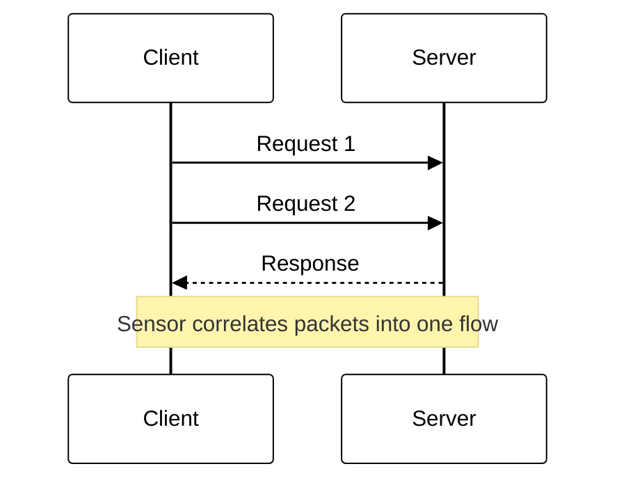

</div>

---

# IPS buffering — the latency cost

An **IPS** sits **inline** — it must decide before forwarding. To inspect a full flow, the IPS buffers packets:

```text
Packet arrives → buffer → reassemble stream → match rules → forward or drop
                  ╰─────── added latency ──────╯
```

| Inspection depth | What is buffered | Typical delay |
|---|---|---|
| Single packet | Just headers + payload | µs–low ms |
| Stream reassembly | Multiple TCP segments | ms |
| Full protocol decode | HTTP request body, file content | ms–tens of ms |
| File extraction + cloud ML | Stream hash + rapid ML verdict | ms–low seconds (fails open on timeout) |

Full behavioral sandboxing (VM detonation) is performed **asynchronously out-of-band** — the sensor forwards packets and submits a file copy; if the sandbox later convicts the file, a reactive signature or block is distributed. Holding an entire file inline for minutes would exhaust TCP RTO timers and sensor memory.

A true multi-minute inline hold requires an **Explicit Proxy** (L7 termination), which is architecturally different from packet-level IPS buffering.

---

# High-speed sensor architecture

Why sensors drop packets under load — and how to prevent it.

**Packet acquisition (Linux):**
- **AF_PACKET** — zero-copy ring-buffer capture; used in IPS bridge mode or passive TAP mode
- **NFQUEUE** — nftables/iptables delivers packets to userspace; supports fail-open bypass if the sensor process dies

**Symmetric flow distribution:** both directions of a TCP/UDP flow must land on the **same worker thread** (CPU core) — otherwise stateful stream reassembly breaks. Suricata's `cluster_flow` mode hashes on the 5-tuple to guarantee this.

**Multi-Pattern Matching (MPM):** the engine does **not** evaluate 50 000 rules sequentially. One `content` keyword per rule is designated `fast_pattern`. A single **Aho–Corasick** pass over each buffer finds all candidate rules in $O(n)$; only matching candidates are fully evaluated.

**Workers mode:** each packet-capture thread runs its own detection engine — no locking, linear horizontal scaling across CPU cores.

---

# File extraction and metadata

Network sensors may identify files transferred through supported protocols.

Possible metadata:

- filename;
- MIME/type;
- size;
- hash;
- source/destination;
- transfer protocol.

This can feed malware analysis without making the IDS a full endpoint scanner.

---

# Alert does not equal incident

<div style="transform: scale(0.8); transform-origin: top center;">

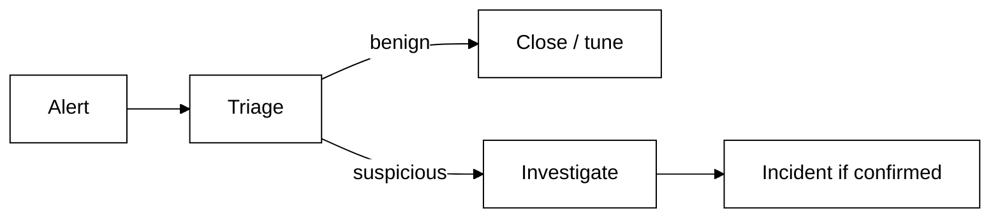

</div>

A detection system creates hypotheses, not automatic truth.

---

# False positives

A false positive is benign activity that triggers a detection.

Too many false positives lead to:

- analyst fatigue;
- ignored alerts;
- disabled rules;
- missed real incidents.

---

# False negatives

A false negative is malicious activity the system fails to detect.

Reasons include:

- no applicable rule;
- lost packets;
- encrypted payload;
- visibility gap;
- evasion;
- misconfiguration.

Silence does not prove safety.

---

# The Base-Rate Fallacy

Analysts confuse detection rate (TPR) with **precision** — *given an alarm, how likely is it a true attack?* (Axelsson 1999).

$$
P(\text{Attack} \mid \text{Alarm}) = \frac{P(\text{Alarm}\mid\text{Attack}) \cdot P(\text{Attack})}{P(\text{Alarm}\mid\text{Attack}) \cdot P(\text{Attack}) + P(\text{Alarm}\mid\neg\text{Attack}) \cdot P(\neg\text{Attack})}
$$

**Worked example:** 10 000 events, 100 attacks (1% base rate), 99% TPR, 1% FPR:

| | Alarm | No alarm |
|---|---|---|
| Attack (100) | 99 TP | 1 FN |
| Benign (9 900) | 99 FP | 9 801 TN |

Precision = 99 / (99 + 99) = **50%** — half the alarms are false.

At network-flow scale ($P(\text{Attack}) \ll 0.01\%$), precision drops near zero unless FPR is negligibly small.

**Practical tuning:** write **narrow suppressions** (scoped to source/destination/port/time window) before raising global thresholds. Quantitative calibration: $3\sigma$ anomaly threshold ≈ 389 false alerts/day across 500 metrics; $4\sigma$ ≈ 9/day.

---

# Asset context

The same alert can have different priority:

<div style="transform: scale(0.8); transform-origin: top center;">

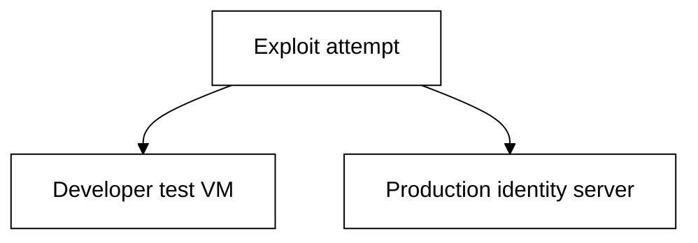

</div>

Asset importance and exposure should influence triage.

---

# Network Security Monitoring

NSM is broader than signatures.

It asks:

> What communications occurred, between whom, using which protocols, with what observable properties?

This supports hunting and incident reconstruction.

---

# Zeek

Zeek is an open-source network analysis framework that turns observed traffic into rich events and logs.

Common logs include:

- connections;
- DNS;
- HTTP;
- TLS;
- files;
- notices.

Its strength is **structured network context**.

---

# Zeek event model

<div style="transform: scale(0.8); transform-origin: top center;">

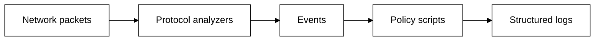

</div>

This differs from thinking only in signatures.

---

# conn.log

Connection records can answer questions like:

- who talked to whom?
- when?
- for how long?
- which protocol?
- how many bytes?
- was the connection successful?

This is foundational investigative context.

---

# DNS and HTTP logs

A timeline might look like:

<div style="transform: scale(0.8); transform-origin: top center;">

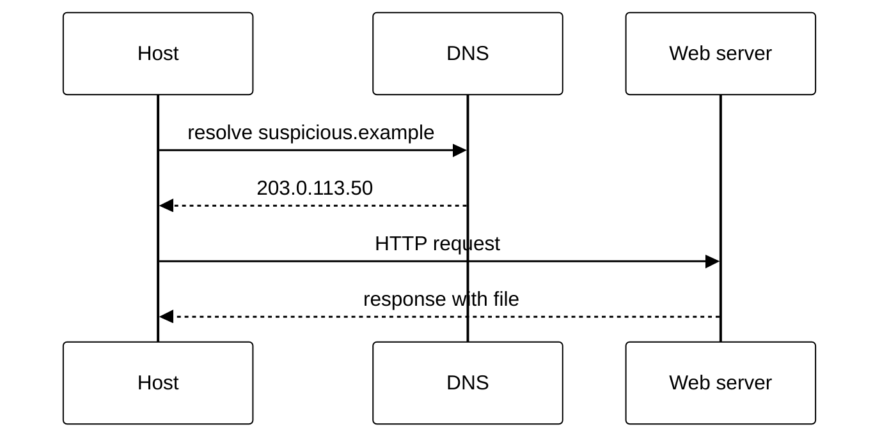

</div>

Zeek can help reconstruct this chain.

---

# Correlating Suricata, Zeek, and HIDS

A modern SOC correlates **Suricata** alerts (`eve.json`) with **Zeek** logs (`conn.log`, `dns.log`, `ssl.log`) using a shared flow identifier — Suricata's `community_id` or Zeek's `uid`.

**Pivot workflow:** a single signature alert → look up the flow's full DNS resolution, HTTP transactions, TLS certificate chain, and any extracted files. One alert becomes a complete narrative.

**HIDS integration:** host-based agents (Wazuh / OSSEC) can:
- ingest Suricata `eve.json` as a log source
- monitor host-level logs, file integrity, and running processes
- see **cleartext** regardless of network encryption

**Unified dashboard:** network alert + host-level process/auth telemetry + coordinated active response (e.g., Suricata alerts → Wazuh triggers nftables block + host forensic snapshot).

---

# Behavioral detection

Instead of matching a known payload, detect patterns such as:

- one host contacting hundreds of destinations;
- DNS labels with unusual entropy;
- rare external services;
- unusual outbound volumes;
- new protocols from a sensitive server.

Behavior needs a baseline and context.

---

# Rare does not mean malicious

A new destination may be:

- an attacker;
- a software update;
- a new SaaS provider;
- a developer experiment;
- a business partner.

Anomaly detection produces leads, not certainty.

---

# Encrypted traffic

<div style="transform: scale(0.8); transform-origin: top center;">

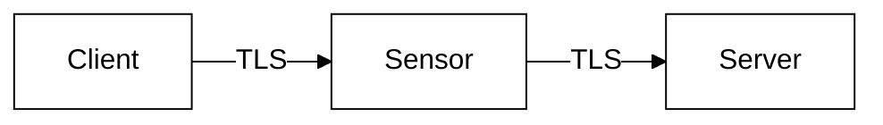

</div>

A passive sensor may still observe:

- endpoints;
- timing;
- sizes;
- TLS handshake metadata;
- DNS around the connection.

**TLS 1.3** encrypts all handshake messages after ServerHello — server certificates are no longer visible on the wire (unlike TLS 1.2). **Encrypted Client Hello (ECH)** additionally encrypts the SNI field, removing the last plaintext domain indicator.

**QUIC / HTTP/3** encapsulates TLS 1.3 over **UDP**, bypassing TCP-based flow rules and many legacy DPI engines entirely.

---

# After TLS termination

<div style="transform: scale(0.8); transform-origin: top center;">

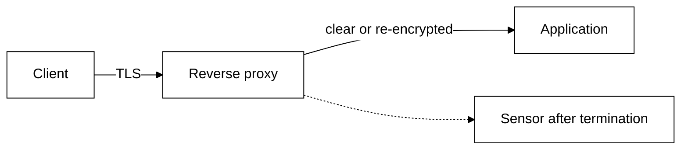

</div>

Sensor placement relative to decryption changes what can be inspected.

**Caveat:** if backend traffic is **re-encrypted** (mTLS between proxy and application, Zero Trust east-west), a passive wire sensor between proxy and application still sees ciphertext.

Solutions: host-level **eBPF** tap on the application's TLS library, **SSLKEYLOGFILE** export to the sensor for passive decryption, or a dedicated **SSL visibility appliance** that brokers keys.

---

# IPS risk

An incorrect IDS alert is annoying.

An incorrect IPS decision can cause an outage.

<div style="transform: scale(0.8); transform-origin: top center;">

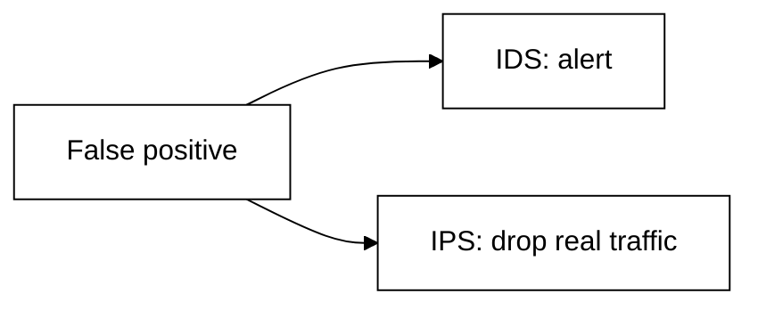

</div>

Blocking requires higher confidence and careful change control.

---

# Fail-open vs fail-closed

If an inline sensor fails:

- **fail-open** preserves availability but loses inspection;
- **fail-closed** preserves enforcement but can stop business traffic.

The right answer depends on the protected service.

---

# Rule lifecycle

<div style="transform: scale(0.8); transform-origin: top center;">

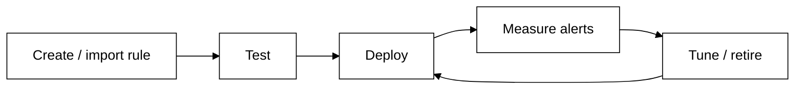

</div>

Detection content needs maintenance just like software.

---

# Metrics that matter

Useful questions:

- Which alerts are actionable?
- How many are investigated?
- Which rules never fire?
- Which rules fire constantly?
- Are sensors dropping packets?
- How quickly are high-confidence alerts triaged?

Raw alert count is a poor success metric.

---

# Common mistakes

- Deploying sensors without validating visibility
- Treating every alert as an incident
- Enabling thousands of rules with no tuning
- Ignoring dropped packets
- Running inline before understanding false positives
- Forgetting encrypted traffic
- Keeping alerts but not network context
- No rule ownership/lifecycle

---

# What IDS/IPS cannot solve

Detection does not replace:

- preventive firewall policy;
- endpoint security;
- secure application design;
- identity controls;
- patching;
- incident response.

A perfect alert that nobody responds to has little value.

---

# Mental model

<div style="transform: scale(0.8); transform-origin: top center;">

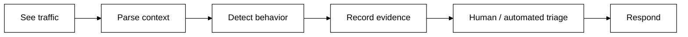

</div>

---

# Encrypted traffic analysis

ETA-style detection uses flow features rather than plaintext.

<div style="transform: scale(0.8); transform-origin: top center;">

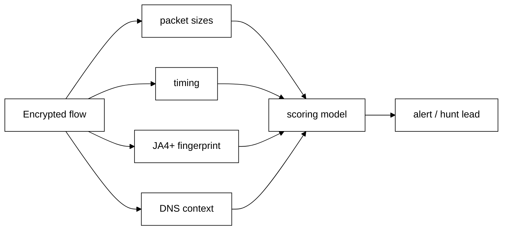

</div>

**From JA3 to JA4+:** JA3 hashed TLS ClientHello fields in order, but Chrome's TLS extension order randomization (2023) broke its stability. **JA4** (FoxIO 2023) sorts ciphers and extensions before hashing, producing a stable fingerprint with a human-readable prefix encoding transport type, TLS version, SNI presence, cipher count, and ALPN.

The **JA4+ suite** extends fingerprinting to:
- **JA4S** — ServerHello fingerprint; identifies malware C2 families (Cobalt Strike, Sliver)
- **JA4H** — HTTP client fingerprint
- **JA4SSH** — SSH session profiling (keystroke vs. file transfer)
- **JA4T** — TCP/OS fingerprint

JA4 is BSD 3-Clause licensed; the rest of the JA4+ suite is FoxIO License 1.1 (free for internal and academic use).

---

# Final checklist

For a network detection deployment, ask:

- Which traffic is actually visible?
- Is packet loss measured?
- Passive or inline?
- Which detections map to real assets?
- How are signatures tested and tuned?
- What structured metadata is retained?
- How does encryption affect visibility?
- Who investigates the alert?
- What response follows confirmation?
