---

theme: sred-theme
title: "Load Balancers and Reverse Proxies"
info: |
  Network Security Using Dedicated Devices
  Open-source teaching deck
transition: slide-left
mdc: true
---

# Load Balancers and Reverse Proxies

## Traffic distribution becomes a security control point

__Open-source tool:__ HAProxy

A load balancer is primarily an availability/performance component, but its position makes it extremely important for security.

---

# Learning objectives

You should be able to:

- distinguish L4 and L7 load balancing;
- explain reverse proxying;
- compare common balancing algorithms;
- explain health checks and failover;
- reason about TLS termination and client IP preservation;
- use HAProxy as an open-source implementation.

---

# Basic architecture

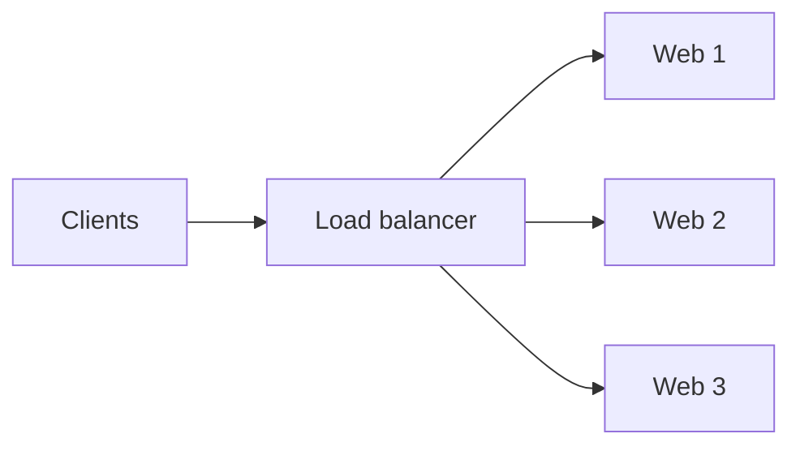

Clients see one service endpoint while the load balancer manages multiple backends.

---

# Why load balance?

Primary goals:

- distribute load;
- survive backend failure;
- scale horizontally;
- hide backend topology;
- centralize TLS and routing decisions.

Security appears because the load balancer becomes a **mandatory transit point**.

---

# Layer 4 load balancing

An L4 balancer primarily reasons about:

- IP addresses;
- TCP/UDP ports;
- connection tuples.

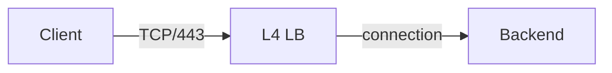

---

# Layer 7 load balancing

An L7 proxy understands application semantics.

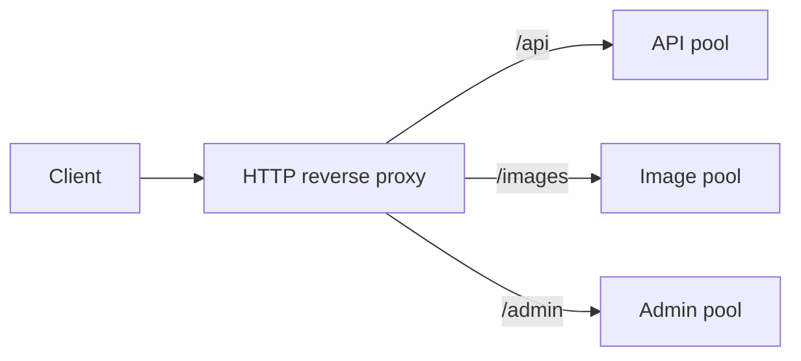

---

# Reverse proxy concept

The proxy terminates one connection and creates another.

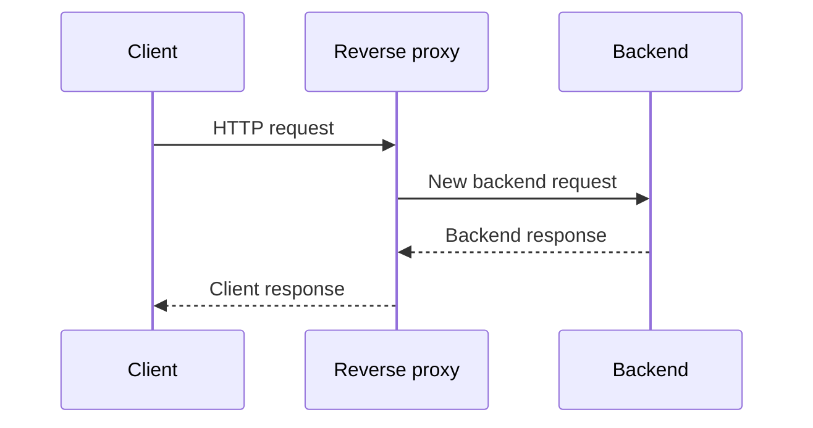

This is not simple packet forwarding.

---

# Security consequence

Because the proxy terminates the application connection, it can:

- parse requests;
- normalize headers;
- apply limits;
- add/remove headers;
- authenticate in some designs;
- route by content;
- feed a WAF.

That is much richer than an L3/L4 firewall.

---

# Round robin

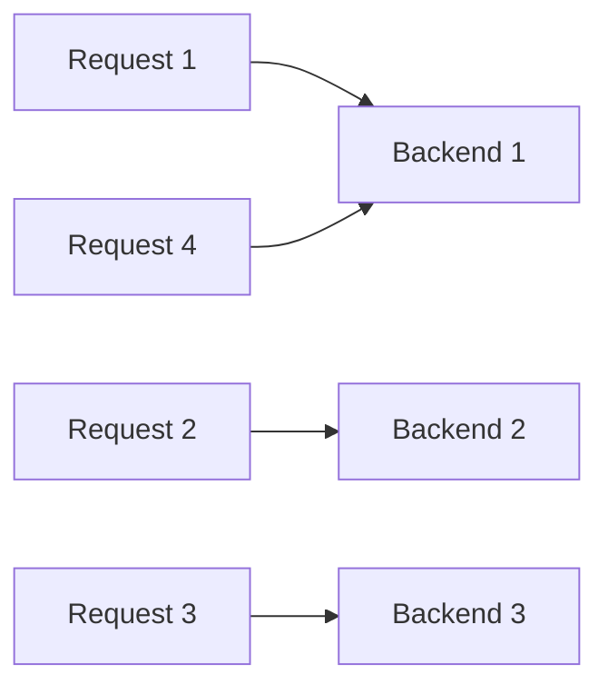

Simple and useful when backends have similar capacity and request cost.

---

# Least connections

Send new work to the backend with fewer active connections.

Useful when:

- connections vary in duration;
- some requests remain open longer;
- backend workload correlates with connection count.

No algorithm perfectly predicts application cost.

---

# Hash-based selection

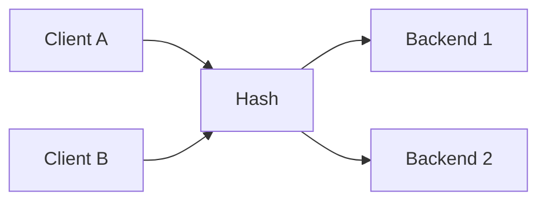

Hashing can provide deterministic affinity, but topology changes may remap clients depending on the algorithm.

---

# Health checks

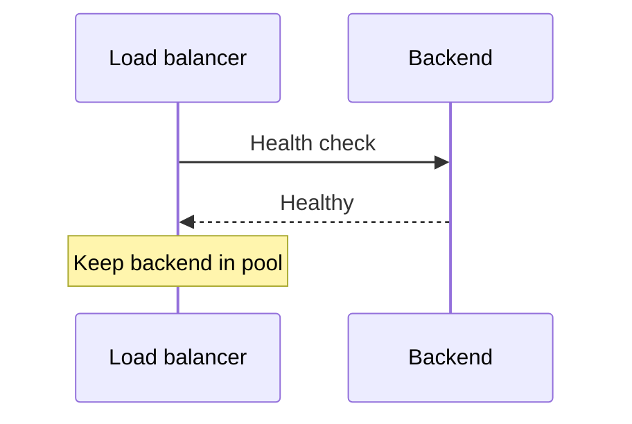

A backend should receive production traffic only while it is considered healthy.

---

# Failed backend

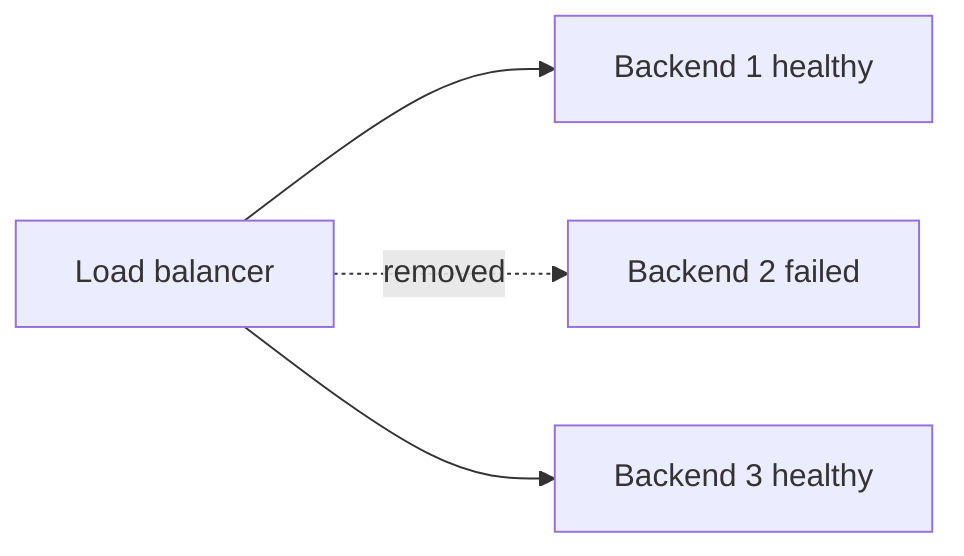

Health checks turn backend failure into a routing decision.

---

# Health check depth

A TCP connect proves:

> Something accepts TCP.

An HTTP check can prove:

> The application returns the expected status/path.

A deep check gives better confidence but may be more expensive or have side effects.

---

# Availability vs masking failures

A load balancer can hide individual backend failure.

But repeated health failures may indicate:

- application bug;
- dependency failure;
- overload;
- attack;
- bad deployment.

High availability should not hide operational evidence.

---

# TLS pass-through

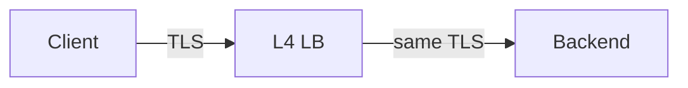

The load balancer can distribute connections without seeing HTTP content.

---

# TLS termination

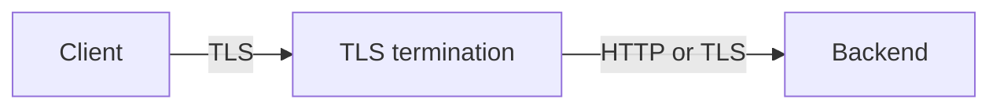

Now the proxy sees application requests and becomes responsible for private keys and certificate lifecycle.

---

# Re-encryption

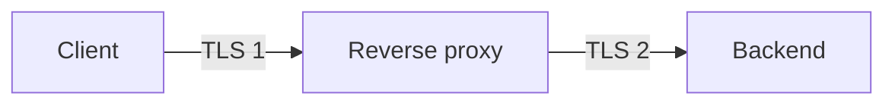

Two independent protected connections can preserve confidentiality on both network segments.

---

# Security trade-off of termination

Benefits:

- centralized certificate management;
- WAF/application inspection;
- header policy;
- consistent protocol configuration.

Risks:

- high-value private keys;
- large blast radius;
- misconfiguration affects many services.

---

# SNI-based routing

For HTTPS, the proxy may route based on the requested server name when available.

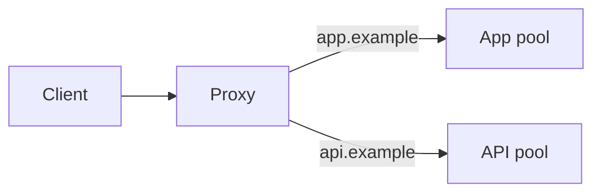

This enables many services behind one address.

---

# Host/path routing

At HTTP layer:

```text
Host: api.example
Path: /v2/users
```

can select a different backend than:

```text
Host: shop.example
Path: /images/logo.png
```

Routing policy becomes application-aware.

---

# Client IP problem

A backend may otherwise see only the proxy as the source.

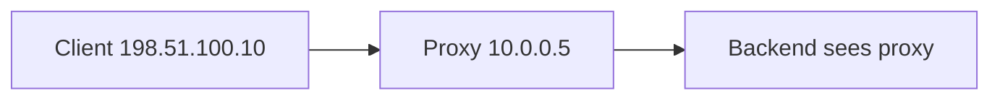

This affects logs, rate limits, and attribution.

---

# X-Forwarded-For

HTTP proxies commonly add a header carrying client address context.

Security warning:

> The backend must trust this header only from trusted proxies.

A direct client can forge arbitrary headers.

---

# PROXY protocol

The PROXY protocol can transport original connection metadata to a backend at the transport layer.

Conceptually:

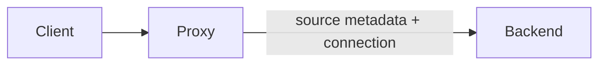

Both ends must be configured consistently.

---

# Session persistence

Some applications expect a user to return to the same backend.

Methods may include:

- cookie-based affinity;
- source hashing;
- application token.

Persistence can reduce balancing quality and complicate failover.

---

# Prefer stateless applications

If application state lives outside one web process:

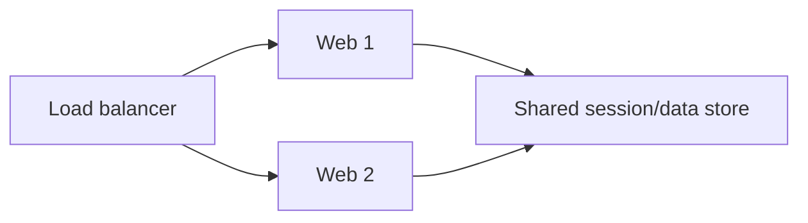

then backends become easier to replace and scale.

---

# Connection limits

A proxy can place bounds on:

- concurrent client connections;
- backend connections;
- request rate;
- queue size;
- request body size in some layers.

These controls help protect scarce backend resources.

---

# Rate limiting

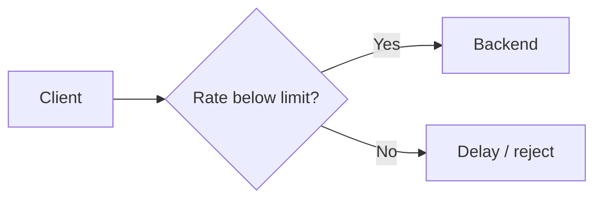

Rate limits are useful against abuse but need identity and traffic context.

---

# Queueing

When all backends are busy, the load balancer may queue some requests rather than failing immediately.

But queues can also hide overload.

A queue is not infinite capacity; it is controlled waiting.

---

# Timeouts are security controls

Useful timeouts include:

- connect timeout;
- client inactivity;
- server inactivity;
- request/header timeout.

Slow clients should not hold expensive resources forever.

---

# Slow-request attacks

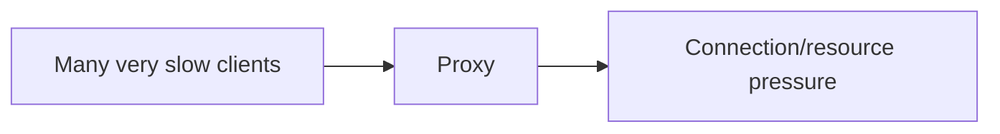

Reasonable timeouts and connection limits reduce exposure before traffic reaches application servers.

---

# Header normalization

A reverse proxy can reject malformed requests and enforce consistent HTTP parsing.

This matters because parser disagreement between:

- proxy;
- WAF;
- application server;

can create request-smuggling style problems.

---

# Trust boundaries between proxies

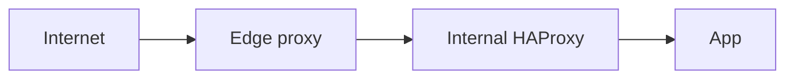

Each hop must define:

- which headers are trusted;
- which are overwritten;
- who supplies client identity/address context.

---

# Open-source tool: HAProxy

HAProxy can demonstrate:

- TCP proxying;
- HTTP reverse proxying;
- balancing algorithms;
- health checks;
- TLS termination;
- ACL-based routing;
- rate/connection controls;
- structured logging.

---

# HAProxy architecture

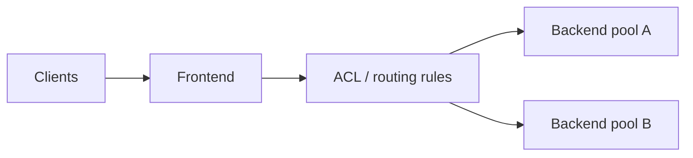

The frontend accepts traffic; backend sections describe destinations.

---

# Minimal HAProxy concept

```text
frontend https_in
  bind :443 ssl crt /certs/site.pem
  default_backend web_pool

backend web_pool
  balance roundrobin
  server web1 10.0.0.11:8080 check
  server web2 10.0.0.12:8080 check
```

Readable configuration makes a good teaching artifact.

---

# Path routing concept

```text
acl is_api path_beg /api/
use_backend api_pool if is_api
use_backend web_pool otherwise
```

This is where load balancing becomes application-aware routing.

---

# HAProxy lab topology

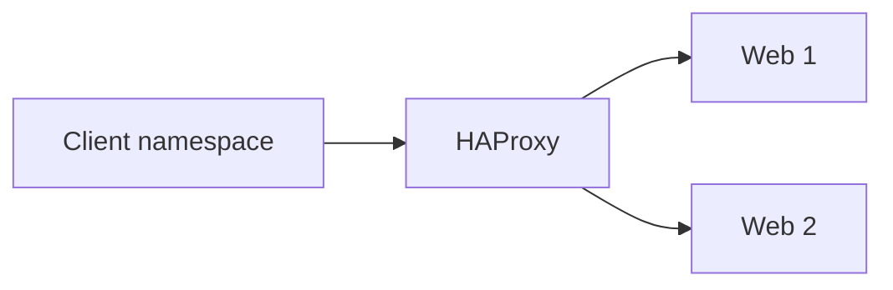

Make backends return their hostname so students can see balancing decisions.

---

# Lab progression

1. One backend.
2. Add second backend.
3. Round robin.
4. Stop one backend.
5. Observe health removal.
6. Add path-based backend.
7. Add TLS termination.
8. Inspect forwarded client metadata.

---

# Logging

Useful proxy log context:

- client address;
- selected frontend/backend;
- response status;
- timing components;
- bytes;
- TLS details;
- termination reason.

Proxy logs often become a crucial source for application incident investigations.

---

# Reverse proxy as WAF anchor

```mermaid
flowchart LR
  C["Internet"] --> RP["Reverse proxy"] --> WAF["WAF policy"] --> APP["Application"]
```

Often these functions are integrated or adjacent because both require HTTP visibility.

---

# Reverse proxy as authentication anchor

Some architectures place authentication before the application.

```mermaid
flowchart LR
  C["Client"] --> AUTH["Identity-aware proxy"] --> APP["Application"]
```

This is powerful, but application authorization still matters.

---

# Failure modes

Ask what happens when:

- one backend fails;
- all backends fail;
- health checks are wrong;
- certificates expire;
- proxy configuration is invalid;
- proxy itself fails;
- upstream DNS is wrong.

Centralization creates both leverage and concentration risk.

---

# High availability pair

```mermaid
flowchart LR
  C["Clients"] --> VIP["Virtual service IP"]
  VIP --> A["LB A"]
  VIP --> B["LB B"]
  A --> POOL["Backends"]
  B --> POOL
```

Redundancy should include configuration consistency and failover testing.

---

# Common mistakes

- Health check too shallow
- Trusting client-supplied forwarding headers
- No backend TLS where required
- Infinite/very long timeouts
- Sticky sessions everywhere
- Proxy logs missing client attribution
- Single proxy with no HA
- TLS keys broadly accessible

---

# Design scenario

Requirements:

- `/api/` to API pool;
- `/static/` to static pool;
- TLS terminates centrally;
- client address preserved;
- unhealthy backend removed;
- no single backend receives unlimited connections.

Draw the flow before writing HAProxy configuration.

---

# Possible architecture

```mermaid
flowchart LR
  C["Clients"] --> H["HAProxy
TLS + routing"]
  H -->|"/api"| API["API pool"]
  H -->|"/static"| ST["Static pool"]
  H -.-> LOG["Central logs"]
  H -.-> HC["Health checks"]
```

---

# What the load balancer cannot solve

A load balancer does not automatically know whether:

- an HTTP input is SQL injection;
- a user is authorized for a record;
- malware is uploaded;
- backend code is vulnerable.

Its position enables security controls, but does not replace them.

---

# Mental model

```mermaid
flowchart LR
  ACCEPT["Accept client connection"] --> INSPECT["Inspect L4/L7 context"]
  INSPECT --> SELECT["Select backend"]
  SELECT --> PROTECT["Apply limits / health"]
  PROTECT --> FORWARD["Create backend connection"]
```

---

# Expert augmentation: TLS edge and PQC pressure

TLS termination concentrates cryptographic cost at the edge.

```mermaid
flowchart LR
  Clients[Many clients] --> LB[Load balancer / TLS terminator]
  LB --> Web1[Backend 1]
  LB --> Web2[Backend 2]
```

Post-quantum key exchange increases handshake size and computation.

Design impact:

- more CPU per new connection;
- larger handshake messages;
- more memory buffering;
- more sensitivity to fragmentation and retransmission.

---

# PQC migration question for reverse proxies

```mermaid
flowchart TB
  A[Classical TLS] --> B[Hybrid TLS]
  B --> C[More bytes in handshake]
  B --> D[More crypto work]
  C --> E[MTU / fragmentation risk]
  D --> F[connection-rate pressure]
  E --> G[capacity planning]
  F --> G
```

Students should ask:

- is the bottleneck CPU, memory, or network?
- are we measuring new connections or long-lived sessions?
- can hardware acceleration or vectorized crypto help?
- what is the rollback and compatibility plan?

---

# Review questions

1. What is the difference between L4 and L7 load balancing?
2. Why is a reverse proxy not simple forwarding?
3. What changes when TLS terminates at the proxy?
4. Why must forwarding headers have a trust boundary?
5. What do health checks actually prove?
6. Why are timeouts security-relevant?

---

# Final checklist

For a load-balancing design, ask:

- L4 or L7?
- Where does TLS terminate?
- How are backends selected?
- How deep are health checks?
- How is client identity/address preserved?
- Which headers are trusted?
- What resource limits exist?
- How is the proxy made highly available?
- Which logs support investigation?
