---

theme: sred-theme
routerMode: hash
title: "HTTP Inspection and Web Application Firewalls"
info: |
  Network Security Using Dedicated Devices
  Open-source teaching deck
transition: slide-left
mdc: true
---

# HTTP Inspection and Web Application Firewalls

## Making security decisions on application requests

__Open-source stack:__ ModSecurity + OWASP Core Rule Set, with NGINX/Apache or reverse-proxy integration

A WAF asks not only **who is connecting**, but **what HTTP request is being sent**.

---

# Learning objectives

You should be able to:

- identify security-relevant parts of HTTP requests;
- explain where a WAF sits;
- distinguish positive and negative security models;
- explain CRS anomaly scoring at a high level;
- reason about normalization, false positives, and virtual patching;
- build a simple ModSecurity teaching setup.

---

# Why a firewall is not enough

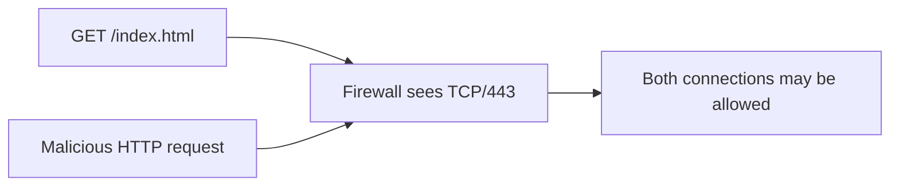

Layer-4 permission does not imply application-layer safety.

---

# HTTP request anatomy

```http
POST /login HTTP/1.1
Host: app.example
Content-Type: application/x-www-form-urlencoded
Cookie: session=...

username=alice&password=...
```

Security-relevant fields can exist in:

- method;
- path;
- query;
- headers;
- cookies;
- body.

---

# WAF placement

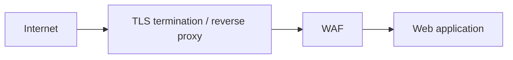

The WAF needs access to HTTP semantics. Encrypted traffic must therefore be visible at the inspection point.

---

# Reverse proxy WAF

The cleanest conceptual model:

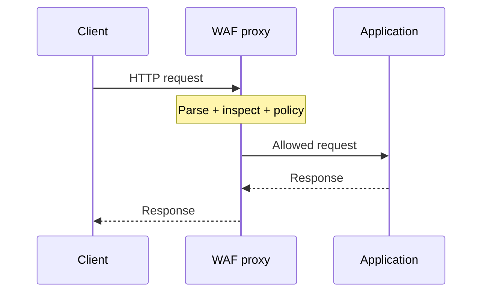

---

# What can a WAF inspect?

Typical fields:

- URI and query parameters;
- headers;
- cookies;
- body parameters;
- JSON/XML payloads when parsed;
- file uploads;
- response headers/body in some modes.

Visibility depends on protocol support and configuration.

---

# Negative security model

Ask:

> Does this request match something known to be dangerous?

Examples:

- SQL injection patterns;
- XSS patterns;
- path traversal;
- protocol violations.

This is flexible but never enumerates every possible attack.

---

# Positive security model

Ask:

> Does this request match what this application is supposed to accept?

Example:

```text
POST /api/user
Content-Type: application/json
field id: integer
field name: 1..80 chars
```

Very powerful, but costly to maintain for changing applications.

---

# SQL injection concept

Normal:

```text
?id=15
```

Suspicious:

```text
?id=15 UNION SELECT ...
```

The WAF can inspect the parameter value, but it does not execute the application's database query.

---

# XSS concept

A request or response may contain script-like content.

```text
<script>...</script>
```

But context matters: a programming forum may legitimately carry code snippets.

Pattern presence is not automatically an exploit.

---

# Path traversal concept

Requests may attempt to escape an intended directory context.

```text
/download?file=../../sensitive
```

A WAF can detect traversal patterns, but the application should still validate and constrain file access itself.

---

# Protocol anomalies

A WAF can reject malformed or suspicious HTTP behavior such as:

- conflicting lengths;
- invalid encodings;
- oversized headers;
- unexpected methods;
- malformed multipart bodies.

Strict parsing can reduce ambiguity between intermediaries and backends.

---

# Normalization matters

The same logical input can have multiple encodings.

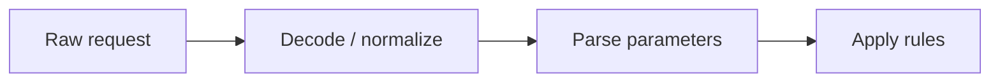

Rules should inspect the same semantic value the application will process.

---

# Parser disagreement

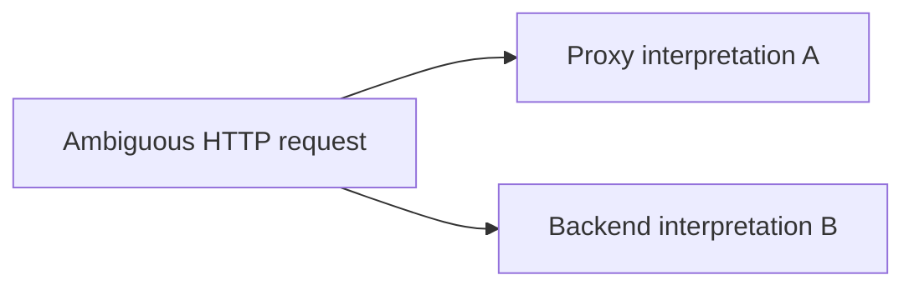

If intermediaries disagree, attackers may exploit the gap.

Consistent parsing is a security property.

---

# Request smuggling lesson

Do not teach exploit recipes. Teach the architecture problem:

- two HTTP parsers disagree about request boundaries;
- one component sees one request;
- another sees two.

Security devices must agree with the protected server's parsing behavior.

---

# File uploads

A WAF/reverse proxy may enforce:

- maximum size;
- permitted content types;
- filename policy;
- body limits;
- handoff to malware scanning.

But file security usually needs cooperation with application and storage layers.

---

# Body size limits

Very large request bodies can consume:

- memory;
- disk;
- parser CPU;
- backend worker time.

Reasonable limits reduce both accidental and malicious resource consumption.

---

# ModSecurity

ModSecurity is an open-source web application firewall engine.

It can inspect HTTP transactions and apply rules to request/response data.

For teaching, pair it with the **OWASP Core Rule Set (CRS)** rather than inventing a full ruleset from scratch.

---

# OWASP Core Rule Set

CRS provides generic detection rules for classes of web attacks and anomalies.

Important teaching point:

> Generic rules are a starting point, not a substitute for understanding the application.

---

# CRS anomaly scoring

Simplified model:

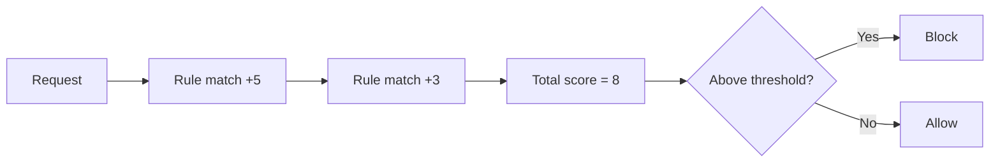

---

# Why scoring helps

One weak signal may not justify blocking.

Several independent suspicious signals together may provide stronger confidence.

Scoring supports:

- tuning;
- thresholds;
- staged deployment;
- better explanation of why a request was blocked.

---

# Detection-only mode

Recommended deployment sequence:

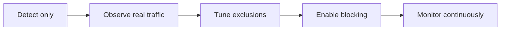

Blocking before observing can break legitimate applications.

---

# False positives

A legitimate request may resemble an attack because:

- code is submitted as data;
- search strings contain SQL syntax;
- APIs accept unusual JSON;
- legacy applications use odd encodings.

False positives must be investigated, not blindly suppressed.

---

# False-positive tuning

Prefer narrow exclusions:

```text
exclude rule X
only for parameter Y
only on endpoint Z
```

rather than:

```text
disable SQL injection protection globally
```

Tuning should reduce noise while preserving coverage.

---

# False negatives

WAFs can miss attacks because:

- rule lacks the pattern;
- application semantics are unique;
- content is encoded unexpectedly;
- unsupported protocol/body format;
- traffic bypasses the WAF;
- inspection limits are exceeded.

WAF ≠ secure application.

---

# Virtual patching

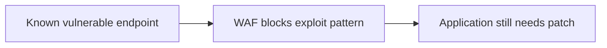

Virtual patches can buy time, but should not become permanent excuses to leave vulnerable code unchanged.

---

# Rate limiting and abuse

Some application abuse is not an injection exploit.

Examples:

- credential stuffing;
- scraping;
- brute-force search;
- expensive API calls.

These may need rate, identity, and behavior controls rather than classic signatures.

---

# Authentication context

A WAF sees HTTP, but often lacks complete business identity context.

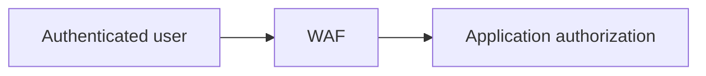

The application still decides whether that user may access a specific object or action.

---

# API security

Modern WAF/API gateways may validate:

- HTTP method;
- path;
- content type;
- JSON structure;
- schema constraints;
- request size;
- rate limits.

Positive API schemas can be more precise than generic attack signatures.

---

# GraphQL and flexible APIs

Highly expressive APIs complicate simple URL-based policy.

Security may need to consider:

- operation depth;
- request complexity;
- allowed operations;
- authentication context.

Again: application semantics matter.

---

# Bot traffic

Not all automation is malicious.

Bots include:

- search engines;
- monitoring;
- integrations;
- scrapers;
- credential attackers.

A WAF can contribute signals, but bot management is often a broader behavior/identity problem.

---

# TLS dependency

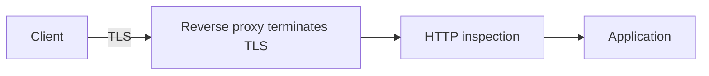

If TLS passes through untouched, an external WAF cannot inspect the encrypted HTTP payload.

---

# Backend encryption

TLS can be re-established after inspection.

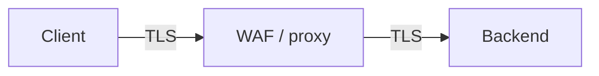

Inspection and internal encryption are not mutually exclusive.

---

# Trust forwarded headers carefully

The proxy may add:

- client IP;
- scheme (`https`);
- original host;
- request ID.

The application should accept these values only from trusted proxy paths, not arbitrary Internet clients.

---

# WAF bypass path

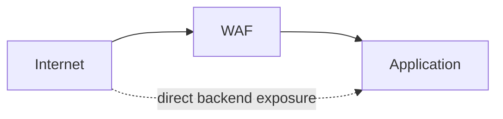

If the backend is directly reachable, the WAF may be irrelevant.

Architecture must enforce the inspection path.

---

# Open-source lab architecture

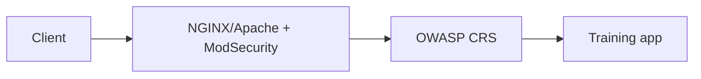

Run the application and WAF in separate containers so the boundary is visible.

---

# Minimal teaching workflow

1. Send normal request.
2. Observe allow/log.
3. Send intentionally suspicious training string.
4. Observe rule ID and score.
5. Run in detection-only mode.
6. Create a narrow exclusion for a legitimate endpoint.
7. Re-enable blocking.

---

# Custom rule idea

A deliberately simple lab rule:

```text
SecRule REQUEST_URI "@beginsWith /admin-test"   "id:100001,phase:1,deny,status:403,msg:'Training admin path'"
```

Use custom rules to teach mechanics, CRS to teach real-world rule management.

---

# Audit logs

Useful WAF evidence includes:

- timestamp;
- client/request ID;
- rule IDs;
- matched variable;
- anomaly score;
- action;
- request metadata.

Avoid recording sensitive bodies indiscriminately.

---

# Privacy and secrets

HTTP bodies may contain:

- passwords;
- tokens;
- personal data;
- payment data.

Inspection is powerful, but logging the inspected content can create a new data-protection problem.

---

# Performance

Deep inspection costs resources.

Factors include:

- request size;
- rule count;
- regex complexity;
- body parsing;
- response inspection;
- TLS termination.

Measure latency and throughput before treating the WAF as free.

---

# Availability risk

If the WAF is inline, bad policy can block production.

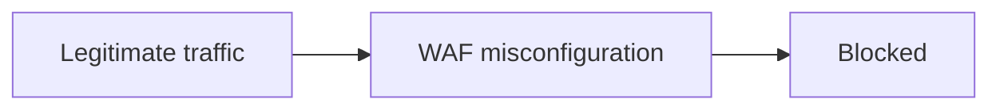

Detection quality and change management directly affect availability.

---

# Design scenario

A public application has:

- `/login`;
- `/search`;
- `/api/v1/`;
- file upload;
- administrative UI.

Which paths need:

- stricter methods?
- rate limits?
- body limits?
- custom WAF exceptions?
- additional authentication controls?

---

# Possible layered design

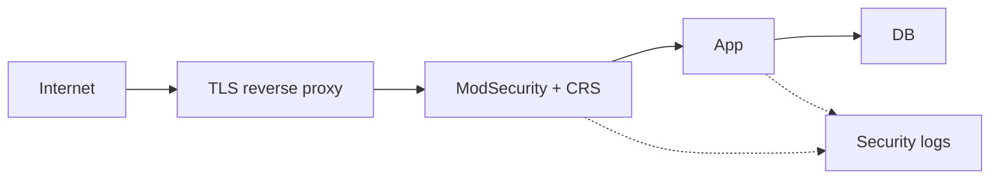

Compare WAF evidence with application logs during investigations.

---

# Common mistakes

- Blocking immediately with no tuning
- Disabling broad protections to fix one false positive
- Backend directly reachable around the WAF
- Logging secrets
- Assuming WAF replaces secure coding
- Ignoring body/size limits
- Parser mismatch between proxy and backend
- No rule/change ownership

---

# What the WAF cannot solve

A WAF cannot reliably understand every business rule.

It cannot replace:

- secure application design;
- parameterized database queries;
- object-level authorization;
- dependency patching;
- secure secrets handling;
- server hardening.

---

# Mental model

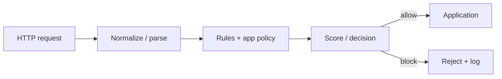

---

# Expert augmentation: WAF becomes API gateway

Modern WAFs inspect more than form parameters.

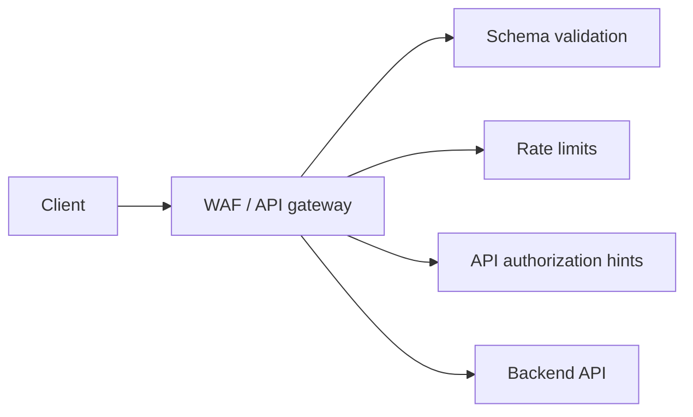

Useful checks:

- OpenAPI schema conformance;
- method and path allowlisting;
- object size limits;
- authentication context;
- abnormal sequence of API calls.

---

# GenAI gateway and ReDoS risk

LLM-backed applications create new inspection problems.

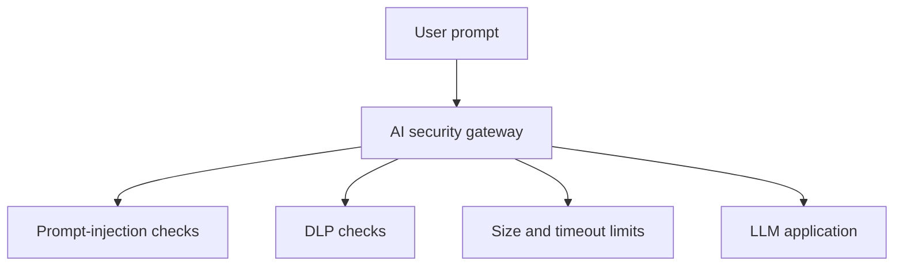

Operational warning:

> Deep text/JSON inspection can itself become a DoS target.

Controls:

- parser limits;
- regex timeouts;
- streaming inspection;
- fail-closed or fail-open decision documented.

---

# Review questions

1. Why does a WAF need HTTP visibility?
2. What is the difference between positive and negative models?
3. Why is normalization important?
4. Why deploy CRS in detection-only mode first?
5. What is virtual patching?
6. How can architecture bypass a perfectly configured WAF?

---

# Final checklist

For a WAF deployment, ask:

- Where does TLS terminate?
- Can the backend bypass the WAF?
- Which request parts are parsed?
- What body/size limits apply?
- Detection or blocking mode?
- How are false positives tuned?
- Which rules are application-specific?
- Are logs privacy-safe?
- How is performance measured?
- What remains the application's responsibility?
