# DNS Security

## Protecting name resolution and using DNS as a security control

__Open-source stack:__ Unbound, RPZ, dnsmasq for labs, Zeek/Suricata for visibility

DNS is both critical infrastructure and a valuable place to block malicious destinations early.

---

# Learning objectives

You should be able to:

- explain recursive DNS resolution at a practical level;
- identify common DNS abuse patterns;
- explain protective DNS, RPZ, and sinkholing;
- recognize DNS tunnelling indicators;
- discuss DoH/DoT visibility trade-offs;
- build a small Unbound-based security resolver.

---

# Where DNS fits

<div style="transform: scale(0.8); transform-origin: top center;">

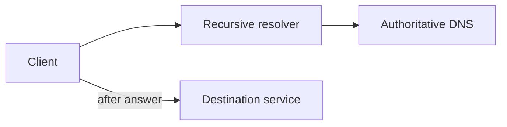

</div>

DNS often runs **before** the application connection, making it an early enforcement opportunity.

---

# Stub resolver vs recursive resolver

The endpoint usually asks a configured recursive resolver.

<div style="transform: scale(0.8); transform-origin: top center;">

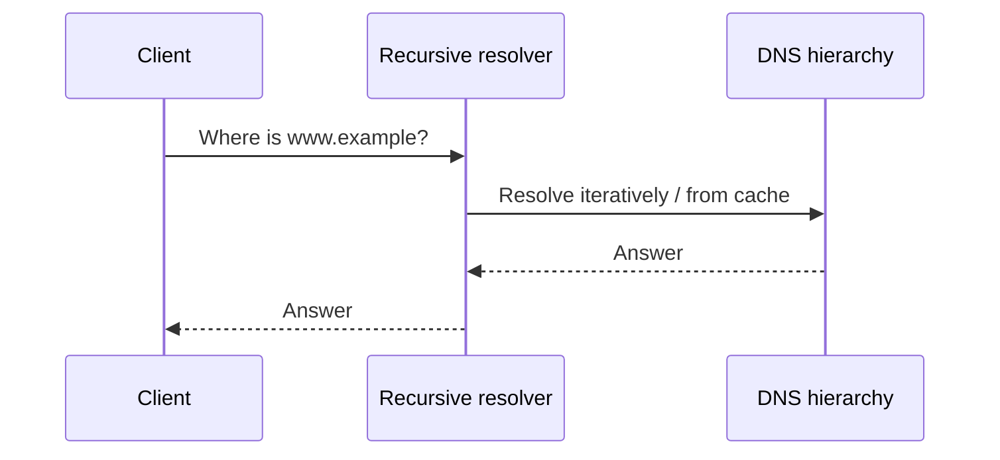

</div>

---

# Caching

Resolvers cache answers to reduce latency and load.

Security implications:

- poisoned data can affect many clients;
- stale data may persist until TTL expiry;
- cached malicious domains can continue working temporarily;
- logging at the resolver centralizes visibility.

---

# DNS as a trust dependency

If an attacker can influence DNS answers, users may be redirected without changing the URL they typed.

<div style="transform: scale(0.8); transform-origin: top center;">

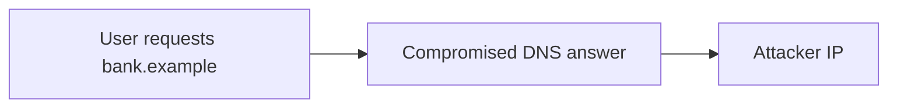

</div>

TLS can still provide an additional identity check if certificates are validated.

---

# DNS cache poisoning: concept

Do not focus on exploit mechanics.

The architectural risk is:

> The resolver accepts an incorrect mapping and serves it to clients.

Defenses include transaction unpredictability, hardened resolver behavior, and DNSSEC validation where appropriate.

---

# DNSSEC: what students need

DNSSEC allows validation of signed DNS data.

At this level, understand:

- authenticity/integrity of DNS data;
- chain of trust;
- validation success/failure;
- it does **not** encrypt DNS queries.

No need for signature mathematics.

---

# Protective DNS

A security resolver can apply policy before returning an answer.

<div style="transform: scale(0.8); transform-origin: top center;">

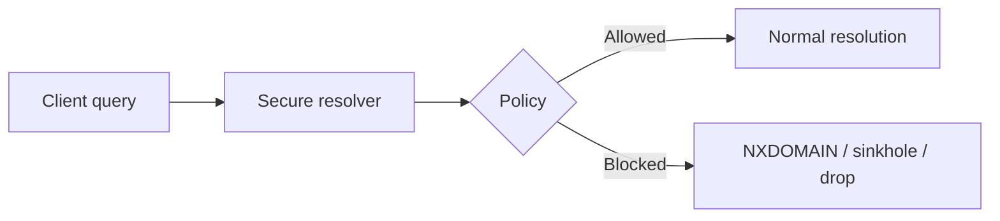

</div>

---

# Why block at DNS?

Advantages:

- stops some connections before they begin;
- central policy point;
- domain-level context;
- useful logs;
- can protect many applications without endpoint changes.

Limitations: direct IP connections and alternate resolvers can bypass it.

---

# Response Policy Zone

RPZ is a way to apply DNS response policy using zone-like data.

Conceptually:

```text
malware.example     -> NXDOMAIN
phishing.example    -> NXDOMAIN
sink.example        -> 10.0.0.99
```

The resolver modifies the answer according to policy.

---

# RPZ decision path

<div style="transform: scale(0.8); transform-origin: top center;">

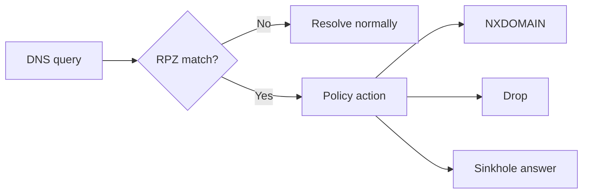

</div>

---

# Sinkholing

Instead of resolving a malicious domain to the real attacker infrastructure:

<div style="transform: scale(0.8); transform-origin: top center;">

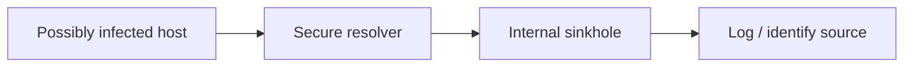

</div>

A sinkhole can convert attempted compromise into useful detection.

---

# Sinkhole caveat

A sinkhole should be intentionally designed.

Questions:

- Does it answer HTTP/HTTPS?
- Does it only log connections?
- Could TLS errors confuse users?
- Is sensitive data accidentally sent to it?

Blocking is sometimes safer than impersonating the destination.

---

# Malware command-and-control

A common pattern:

<div style="transform: scale(0.8); transform-origin: top center;">

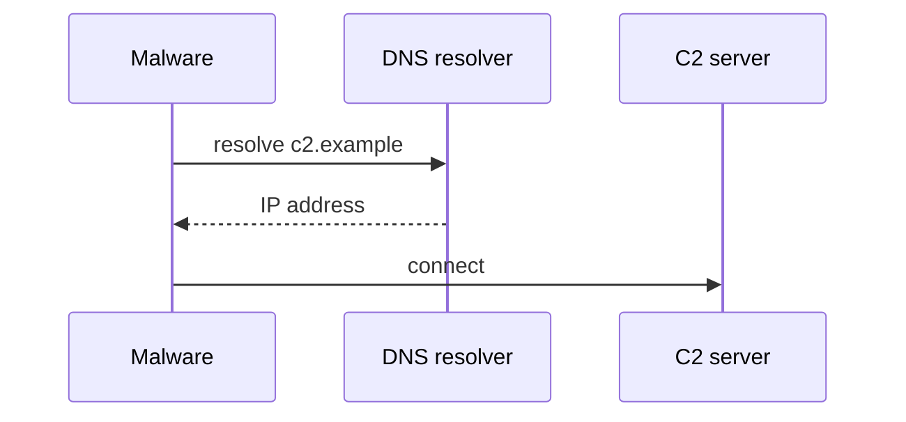

</div>

Blocking the domain can interrupt the chain before the C2 connection.

---

# Newly registered or suspicious domains

Risk feeds may classify domains by:

- known malicious reputation;
- age;
- observed campaigns;
- category;
- threat intelligence.

These are probabilistic signals. Legitimate new domains exist too.

---

# Domain Generation Algorithms

Some malware generates many candidate domains.

<div style="transform: scale(0.8); transform-origin: top center;">

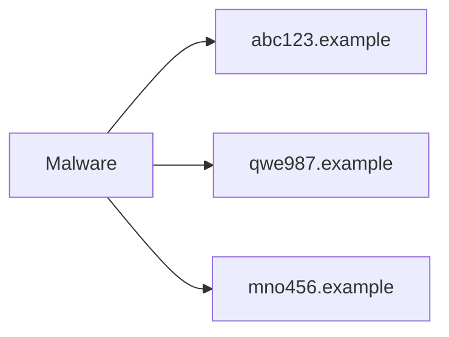

</div>

Defenders may look for volume, lexical patterns, rarity, and failed lookups.

---

# NXDOMAIN as a signal

A host generating huge numbers of failed lookups may indicate:

- DGA malware;
- misconfiguration;
- broken software;
- typo-heavy automation.

Detection should combine DNS behavior with endpoint/asset context.

---

# DNS tunnelling

DNS can carry more than normal hostnames.

<div style="transform: scale(0.8); transform-origin: top center;">

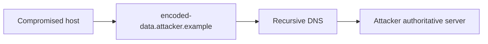

</div>

The attacker abuses allowed DNS as a covert channel.

---

# Tunnelling indicators

Possible signals:

- unusually long labels;
- high entropy;
- many unique subdomains;
- frequent TXT queries;
- high query volume to one domain;
- regular beaconing.

No single indicator proves tunnelling.

---

# Data exfiltration via DNS

The important security lesson:

> An allowed protocol can become a transport for data it was never intended to carry.

Therefore egress policy should consider **which DNS resolvers are allowed**, not just UDP/53.

---

# Force clients through approved resolvers

<div style="transform: scale(0.8); transform-origin: top center;">

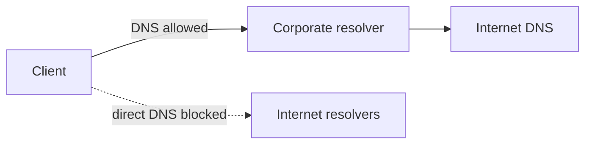

</div>

Centralization improves both policy and visibility.

---

# DNS over TCP

DNS is not only UDP/53.

TCP is used for:

- large responses;
- fallback;
- zone transfers;
- DNSSEC-related larger messages;
- other cases.

Blocking all TCP/53 can cause subtle failures.

---

# DoT

DNS over TLS encrypts DNS traffic between client and resolver.

<div style="transform: scale(0.8); transform-origin: top center;">

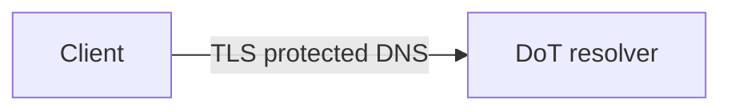

</div>

Benefits privacy against on-path observers, but can reduce visibility for intermediary security devices.

---

# DoH

DNS over HTTPS carries DNS inside HTTPS.

<div style="transform: scale(0.8); transform-origin: top center;">

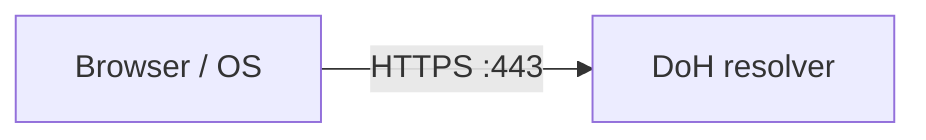

</div>

A port-based control may see only HTTPS, not obvious DNS.

---

# DoH security tension

DoH can improve privacy, but enterprises may need:

- malware-domain filtering;
- incident visibility;
- policy enforcement.

The architectural question is not “DoH good or bad?” but:

> Which resolver is trusted, and where should policy live?

---

# Split-horizon DNS

Different clients may receive different answers.

<div style="transform: scale(0.8); transform-origin: top center;">

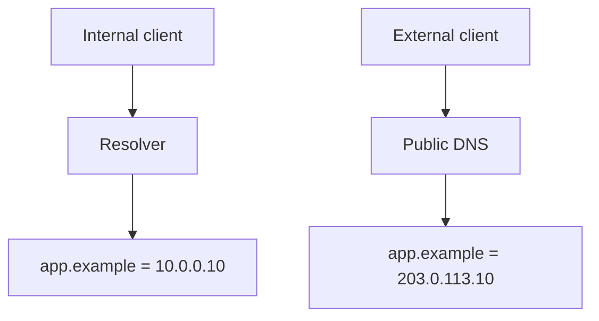

</div>

Useful, but increases troubleshooting complexity.

---

# Internal DNS names

Internal naming can reveal architecture:

```text
db-prod-01.corp
payroll-admin.corp
```

Avoid exposing internal zones publicly and consider what naming conventions leak about roles and environments.

---

# Zone transfers

Authoritative DNS servers may support transferring zone contents to secondary servers.

Security principle:

> Only authorized secondary infrastructure should receive full zone data.

A full zone can reveal many internal/external names.

---

# Recursive resolver exposure

An open recursive resolver can be abused by outsiders and may contribute to amplification attacks.

<div style="transform: scale(0.8); transform-origin: top center;">

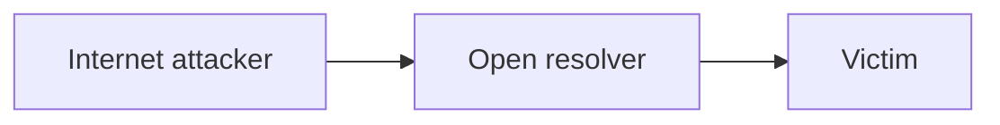

</div>

Recursive service should be restricted to intended clients.

---

# Amplification concept

An attacker may send small requests that trigger larger responses toward a spoofed victim.

The defensive lesson:

- do not run unnecessary open resolvers;
- apply anti-spoofing upstream;
- rate-limit where appropriate.

---

# Logging DNS

Useful fields:

- client;
- query name;
- query type;
- response code;
- returned addresses;
- timestamp;
- policy action;
- resolver used.

DNS logs are often among the most valuable network-security datasets.

---

# Privacy in DNS logs

DNS queries can reveal:

- websites;
- applications;
- internal services;
- user behavior.

Retain only what is justified, control access, and avoid treating DNS telemetry as harmless metadata.

---

# Open-source resolver: Unbound

Unbound is a validating recursive resolver suitable for:

- local recursive DNS;
- DNSSEC validation;
- access control;
- local policy;
- RPZ-based filtering;
- logging for teaching environments.

---

# Unbound security architecture

<div style="transform: scale(0.8); transform-origin: top center;">

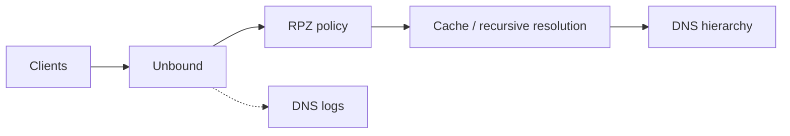

</div>

---

# Simple RPZ teaching entry

Conceptual zone data:

```text
bad.example.      CNAME .
tracking.example. CNAME .
```

Use a harmless lab domain, not real malicious infrastructure.

Students should observe the change in resolver response.

---

# Lab topology

<div style="transform: scale(0.8); transform-origin: top center;">

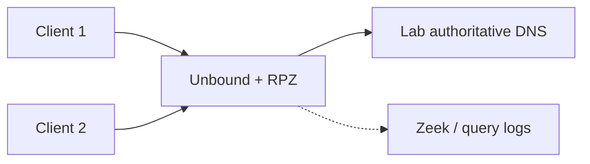

</div>

Everything can run in containers or namespaces.

---

# Lab progression

1. Resolve normal lab domain.
2. Add RPZ block.
3. Observe NXDOMAIN or sinkhole.
4. Generate many random subdomains.
5. Inspect DNS logs.
6. Force clients to use the approved resolver.
7. Discuss what changes if clients use DoH.

---

# Zeek DNS visibility

<div style="transform: scale(0.8); transform-origin: top center;">

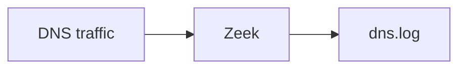

</div>

Students can correlate:

- client IP;
- queried name;
- response;
- subsequent connection from `conn.log`.

---

# DNS + firewall integration

<div style="transform: scale(0.8); transform-origin: top center;">

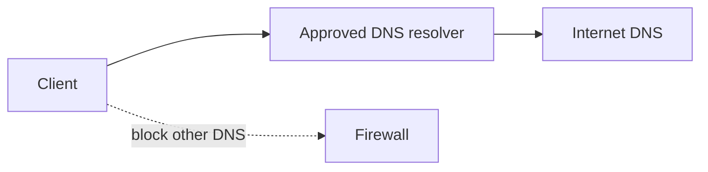

</div>

The DNS control is stronger when the network prevents easy bypass.

---

# DNS + endpoint integration

Network enforcement alone cannot fully control applications that tunnel DNS over arbitrary HTTPS services.

Possible complements:

- managed browser policy;
- endpoint DNS configuration;
- endpoint security telemetry;
- secure web gateway policy.

---

# Common mistakes

- Allowing clients to use any resolver
- Assuming UDP/53 is the only DNS path
- Blocking malicious domains but not logging source clients
- Treating all NXDOMAIN spikes as malware
- Running an open recursive resolver
- Ignoring internal zone leakage
- Forgetting privacy implications of DNS logs

---

# Design scenario

An enterprise wants:

- central DNS logging;
- malicious-domain blocking;
- internal names resolved internally;
- Internet clients unable to use the recursive resolver;
- endpoint DoH controlled by policy.

Draw the resolver and firewall relationships.

---

# Possible design

<div style="transform: scale(0.8); transform-origin: top center;">

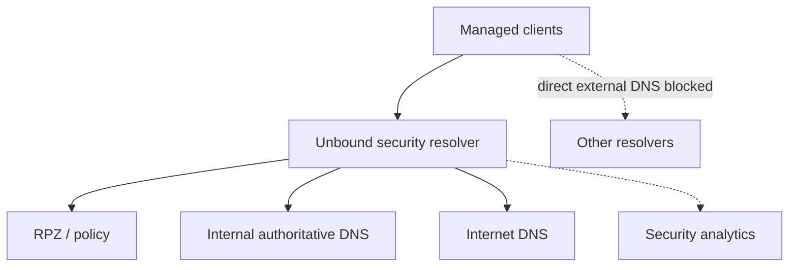

</div>

---

# What DNS security cannot solve

Protective DNS cannot stop:

- direct IP connections;
- already-compromised trusted domains;
- abuse entirely inside allowed SaaS;
- malicious content on a legitimate domain;
- every encrypted alternate resolver.

It is an early control, not a complete web security solution.

---

# Mental model

<div style="transform: scale(0.8); transform-origin: top center;">

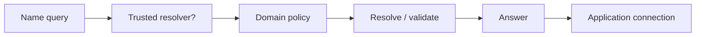

</div>

---

# Expert augmentation: encrypted DNS evasion

DNS filtering assumes clients use the enterprise resolver.

<div style="transform: scale(0.8); transform-origin: top center;">

```mermaid
flowchart LR
  C[Client] -->|UDP 53| R[Enterprise resolver]
  C -. DoH over 443 .-> EXT[External DoH resolver]
  R --> POLICY[RPZ / logging / sinkhole]
```

</div>

DoH and DoT can bypass local DNS controls if unmanaged.

Policy choices:

- block known external DoH endpoints;
- manage browser/OS DNS policy;
- use SWG inspection where appropriate;
- force clients to approved resolvers.

---

# DNSSEC: integrity, not filtering

DNSSEC helps validate that DNS data was not forged.

<div style="transform: scale(0.8); transform-origin: top center;">

```mermaid
flowchart TB
  Root[Root trust anchor] --> TLD[TLD signed zone]
  TLD --> Zone[example.com signed zone]
  Zone --> Record[Validated DNS answer]
```

</div>

Do not confuse:

<div style="transform: scale(0.8); transform-origin: top center;">

```mermaid
flowchart LR
  DNSSEC[DNSSEC] -->|authenticity| A[Is this answer valid?]
  RPZ[DNS policy] -->|security filtering| B[Should we allow this domain?]
```

</div>

They solve different problems.

---

# Review questions

1. Why is DNS an early enforcement point?
2. What does RPZ do?
3. What is the purpose of a sinkhole?
4. Which behaviors can suggest DNS tunnelling?
5. Why can DoH reduce network visibility?
6. Why should recursive DNS be restricted to intended clients?

---

# Final checklist

For DNS security, ask:

- Which resolvers may clients use?
- Is recursive service access-controlled?
- Is DNSSEC validation required?
- Which policy feeds/RPZ rules are used?
- Block, NXDOMAIN, or sinkhole?
- Are DNS logs available and privacy-governed?
- How are DoH/DoT handled?
- Can direct DNS bypass policy?
- Are internal and public namespaces intentionally separated?
