# Email Security Gateways

## Protecting a store-and-forward application

__Open-source stack:__ Postfix, Rspamd, ClamAV, OpenDKIM/OpenDMARC where useful

Email security is a good example of deep inspection because the gateway can examine an entire message before delivery.

---

# Learning objectives

You should be able to:

- explain SMTP store-and-forward architecture;
- identify spoofing, spam, phishing, malware, and BEC risks;
- explain SPF, DKIM, and DMARC operationally;
- understand attachment and URL inspection;
- describe quarantine and DLP decisions;
- assemble an open-source mail-security pipeline.

---

# Email delivery path

<div style="transform: scale(0.8); transform-origin: top center;">

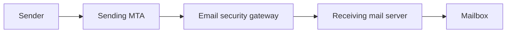

</div>

The gateway is a natural inspection point because email is already relayed between servers.

---

# Store and forward

Unlike a typical interactive web request, email can be:

- accepted;
- queued;
- scanned;
- delayed;
- quarantined;
- rejected;
- forwarded later.

This gives defenders time to make a richer decision.

---

# Threat categories

<div style="transform: scale(0.8); transform-origin: top center;">

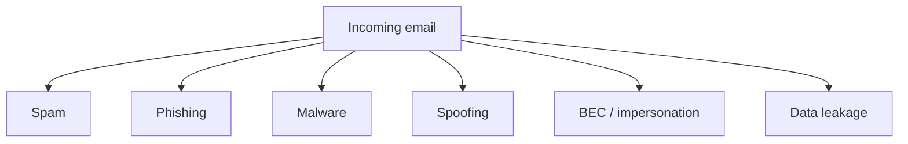

</div>

---

# SMTP envelope vs visible headers

Email contains multiple identity concepts.

Examples:

- SMTP envelope sender;
- `From:` header;
- `Reply-To:`;
- `Return-Path` after delivery.

Security controls must know **which identity they are evaluating**.

---

# Display name spoofing

A message may show:

```text
From: CEO <attacker@example.net>
```

Users often notice the display name before the address.

Technical authentication does not solve every human impersonation problem.

---

# Domain spoofing

An attacker may attempt to send mail claiming:

```text
From: payroll@company.example
```

Domain-authentication technologies help receiving systems evaluate whether that claim is consistent with the sending infrastructure.

---

# SPF concept

SPF asks approximately:

> Is this sending server authorized to send mail for this envelope domain?

<div style="transform: scale(0.8); transform-origin: top center;">

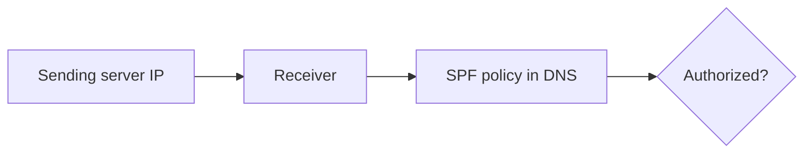

</div>

---

# SPF limitations

SPF alone does not guarantee:

- the visible `From:` domain is authenticated;
- the message content is trustworthy;
- the sender account is uncompromised;
- forwarding will always preserve SPF success.

It is one signal.

---

# DKIM concept

<div style="transform: scale(0.8); transform-origin: top center;">

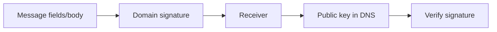

</div>

The goal is domain-level integrity/authentication for selected message content.

---

# DKIM is not encryption

A DKIM-signed email can still be readable in transit.

DKIM answers:

> Was this content signed by a domain, and did the signed parts survive modification?

It does not make the email confidential.

---

# DMARC concept

DMARC connects domain alignment with policy.

<div style="transform: scale(0.8); transform-origin: top center;">

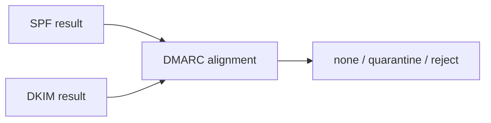

</div>

The visible `From:` domain becomes central to the decision.

---

# Alignment

Authentication is more useful when it aligns with the domain the user sees.

DMARC asks whether successful SPF or DKIM identity is appropriately related to the visible `From:` domain.

This reduces simple domain impersonation.

---

# DMARC policy rollout

A sensible sequence:

<div style="transform: scale(0.8); transform-origin: top center;">

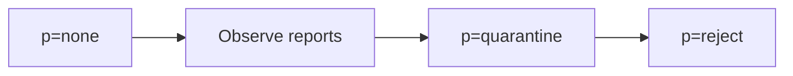

</div>

Organizations should understand all legitimate senders before strict enforcement.

---

# Authentication does not equal benign

A malicious message can be fully SPF/DKIM/DMARC authenticated if:

- the attacker owns the sending domain;
- a legitimate account is compromised;
- a legitimate service is abused.

Mail authentication primarily addresses spoofing, not all phishing.

---

# Spam scoring

Modern filtering often combines many weak signals:

- sender reputation;
- message structure;
- URLs;
- authentication results;
- language/content features;
- attachment properties;
- historical behavior.

Scoring is often more useful than one binary rule.

---

# Rspamd

Rspamd is an open-source mail filtering system that can combine:

- spam scoring;
- SPF/DKIM/DMARC checks;
- reputation;
- fuzzy hashes;
- URL analysis;
- policy rules;
- integration with MTAs.

---

# Rspamd pipeline

<div style="transform: scale(0.8); transform-origin: top center;">

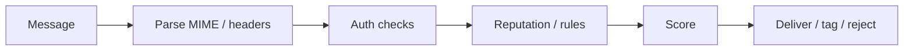

</div>

---

# MIME structure

Email can contain nested parts:

<div style="transform: scale(0.8); transform-origin: top center;">

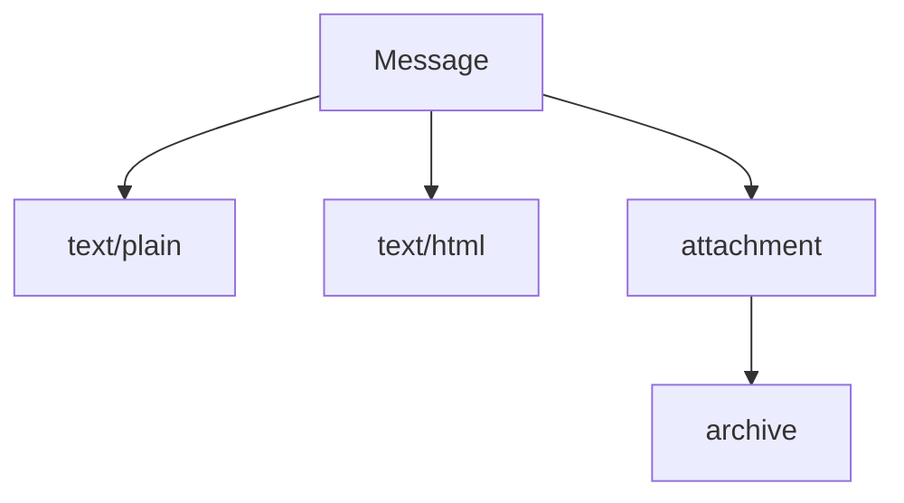

</div>

Security scanners must parse structure, not treat the message as one flat string.

---

# Attachments

Potential checks:

- declared MIME type;
- actual file type;
- extension mismatch;
- archive contents;
- executable/script formats;
- malware signatures;
- size/depth limits.

---

# Archive recursion limits

Nested archives can consume large amounts of CPU/disk.

<div style="transform: scale(0.8); transform-origin: top center;">

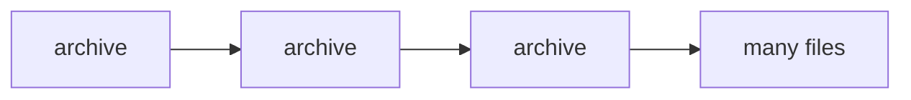

</div>

Set limits on nesting, expanded size, and processing time.

---

# ClamAV

ClamAV provides open-source malware scanning.

It can be integrated into a mail pipeline to inspect attachments/content.

Important limitation:

> Signature-based malware scanning will not identify every malicious file.

---

# Attachment sandboxing

A more advanced gateway may execute suspicious files in an isolated environment and observe behavior.

Conceptually:

<div style="transform: scale(0.8); transform-origin: top center;">

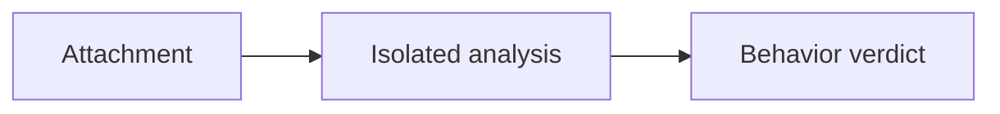

</div>

This is useful but operationally expensive and still imperfect.

---

# Malicious URLs

Phishing often contains a benign-looking message with a link.

Gateway analysis may inspect:

- destination domain;
- displayed text vs actual URL;
- redirect chain;
- reputation;
- URL structure;
- known phishing indicators.

---

# Time-of-click problem

A URL may be harmless during delivery and malicious later.

<div style="transform: scale(0.8); transform-origin: top center;">

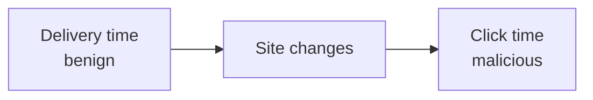

</div>

This motivates link rewriting or click-time inspection in some products.

---

# URL rewriting trade-off

Rewriting links can enable click-time policy, but introduces:

- privacy concerns;
- operational dependency;
- altered URLs;
- difficult troubleshooting;
- new high-value infrastructure.

Again, central security controls concentrate risk.

---

# Business Email Compromise

BEC often avoids malware entirely.

Example:

> “Please urgently change the bank account for this invoice.”

Controls may need:

- sender identity context;
- display-name analysis;
- unusual reply-to detection;
- process controls outside email.

---

# Human process is part of security

For high-risk requests:

<div style="transform: scale(0.8); transform-origin: top center;">

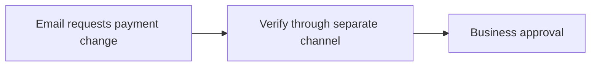

</div>

No email gateway can replace strong financial/process controls.

---

# DLP for outbound mail

Email gateways may inspect outbound messages for:

- sensitive patterns;
- regulated data;
- confidential labels;
- unusual attachment types;
- large recipient lists.

DLP is probabilistic and context-sensitive.

---

# DLP false positives

A number pattern may look like:

- a card number;
- an invoice reference;
- a random identifier.

Blocking automatically can disrupt business.

Use context, classification, and review workflows where appropriate.

---

# Quarantine

<div style="transform: scale(0.8); transform-origin: top center;">

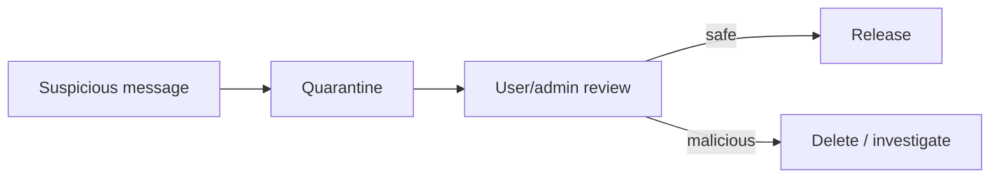

</div>

Quarantine trades immediate delivery for safer review.

---

# User release risk

If every user can release any quarantined message without understanding the risk, quarantine may become a warning screen that is routinely bypassed.

Design the release experience according to severity and user role.

---

# Inbound vs outbound controls

<div style="transform: scale(0.8); transform-origin: top center;">

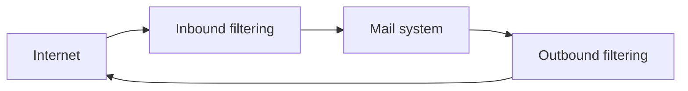

</div>

Outbound controls matter for:

- compromised accounts;
- spam reputation;
- data leakage;
- malicious internal senders.

---

# Postfix

Postfix is an open-source Mail Transfer Agent suitable for teaching:

- SMTP relay;
- queueing;
- recipient restrictions;
- integration with Rspamd/ClamAV;
- mail-routing architecture.

---

# Open-source gateway architecture

<div style="transform: scale(0.8); transform-origin: top center;">

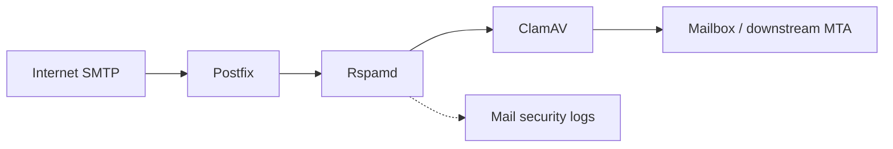

</div>

Exact integration can differ; the conceptual pipeline is what matters.

---

# Teaching lab

Use a closed lab domain and synthetic messages.

Test:

1. clean mail;
2. spam-like training mail;
3. spoofed visible sender;
4. harmless EICAR-style antivirus test where permitted in the lab;
5. attachment type policy;
6. DMARC alignment outcomes.

---

# Header investigation

Students should learn to inspect:

- `Received:` chain;
- `From:`;
- `Reply-To:`;
- authentication results;
- DKIM signature metadata;
- message ID;
- MIME structure.

Email headers are an investigation trail, not just decoration.

---

# Mail authentication flow

<div style="transform: scale(0.8); transform-origin: top center;">

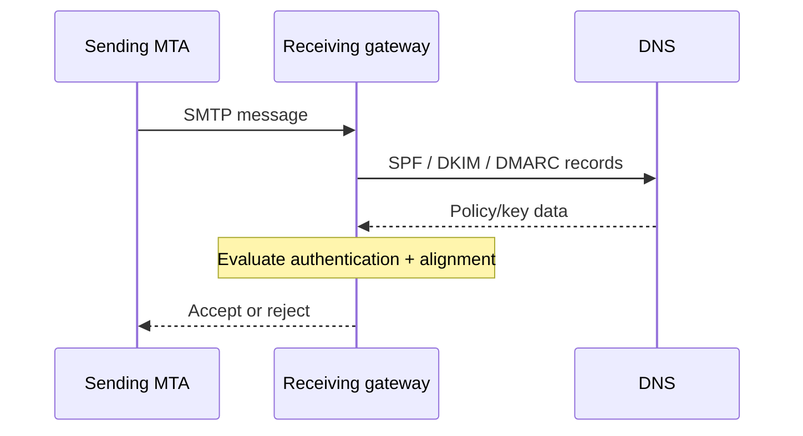

</div>

---

# Reputation

Gateways may use reputation about:

- sender IP;
- domain;
- URL;
- attachment hash;
- historical behavior.

Reputation changes over time. A previously benign entity can be compromised.

---

# Greylisting concept

Some systems temporarily reject unfamiliar senders and expect legitimate MTAs to retry.

This can reduce simplistic spam, but may:

- delay legitimate mail;
- provide diminishing value;
- interact poorly with modern distributed senders.

Teach it as an example of protocol-behavior filtering.

---

# Availability concerns

Mail gateways can fail due to:

- DNS outage;
- queue growth;
- scanner overload;
- disk exhaustion;
- policy loop;
- certificate/TLS problems.

Store-and-forward helps resilience, but queues are finite.

---

# Logging

Useful events:

- sender/recipient;
- authentication results;
- spam score;
- malware verdict;
- policy action;
- queue ID;
- URLs/domains;
- attachment hashes where appropriate.

Be mindful that email metadata and content are sensitive.

---

# Design scenario

A company wants:

- reject obvious domain spoofing;
- score spam;
- scan attachments;
- quarantine medium-risk messages;
- inspect outbound confidential data;
- retain enough evidence for investigations.

Build a layered message path.

---

# Possible design

<div style="transform: scale(0.8); transform-origin: top center;">

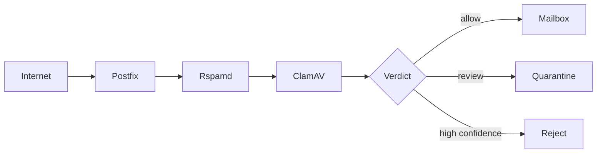

</div>

---

# Common mistakes

- Treating SPF alone as anti-phishing
- Assuming authenticated mail is benign
- Ignoring outbound abuse
- Unlimited archive expansion
- Quarantine everyone can override casually
- Logging sensitive bodies unnecessarily
- No DMARC rollout observation
- No business verification for high-risk requests

---

# What the gateway cannot solve

An email gateway cannot guarantee users will never be deceived.

It cannot fully prevent:

- compromised legitimate accounts;
- social engineering over other channels;
- malicious content on trusted services;
- business-process fraud.

Technical and human controls must cooperate.

---

# Mental model

<div style="transform: scale(0.8); transform-origin: top center;">

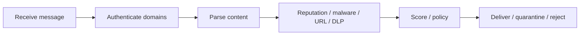

</div>

---

# Expert augmentation: API-based cloud email security

Traditional SEG:

<div style="transform: scale(0.8); transform-origin: top center;">

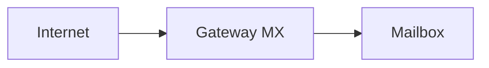

</div>

API-based cloud inspection:

<div style="transform: scale(0.8); transform-origin: top center;">

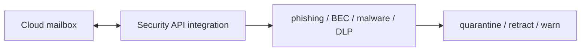

</div>

Strengths:

- sees internal mail;
- can retract delivered messages;
- integrates with identity and collaboration data.

---

# Email security as third-party risk

Cloud SEG becomes part of your resilience architecture.

<div style="transform: scale(0.8); transform-origin: top center;">

```mermaid
flowchart TB
  Org[Organization] --> Vendor[Cloud email security provider]
  Vendor --> Mail[Email platform]
  Vendor --> Risk[Availability + data access + incident reporting]
  Org --> Exit[Exit strategy and contract controls]
```

</div>

Questions for DORA/NIS2-style thinking:

- is this a critical dependency?
- what data does the provider access?
- what are reporting obligations?
- can we operate if the provider fails?

---

# Review questions

1. Why is email especially suitable for gateway inspection?
2. What does SPF actually authenticate?
3. How is DKIM different from encryption?
4. What role does DMARC alignment play?
5. Why can an authenticated message still be malicious?
6. Why do BEC defenses need business-process controls?

---

# Final checklist

For email security, ask:

- Which identities are evaluated?
- Are SPF, DKIM, and DMARC understood separately?
- How are attachments parsed and limited?
- How are URLs evaluated?
- Which messages are quarantined vs rejected?
- Is outbound mail inspected?
- Are high-risk business requests verified elsewhere?
- Are logs useful without over-collecting sensitive content?
