# Secure Web Gateways and Forward Proxies

## Controlling users and servers as they access the web

__Open-source tool:__ Squid

A reverse proxy protects services we publish. A forward proxy controls clients when they access services elsewhere.

---

# Learning objectives

You should be able to:

- distinguish forward and reverse proxies;
- explain explicit proxying and CONNECT;
- reason about proxy authentication and policy;
- explain TLS inspection and its risks;
- identify bypasses involving QUIC, DoH, and direct access;
- build a small Squid-based teaching lab.

---

# Forward vs reverse proxy

<div style="transform: scale(0.8); transform-origin: top center;">

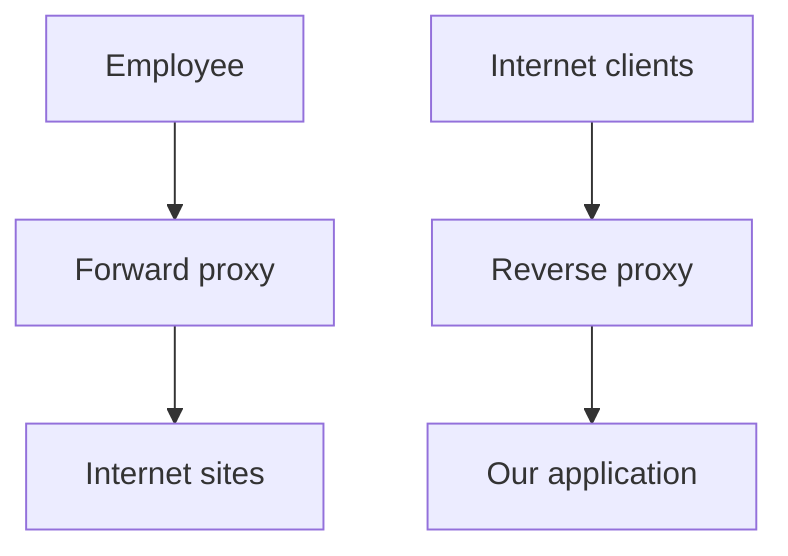

</div>

Direction of trust and ownership is the easiest way to remember the difference.

---

# Why use a forward proxy?

Possible goals:

- URL/domain policy;
- user-aware access control;
- malware/file filtering integration;
- logging;
- egress control;
- caching;
- TLS inspection in selected environments.

---

# Explicit proxy

The client is configured to send web requests to the proxy.

<div style="transform: scale(0.8); transform-origin: top center;">

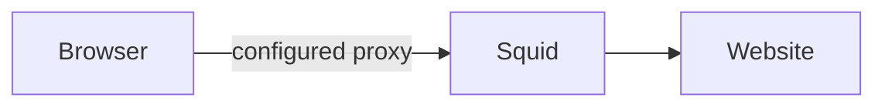

</div>

The client knows a proxy exists.

---

# Direct web access

Without an enforced network policy:

<div style="transform: scale(0.8); transform-origin: top center;">

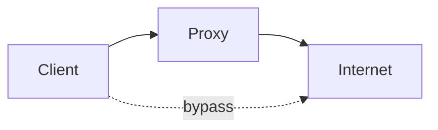

</div>

A proxy policy is weak if clients can simply connect around it.

---

# Enforce the path

Common architectural pattern:

<div style="transform: scale(0.8); transform-origin: top center;">

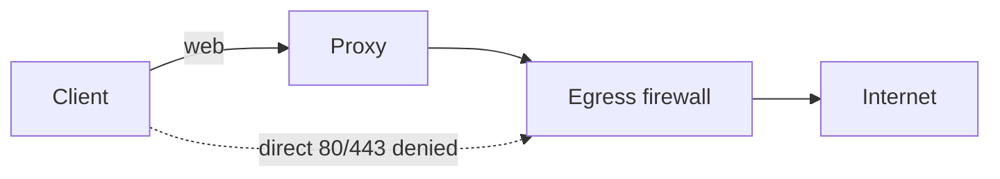

</div>

Proxy and firewall policies reinforce each other.

---

# HTTP through a proxy

For plain HTTP, the proxy can receive the full request and create a separate server connection.

<div style="transform: scale(0.8); transform-origin: top center;">

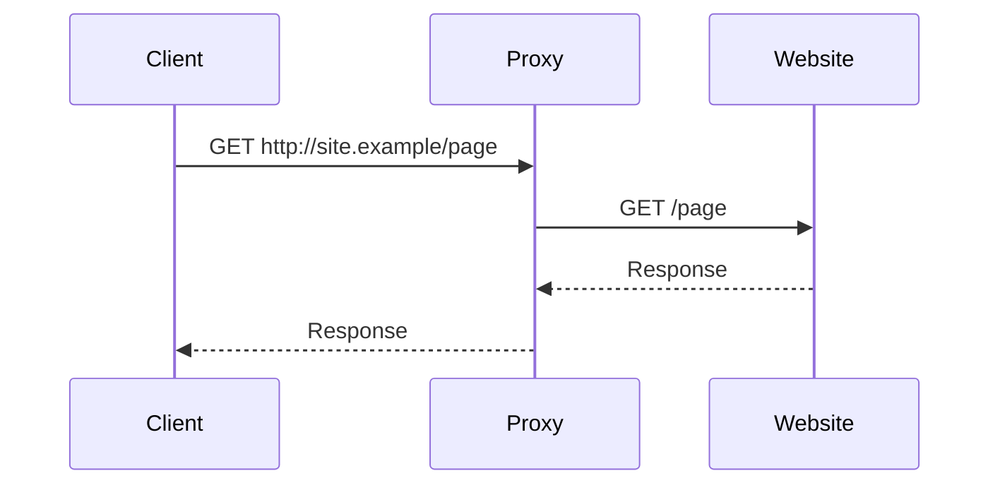

</div>

---

# HTTPS CONNECT

A client can ask the proxy to establish a tunnel.

<div style="transform: scale(0.8); transform-origin: top center;">

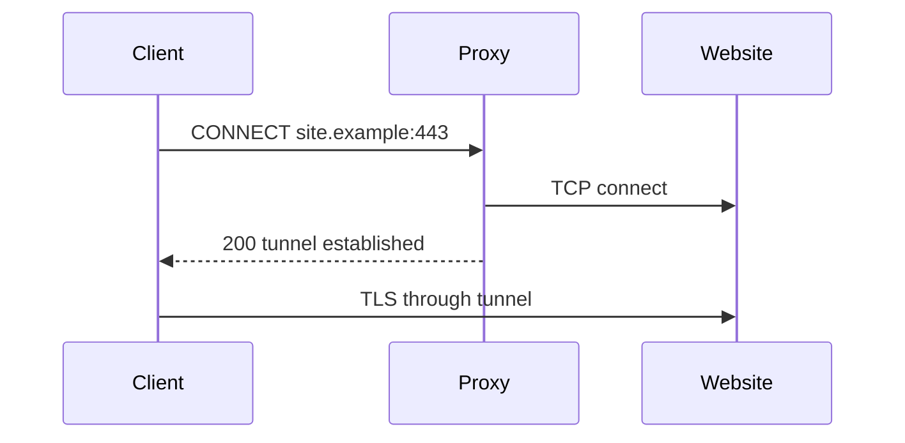

</div>

Without interception, the proxy does not see encrypted HTTP content.

---

# What is visible without TLS inspection?

Depending on protocol/version, the proxy/network may know:

- client identity/IP;
- destination IP;
- requested CONNECT host;
- timing and byte counts;
- some TLS handshake metadata.

It does not automatically see HTTP paths, bodies, cookies, or downloaded plaintext.

---

# URL policy for plain HTTP

A proxy can evaluate:

```text
http://example.test/category/path
```

against policy such as:

```text
malware category -> deny
business apps     -> allow
unknown category  -> log / review
```

---

# User-aware policy

Instead of only source IP:

<div style="transform: scale(0.8); transform-origin: top center;">

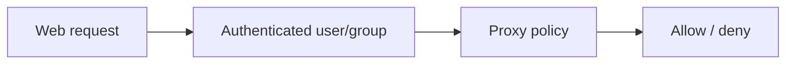

</div>

Identity-aware policy can follow roaming users better than fixed addressing.

---

# Proxy authentication

A proxy may integrate with enterprise identity systems.

Security questions:

- how is the user authenticated?
- can service accounts browse?
- what happens when identity is unavailable?
- are shared devices expected?

---

# Servers should not browse like users

A server often needs much narrower egress.

<div style="transform: scale(0.8); transform-origin: top center;">

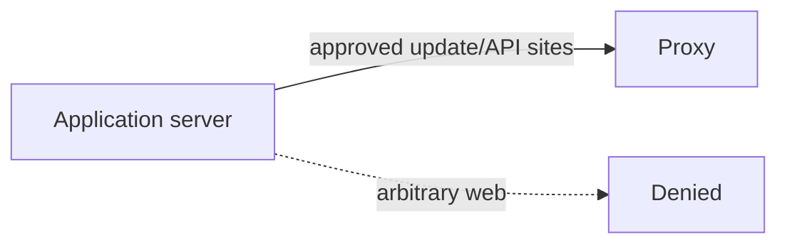

</div>

Proxy allowlists can reduce compromise impact.

---

# Domain vs URL controls

Domain-level:

```text
allow docs.example
```

URL-level:

```text
allow docs.example/public/
deny  docs.example/admin/
```

URL-level inspection generally requires access to the HTTP request, which HTTPS hides unless terminated/intercepted.

---

# TLS inspection architecture

<div style="transform: scale(0.8); transform-origin: top center;">

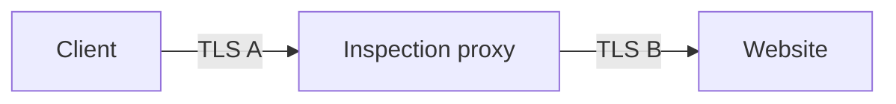

</div>

The proxy deliberately becomes a trusted intermediary between client and website.

---

# How the client accepts interception

Managed clients trust a private CA controlled by the organization.

<div style="transform: scale(0.8); transform-origin: top center;">

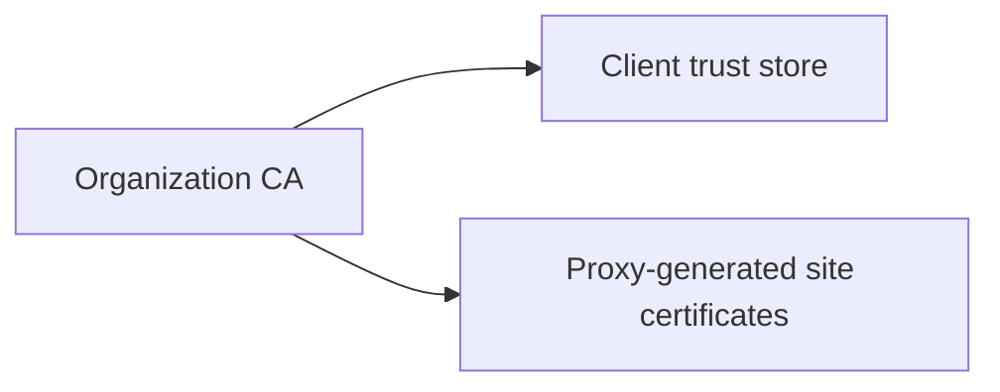

</div>

This is a major trust decision, not just a checkbox.

---

# Security benefits of TLS inspection

It can enable:

- full URL inspection;
- malware scanning;
- DLP;
- content policy;
- application controls;
- detailed logging.

But visibility comes with substantial responsibility.

---

# Risks of TLS inspection

- private CA compromise has broad impact;
- proxy becomes high-value target;
- application compatibility can break;
- certificate pinning may fail;
- privacy/legal concerns;
- sensitive plaintext becomes visible centrally;
- proxy TLS quality must be maintained.

---

# Selective inspection

A sensible design may bypass interception for categories such as:

- health;
- banking;
- other highly sensitive services;
- pinned applications.

The exact policy depends on legal, privacy, and security requirements.

---

# Certificate validation still matters

The proxy must validate the real server certificate correctly.

<div style="transform: scale(0.8); transform-origin: top center;">

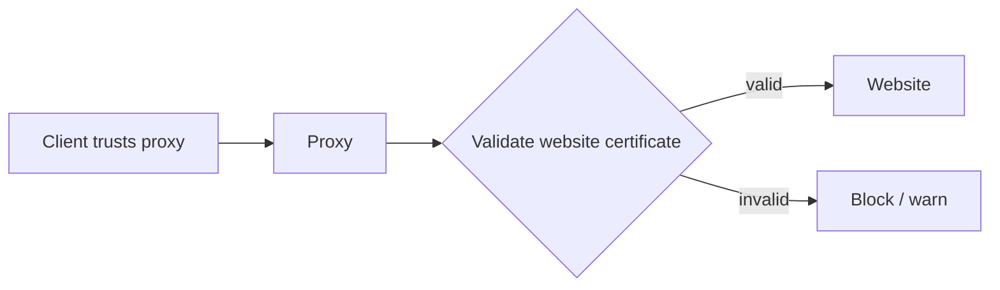

</div>

Otherwise interception can weaken server authentication.

---

# File downloads

A proxy may enforce policies based on:

- content type;
- extension;
- size;
- source category;
- malware scan verdict.

Large-content inspection requires careful limits to avoid resource exhaustion.

---

# Malware scanning integration

<div style="transform: scale(0.8); transform-origin: top center;">

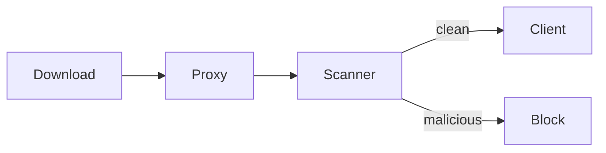

</div>

Inspection latency and file size influence feasibility.

---

# Data Loss Prevention

Outbound HTTP(S) may carry:

- source code;
- documents;
- credentials;
- personal data.

A proxy can contribute content visibility, but business context is often needed to distinguish legitimate upload from exfiltration.

---

# DLP is not simple keyword blocking

The string `CONFIDENTIAL` might occur in:

- a real sensitive document;
- a training slide;
- sample code;
- a public policy document.

High-confidence DLP usually combines classification, content, destination, user, and workflow.

---

# Web categories

Gateways may classify destinations as:

- business;
- social media;
- malware;
- newly observed;
- file sharing;
- gambling;
- uncategorized.

Category policy is organizational governance as much as technical security.

---

# Newly observed domains

A domain with little history may deserve more scrutiny, but new does not mean malicious.

Possible policy:

```text
known malware -> block
known business -> allow
new/unknown -> allow with extra monitoring or restricted downloads
```

---

# QUIC / HTTP/3 challenge

HTTP/3 commonly uses QUIC over UDP.

<div style="transform: scale(0.8); transform-origin: top center;">

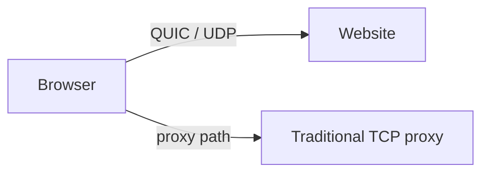

</div>

Proxy architectures designed around TCP may need explicit policy for QUIC.

---

# One policy choice: force fallback

An organization may block direct QUIC so managed clients fall back to proxy-compatible HTTPS paths.

This can improve inspection consistency but may reduce performance and should be intentionally tested.

---

# DoH bypass

<div style="transform: scale(0.8); transform-origin: top center;">

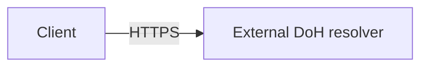

</div>

A web proxy may see this as ordinary HTTPS unless it identifies or controls the destination/application.

DNS and web egress policies must align.

---

# Tunnelling over allowed HTTPS

If arbitrary HTTPS is allowed, malware can often communicate over the same channel.

A proxy can add:

- destination policy;
- identity;
- TLS/application metadata;
- optional inspection.

But allowed SaaS services can still be abused.

---

# Caching

Traditional proxies can cache content to save bandwidth and latency.

Security considerations:

- avoid caching private/authenticated responses incorrectly;
- manage stale content;
- protect cached sensitive data;
- understand modern HTTPS limits on caching usefulness.

---

# Open-source tool: Squid

Squid can demonstrate:

- explicit forward proxying;
- ACLs;
- proxy authentication;
- HTTP caching;
- CONNECT handling;
- TLS interception concepts;
- detailed access logs.

---

# Squid policy flow

<div style="transform: scale(0.8); transform-origin: top center;">

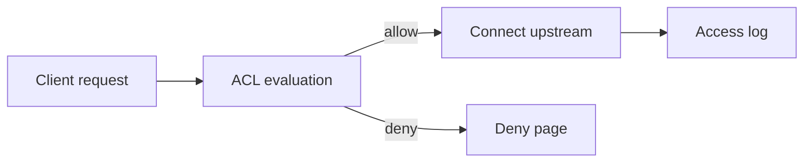

</div>

Keep first labs to explicit proxying before adding interception.

---

# Simple ACL concept

```text
acl students src 10.10.0.0/16
acl blocked dstdomain .blocked.test

http_access deny students blocked
http_access allow students
http_access deny all
```

Readable policy reinforces the same rule-order lessons as firewalls.

---

# Lab topology

<div style="transform: scale(0.8); transform-origin: top center;">

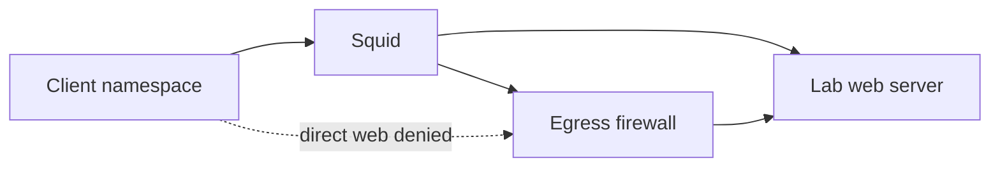

</div>

Use a lab web server so everything works offline.

---

# Lab progression

1. Direct HTTP succeeds.
2. Configure explicit proxy.
3. Block direct egress.
4. Add domain ACL.
5. Add user/source policy.
6. Observe CONNECT for HTTPS.
7. Discuss interception; optionally demonstrate with a lab CA only.

---

# Proxy logs

Useful fields:

- authenticated user;
- client IP;
- destination;
- result/status;
- bytes;
- request method;
- timing;
- policy action.

Logs can expose browsing behavior, so access and retention should be governed.

---

# Privacy boundary

A secure web gateway may know a great deal about users.

<div style="transform: scale(0.8); transform-origin: top center;">

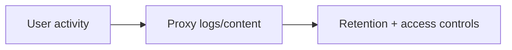

</div>

Security monitoring should not become uncontrolled surveillance.

---

# Availability

If every user depends on one proxy, proxy failure can appear as “the Internet is down.”

Plan:

- HA;
- capacity;
- bypass/emergency behavior;
- DNS dependencies;
- certificate lifecycle if intercepting TLS.

---

# Fail-open vs fail-closed

During proxy failure:

__fail-open__
- users keep Internet access;
- security visibility/policy may disappear.

__fail-closed__
- security path preserved;
- business Internet access may fail.

The choice must be explicit.

---

# Design scenario

Requirements:

- employees use approved web destinations;
- servers only access package repositories and named APIs;
- direct outbound 80/443 is blocked;
- malware downloads should be detected where feasible;
- sensitive categories should not be TLS-intercepted.

---

# Possible architecture

<div style="transform: scale(0.8); transform-origin: top center;">

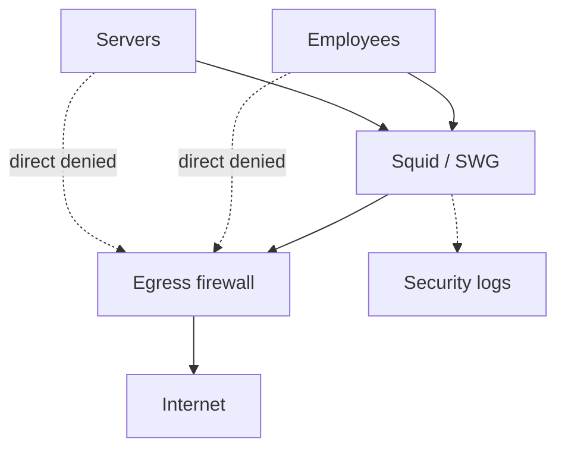

</div>

---

# Common mistakes

- Proxy configured but bypass path remains open
- Treating domain category as perfect truth
- TLS inspection deployed with weak certificate governance
- No QUIC/DoH strategy
- Servers given the same broad web policy as users
- Logging sensitive browsing indefinitely
- No failover/capacity plan

---

# What the proxy cannot solve

A forward proxy cannot fully prevent:

- malicious behavior inside trusted SaaS;
- compromised accounts uploading legitimate-looking data;
- non-web covert channels;
- endpoint compromise using allowed destinations;
- every encrypted protocol evolution.

It is an egress control point, not an endpoint replacement.

---

# Mental model

<div style="transform: scale(0.8); transform-origin: top center;">

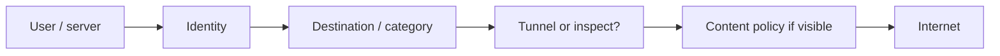

</div>

---

# Expert augmentation: SWG to SASE

The on-prem proxy model breaks down for distributed users.

<div style="transform: scale(0.8); transform-origin: top center;">

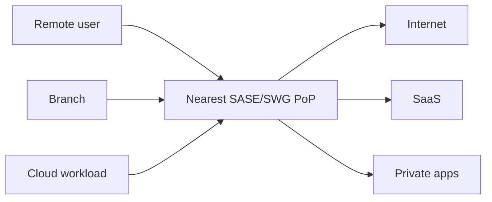

</div>

SASE commonly combines:

- secure web gateway;
- cloud firewall;
- CASB;
- ZTNA;
- DLP.

---

# TLS inspection and key custody

TLS inspection creates a sensitive key-management problem.

<div style="transform: scale(0.8); transform-origin: top center;">

```mermaid
flowchart LR
  CA[Enterprise inspection CA] --> HSM[HSM / protected key store]
  HSM --> POP[Inspection proxy]
  POP -->|generates leaf certs| Client[Managed clients]
```

</div>

Students should ask:

- where is the inspection CA key stored?
- who can use it?
- can raw key material be extracted?
- what audit evidence exists?
- what traffic must be exempted?

---

# Review questions

1. What is the difference between forward and reverse proxies?
2. What does HTTP CONNECT do?
3. What becomes visible only after TLS interception?
4. Why is the organization's private CA high risk?
5. How can QUIC or DoH affect proxy visibility?
6. Why should servers have narrower egress than user browsers?

---

# Final checklist

For secure web egress, ask:

- Is proxy use explicit and enforced?
- Which identities drive policy?
- Which destinations are allowed?
- How are direct paths blocked?
- How are CONNECT, QUIC, and DoH handled?
- Is TLS inspection necessary and selectively governed?
- What file/content limits apply?
- Are logs privacy-governed?
- What happens if the proxy fails?
