# DDoS Protection

## Protecting availability before resources are exhausted

__Open-source stack:__ FastNetMon Community, nftables, Linux traffic control, FRRouting; XDP/eBPF as an advanced topic

DDoS is the lecture where **placement and capacity** matter as much as filtering logic.

---

# Learning objectives

You should be able to:

- classify DDoS attacks by exhausted resource;
- explain reflection/amplification conceptually;
- distinguish local filtering from upstream mitigation;
- explain rate limiting, SYN cookies, RTBH, and scrubbing;
- understand flow telemetry and FastNetMon;
- design a layered availability strategy.

---

# Availability is security

CIA includes:

```text
Confidentiality
Integrity
Availability
```

A perfectly encrypted and authenticated service is still useless when legitimate users cannot reach it.

---

# DoS vs DDoS

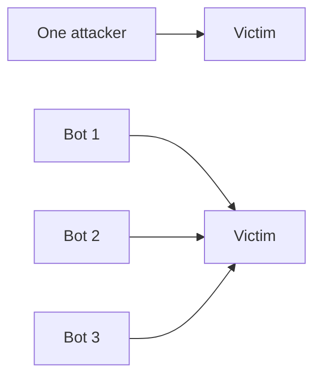

Distributed attacks combine resources and source diversity.

---

# Ask: which resource is exhausted?

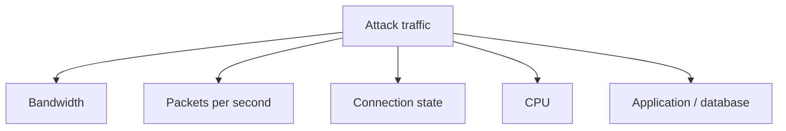

Different bottlenecks require different defenses.

---

# Volumetric attack

If the access link is 1 Gbit/s and 20 Gbit/s arrives:

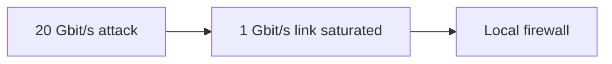

The firewall may drop perfectly, but legitimate traffic cannot reach it.

---

# Packet-rate exhaustion

A device may have enough bandwidth but not enough packet-processing capacity.

Small packets can create huge packets-per-second rates.

Always measure more than Mbps/Gbps.

---

# State exhaustion

Stateful devices maintain finite tables.

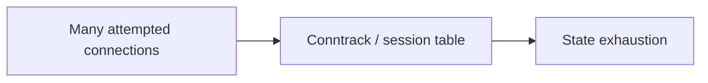

Targets can include firewalls, load balancers, NAT devices, and servers.

---

# Application-layer exhaustion

A small number of requests may consume expensive backend work.

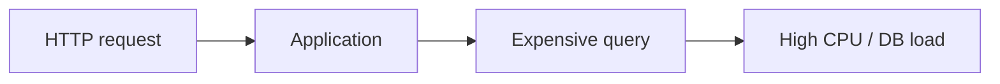

Bandwidth may look normal while the service fails.

---

# Attack taxonomy by layer

| Area | Example pressure |
|---|---|
| Network | bandwidth |
| Packet processing | packets/s |
| Transport | connection/state |
| TLS | handshake CPU/state |
| HTTP/API | request rate |
| Application | expensive business operation |

No single threshold protects all layers.

---

# SYN flood concept

Normal TCP:

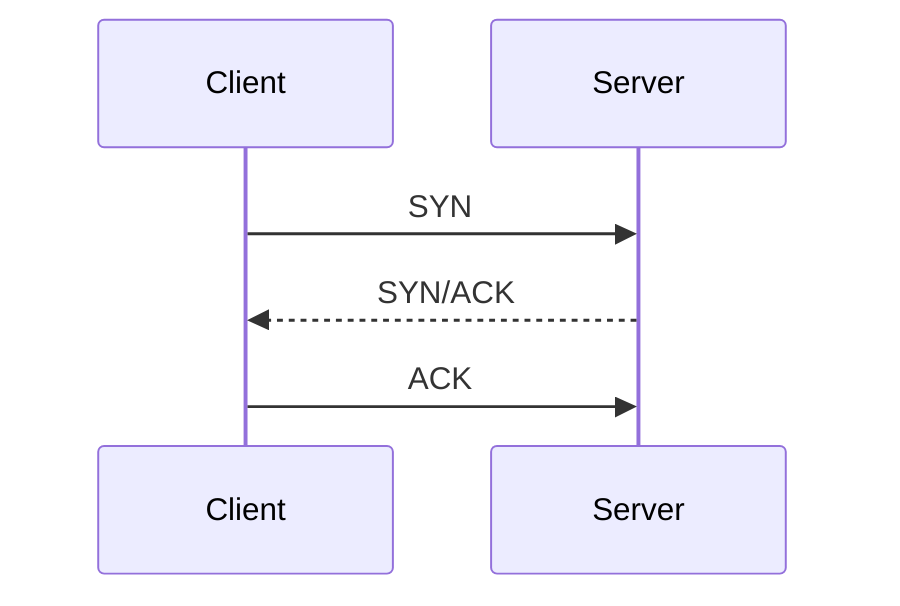

A flood creates many connection attempts without completing normal use.

---

# SYN cookies

Simplified idea:

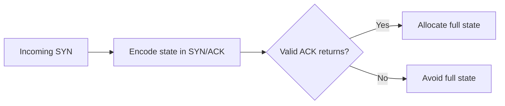

This reduces memory pressure from incomplete handshakes.

---

# UDP floods

UDP is connectionless, so high packet rates can target:

- network bandwidth;
- host packet processing;
- application sockets.

Defenses depend on whether the UDP service is actually required.

---

# Reflection

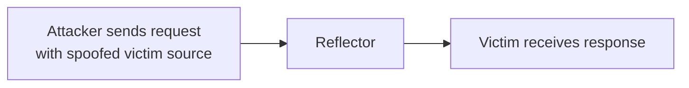

The attacker abuses a third-party service to send traffic toward the victim.

---

# Amplification

If the response is much larger than the request, reflection becomes amplification.

Defensive lessons:

- prevent source spoofing;
- do not expose amplifiable services unnecessarily;
- restrict recursive services;
- rate-limit appropriately.

---

# Anti-spoofing matters upstream

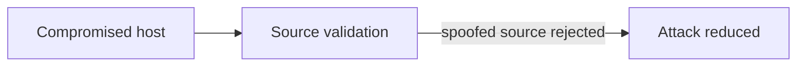

BCP-style source validation benefits the whole Internet, not just one customer.

---

# ICMP floods

ICMP can be abused, but ICMP is also needed for legitimate network functions.

Avoid simplistic policy:

```text
block all ICMP
```

Prefer targeted limits and required message types.

---

# HTTP request floods

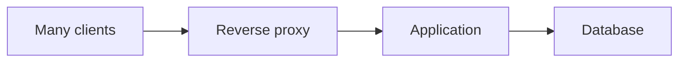

Requests may look syntactically valid. Detection may need identity, rate, cost, and behavior context.

---

# Expensive endpoint

Suppose:

```text
GET /search?query=...
```

triggers a heavy database query.

Protecting `/` at 1000 req/s does not help if `/search` becomes unavailable at 50 req/s.

---

# Rate limiting

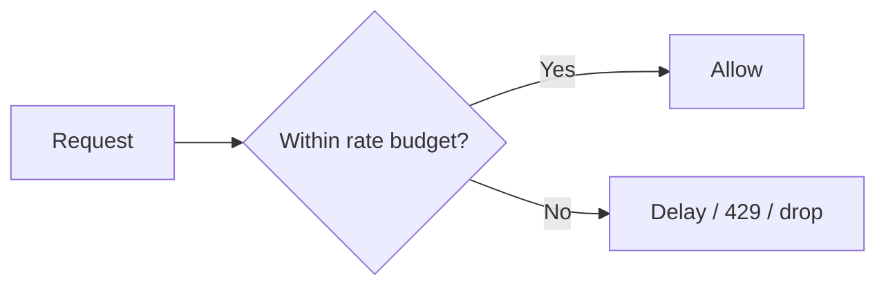

The hard part is deciding the key:

- source IP?
- account?
- API key?
- endpoint?
- global capacity?

---

# Per-IP limits are imperfect

A distributed botnet can stay below each per-IP threshold.

Conversely, many legitimate users may share one NAT address.

Rate limits should match the identity and resource being protected.

---

# Concurrency limits

Limit simultaneous expensive work:

```text
max active requests to expensive endpoint = N
```

This can protect the backend even if requests arrive faster than they can be processed.

---

# Queue or reject?

Queues help absorb bursts.

But when arrival rate remains above processing capacity:

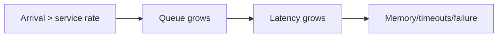

Bound queues intentionally.

---

# Local firewall filtering

nftables can drop obvious unwanted traffic early.

Examples:

- unused protocols;
- invalid state;
- impossible source ranges;
- known blocked sources in small cases.

But local filtering helps only if traffic can still reach the host/link.

---

# Linux traffic control

`tc` can shape or police traffic.

Teaching concepts:

- rate;
- burst;
- queue;
- drop.

It is useful for labs because students can simulate constrained links and observe overload.

---

# XDP/eBPF as advanced mitigation

XDP can execute very early in Linux packet reception.

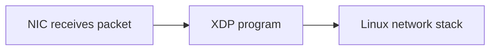

Dropping earlier can reduce CPU cost, but this is an advanced implementation topic.

---

# The upstream problem

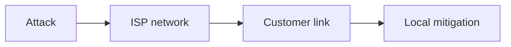

If `LINK` is saturated, controls after it cannot restore availability.

---

# Remote triggered blackhole

RTBH intentionally routes attacked traffic to a discard path upstream.

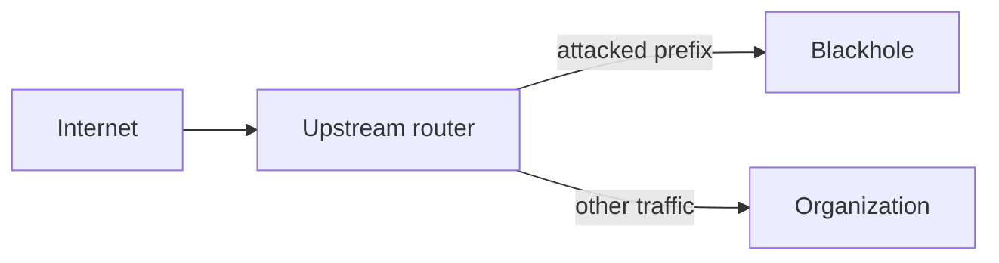

It sacrifices reachability to stop collateral damage.

---

# When blackholing helps

Useful when:

- one target is under severe attack;
- protecting the rest of the network matters more than that target;
- no better selective mitigation is available.

It is mitigation by **intentional unavailability of the target**.

---

# FlowSpec concept

BGP FlowSpec can distribute more specific traffic-filtering rules through routing infrastructure.

Teach the architectural idea:

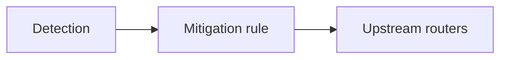

Do not turn the lecture into BGP FlowSpec syntax.

---

# Scrubbing center

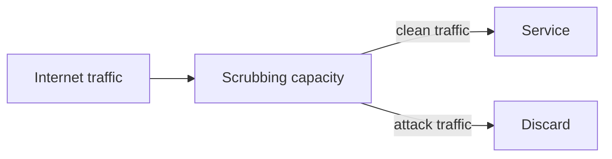

Scrubbing must have enough upstream capacity to receive the attack.

---

# Diversion to scrubbing

Traffic may be redirected through:

- BGP routing changes;
- provider integration;
- always-on upstream path.

The key is that mitigation happens **before the constrained customer link**.

---

# Detection data sources

Useful telemetry includes:

- interface counters;
- NetFlow/IPFIX;
- sFlow;
- firewall/session metrics;
- load balancer metrics;
- application request rates;
- CPU/memory/queue depth.

---

# Flow telemetry

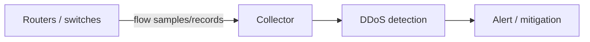

Flow records summarize conversations without storing every payload.

---

# FastNetMon Community

FastNetMon can consume network telemetry and detect traffic-rate anomalies.

Teaching value:

- traffic baselines;
- packets/s vs bits/s;
- per-prefix visibility;
- automated response concepts;
- integration with routing/firewall actions.

---

# Detection thresholds

A fixed threshold is simple:

```text
alert if > 1 Gbit/s
```

But real services vary by time and event.

Better detection may consider:

- baseline;
- rate of change;
- packets/s;
- protocol distribution;
- application health.

---

# Autoscaling is not DDoS protection

Adding servers can help application capacity, but it does not solve:

- saturated links;
- exhausted stateful firewalls;
- expensive database bottlenecks;
- unlimited cost growth.

Scaling and attack mitigation are related but not identical.

---

# Cost-exhaustion attacks

Cloud systems can remain technically available while generating enormous bills.

Security objective may include:

> maintain service **within an acceptable resource/cost envelope**.

Rate limits and budgets can therefore be security controls.

---

# Dependency DDoS

Your service may fail because an upstream dependency is attacked:

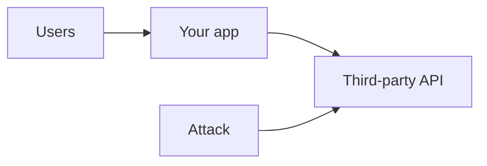

Availability architecture must include dependencies.

---

# Anycast concept

Anycast can announce the same service address from multiple locations.

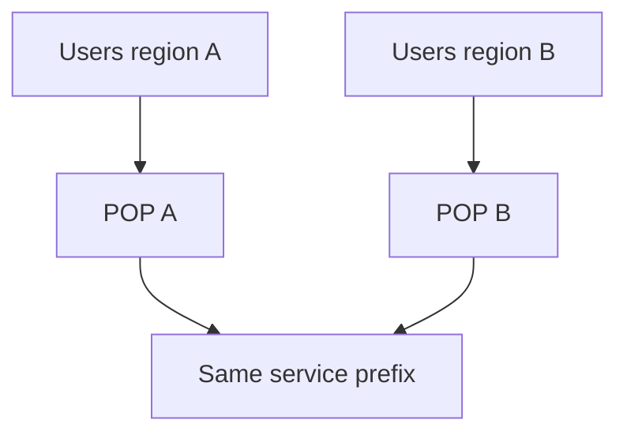

This can distribute both legitimate load and attacks.

---

# Lab topology

```mermaid
flowchart LR
  GEN["Traffic generator"] --> R["Linux router"] --> S["Protected service"]
  R -.-> FLOW["sFlow/NetFlow or counters"]
  FLOW --> FNM["FastNetMon"]
```

Keep generation rates safe and inside an isolated lab.

---

# Lab progression

1. Measure normal baseline.
2. Introduce a controlled burst.
3. Observe bandwidth and pps separately.
4. Add nftables rate/allow policy.
5. Constrain the link with `tc`.
6. Demonstrate why downstream filtering cannot fix upstream saturation.
7. Discuss RTBH/scrubbing conceptually.

---

# Monitoring service health

Traffic volume alone is not enough.

Monitor:

- success rate;
- latency;
- queue depth;
- backend saturation;
- error rate;
- connection failures.

A DDoS detector should correlate network pressure with user impact.

---

# Incident response sequence

```mermaid
flowchart LR
  DET["Detect anomaly"] --> CLASS["Classify bottleneck"]
  CLASS --> MIT["Apply mitigation"]
  MIT --> VERIFY["Verify service recovery"]
  VERIFY --> TUNE["Tune / document"]
```

Do not jump to blocking without understanding what is actually exhausted.

---

# Common mistakes

- Measuring only bandwidth
- Assuming firewall drops solve saturated links
- Per-IP limits against distributed attacks
- Unlimited queues
- No upstream mitigation process
- No baseline
- Autoscaling treated as infinite defense
- Blocking essential protocols too aggressively

---

# Design scenario

Service characteristics:

- 1 Gbit/s access link;
- reverse proxy handles 100k connections;
- expensive `/report` endpoint;
- upstream supports BGP blackhole;
- flow telemetry available.

Design controls for bandwidth, state, and application exhaustion.

---

# Possible layered design

```mermaid
flowchart LR
  NET["Internet"] --> UP["Upstream filtering / RTBH / scrub"] --> EDGE["Edge router"] --> FW["Firewall"] --> RP["Rate-limiting proxy"] --> APP["Application"]
  EDGE -.-> FLOW["Flow telemetry"]
  RP -.-> MET["App metrics"]
  FLOW --> DET["Detection"]
  MET --> DET
```

---

# What DDoS controls cannot solve

Mitigation cannot guarantee zero disruption.

It cannot create infinite:

- bandwidth;
- CPU;
- state;
- database capacity;
- third-party dependency capacity.

The goal is controlled degradation, resilience, and timely upstream response.

---

# Mental model

```mermaid
flowchart LR
  OBS["Observe rates + health"] --> BOT["Identify bottleneck"]
  BOT --> PLACE["Choose control before bottleneck"]
  PLACE --> LIMIT["Drop / limit / divert / scale"]
  LIMIT --> VERIFY["Verify user availability"]
```

---

# Expert augmentation: stateless DDoS filtering

State is dangerous under flood.

```mermaid
flowchart LR
  Flood[Huge packet flood] --> Stateless[Stateless hardware/software filter]
  Stateless -->|drop obvious bad| Drop[Drop]
  Stateless -->|pass likely good| Stateful[Stateful services]
```

DDoS appliances and edge filters try to drop traffic before expensive state is created.

Teaching point:

> Protect the scarce resource before it is consumed.

---

# Routing integration for scrubbing

```mermaid
flowchart LR
  Attack[Internet attack] --> Scrub[Scrubbing center]
  Scrub --> Clean[Clean tunnel / route] --> Site[Protected site]
  Site --> Out[Normal outbound path]
```

Routing mechanisms can divert inbound traffic to a scrubbing service.

Design questions:

- who announces the protected prefix?
- how quickly can diversion occur?
- is return traffic symmetric?
- what happens to stateful middleboxes?

---

# Review questions

1. Why can local firewall filtering fail against volumetric DDoS?
2. What resource does a SYN flood pressure?
3. Why is reflection related to source spoofing?
4. What is the trade-off of RTBH?
5. Why are per-IP limits weak against a botnet?
6. Why should application health be monitored alongside traffic volume?

---

# Final checklist

For DDoS resilience, ask:

- What is the first constrained resource?
- What are normal bandwidth and pps baselines?
- Which services/protocols are truly required?
- Are connection and request limits bounded?
- Can mitigation occur upstream?
- Is RTBH/scrubbing pre-arranged?
- Is flow telemetry available?
- Are application health metrics correlated?
- Is degraded-mode behavior intentional?
