---

theme: sred-theme
routerMode: hash
title: "IPsec VPNs"
info: |
  Network Security Using Dedicated Devices
  Open-source teaching deck
transition: slide-left
mdc: true
---

# IPsec VPNs

## Protecting IP traffic across untrusted networks

__Open-source tool:__ strongSwan

We will treat cryptography as an implementation primitive and focus on architecture: peers, policies, Security Associations, IKE, ESP, routing, and failure modes.

---

# Learning objectives

You should be able to:

- explain site-to-site IPsec architecture;
- distinguish IKE and ESP;
- explain Security Associations and traffic selectors;
- compare tunnel and transport mode;
- understand NAT traversal and route/policy-based designs;
- build and troubleshoot a small strongSwan lab.

---

# Why a VPN?

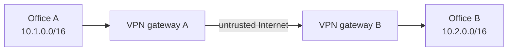

The networks want to communicate as if connected by a protected path.

---

# Security goals

IPsec can provide:

- confidentiality;
- integrity;
- peer authentication;
- anti-replay protection;
- policy-based protection of selected IP traffic.

The application does not need to implement its own VPN logic.

---

# Layer placement

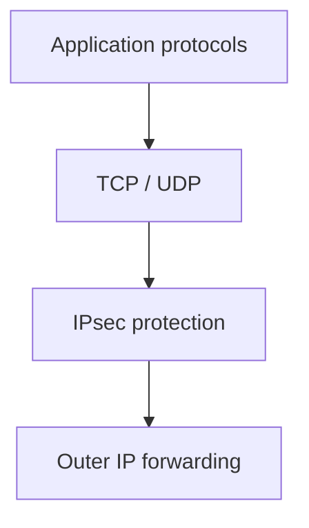

IPsec sits at the network layer and can protect many application protocols transparently.

---

# Two major pieces

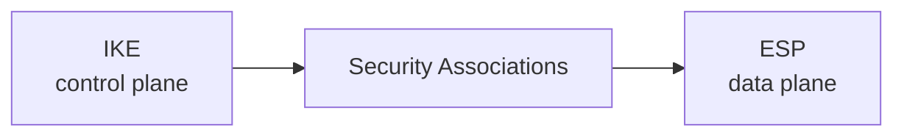

Simplify the mental model:

- IKE negotiates/authenticates and establishes state;
- ESP protects actual traffic.

---

# Security Association

An SA describes how traffic in **one direction** is protected.

It includes concepts such as:

- peer/security parameters;
- keys;
- algorithms;
- lifetime;
- sequence/replay state;
- identifier (SPI).

Do not reduce an SA to “the encryption key.”

---

# SAs are directional

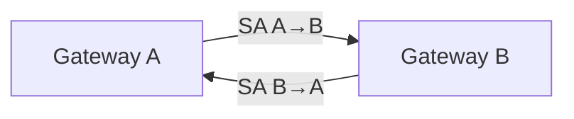

Bidirectional communication uses protection state for both directions.

---

# Security Association Database

Conceptually, the SAD stores active SA state.

```text
SPI -> peer, keys, algorithms, counters, lifetime...
```

When an ESP packet arrives, the receiver uses its metadata to locate the appropriate SA.

---

# Security Policy Database

The SPD answers:

> What should happen to this traffic?

Possible outcomes:

- protect with IPsec;
- bypass IPsec;
- discard.

This policy decision happens before we talk about crypto details.

---

# Traffic selectors

Example site-to-site policy:

```text
local  = 10.1.0.0/16
remote = 10.2.0.0/16
```

Traffic matching these selectors should use the IPsec tunnel.

---

# Policy decision

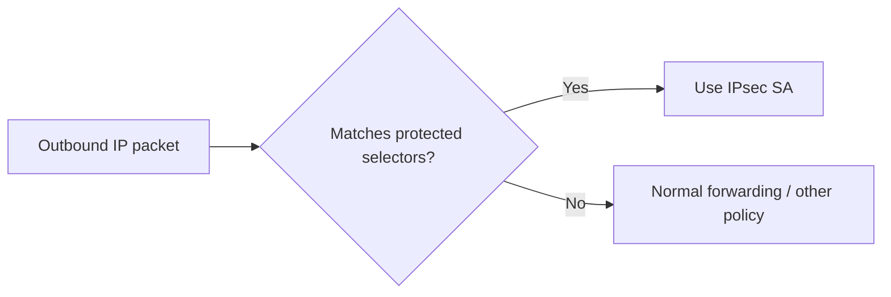

Routing and IPsec policy must agree.

---

# ESP

Encapsulating Security Payload is the main IPsec data-protection protocol used in modern deployments.

Conceptually it provides:

- payload confidentiality;
- integrity/authentication;
- anti-replay support.

Do not start by memorizing every field.

---

# ESP packet concept

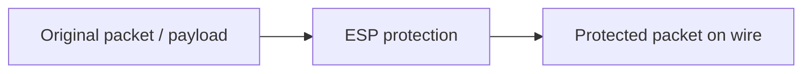

On the public network, observers see outer routing information but not the protected inner content in tunnel mode.

---

# AH

Authentication Header provides integrity/authentication without payload encryption.

It is important historically and conceptually, but ESP is far more common in practical VPN deployments.

Keep AH as a comparison, not the center of the lecture.

---

# Transport mode

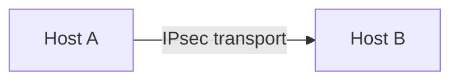

The original IP header remains the routing header while the transport payload is protected.

Typical mental model: **host-to-host protection**.

---

# Tunnel mode

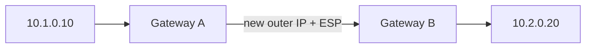

The entire original IP packet becomes protected inside a new outer packet.

---

# Tunnel mode packet

```text
[ outer IP header ]
[ ESP header       ]
[ encrypted original IP packet ]
[ ESP trailer/auth ]
```

The gateways route the outer packet while preserving the original inner addressing for the private networks.

---

# IKE

Internet Key Exchange establishes the authenticated relationship and negotiates IPsec state.

Students should understand:

- peers authenticate;
- cryptographic parameters are negotiated;
- shared keying material is established;
- Child SAs protect data.

---

# IKE high-level flow

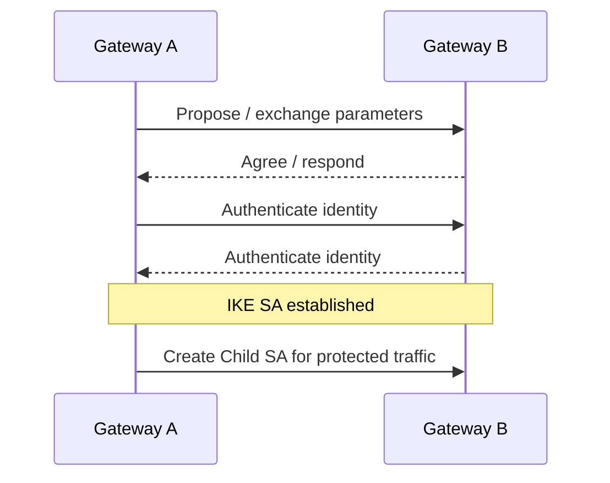

---

# IKE SA vs Child SA

Simplified distinction:

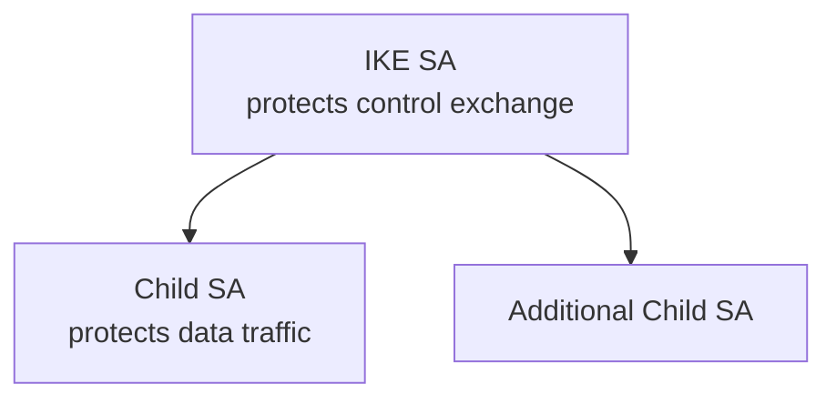

One authenticated IKE relationship can manage data-protection SAs.

---

# Peer authentication

Common choices include:

- pre-shared keys;
- certificates.

Architectural question:

> How does each gateway know it is talking to the intended peer?

Key/certificate lifecycle matters more operationally than cryptographic math.

---

# Pre-shared keys

Advantages:

- simple for small labs;
- easy to understand.

Risks:

- secret distribution;
- reuse across peers;
- rotation difficulty;
- broad blast radius if shared widely.

Use unique secrets per relationship where possible.

---

# Certificates

Certificates scale peer identity better in larger environments.

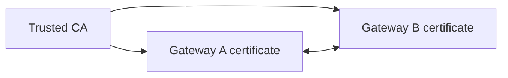

The VPN then depends on PKI lifecycle and trust configuration.

---

# Rekeying

SAs have lifetimes.

Before expiration, peers establish fresh protection state.

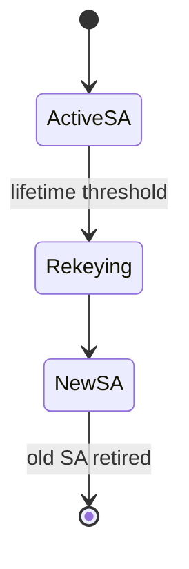

Rekey failures can look like intermittent network outages.

---

# Anti-replay

ESP sequence numbers allow the receiver to detect repeated packets within a window.

Conceptually:

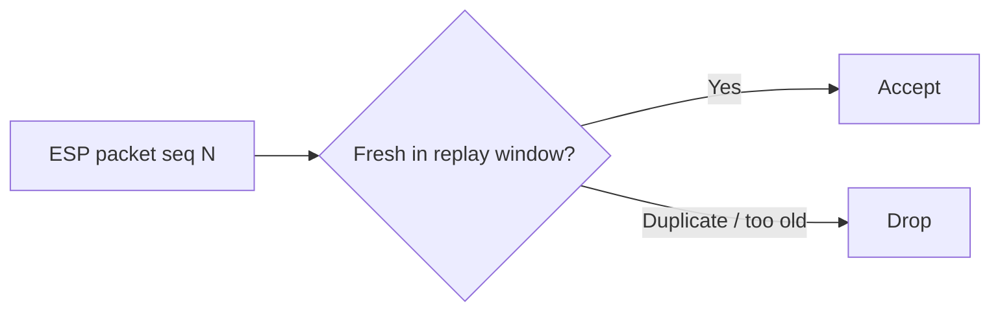

---

# NAT problem

Traditional IPsec assumptions become complicated when addresses/ports are translated between peers.

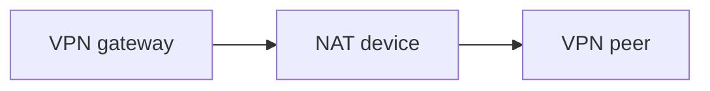

Modern IPsec commonly uses NAT traversal to carry ESP-related traffic through NAT-friendly UDP encapsulation.

---

# NAT-T

Conceptual path:

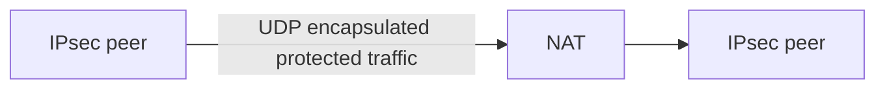

Students need to recognize UDP/4500 as a common troubleshooting clue, not memorize protocol internals.

---

# Firewall requirements

An IPsec deployment may require policy for:

- IKE negotiation;
- NAT-T;
- ESP when not UDP-encapsulated.

The VPN cannot work if upstream firewalls block its control/data traffic.

---

# Policy-based VPN

The IPsec policy directly identifies protected subnets.

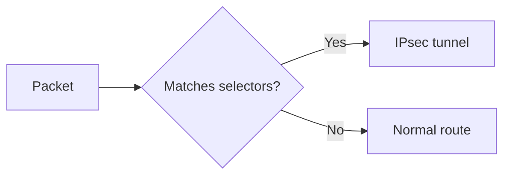

This model is intuitive for simple site-to-site designs.

---

# Route-based VPN

A virtual interface represents the tunnel path.

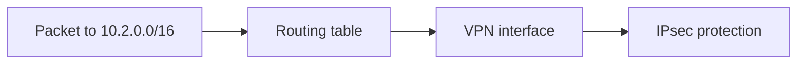

Routing protocols and complex topologies are often easier to integrate this way.

---

# Routing still matters

A working IKE/ESP session does not guarantee application connectivity.

Check:

- route to remote private prefix;
- selector/policy match;
- return route;
- firewall rules on both sides;
- overlapping addresses.

---

# Overlapping networks

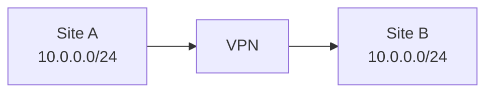

Identical addressing creates ambiguity.

Possible solutions involve renumbering or carefully designed translation, each with operational cost.

---

# MTU overhead

Encapsulation adds bytes.

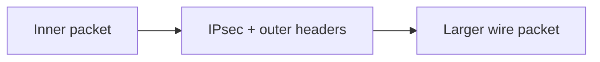

If path MTU is not handled correctly, some applications may fail while small pings still work.

---

# Fragmentation symptoms

Typical clues:

- small packets work;
- large transfers stall;
- specific protocols fail;
- tunnels work only with reduced MTU/MSS.

Do not immediately blame crypto. Check packet size and Path MTU behavior.

---

# strongSwan

strongSwan is an open-source IPsec implementation supporting IKE and ESP integration on Linux and other platforms.

It is ideal for teaching:

- peer definitions;
- traffic selectors;
- authentication;
- Child SAs;
- route/policy interaction;
- troubleshooting logs.

---

# strongSwan lab topology

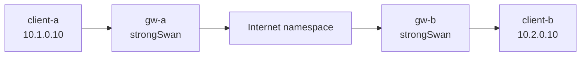

Run everything in containers or namespaces.

---

# Minimal configuration concepts

A connection definition needs concepts such as:

```text
local peer identity/address
remote peer identity/address
local traffic selector
remote traffic selector
authentication method
IKE/ESP proposals
lifetimes
```

Teach these as architectural fields before syntax.

---

# Lab progression

1. Route sites without IPsec.
2. Confirm clear traffic on transit link.
3. Enable strongSwan tunnel.
4. Confirm IKE SA.
5. Confirm Child SA.
6. Observe ESP/NAT-T on transit link.
7. Break one selector and troubleshoot.
8. Trigger/review rekey behavior.

---

# What tcpdump should show

Before tunnel:

```text
10.1.0.10 -> 10.2.0.10 ICMP/HTTP/etc.
```

On public link after tunnel:

```text
gateway-A -> gateway-B ESP
```

or UDP-encapsulated protected traffic with NAT-T.

---

# Troubleshooting order

```mermaid
flowchart TD
  A["Can peers reach each other? "] --> B["IKE established?"]
  B --> C["Child SA established?"]
  C --> D["Selectors match packet?"]
  D --> E["Routing correct?"]
  E --> F["Firewall permits inner traffic?"]
  F --> G["Return path + MTU okay?"]
```

---

# Common IKE failure causes

- peer unreachable;
- wrong identity;
- mismatched authentication;
- incompatible proposals;
- expired/invalid certificate;
- wrong pre-shared key;
- upstream firewall blocking negotiation;
- time synchronization problems with certificates.

---

# Child SA failure causes

- incompatible traffic selectors;
- proposal mismatch;
- conflicting policy;
- route-based/policy-based design mismatch;
- rekey negotiation problem.

Logs should distinguish control-plane establishment from data-plane use.

---

# Logs and counters

Useful evidence:

- IKE authentication events;
- SA creation/deletion;
- negotiated proposals;
- selector pairs;
- rekeys;
- replay/drop counters;
- bytes/packets per SA.

A tunnel can be “up” yet carry zero useful traffic.

---

# Site-to-site policy design

Avoid automatically encrypting `0.0.0.0/0` between sites unless that is truly the intent.

Protect the required networks and understand how default routes interact with the tunnel.

---

# Design scenario

Site A:

- users `10.1.0.0/16`
- management `10.1.100.0/24`

Site B:

- services `10.2.0.0/16`

Requirement: only user-to-service traffic crosses the VPN; management is not exported.

---

# Possible policy

```mermaid
flowchart LR
  U["10.1.0.0/16"] --> G1["Gateway A"] -->|"IPsec"| G2["Gateway B"] --> S["10.2.0.0/16"]
  M["10.1.100.0/24"] -.->|"not selected"| G1
```

Then add firewall rules for the specific applications permitted inside the tunnel.

---

# Common mistakes

- Treating “tunnel up” as proof applications work
- Wrong/mismatched selectors
- No return route
- Overlapping subnets
- MTU ignored
- Broad pre-shared key reuse
- Certificate expiry surprises
- Firewall rules allow too much because traffic is “encrypted”

---

# Encryption does not equal authorization

```mermaid
flowchart LR
  A["Site A"] -->|"encrypted tunnel"| B["Site B"]
  B --> FW["Internal firewall policy"] --> APP["Application"]
```

IPsec protects transport between peers. It does not decide which internal user should access which application.

---

# Mental model

```mermaid
flowchart LR
  ROUTE["Packet needs remote site"] --> SPD["Policy selects IPsec"]
  SPD --> SA["Child SA"]
  SA --> ESP["Protect with ESP"]
  ESP --> PUBLIC["Route outer packet"]
  PUBLIC --> PEER["Peer decrypts + forwards inner packet"]
```

---

# Expert augmentation: IPsec and quantum migration

Long-lived encrypted traffic can have long-term value.

```mermaid
flowchart TB
  A[Intercept encrypted VPN traffic today] --> B[Store now]
  B --> C[Future cryptanalytic capability]
  C --> D[Decrypt later if key exchange breaks]
```

PQC migration focuses first on key establishment.

Practical IPsec questions:

- does IKE support hybrid/PQC key exchange in your platform?
- what is the tunnel performance impact?
- which tunnels carry long-lived sensitive data?
- how will interoperability be tested?

---

# Review questions

1. What is the difference between IKE and ESP?
2. What does an SA represent?
3. What does the SPD decide?
4. Tunnel vs transport mode?
5. Why is NAT-T needed?
6. Why can a tunnel be up while application traffic still fails?

---

# Final checklist

For an IPsec VPN, ask:

- Who are the peers?
- How do they authenticate?
- Which traffic selectors are protected?
- Tunnel or transport mode?
- Policy-based or route-based?
- Does NAT exist in the path?
- Are routes and return routes correct?
- Are firewall rules inside the tunnel least-privilege?
- Are rekey, MTU, certificates, and logs monitored?
