# TLS VPNs

## Remote access using an application-layer secure tunnel

__Open-source tool:__ OpenVPN Community Edition

The lecture focuses on remote-access architecture, authentication, tunnel interfaces, routing, full/split tunnel policy, and operational failure modes.

---

# Learning objectives

You should be able to:

- explain the architecture of a TLS-based remote-access VPN;
- distinguish control-channel authentication from tunneled data traffic conceptually;
- compare routed and bridged designs;
- explain full vs split tunneling;
- reason about routes, DNS, authentication, and client isolation;
- build a small OpenVPN Community Edition lab.

---

# Remote-access problem

<div style="transform: scale(0.8); transform-origin: top center;">


</div>

The endpoint is outside the trusted network but needs selected internal connectivity.

---

# What a remote-access VPN adds

A VPN gateway can provide:

- authenticated remote access;
- encrypted transport across the Internet;
- virtual IP addressing;
- routes to internal networks;
- central access policy;
- logging and session control.

---

# TLS-based VPN idea

<div style="transform: scale(0.8); transform-origin: top center;">

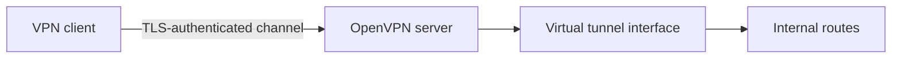

</div>

The application carries IP packets through a protected channel.

---

# OpenVPN architecture

<div style="transform: scale(0.8); transform-origin: top center;">

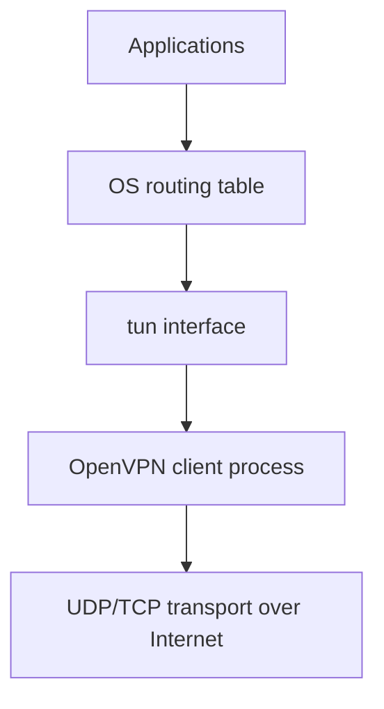

</div>

OpenVPN runs in user space and connects the virtual interface to the encrypted transport.

---

# TUN vs TAP

__TUN__
- Layer 3 IP tunnel;
- routed design;
- usually simpler and more scalable.

__TAP__
- Layer 2 Ethernet bridge;
- carries broadcasts and non-IP Ethernet;
- usually more complexity.

Prefer routed designs unless bridging is truly required.

---

# Routed VPN

<div style="transform: scale(0.8); transform-origin: top center;">

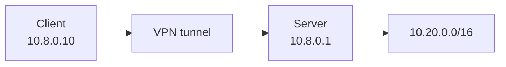

</div>

The client receives routes that send selected private prefixes into the tunnel.

---

# Tunnel addressing

The VPN usually has its own logical address space.

Example:

```text
VPN clients: 10.8.0.0/24
Corporate LAN: 10.20.0.0/16
```

The server must route or firewall between these networks.

---

# Authentication layers

A deployment may authenticate:

- VPN server to client;
- client device via certificate;
- user via username/password;
- user via MFA through an external integration.

Do not collapse machine and user identity into one concept.

---

# Server authentication

The client should know it reached the intended VPN server.

<div style="transform: scale(0.8); transform-origin: top center;">

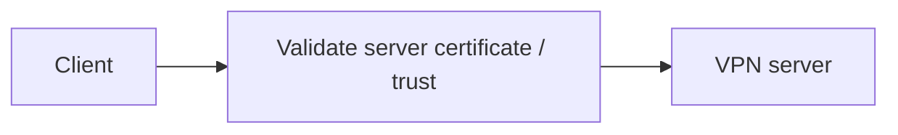

</div>

Otherwise an attacker could attempt to impersonate the remote-access gateway.

---

# Client certificates

A client certificate can identify a managed device or VPN credential.

Benefits:

- stronger than password alone;
- per-client revocation;
- automation for managed endpoints.

Costs:

- issuance;
- secure storage;
- renewal;
- revocation.

---

# User authentication

A deployment may add user authentication to answer:

> Which person is using this VPN credential now?

This supports:

- user-level policy;
- MFA;
- access review;
- session attribution.

---

# MFA

<div style="transform: scale(0.8); transform-origin: top center;">

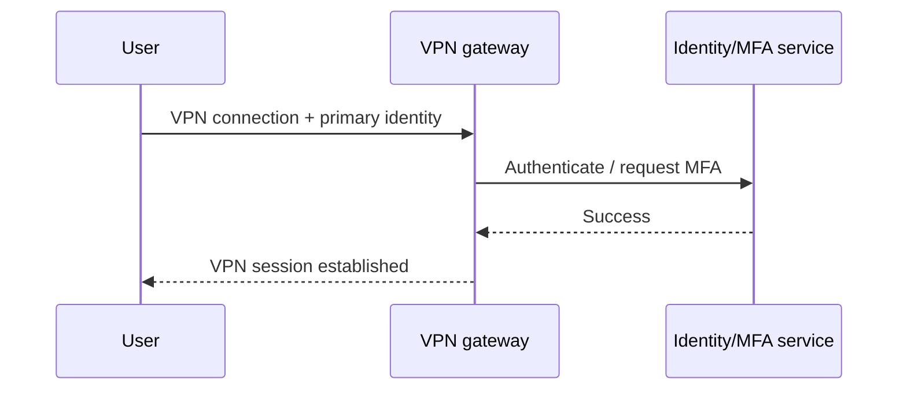

</div>

MFA protects against stolen passwords but not every compromised endpoint.

---

# Control plane and data plane

Conceptually separate:

<div style="transform: scale(0.8); transform-origin: top center;">

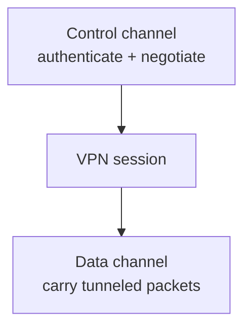

</div>

This helps students reason about setup failures vs traffic failures.

---

# Full tunnel

<div style="transform: scale(0.8); transform-origin: top center;">

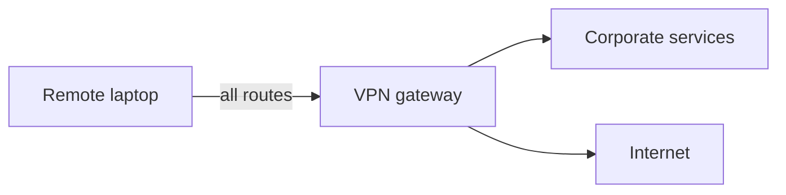

</div>

The organization can enforce web/DNS policy centrally, but consumes more bandwidth.

---

# Split tunnel

<div style="transform: scale(0.8); transform-origin: top center;">

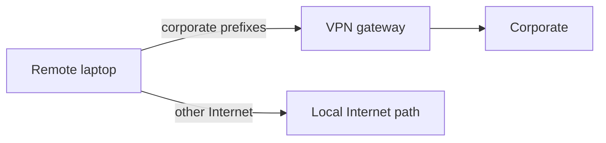

</div>

This reduces VPN load but creates simultaneous trusted and untrusted paths.

---

# Full vs split: security trade-off

__Full tunnel__
- more centralized visibility/control;
- more latency/bandwidth dependency.

__Split tunnel__
- efficient;
- less centralized inspection;
- endpoint becomes a bridge between contexts if compromised.

There is no universal winner.

---

# Pushed routes

The VPN server may tell the client which private networks use the tunnel.

Example:

```text
10.20.0.0/16 via VPN
10.30.0.0/16 via VPN
```

The client OS routing table ultimately determines packet direction.

---

# Default route push

For full tunnel, the VPN influences the client's default path.

Security implication:

> A VPN configuration change can reroute essentially all client traffic.

Treat remote-access configuration as high-impact infrastructure.

---

# DNS over the VPN

Remote users often need internal DNS names.

<div style="transform: scale(0.8); transform-origin: top center;">

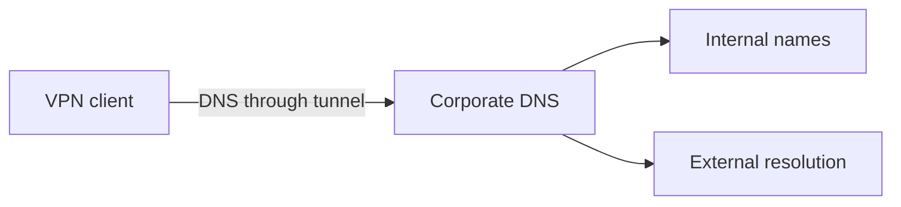

</div>

DNS routing must align with split/full tunnel design.

---

# DNS leaks

A client may send DNS to a local resolver even while private traffic uses the VPN.

Consequences:

- internal names fail or leak;
- web destinations bypass corporate DNS policy;
- troubleshooting becomes confusing.

Always test actual resolver behavior on the endpoint.

---

# Access policy after VPN login

Do not equate:

```text
VPN authenticated = entire internal network
```

Prefer:

<div style="transform: scale(0.8); transform-origin: top center;">

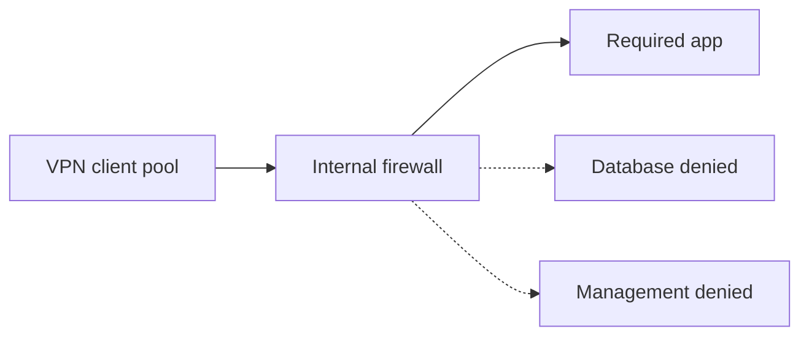

</div>

---

# VPN is another security zone

Treat remote clients as their own zone.

<div style="transform: scale(0.8); transform-origin: top center;">

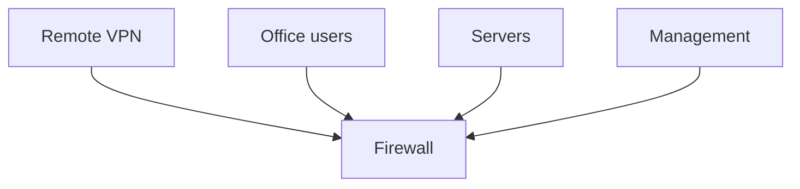

</div>

Remote access can have narrower policy than office access.

---

# Client-to-client traffic

Should two remote VPN clients talk directly through the gateway?

Possible risks:

- lateral movement;
- peer attacks;
- accidental service exposure.

Default to isolation unless client-to-client connectivity has a real requirement.

---

# Endpoint posture

A VPN authenticates a credential, not necessarily endpoint health.

A compromised laptop with valid credentials can still attack internal systems.

Complement VPN with:

- endpoint security;
- NAC/ZTNA-like policy where appropriate;
- least-privilege internal firewall rules.

---

# Lost device

<div style="transform: scale(0.8); transform-origin: top center;">

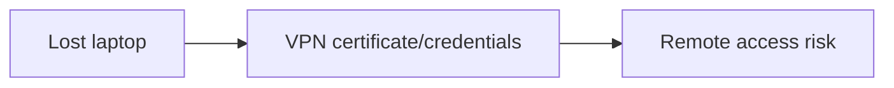

</div>

You need:

- credential revocation;
- user disablement;
- inventory;
- rapid incident process.

---

# Certificate revocation

If a client certificate is compromised or retired, the server must stop trusting it.

Operationally this requires a maintained revocation process, not just a one-time PKI setup.

---

# Account offboarding

Remote access should disappear when employment/role changes.

Integrate with identity lifecycle where practical.

A VPN account that survives offboarding is a classic persistent access problem.

---

# UDP vs TCP transport

OpenVPN can operate over UDP or TCP.

General guidance:

- UDP avoids TCP-over-TCP behavior and is common for VPN data;
- TCP may traverse some restrictive networks more easily.

Choose based on network constraints, not superstition.

---

# Why TCP-over-TCP can hurt

<div style="transform: scale(0.8); transform-origin: top center;">

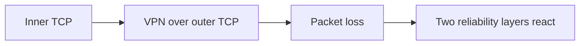

</div>

Independent retransmission/congestion behavior can interact poorly.

---

# NAT traversal

A remote client is commonly behind NAT.

<div style="transform: scale(0.8); transform-origin: top center;">


</div>

Client-initiated UDP/TCP sessions make TLS VPNs relatively NAT-friendly.

---

# Keepalive and roaming realities

Remote networks change:

- Wi-Fi to cellular;
- hotel NAT mappings;
- temporary packet loss;
- sleep/wake.

VPN software needs timers/reconnection behavior that tolerates realistic client mobility.

---

# MTU and tunnel overhead

<div style="transform: scale(0.8); transform-origin: top center;">


</div>

Symptoms of MTU problems include working pings but stalled websites or file transfers.

---

# OpenVPN Community Edition

OpenVPN CE gives a clear open-source platform for:

- TLS/certificate-based VPN setup;
- TUN routing;
- pushed routes;
- user auth hooks;
- client configuration;
- logs and session state.

---

# OpenVPN lab topology

<div style="transform: scale(0.8); transform-origin: top center;">

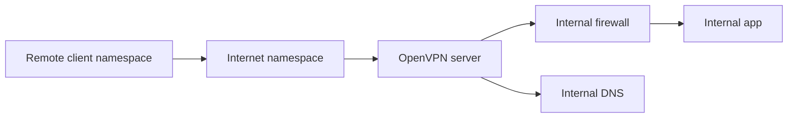

</div>

Use isolated namespaces/containers so route changes are safe.

---

# Server configuration concepts

Students should recognize fields for:

```text
listen protocol/port
server certificate/key
trusted CA
VPN client subnet
pushed routes
DNS settings
authentication hooks
client isolation
logging
```

Concept first, syntax second.

---

# Client configuration concepts

```text
server address
trusted CA
client certificate/key if used
transport protocol
remote server identity checks
route behavior
```

A portable profile is effectively a security credential and should be protected.

---

# Lab progression

1. Reach internal app without VPN: fail.
2. Establish OpenVPN session.
3. Inspect TUN addresses.
4. Inspect routes.
5. Reach only allowed internal service.
6. Compare split vs full tunnel.
7. Inspect DNS behavior.
8. Revoke a client credential and retest.

---

# Observe routing

Useful commands:

```bash
ip addr
ip route
ip rule
```

Ask students:

> Why did this packet enter `tun0`?

If they can answer from the routing table, they understand much of the VPN.

---

# Observe the public link

On the untrusted network you should see:

```text
client-public -> vpn-server-public : VPN transport
```

You should not see the protected private application payload in plaintext.

---

# Server-side forwarding

After decryption, the VPN server still needs to route/firewall the inner packet.

<div style="transform: scale(0.8); transform-origin: top center;">

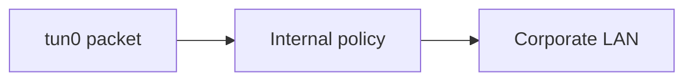

</div>

Encryption does not bypass ordinary network policy.

---

# Return route problem

The internal service must know how to reply to the VPN client subnet.

Options include:

- route `10.8.0.0/24` via VPN gateway;
- NAT at the VPN gateway.

Routing is preferable when architecture allows clear end-to-end addressing.

---

# NAT inside remote-access VPN

<div style="transform: scale(0.8); transform-origin: top center;">

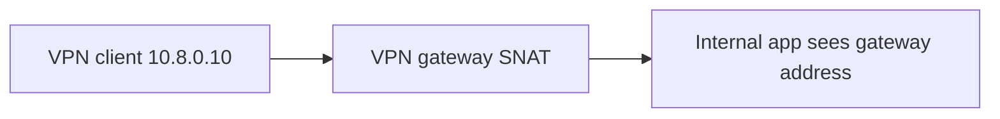

</div>

This simplifies return routing but reduces direct client attribution downstream.

---

# Logs

Useful VPN events:

- authentication success/failure;
- client certificate identity;
- assigned virtual IP;
- connect/disconnect;
- bytes transferred;
- route/config push;
- revocation failures;
- repeated reconnects.

Avoid logging secrets.

---

# Capacity planning

A remote-access gateway consumes:

- CPU for encryption;
- memory/session state;
- network bandwidth;
- authentication dependencies.

Peak remote-work events can turn a normally quiet VPN into critical infrastructure.

---

# High availability

<div style="transform: scale(0.8); transform-origin: top center;">

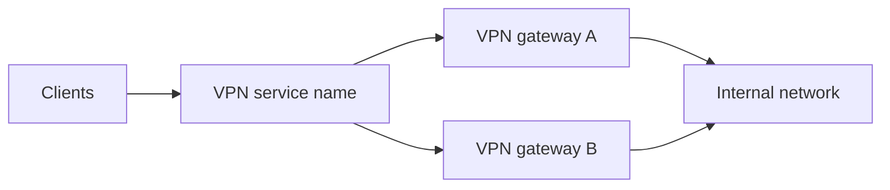

</div>

HA design must consider session state, routing, certificates, and client reconnect behavior.

---

# Design scenario

Remote employees need:

- Git, ticketing, and internal documentation;
- no direct database access;
- corporate DNS for internal names;
- ordinary Internet browsing locally;
- MFA plus managed-device certificate.

Design a split-tunnel policy.

---

# Possible architecture

<div style="transform: scale(0.8); transform-origin: top center;">

```mermaid
flowchart TB
  C["Managed remote laptop"] -->|"MFA + cert"| V["OpenVPN gateway"]
  V --> FW["Remote-access firewall zone"]
  FW --> GIT["Git"]
  FW --> DOC["Docs / tickets"]
  FW -.-> DB["Database denied"]
  C -->|"normal Internet"| NET["Local ISP"]
  C -->|"internal DNS"| DNS["Corporate DNS via VPN"]
```

</div>

---

# Common mistakes

- VPN users trusted like administrators
- No client isolation
- No credential revocation process
- Split-tunnel routes incomplete
- DNS leak ignored
- Return route missing
- NAT hides attribution unexpectedly
- MTU issues misdiagnosed
- One gateway with no capacity/HA plan

---

# TLS VPN vs IPsec VPN

| Topic | TLS/OpenVPN style | IPsec |
|---|---|---|
| Typical teaching use | Remote access | Site-to-site + remote access |
| Tunnel interface | Common | Common in route-based designs |
| NAT traversal | Usually straightforward | NAT-T considerations |
| User-space implementation | Yes for OpenVPN | strongSwan control + kernel IPsec |
| Policy focus | Client routes + gateway ACL | SPD/selectors + routes |

Architecture should drive selection.

---

# What the VPN cannot solve

A VPN does not make the endpoint trustworthy.

It cannot replace:

- endpoint protection;
- identity lifecycle;
- application authorization;
- network segmentation;
- monitoring;
- patching.

It securely extends **connectivity**, which can extend attacker connectivity too.

---

# Mental model

<div style="transform: scale(0.8); transform-origin: top center;">

```mermaid
flowchart LR
  AUTH["Authenticate client"] --> SESSION["Establish VPN session"]
  SESSION --> TUN["Create tunnel interface / virtual IP"]
  TUN --> ROUTE["Install routes + DNS policy"]
  ROUTE --> FW["Enforce internal access"]
  FW --> APP["Reach required services"]
```

</div>

---

# Expert augmentation: PQ TLS VPN latency

Remote-access VPN gateways are sensitive to handshake cost.

<div style="transform: scale(0.8); transform-origin: top center;">

```mermaid
flowchart LR
  Many[Many remote users reconnect] --> GW[TLS VPN gateway]
  GW --> CPU[Handshake CPU]
  GW --> MEM[Buffers]
  GW --> MTU[Fragmentation / retransmission]
```

</div>

Hybrid post-quantum TLS can increase handshake size and computation.

Capacity planning must distinguish:

- new connections per second;
- long-lived tunnel throughput;
- authentication backend load;
- packet overhead after the tunnel is established.

---

# Review questions

1. What does a TUN interface represent?
2. Full vs split tunnel?
3. Why should VPN clients be their own firewall zone?
4. What is a DNS leak?
5. Why does a working VPN handshake not guarantee application access?
6. Why is certificate revocation operationally important?
