---

theme: sred-theme
routerMode: hash
title: "Zero Trust, HSMs, and Compliance"
info: |
  Network Security Using Dedicated Devices
  Lecture 14 capstone
transition: slide-left
mdc: true
---

# Zero Trust, HSMs, and Compliance

## Capstone architecture lecture

This lecture connects dedicated network equipment to:

- Zero Trust Architecture;
- hardware roots of trust;
- key custody;
- regulatory obligations;
- audit evidence;
- design trade-offs.

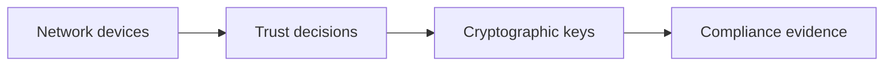

---

# Learning objectives

You should be able to:

- explain Zero Trust without reducing it to one product;
- distinguish PDP and PEP roles;
- place microsegmentation controls in a network;
- explain why HSMs matter for network security;
- connect technical controls to NIS2, DORA, ISO 27001, and FIPS 140-3;
- design a capstone security architecture.

---

# The course so far

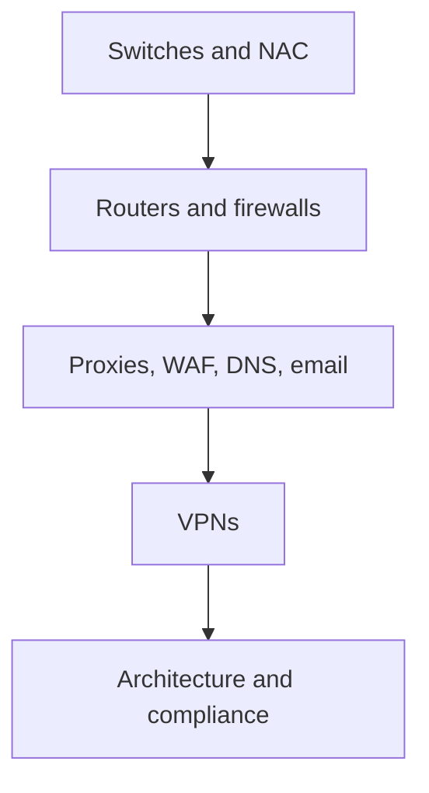

Each device answered:

- where is it?
- what can it see?
- what can it decide?
- what does it protect?
- what bypasses it?

---

# Why capstone architecture matters

Individual devices are easy to overvalue.

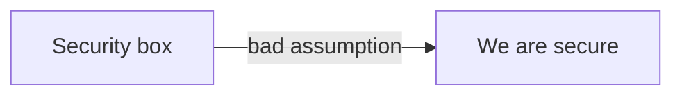

Architecture asks:


---

# Old model: castle and moat

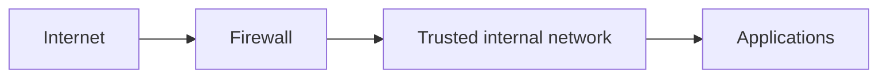

Assumption:

> Inside is trusted. Outside is untrusted.

Common failure:

- one compromised internal device gains broad reachability;
- VPN users become “internal”;
- flat networks enable lateral movement.

---

# Modern reality

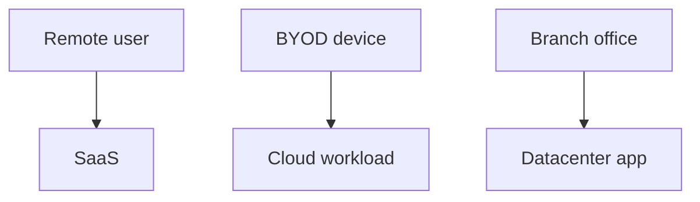

The enterprise boundary is blurred.

Network location is no longer a reliable trust signal.

---

# Zero Trust principle

Zero Trust does not mean:

> trust nothing and block everything.

It means:

> no implicit trust based solely on network location or asset ownership.

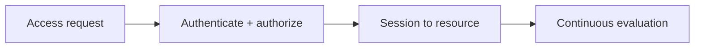

---

# ZTA reference model

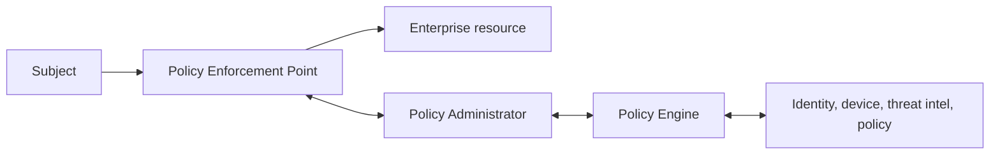

Key separation:

- **PDP** decides;
- **PEP** enforces;
- resource access is explicit and contextual.

---

# PDP components

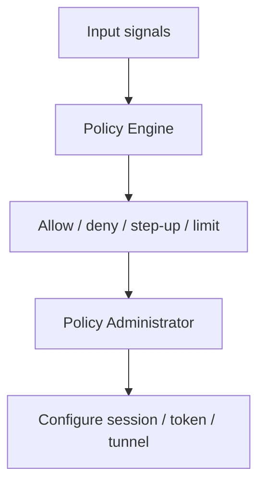

Signals may include:

- identity;
- device state;
- vulnerability status;
- data sensitivity;
- location;
- risk score;
- threat intelligence.

---

# PEP examples

A PEP can be many things.

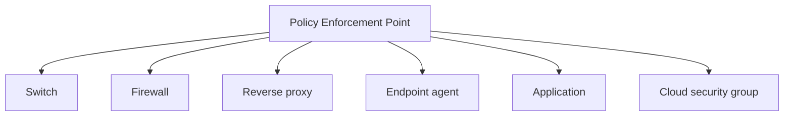

Important point:

> Zero Trust is an architecture, not a single appliance.

---

# Zero Trust vs NAC

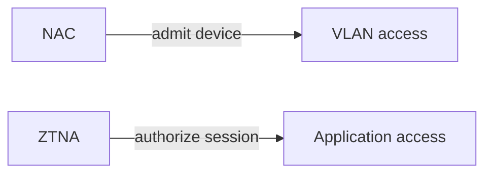

NAC is still useful.

But NAC alone often answers:

> May this device join a network?

ZTNA answers:

> May this subject access this resource now?

---

# Microsegmentation

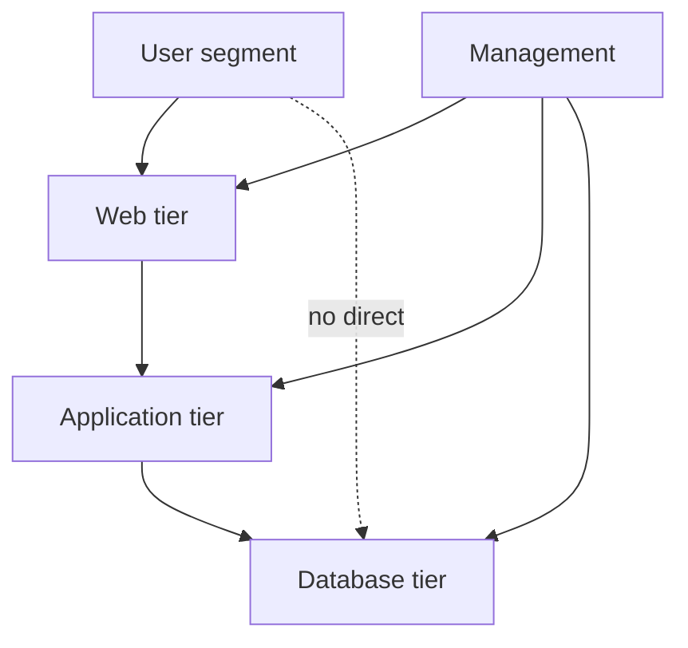

Goal:

> limit lateral movement and reduce blast radius.

---

# Enforcement locations


Microsegmentation can be enforced at:

- host;
- hypervisor;
- container network;
- switch fabric;
- firewall;
- service mesh.

---

# Identity is not enough

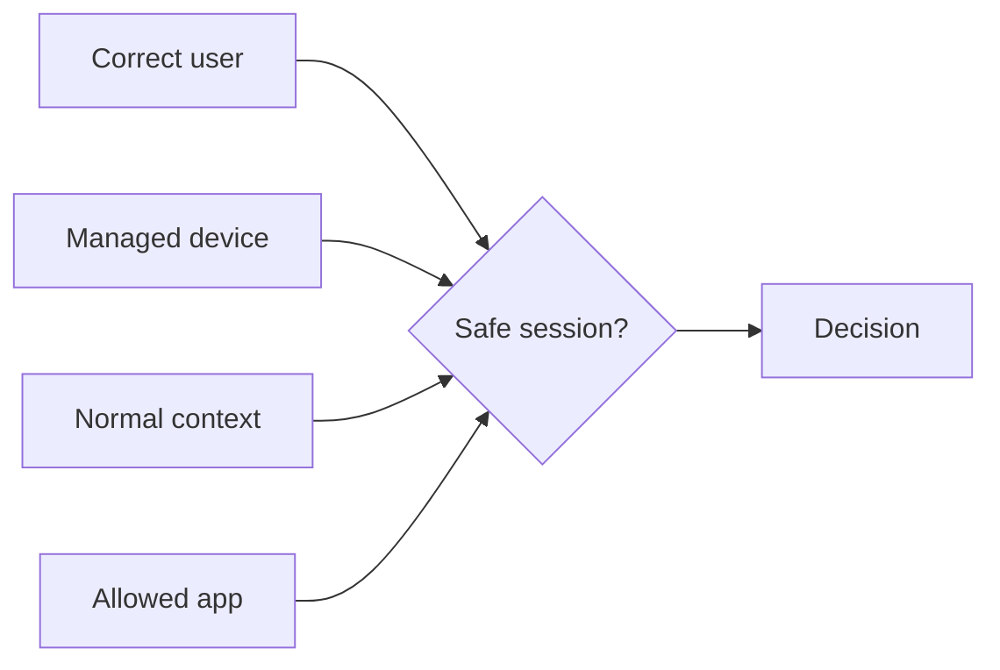

A stolen credential from an unknown device should not equal full access.

The decision combines multiple signals.

---

# Device posture

Examples:

- managed endpoint;
- disk encryption enabled;
- EDR healthy;
- no critical vulnerabilities;
- certificate present;
- OS supported;
- not jailbroken/rooted.

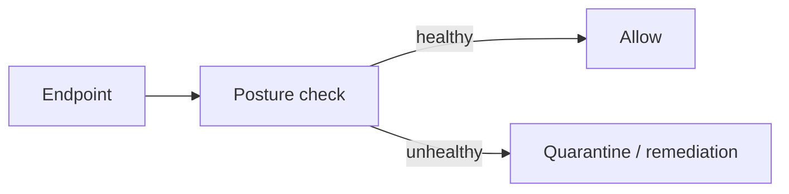

---

# Continuous evaluation

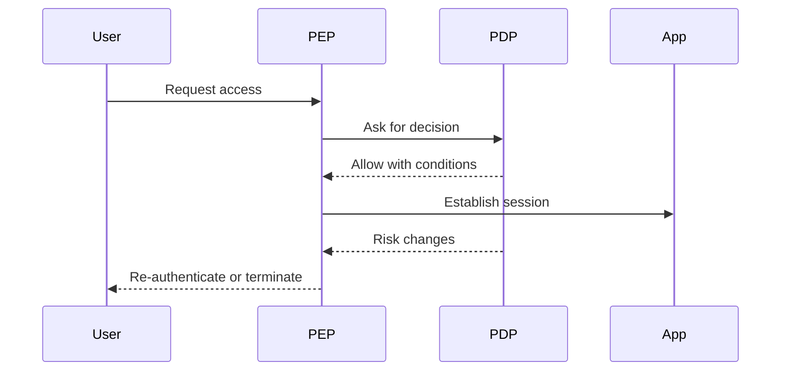

Zero Trust decisions are not only login-time decisions.

---

# Zero Trust failure mode

A common mistake:

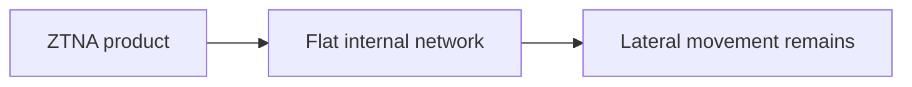

Better:

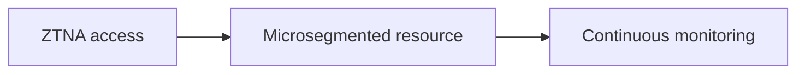

---

# Where HSMs enter the story

Many network controls depend on private keys.

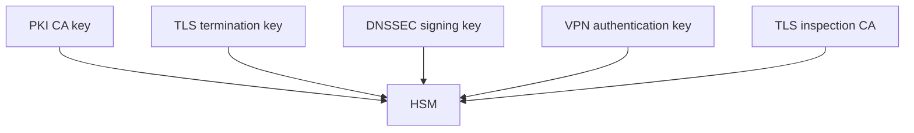

If the key is stolen, the control collapses.

---

# What is an HSM?

A Hardware Security Module is a cryptographic boundary.

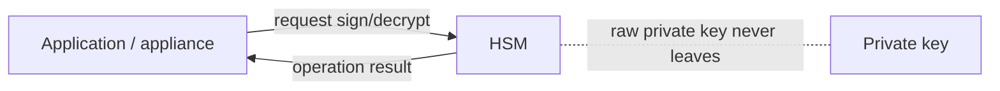

The key idea:

> use the key without exporting the key.

---

# HSM vs software key store

```mermaid
flowchart TB
  SW[Software key file] --> OS[Host OS compromise]
  OS --> Exfil[Key exfiltration risk]

  HSM[HSM-protected key] --> API[Restricted crypto API]
  API --> Audit[Audit and access control]
```

HSMs reduce key-extraction risk, but do not remove all risk.

Misuse through authorized API access remains possible.

---

# HSM use case: PKI

```mermaid
flowchart TB
  Root[Offline root CA key in HSM]
  Root --> Issuing[Issuing CA]
  Issuing --> Device[Device certificates]
  Issuing --> User[User certificates]
  Issuing --> TLS[Server certificates]
```

Network security depends on PKI for:

- 802.1X certificates;
- VPN certificates;
- TLS services;
- device identity;
- management-plane authentication.

---

# HSM use case: TLS inspection

```mermaid
flowchart LR
  Client --> Proxy[Inspection proxy]
  Proxy --> HSM[HSM-held subordinate CA key]
  Proxy --> Server[Internet server]
```

Risk question:

> Who can mint certificates trusted by every managed endpoint?

This key requires stronger custody than ordinary server keys.

---

# HSM use case: DNSSEC

```mermaid
flowchart TB
  ZSK[Zone signing key] --> Sign[Sign DNS zone data]
  KSK[Key signing key] --> SignZSK[Sign ZSK]
  KSK --> HSM[HSM protection]
```

DNSSEC improves DNS data authenticity.

HSMs help protect high-value signing keys.

---

# FIPS 140-3 idea

FIPS 140-3 defines security requirements for cryptographic modules.

```mermaid
flowchart TB
  Module[Cryptographic module] --> Design[Secure design]
  Module --> Interfaces[Controlled interfaces]
  Module --> Auth[Roles and authentication]
  Module --> Physical[Physical security]
  Module --> SelfTests[Self-tests]
  Module --> Lifecycle[Lifecycle assurance]
```

It is about the module boundary and assurances, not only algorithms.

---

# FIPS levels: teaching view

| Level | Intuition | Example use |
|---|---|---|
| 1 | basic cryptographic module requirements | software crypto module |
| 2 | tamper evidence / role authentication | appliances, smartcards |
| 3 | stronger physical security and identity-based auth | enterprise HSMs |
| 4 | high physical/environmental protection | specialized high-assurance settings |

Do not reduce FIPS to “uses AES.”

---

# Management plane security

Dedicated equipment is often compromised through management interfaces.

```mermaid
flowchart LR
  Admin[Admin] --> Mgmt[Management network]
  Mgmt --> Devices[Switches / routers / firewalls]
  Internet -. must not reach .-> Devices
```

Controls:

- dedicated management network;
- MFA;
- admin bastion;
- configuration backup;
- immutable logs;
- role-based access;
- emergency access process.

---

# Configuration as security evidence

A firewall rule is not only a technical setting.

```mermaid
flowchart LR
  Req[Requirement] --> Rule[Configuration]
  Rule --> Change[Change record]
  Change --> Test[Test result]
  Test --> Audit[Audit evidence]
```

Students should learn to connect:

- requirement;
- implementation;
- verification;
- evidence.

---

# ISO 27001 mapping concept

ISO 27001 is an ISMS standard.

For network equipment, useful evidence includes:

- network architecture diagrams;
- segmentation policy;
- approved firewall rules;
- change records;
- vulnerability remediation;
- access reviews;
- backup and restore tests;
- incident records.

```mermaid
flowchart TB
  ISMS[ISMS] --> Controls[Controls]
  Controls --> Evidence[Evidence]
  Evidence --> Improvement[Improvement cycle]
```

---

# NIS2: why engineers should care

NIS2 turns security engineering into governance obligations.

```mermaid
flowchart TB
  Entity[Essential / important entity] --> Risk[Risk management]
  Entity --> Incident[Incident reporting]
  Entity --> Supply[Supply-chain security]
  Entity --> Governance[Management accountability]
```

Network controls become part of demonstrable risk management.

---

# NIS2 incident timeline concept

```mermaid
sequenceDiagram
  participant Org as Organization
  participant CSIRT as CSIRT / authority
  Org->>CSIRT: Early warning within 24h
  Org->>CSIRT: Incident notification within 72h
  Org->>CSIRT: Final report later
```

Technical implication:

> logging, detection, ownership, and escalation must already exist before the incident.

---

# NIS2 penalties: design implication

The point is not memorizing fines.

The point is:

```mermaid
flowchart LR
  PoorControl[Poor control evidence] --> RegRisk[Regulatory risk]
  RegRisk --> Exec[Executive accountability]
```

Security devices must be:

- documented;
- maintained;
- monitored;
- tested;
- auditable.

---

# DORA: financial-sector resilience

DORA focuses on digital operational resilience for financial entities.

```mermaid
flowchart TB
  DORA[DORA] --> Risk[ICT risk management]
  DORA --> Incidents[Incident reporting]
  DORA --> Testing[Resilience testing]
  DORA --> ThirdParty[ICT third-party risk]
```

Relevant to network equipment:

- outsourced security gateways;
- cloud email security;
- SASE providers;
- DDoS protection vendors;
- managed SOC/NDR platforms.

---

# DORA third-party risk

```mermaid
flowchart LR
  Bank[Financial entity] --> Provider[ICT third-party provider]
  Provider --> Service[Critical service]
  Bank --> Register[Register of information]
  Bank --> Exit[Exit strategy]
  Bank --> Audit[Audit / inspection rights]
```

Technical dependency becomes a contractual and operational dependency.

---

# Supply-chain question

For every security appliance or cloud security service, ask:

```mermaid
flowchart TB
  Vendor[Vendor / service] --> Access[What data can it access?]
  Vendor --> Outage[What if it is down?]
  Vendor --> Compromise[What if it is compromised?]
  Vendor --> Exit[How do we exit?]
```

This applies to both hardware and SaaS controls.

---

# Compliance does not equal security

```mermaid
flowchart LR
  Compliance[Pass audit] -. not enough .-> Security[Actual security]
  Security --> Evidence[Evidence helps prove control]
```

A compliant but flat, poorly monitored network is still weak.

A secure design without evidence is hard to defend to auditors and executives.

Both matter.

---

# Capstone architecture scenario

Design for:

- headquarters;
- remote users;
- public web app;
- internal admin systems;
- SaaS usage;
- cloud workloads;
- regulatory reporting requirements;
- third-party DDoS and email security.

```mermaid
flowchart TB
  Users[Users] --> Apps[Applications]
  Attackers[Attackers] --> Edge[Edge controls]
  Regulators[Regulators] --> Evidence[Evidence]
```

---

# Required properties

The design must support:

- strong identity;
- least privilege;
- segmentation;
- remote access;
- DNS and web controls;
- email controls;
- monitoring;
- key protection;
- incident evidence;
- third-party resilience.

---

# Reference architecture

```mermaid
flowchart TB
  Internet --> DDoS[DDoS service]
  DDoS --> EdgeFW[Edge firewall]
  EdgeFW --> WAF[Reverse proxy / WAF]
  WAF --> Web[Web app]
  Web --> App[App tier]
  App --> DB[Database]

  Remote[Remote users] --> ZTNA[ZTNA / VPN]
  ZTNA --> Apps[Private apps]

  Users[Managed users] --> SWG[SWG / SASE]
  SWG --> SaaS[SaaS / Internet]

  DNS[Enterprise DNS] --> RPZ[DNS policy]
  Mail[Cloud email security] --> Mailbox[Mailbox]
```

---

# Reference architecture: management plane

```mermaid
flowchart TB
  Admin[Admin with MFA] --> Bastion[Admin bastion]
  Bastion --> MgmtNet[Management network]
  MgmtNet --> Switches[Switches]
  MgmtNet --> Routers[Routers]
  MgmtNet --> Firewalls[Firewalls]
  MgmtNet --> Proxies[Proxies]
  MgmtNet --> HSM[HSM]
  Devices[All devices] --> SIEM[Central logs]
```

No production user subnet should administer infrastructure directly.

---

# Reference architecture: trust flow

```mermaid
sequenceDiagram
  participant U as User/device
  participant P as PEP
  participant D as PDP
  participant A as Application
  participant L as Logging
  U->>P: request application access
  P->>D: identity + posture + context
  D-->>P: decision and conditions
  P->>A: permitted session
  P->>L: access log
  A->>L: app log
```

---

# Reference architecture: key custody

```mermaid
flowchart TB
  HSM[HSM cluster]
  HSM --> PKI[PKI CA keys]
  HSM --> TLS[TLS termination keys]
  HSM --> DNSSEC[DNSSEC keys]
  HSM --> Inspect[Inspection CA key]
  PKI --> Certs[Device/user/service certificates]
```

Design rule:

> the more a key can impersonate, the stronger its custody must be.

---

# What students should document

For each control:

| Control | Evidence |
|---|---|
| NAC | policy, logs, exception list |
| Firewall | approved rules, change tickets |
| WAF | detection mode results, tuned rules |
| DNS | RPZ policy, resolver logs |
| VPN/ZTNA | access policy, session logs |
| HSM | key inventory, access logs |
| DDoS | runbook, test evidence |

---

# Attack path exercise

```mermaid
flowchart LR
  Phish[Phishing email] --> Creds[Credential theft]
  Creds --> Login[Remote login]
  Login --> App[App access]
  App --> Lateral[Lateral movement]
  Lateral --> Data[Data exfiltration]
```

Map where controls detect or block:

- email gateway;
- MFA;
- ZTNA policy;
- segmentation;
- DNS/SWG;
- IDS/NDR;
- logging and incident response.

---

# Failure analysis exercise

```mermaid
flowchart TB
  Failure[Cloud SEG outage] --> MailFlow[Mail flow impact]
  Failure --> Phishing[Reduced detection]
  Failure --> Compliance[Reporting implications]
  Failure --> Exit[Fallback plan]
```

Questions:

- is mail delayed or delivered without scanning?
- who decides fail-open vs fail-closed?
- how do users know?
- what evidence is retained?

---

# Design trade-off: TLS inspection

```mermaid
flowchart TB
  Inspect[TLS inspection] --> Benefit[Malware/DLP visibility]
  Inspect --> Risk[Privacy/key risk]
  Inspect --> Cost[Latency/compatibility]
  Inspect --> Exempt[Exemptions]
```

A mature design documents:

- why inspection is needed;
- what is excluded;
- how keys are protected;
- who can approve changes;
- how failures are handled.

---

# Design trade-off: SASE

```mermaid
flowchart TB
  SASE[SASE provider] --> Global[Global user coverage]
  SASE --> Elastic[Elastic inspection capacity]
  SASE --> ThirdParty[Third-party dependency]
  SASE --> Data[Data processing location]
```

Questions:

- data sovereignty;
- provider outage;
- vendor lock-in;
- log export;
- exit strategy;
- contractual audit rights.

---

# Design trade-off: PQC readiness

```mermaid
flowchart LR
  Inventory[Crypto inventory] --> Priority[Prioritize long-lived data]
  Priority --> Pilot[PQC/hybrid pilot]
  Pilot --> Capacity[Capacity testing]
  Capacity --> Migration[Migration plan]
```

For network devices:

- TLS terminators;
- VPN gateways;
- load balancers;
- PKI;
- management access;
- device certificates.

---

# Control placement checklist

For every proposed control:

1. What asset does it protect?
2. What traffic reaches it?
3. What identity/context does it know?
4. What action can it take?
5. What logs does it produce?
6. What happens when it fails?
7. What evidence proves it works?

---

# Capstone deliverable

Students should submit:

- one architecture diagram;
- one trust-flow diagram;
- one management-plane diagram;
- one table mapping controls to threats;
- one table mapping controls to evidence;
- one paragraph on residual risk;
- one paragraph on third-party dependencies.

---

# Common capstone mistakes

- drawing devices without traffic direction;
- treating Zero Trust as only ZTNA;
- forgetting management access;
- ignoring key custody;
- ignoring logs and evidence;
- relying on one perimeter firewall;
- forgetting failure modes;
- no exit plan for security SaaS.

---

# Final mental model

```mermaid
flowchart TB
  Architecture --> Placement[Control placement]
  Placement --> Enforcement[Enforcement]
  Enforcement --> Keys[Key custody]
  Enforcement --> Logs[Evidence]
  Logs --> Compliance[Compliance]
  Compliance --> Risk[Risk decisions]
  Risk --> Architecture
```

Security architecture is a loop, not a drawing.

---

# Final review questions

1. What is the difference between PDP and PEP?
2. Why does network location no longer imply trust?
3. Where can microsegmentation be enforced?
4. Why are HSMs relevant to TLS inspection?
5. What evidence would prove a firewall rule is controlled?
6. How do NIS2 and DORA change engineering priorities?
7. Why is third-party risk a technical architecture issue?
8. What should happen when a security control fails?

---

# Course closing

You now have three layers of understanding:

```mermaid
flowchart TB
  Device[How each device works]
  Path[How traffic crosses controls]
  Governance[How architecture is governed]
  Device --> Path --> Governance
```

The expert question is no longer:

> What product do we buy?

It is:

> What decision must be enforced, where, with what evidence, and under what failure mode?
